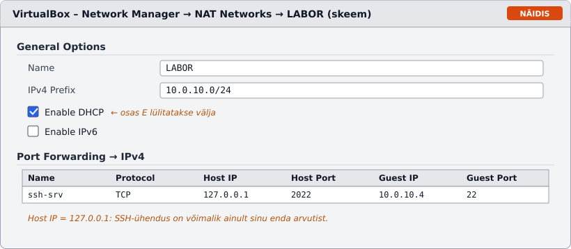
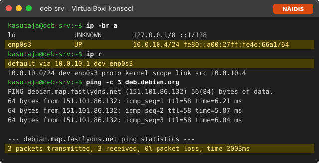
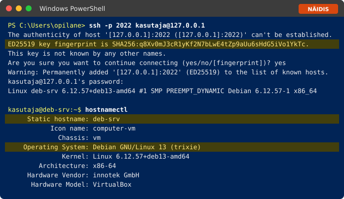
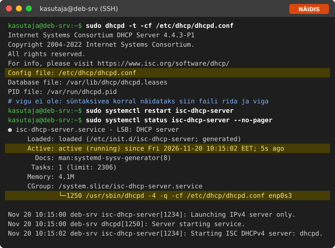
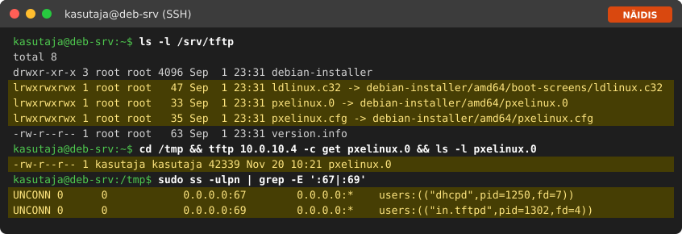
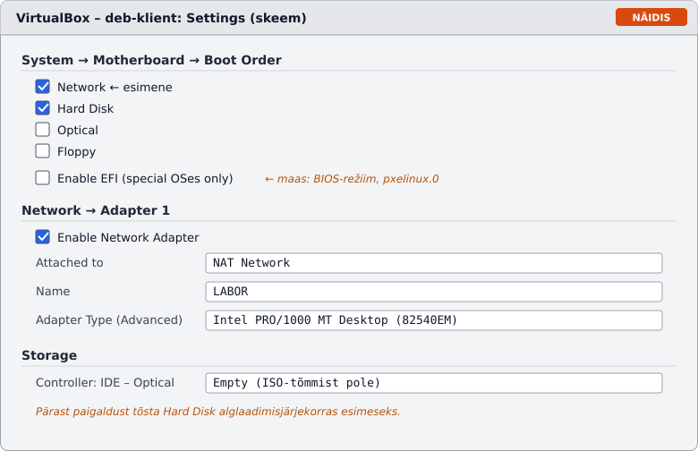
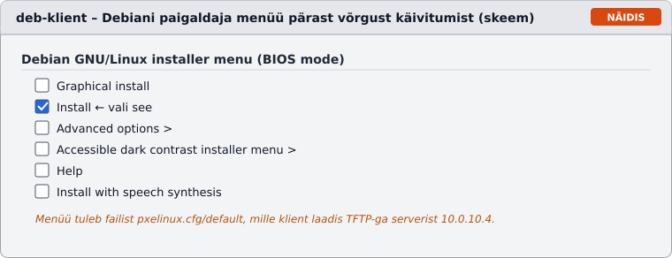
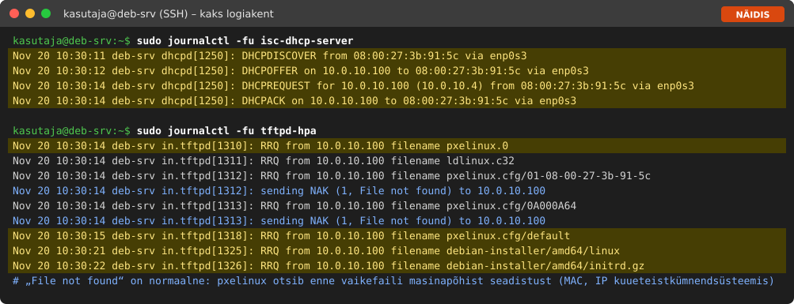

[Sisukord](../README.md) · [Tunnijaotus](tunnijaotus-40h.md) · [Labor 2: LVM →](labor-02-lvm.md)

## Labor 1. Debiani paigaldus üle võrgu (PXE) VirtualBoxis

**Maht:** 4 kontakttundi (osade ajad kokku ~210 min) + 1 tund iseseisvat tööd (aruande lõpetamine). Kui kontakttund on 45 min, tehke osa B (serveri paigaldus, 40 min) eelneval iseseisval ajal.
**Seotud peatükk:** [4.12 Arvuti alglaadimine toitenupust töölauani](../peatykid/04-arhitektuur.md) – alajaotus „Alglaadimine võrgust (PXE)“
**Õppekava seos (moodul „IT valdkonna alusteadmised“):** ÕV1 IT-süsteemi ülesehitus, ÕV2 operatsioonisüsteemi roll, ÕV3 seadmete ühendamine võrku ja võrguparameetrite seadistamine

Selles laboris ehitad VirtualBoxi sisse väikese võrgu, kus üks Debiani server jagab IP-aadresse ja alglaadimisfaile ning teine, tühja kettaga virtuaalmasin paigaldab endale Debiani üle võrgu. Samamoodi paigaldatakse operatsioonisüsteeme koolides ja ettevõtetes kümnetesse arvutitesse korraga.

**Pärast laborit õppija:**

- seadistab VirtualBoxis NAT-võrgu ja pordisuunamise;
- määrab Linuxi serverile staatilise IP-aadressi ja kontrollib võrguühendust;
- loob SSH-ühenduse Windows Terminalist Linuxi serverisse;
- seadistab DHCP- ja TFTP-serveri ning selgitab, mis on nende roll võrgust alglaadimisel;
- leiab logidest DHCP-sõnumid ja TFTP-päringud ning kasutab neid veaotsingul.

### Mõisted

| Lühend / mõiste | Inglise keeles | Tähendus |
|---|---|---|
| **PXE** | *Preboot Execution Environment* | võrgukaardi püsivaras olev lahendus, millega arvuti käivitub võrgust, mitte kettalt |
| **DHCP** | *Dynamic Host Configuration Protocol* | protokoll, millega server jagab võrgus olevatele seadmetele IP-aadressi, lüüsi, DNS-serveri ja PXE puhul ka alglaaduri asukoha |
| **TFTP** | *Trivial File Transfer Protocol* | lihtne failiedastusprotokoll (UDP port 69) ilma autentimiseta; PXE laadib sellega alglaaduri ja tuuma |
| **IP** | *Internet Protocol* | võrguprotokoll; IP-aadress on seadme aadress võrgus |
| **DNS** | *Domain Name System* | nimelahendus: muudab nime (nt `deb.debian.org`) IP-aadressiks |
| **NAT** | *Network Address Translation* | võrguaadresside teisendus: mitu sisevõrgu masinat kasutavad internetti ühe välise aadressi kaudu |
| **NAT Network** | *NAT Network* | VirtualBoxi võrgutüüp, kus samas võrgus olevad virtuaalmasinad näevad üksteist ja pääsevad internetti |
| **pordisuunamine** | *port forwarding* | reegel, mis suunab hostarvuti pordi virtuaalmasina pordile |
| **SSH** | *Secure Shell* | krüpteeritud kaugühendus käsurea kasutamiseks (TCP port 22) |
| **VM** | *Virtual Machine* | virtuaalmasin |
| **alglaadur** | *bootloader* | väike programm, mis laadib operatsioonisüsteemi tuuma; siin `pxelinux.0` |
| **netboot-tõmmis** | *netboot image* | Debiani paigaldaja failid võrgust alglaadimiseks (`netboot.tar.gz`) |

> **Animatsioon:** [PXE: kuidas arvuti võrgust käivitub](https://valdonolvak.github.io/Operatsioonis-steemi-ja-k-berturbe-alused/animatsioonid/pxe-alglaadimine.html) – vaata see enne laborit läbi. Siis tead, mida logides otsida.

### Laborikeskkond

```
           Windowsi hostarvuti (Windows Terminal)
                     │  127.0.0.1:2022  ──►  10.0.10.4:22 (SSH)
          ┌──────────┴────────────────────────────────┐
          │  VirtualBox NAT Network „LABOR“           │
          │  10.0.10.0/24, lüüs ja DNS 10.0.10.1      │
          │                                           │
          │  deb-srv              deb-klient          │
          │  10.0.10.4 (staatiline)  10.0.10.100–150   │
          │  DHCP + TFTP          tühi ketas, PXE     │
          └───────────────────────────────────────────┘
```

| Masin | Roll | CPU | RAM | Ketas | Võrk | IP-aadress |
|---|---|---|---|---|---|---|
| `deb-srv` | Debian 13 server: DHCP, TFTP, SSH | 2 | 2 GB | 20 GB | NAT Network LABOR | 10.0.10.4/24 staatiline |
| `deb-klient` | paigaldatav masin | 2 | 2 GB | 20 GB | NAT Network LABOR | DHCP-st (10.0.10.100–150) |

**Vajalik:** VirtualBox 7.x, Debian 13 (*trixie*) netinst ISO-tõmmis serveri paigaldamiseks, internetiühendus.

> 🖼️ **Kuvatõmmistest.** Juhendis olevad kuvatõmmised on joonistatud näidised (märge **NÄIDIS**). Need näitavad, milline peaks olema tulemus. Sinu väljundis on teised MAC-aadressid, kellaajad, UUID-d ja protsessinumbrid – need ei ole vead.

> ⚠️ **Turvalisus.** DHCP-serverit tohib käivitada ainult isoleeritud laborivõrgus. Kui kooli päris võrku tekib teine DHCP-server, hakkavad arvutid saama valesid aadresse ja võrk lakkab töötamast. Seetõttu teeme kõik VirtualBoxi NAT-võrgu sees.

---

### Osa A. VirtualBoxi NAT-võrk LABOR (20 min)

**Graafilises liideses (VirtualBox 7.x):**

1. **File → Tools → Network Manager** (või `Ctrl+H`) → vahekaart **NAT Networks** → **Create**.
2. Määra:
   - **Name:** `LABOR`
   - **IPv4 Prefix:** `10.0.10.0/24`
   - **Enable DHCP:** ✔ (esialgu sees – serveri paigaldamiseks; lülitame osas E välja)
3. Vahekaart **Port Forwarding** → **IPv4** → lisa reegel:

| Name | Protocol | Host IP | Host Port | Guest IP | Guest Port |
|---|---|---|---|---|---|
| ssh-srv | TCP | 127.0.0.1 | 2022 | 10.0.10.4 | 22 |



*Joonis: NAT-võrgu LABOR seaded ja SSH pordisuunamine. Algul on DHCP sees, osas E lülitatakse see välja.*

**Sama käsurealt (PowerShell Windowsis):**

```powershell
$vbm = "C:\Program Files\Oracle\VirtualBox\VBoxManage.exe"
& $vbm natnetwork add --netname LABOR --network "10.0.10.0/24" --enable --dhcp on
& $vbm natnetwork modify --netname LABOR --port-forward-4 "ssh-srv:tcp:[127.0.0.1]:2022:[10.0.10.4]:22"
& $vbm natnetwork list
```

| Rida | Selgitus |
|---|---|
| `$vbm = "…VBoxManage.exe"` | salvestab VirtualBoxi käsureatööriista asukoha muutujasse, et ei peaks pikka teed iga kord kirjutama |
| `natnetwork add --netname LABOR` | loob uue NAT-võrgu nimega LABOR |
| `--network "10.0.10.0/24"` | võrgu aadressivahemik: 10.0.10.0–10.0.10.255, mask 255.255.255.0 |
| `--enable --dhcp on` | lülitab võrgu sisse ja jätab VirtualBoxi sisseehitatud DHCP esialgu tööle |
| `--port-forward-4 "ssh-srv:tcp:[127.0.0.1]:2022:[10.0.10.4]:22"` | IPv4 reegel: nimi `ssh-srv`, protokoll TCP, hosti aadress 127.0.0.1 port 2022 → virtuaalmasina 10.0.10.4 port 22 |
| `natnetwork list` | näitab loodud võrke ja nende seadeid |

**Miks `127.0.0.1`, mitte tühi väli?** Kui hosti IP jätta tühjaks, kuulab VirtualBox porti 2022 kõigil hostarvuti võrguliidestel ja klassi teised arvutid saaksid sinu serverisse SSH-ga sisse logida. `127.0.0.1` (*localhost*) tähendab, et ühendus on võimalik ainult sinu enda arvutist. See on rünnakupinna vähendamise lihtne näide (vt [ptk 24.4](../peatykid/24-kuberturbe-pohimoisted.md)).

VirtualBoxi NAT-võrgus on aadress **10.0.10.1** alati lüüs (*gateway*), mille kaudu virtuaalmasinad pääsevad internetti.

---

### Osa B. Serveri `deb-srv` paigaldus (40 min)

1. Loo uus VM: nimi `deb-srv`, tüüp Linux / Debian (64-bit), 2 CPU, 2048 MB RAM, 20 GB dünaamiline ketas.
2. **Settings → Network → Adapter 1:** *Attached to:* **NAT Network**, *Name:* **LABOR**.
3. Ühenda Debian 13 netinst ISO-tõmmis ja käivita paigaldus (**Install**, mitte *Graphical install* – nii on kiirem).
4. Paigaldaja valikud:
   - **Hostname:** `deb-srv`, **Domain:** `labor.lan`
   - **Root password:** jäta **tühjaks** → sinu tavakasutaja saab automaatselt `sudo` õigused
   - **Kasutaja:** oma eesnimi väiketähtedega (edaspidi juhendis `kasutaja`)
   - **Partitioning:** *Guided – use entire disk*, kõik failid ühel partitsioonil
   - **Software selection:** ainult ✔ **SSH server** ja ✔ **standard system utilities** (töölauakeskkond **mitte**)
5. Pärast taaskäivitust logi sisse ja kontrolli:

```bash
ip -br a
ip r
```

| Käsk | Selgitus |
|---|---|
| `ip -br a` | näitab võrguliideseid lühikujul (`-br` = *brief*): nimi, olek, IP-aadress. VirtualBoxis on liidese nimi tavaliselt `enp0s3` |
| `ip r` | näitab marsruutimistabelit; rida `default via 10.0.10.1` on vaikelüüs |

Praegu sai server aadressi VirtualBoxi DHCP-st (nt 10.0.10.5). Järgmises osas paneme selle paika.

---

### Osa C. Staatiline IP-aadress 10.0.10.4 (20 min)

Server peab alati olema samal aadressil, sest kliendid ja pordisuunamine otsivad teda just sealt. Tee see osa **VirtualBoxi konsoolis**, mitte SSH kaudu, sest võrgu muutmisel katkeks SSH-ühendus.

```bash
sudo cp /etc/network/interfaces /etc/network/interfaces.bak
sudo nano /etc/network/interfaces
```

Asenda liidese `enp0s3` read (nt `allow-hotplug enp0s3` ja `iface enp0s3 inet dhcp`) järgmistega. Kui `ip -br a` näitas teist nime, kasuta seda.

```
# Silmusliides (loopback) – jäta alles
auto lo
iface lo inet loopback

# LABOR-võrgu liides staatilise aadressiga
auto enp0s3
iface enp0s3 inet static
    address 10.0.10.4/24
    gateway 10.0.10.1
```

| Rida | Selgitus |
|---|---|
| `auto enp0s3` | tõsta liides üles alglaadimisel automaatselt |
| `iface enp0s3 inet static` | IPv4 (`inet`) aadress määratakse käsitsi (`static`), mitte DHCP-st |
| `address 10.0.10.4/24` | serveri aadress ja võrgumask (/24 = 255.255.255.0) |
| `gateway 10.0.10.1` | vaikelüüs ehk VirtualBoxi NAT-ruuter, mille kaudu pääseb internetti |

Määra DNS-server ja taaskäivita:

```bash
printf "nameserver 10.0.10.1\nnameserver 1.1.1.1\n" | sudo tee /etc/resolv.conf
sudo reboot
```

| Käsk | Selgitus |
|---|---|
| `printf "…"` | kirjutab kaks rida: esmane DNS on VirtualBoxi lüüs, varuvariant on 1.1.1.1 |
| `\| sudo tee /etc/resolv.conf` | `tee` kirjutab sisendi faili administraatori õigustes (tavaline `>` ei töötaks koos `sudo`-ga) |
| `sudo reboot` | taaskäivitus on kindlaim viis, et vana DHCP-aadress kaoks ja uus seadistus rakenduks |

Kontrolli pärast taaskäivitust:

```bash
ip -br a              # peab olema 10.0.10.4/24
ip r                  # default via 10.0.10.1
ping -c 3 10.0.10.1   # lüüs vastab
ping -c 3 deb.debian.org   # internet ja DNS töötavad
```

`ping -c 3` saadab kolm ICMP-päringut (ICMP – *Internet Control Message Protocol*) ja lõpetab. Kui lüüs vastab, aga `deb.debian.org` mitte, on viga DNS-is.



*Joonis: õige tulemus: liidesel on 10.0.10.4/24, vaikelüüs 10.0.10.1 ja internet vastab (0% packet loss).*

---

### Osa D. SSH-ühendus Windows Terminalist (20 min)

Windows 10 ja 11 sisaldavad OpenSSH klienti. Ava **Windows Terminal** (PowerShell) ja ühendu:

```powershell
ssh -p 2022 kasutaja@127.0.0.1
```

| Osa | Selgitus |
|---|---|
| `ssh` | SSH klient |
| `-p 2022` | ühendu hosti porti 2022 – VirtualBox suunab selle edasi serveri porti 22 |
| `kasutaja@127.0.0.1` | kasutajanimi serveris `@` hostarvuti enda aadress |

Esimesel ühendusel küsitakse: *„The authenticity of host … can't be established … Are you sure you want to continue connecting?“* See on serveri **võtme sõrmejälg** (*host key fingerprint*). Kirjuta `yes`. Edaspidi kontrollib SSH, et server pole vahetunud. Kui sõrmejälg kunagi ootamatult muutub, võib keegi olla vahel (*man-in-the-middle*).

Kontrolli, et oled õiges masinas:

```bash
hostnamectl
```




*Joonis: esimene SSH-ühendus Windows Terminalist: serveri võtme sõrmejälje kinnitamine ja `hostnamectl` väljund.*

**Lisaülesanne – võtmepõhine sisselogimine (soovitatav):**

```powershell
ssh-keygen -t ed25519
type $env:USERPROFILE\.ssh\id_ed25519.pub | ssh -p 2022 kasutaja@127.0.0.1 "mkdir -p ~/.ssh && chmod 700 ~/.ssh && cat >> ~/.ssh/authorized_keys && chmod 600 ~/.ssh/authorized_keys"
ssh -p 2022 kasutaja@127.0.0.1
```

| Käsk | Selgitus |
|---|---|
| `ssh-keygen -t ed25519` | loob Windowsis võtmepaari (Ed25519 algoritm): privaatvõti `id_ed25519` jääb sulle, avalik võti `id_ed25519.pub` läheb serverisse |
| `type … \| ssh … "…"` | saadab avaliku võtme serverisse ja lisab selle faili `~/.ssh/authorized_keys`; `chmod` paneb kaustale ja failile ainult omaniku õigused |
| viimane `ssh` | nüüd logid sisse võtmega, parooli ei küsita (kui panid võtmele parooli, küsitakse võtme parooli) |

Miks see on turvalisem, loe [ptk 28 „SSH-võtmega serverisse“](../peatykid/28-asummeetriline-kruptograafia.md).

---

### Osa E. Lülita VirtualBoxi DHCP välja (5 min)

Võrgus tohib olla **ainult üks DHCP-server**. Kui VirtualBoxi DHCP jääb tööle, võib klient saada aadressi temalt – ja siis ei tea klient, kust alglaadurit küsida.

Graafilises liideses: **Network Manager → NAT Networks → LABOR → Enable DHCP:** eemalda linnuke → **Apply**.

Käsurealt:

```powershell
& $vbm natnetwork modify --netname LABOR --dhcp off
```

Server `deb-srv` sellest ei sõltu, sest tal on nüüd staatiline aadress.

---

### Osa F. DHCP-server (isc-dhcp-server) (35 min)

Edasi töötad SSH kaudu serveris `deb-srv`.

```bash
sudo apt update
sudo apt install -y isc-dhcp-server
```

Paigaldamise lõpus näed tõenäoliselt viga *„Job for isc-dhcp-server.service failed“*. **See on normaalne:** teenus proovib käivituda, aga tal pole veel seadistust.

> ℹ️ ISC DHCP server on tootja poolt vananenuks kuulutatud ja Debian märgib paketi *deprecated*. Selle järglane on **Kea**. Õppimiseks sobib isc-dhcp-server hästi, sest selle seadistusfail on lihtne lugeda. Päris taristus kasuta Kea't või dnsmasq'i.

#### F1. Millisel liidesel DHCP töötab – `/etc/default/isc-dhcp-server`

Seda faili Debiani wiki juhend ei maini, kuid ilma selleta teenus ei käivitu: server ei tea, millisel võrgukaardil päringuid kuulata.

```bash
sudo nano /etc/default/isc-dhcp-server
```

Failis peavad olema read:

```
INTERFACESv4="enp0s3"
INTERFACESv6=""
```

| Rida | Selgitus |
|---|---|
| `INTERFACESv4="enp0s3"` | IPv4 DHCP-teenus kuulab ainult liidesel `enp0s3` (kasuta oma liidese nime) |
| `INTERFACESv6=""` | IPv6 DHCP-d me ei kasuta – jäta tühjaks |

#### F2. Aadressid ja PXE info – `/etc/dhcp/dhcpd.conf`

Tee algsest failist varukoopia ja loo uus:

```bash
sudo mv /etc/dhcp/dhcpd.conf /etc/dhcp/dhcpd.conf.orig
sudo nano /etc/dhcp/dhcpd.conf
```

```
# /etc/dhcp/dhcpd.conf – LABOR-võrgu DHCP ja PXE
option domain-name "labor.lan";
option domain-name-servers 10.0.10.1, 1.1.1.1;

default-lease-time 600;
max-lease-time 7200;

authoritative;

subnet 10.0.10.0 netmask 255.255.255.0 {
  range 10.0.10.100 10.0.10.150;
  option routers 10.0.10.1;
  option broadcast-address 10.0.10.255;

  # PXE: kust ja mida klient alla laadib
  next-server 10.0.10.4;
  filename "pxelinux.0";
}
```

| Rida | Selgitus |
|---|---|
| `option domain-name "labor.lan"` | domeen, mille klient lisab lühikestele nimedele |
| `option domain-name-servers 10.0.10.1, 1.1.1.1` | DNS-serverid, mille klient saab; paigaldaja vajab DNS-i, et leida Debiani peegelserver |
| `default-lease-time 600` | aadressi rendiaeg sekundites (10 min), kui klient ise ei küsi teisiti |
| `max-lease-time 7200` | pikim lubatud rendiaeg (2 h) |
| `authoritative` | server on selle võrgu ametlik DHCP-server ja vastab ka vale aadressi küsijale eitavalt (DHCPNAK) |
| `subnet 10.0.10.0 netmask 255.255.255.0 { … }` | seadistus kehtib võrgule 10.0.10.0/24 – see peab ühtima serveri enda liidese võrguga |
| `range 10.0.10.100 10.0.10.150` | aadressid, mida jagatakse klientidele (51 aadressi); 10.0.10.4 ei kuulu vahemikku |
| `option routers 10.0.10.1` | vaikelüüs, mille klient saab |
| `option broadcast-address 10.0.10.255` | võrgu leviaadress |
| `next-server 10.0.10.4` | **PXE:** TFTP-serveri aadress, kust klient alglaaduri laadib |
| `filename "pxelinux.0"` | **PXE:** alglaaduri faili nimi TFTP-serveri juurkaustas (BIOS-režiimis klient) |

Kontrolli süntaksit ja käivita teenus:

```bash
sudo dhcpd -t -cf /etc/dhcp/dhcpd.conf
sudo systemctl restart isc-dhcp-server
sudo systemctl status isc-dhcp-server --no-pager
```

| Käsk | Selgitus |
|---|---|
| `dhcpd -t -cf …` | `-t` ainult testib seadistusfaili (*test*), `-cf` näitab faili asukohta; vea korral näitab rea numbrit |
| `systemctl restart isc-dhcp-server` | taaskäivitab DHCP-teenuse uue seadistusega |
| `systemctl status … --no-pager` | näitab teenuse olekut; otsi rida `Active: active (running)` |




*Joonis: `dhcpd -t` ei leidnud vigu ja teenus töötab (`active (running)`) liidesel enp0s3.*

Kui teenus ei käivitu, vaata logi: `sudo journalctl -u isc-dhcp-server -n 30 --no-pager`.

---

### Osa G. TFTP-server ja Debiani netboot-failid (30 min)

```bash
sudo apt install -y tftpd-hpa tftp-hpa
sudo nano /etc/default/tftpd-hpa
```

```
TFTP_USERNAME="tftp"
TFTP_DIRECTORY="/srv/tftp"
TFTP_ADDRESS="0.0.0.0:69"
TFTP_OPTIONS="--secure -v"
```

| Rida | Selgitus |
|---|---|
| `TFTP_USERNAME="tftp"` | teenus töötab vähese õigusega kasutajana `tftp`, mitte `root`-ina |
| `TFTP_DIRECTORY="/srv/tftp"` | TFTP juurkaust – Debiani vaikimisi asukoht |
| `TFTP_ADDRESS="0.0.0.0:69"` | kuula kõigil IPv4-liidestel UDP porti 69 |
| `TFTP_OPTIONS="--secure -v"` | `--secure` lukustab teenuse juurkausta (klient ei pääse sellest välja); `-v` logib iga päringu – näed neid hiljem logis |

Laadi alla Debian 13 netboot-tõmmis ja paki see TFTP kausta:

```bash
cd /tmp
wget https://deb.debian.org/debian/dists/trixie/main/installer-amd64/current/images/netboot/netboot.tar.gz
sudo tar -xzf netboot.tar.gz -C /srv/tftp
ls -l /srv/tftp
sudo systemctl restart tftpd-hpa
```

| Käsk | Selgitus |
|---|---|
| `wget …netboot.tar.gz` | laadib Debiani peegelserverist alla paigaldaja võrgualglaadimise failid (~55 MB) |
| `tar -xzf … -C /srv/tftp` | `-x` paki lahti, `-z` gzip-pakitud, `-f` failist, `-C` sihtkaust |
| `ls -l /srv/tftp` | peab näitama `debian-installer/`, `pxelinux.0`, `pxelinux.cfg`, `ldlinux.c32` – viimased kolm on viidad (`->`) kausta `debian-installer/amd64/` |
| `systemctl restart tftpd-hpa` | rakendab uue seadistuse |

Testi TFTP-d serveris endas – nii nagu klient seda teeks:

```bash
cd /tmp && tftp 10.0.10.4 -c get pxelinux.0 && ls -l pxelinux.0
sudo ss -ulpn | grep -E ':67|:69'
```

| Käsk | Selgitus |
|---|---|
| `tftp 10.0.10.4 -c get pxelinux.0` | TFTP klient laadib serverist faili `pxelinux.0`; kui fail tekib (~42 kB), TFTP töötab |
| `ss -ulpn` | näitab kuulavaid UDP-porte (`-u` UDP, `-l` kuulavad, `-p` protsess, `-n` numbrid); peavad olema `:67` (dhcpd) ja `:69` (in.tftpd) |



*Joonis: netboot-failid on kaustas /srv/tftp, TFTP test laadis alla `pxelinux.0` (42339 baiti) ning DHCP (67) ja TFTP (69) kuulavad.*

---

### Osa H. Klient käivitub võrgust (40 min)

1. Loo uus VM `deb-klient`: Linux / Debian (64-bit), 2 CPU, 2048 MB RAM, 20 GB ketas. **ISO-tõmmist ära ühenda.**
2. **Settings → System → Motherboard:**
   - **Boot Order:** ✔ **Network**, nupuga liiguta see **esimeseks**
   - **Enable EFI:** linnuke **maas** (kasutame BIOS-režiimi ja `pxelinux.0`)
3. **Settings → Network → Adapter 1:** *NAT Network*, *Name:* **LABOR**. *Advanced → Adapter Type:* **Intel PRO/1000 MT Desktop** (sellel on PXE tugi).

   

   *Joonis: kliendi seaded: võrk alglaadimisjärjekorras esimene, EFI väljas, võrguadapter NAT-võrgus LABOR.*

4. Ava serveris kaks SSH-akent ja jälgi logisid **enne kliendi käivitamist**:

```bash
sudo journalctl -fu isc-dhcp-server     # aken 1
sudo journalctl -fu tftpd-hpa           # aken 2
```

`-f` (*follow*) näitab uusi logiridu jooksvalt, `-u` piirab väljundi ühe teenusega.

5. Käivita `deb-klient`. Ekraanil näed PXE teateid ja seejärel Debiani paigaldaja menüüd. Vali **Install**.

   

   *Joonis: klient käivitus võrgust ja näitab Debiani paigaldaja menüüd.*

**Mida logis näha peaks – DHCP neli sammu (DORA):**

```
DHCPDISCOVER from 08:00:27:xx:xx:xx via enp0s3
DHCPOFFER on 10.0.10.100 to 08:00:27:xx:xx:xx via enp0s3
DHCPREQUEST for 10.0.10.100 (10.0.10.4) from 08:00:27:xx:xx:xx via enp0s3
DHCPACK on 10.0.10.100 to 08:00:27:xx:xx:xx via enp0s3
```

| Sõnum | Kes saadab | Tähendus |
|---|---|---|
| DISCOVER | klient (levisõnum) | „Kas siin on mõni DHCP-server?“ |
| OFFER | server | „Võid saada 10.0.10.100, alglaadur on `pxelinux.0` serveris 10.0.10.4“ |
| REQUEST | klient | „Võtan selle aadressi“ |
| ACK | server | „Kinnitatud“ |

**TFTP logis:** read `RRQ from 10.0.10.100 filename pxelinux.0`, seejärel `ldlinux.c32`, `pxelinux.cfg/…`, `debian-installer/amd64/linux` ja `initrd.gz`. RRQ (*Read Request*) on faili lugemispäring.



*Joonis: ülal DHCP neli sammu, all TFTP päringud. „File not found“ read on normaalsed: pxelinux otsib enne vaikefaili masinapõhist seadistust.*

6. Paigaldajas võrguseadistus toimub automaatselt DHCP kaudu. Vali peegelserveriks **deb.debian.org** ja tee paigaldus lõpuni (tarkvaravalikus piisab *standard system utilities*). Paigaldus kestab ~15–25 min sõltuvalt internetiühendusest. Selle aja jooksul arutage kontrollküsimusi.
7. **Pärast paigaldust:** pane `deb-klient` alglaadimisjärjekorras **Hard Disk** esimeseks, muidu käivitub masin uuesti võrgust ja paigaldaja algab otsast.

Vaata serveris, millise aadressi klient sai:

```bash
cat /var/lib/dhcp/dhcpd.leases
```

---

### Veaotsing

| Sümptom | Tõenäoline põhjus | Kontroll / lahendus |
|---|---|---|
| `isc-dhcp-server` ei käivitu: *No subnet declaration for enp0s3* | `subnet` ei ühti liidese võrguga või liidesel pole veel staatilist IP-d | `ip -br a` peab näitama 10.0.10.4/24 |
| *Not configured to listen on any interfaces!* | `/etc/default/isc-dhcp-server` on tühi või vale liidese nimega | osa F1 |
| Klient: *No DHCP or proxyDHCP offers were received* | DHCP ei tööta, klient on teises võrgus või VirtualBoxi DHCP segab | teenuse olek; kliendi võrk = LABOR; osa E |
| Klient saab IP, aga *PXE-E32: TFTP open timeout* | `next-server` vale või TFTP ei tööta | `tftp 10.0.10.4 -c get pxelinux.0` |
| *File not found* TFTP logis | netboot lahti pakitud valesse kausta | `ls -l /srv/tftp` |
| Klient ei käivitu võrgust üldse | Network pole alglaadimisjärjekorras, EFI sees või adapteritüüp vale | osa H samm 2–3 |
| Paigaldaja ei leia peegelserverit | kliendil puudub DNS või lüüs | `domain-name-servers` ja `routers` failis `dhcpd.conf` |
| SSH: *Connection refused* | pordisuunamine puudub või SSH-server pole paigaldatud | osa A reegel; serveris `systemctl status ssh` |

---

### Turvalisus: mida see labor küberturbe kohta õpetab

- **DHCP-l ja TFTP-l puudub autentimine.** Iga seade võrgus võib end DHCP-serveriks kuulutada (*rogue DHCP*) ja jagada klientidele vale lüüsi või pahatahtliku alglaaduri. Ettevõtte võrkudes kaitseb selle eest kommutaatori **DHCP snooping**.
- **TFTP liiklus on krüpteerimata** – sellega ei edastata kunagi saladusi. UEFI turvaline alglaadimine (*Secure Boot*) kontrollib, et võrgust laaditud alglaadur on allkirjastatud (vt [ptk 4.12](../peatykid/04-arhitektuur.md)).
- **Pordisuunamine ainult `127.0.0.1` peale** vähendab ründepinda.
- **SSH võtmega** on turvalisem kui parooliga, sest võtit ei saa ära arvata.

---

### Lisaülesanne (väga hea hinde jaoks): UEFI-klient

Lülita kliendil **Enable EFI** sisse. UEFI-püsivara vajab teist alglaadurit. Lisa faili `dhcpd.conf` algusesse rida, mis tuvastab kliendi arhitektuuri, ja asenda `filename` tingimusega:

```
option arch code 93 = unsigned integer 16;

subnet 10.0.10.0 netmask 255.255.255.0 {
  # … muud read nagu enne …
  next-server 10.0.10.4;
  if option arch = 00:07 {
    filename "debian-installer/amd64/bootnetx64.efi";
  } else {
    filename "pxelinux.0";
  }
}
```

| Rida | Selgitus |
|---|---|
| `option arch code 93 …` | DHCP valik 93 – klient teatab selles oma püsivara tüübi |
| `00:07` | x64 UEFI klient |
| `bootnetx64.efi` | Debiani allkirjastatud UEFI alglaadur netboot-tõmmises |

Selgita aruandes, miks BIOS- ja UEFI-klient vajavad erinevat faili.

---

### Kontrollküsimused

1. Mis vahe on VirtualBoxi võrgutüüpidel *NAT* ja *NAT Network*? Miks see labor vajab just NAT Networki?
2. Miks peab serveril olema staatiline IP-aadress?
3. Mis on pordisuunamise reegli `127.0.0.1:2022 → 10.0.10.4:22` iga osa tähendus?
4. Miks lülitasime VirtualBoxi DHCP välja? Mis juhtuks, kui võrgus oleks kaks DHCP-serverit?
5. Nimeta DHCP neli sammu ja selgita, millises neist saab klient teada alglaaduri asukoha.
6. Mille poolest erineb TFTP tavalisest failiedastusest (nt SCP või HTTPS)? Miks kasutab PXE just TFTP-d?
7. Miks on fail `/etc/default/isc-dhcp-server` vajalik?
8. Võrdle seda laborit Windowsi WDS-iga (WDS – *Windows Deployment Services*): mis on sarnane, mis erinev? (vt [animatsioon](https://valdonolvak.github.io/Operatsioonis-steemi-ja-k-berturbe-alused/animatsioonid/paigaldus-yle-vorgu.html))

---

### Esitamine

Aruanne (PDF või Markdown) kuvatõmmistega:

1. VirtualBoxi NAT-võrgu LABOR seaded ja pordisuunamise reegel.
2. Serveris `ip -br a`, `ip r` ja `ping -c 3 deb.debian.org`.
3. SSH-sessioon Windows Terminalis koos käsu `hostnamectl` väljundiga.
4. `systemctl status isc-dhcp-server` ja `systemctl status tftpd-hpa`.
5. DHCP logist DORA neli rida ja TFTP logist `pxelinux.0` päring.
6. Kliendi ekraanil Debiani paigaldaja menüü.
7. Vastused kontrollküsimustele 2, 4 ja 5.

### Hindamiskriteeriumid

| Tase | Kriteeriumid |
|---|---|
| **Lävend (arvestatud)** | NAT-võrk ja serveri staatiline IP on seadistatud; SSH-ühendus Windows Terminalist töötab; klient käivitub võrgust ja jõuab Debiani paigaldaja menüüsse; aruandes on punktid 1–6 |
| **Hea** | lisaks selgitab logide põhjal DHCP DORA sammud ja TFTP päringute järjekorra; kirjeldab vähemalt üht ettetulnud viga ja selle lahendust |
| **Väga hea** | lisaks teeb võtmepõhise SSH-sisselogimise **või** UEFI-lisaülesande ning põhjendab vähemalt kaht selle keskkonna turvariski ja nende maandamist |

---

### Viited

- Debian. [Installation Guide (trixie), 4.5 Preparing Files for TFTP Net Booting](https://www.debian.org/releases/trixie/amd64/ch04s05.en.html)
- Debian Wiki. [PXEBootInstall](https://wiki.debian.org/PXEBootInstall)
- Debian. [Package isc-dhcp-server (trixie)](https://packages.debian.org/trixie/isc-dhcp-server)
- Oracle. VirtualBox User Manual – Networking Modes, NAT Networks

[Sisukord](../README.md) · [Tunnijaotus](tunnijaotus-40h.md) · [Labor 2: LVM →](labor-02-lvm.md)
