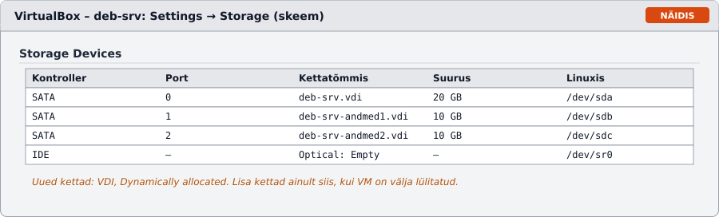
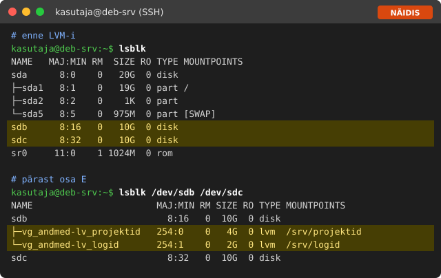
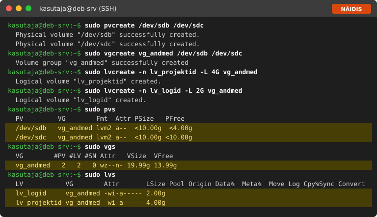
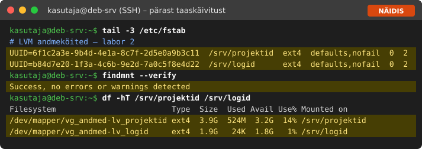
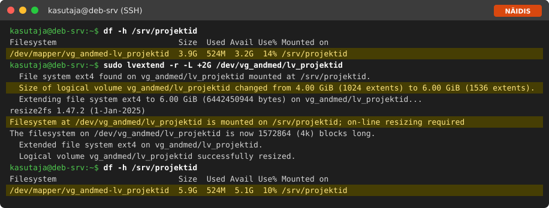
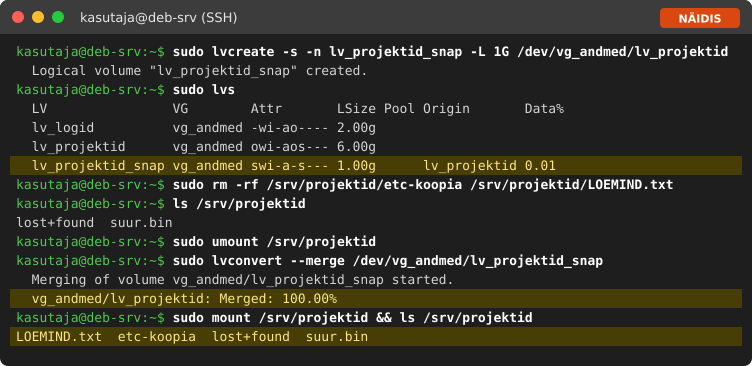
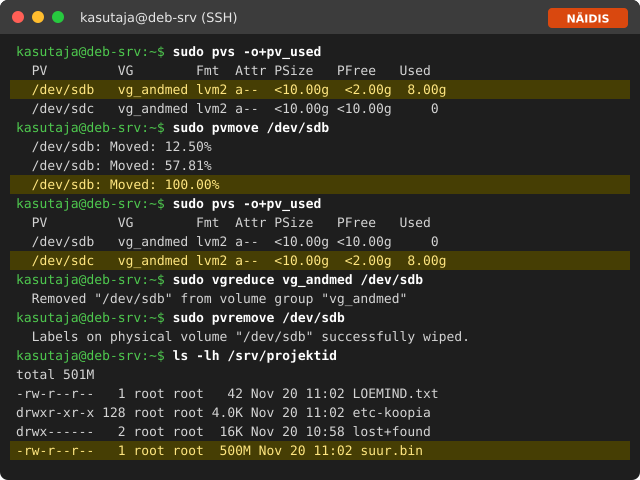

[← Labor 1: PXE](labor-01-pxe-paigaldus.md) · [Sisukord](../README.md) · [Tunnijaotus](tunnijaotus-40h.md)

## Labor 2. Kettahaldus Linuxis: LVM kahe lisakettaga

**Maht:** 4 kontakttundi (labori osad ~165 min + ptk 16.2 RAID ja 16.4 varunduse arutelu osade H ja I juures) + 1 tund iseseisvat tööd (aruanne)
**Seotud peatükid:** [15 Failisüsteemid](../peatykid/15-failisusteemid.md) (15.8 Failihaldus Linuxis), [16 Salvestushaldus](../peatykid/16-salvestushaldus.md) (16.2 kõvaketaste korraldus, 16.4 varundus)
**Õppekava seos (moodul „IT valdkonna alusteadmised“):** ÕV1 IT-süsteemi põhikomponendid, ÕV2 operatsioonisüsteemi roll; toetab moodulit „Linux operatsioonisüsteemide haldus“
**Eeldus:** [Labor 1](labor-01-pxe-paigaldus.md) on tehtud – server `deb-srv` (10.0.10.4) töötab ja SSH-ühendus `ssh -p 2022 kasutaja@127.0.0.1` toimib.

> 🖼️ **Kuvatõmmistest.** Juhendis olevad kuvatõmmised on joonistatud näidised (märge **NÄIDIS**). Need näitavad, milline peaks olema tulemus. Sinu väljundis on teised MAC-aadressid, kellaajad, UUID-d ja protsessinumbrid – need ei ole vead.

Tavalise partitsiooni suurus on kettal kindlaks määratud. Kui partitsioon saab täis, tuleb andmed kuhugi tõsta, partitsioon kustutada ja uuesti teha. **LVM** lisab ketaste ja failisüsteemide vahele paindliku kihi: mitu ketast saab liita üheks „mahutiks“ ja sellest lõigata köiteid, mida saab hiljem suurendada ilma serverit peatamata. Samuti saab teha hetktõmmiseid ja vahetada ketta välja, nii et kasutajad seda ei märka.

**Pärast laborit õppija:**

- lisab virtuaalmasinale kettad ja tuvastab need Linuxis;
- loob LVM-i füüsilised köited, köitegrupi ja loogilised köited;
- loob failisüsteemi, ühendab selle ja teeb ühendamise püsivaks;
- suurendab töötavat köidet ning taastab andmed hetktõmmisest;
- tõstab andmed ühelt kettalt teisele ilma seisakuta ja selgitab, mille poolest erinevad LVM, RAID ja varundus.

### Mõisted

| Lühend / mõiste | Inglise keeles | Tähendus |
|---|---|---|
| **LVM** | *Logical Volume Manager* | loogiliste köidete haldur – Linuxi kiht ketaste ja failisüsteemide vahel |
| **PV** – füüsiline köide | *Physical Volume* | LVM-i jaoks ette valmistatud ketas või partitsioon (nt `/dev/sdb`) |
| **VG** – köitegrupp | *Volume Group* | ühest või mitmest PV-st koosnev ühine mahuti (nt `vg_andmed`) |
| **LV** – loogiline köide | *Logical Volume* | köitegrupist eraldatud osa, millele tehakse failisüsteem – nagu partitsioon, aga paindlik |
| **PE** – füüsiline ulatus | *Physical Extent* | väikseim ühik (vaikimisi 4 MiB), millest LV kokku pannakse |
| **failisüsteem** | *file system* | viis, kuidas failid kettal paiknevad; siin **ext4** (*fourth extended filesystem*) |
| **ühenduspunkt** | *mount point* | kaust, mille kaudu failisüsteem on kättesaadav (nt `/srv/projektid`) |
| **fstab** | *file systems table* | fail `/etc/fstab`, mis ütleb, millised failisüsteemid alglaadimisel ühendatakse |
| **UUID** | *Universally Unique Identifier* | failisüsteemi unikaalne tunnus, mis ei muutu, kui ketaste järjekord muutub |
| **hetktõmmis** | *snapshot* | köite seis kindlal hetkel, kuhu saab tagasi pöörduda |
| **VDI** | *VirtualBox Disk Image* | VirtualBoxi kettatõmmise failivorming |

### Ülesehitus

```
  Failisüsteemid:   ext4 /srv/projektid          ext4 /srv/logid
                          │                            │
  Loogilised köited: lv_projektid (4 → 6 GB)     lv_logid (2 GB)     [vaba ruum]
                          └──────────────┬─────────────┘
  Köitegrupp:                      vg_andmed (~20 GB)
                          ┌──────────────┴─────────────┐
  Füüsilised köited:   /dev/sdb (10 GB)           /dev/sdc (10 GB)

  OS-ketas /dev/sda (20 GB) jääb LVM-ist välja ja seda ei puudutata.
```

**Võrdlus Windowsiga:**

| Linux (LVM) | Windows |
|---|---|
| PV – füüsiline köide | füüsiline ketas salvestusruumide kogumis (*Storage Spaces*) |
| VG – köitegrupp | salvestusruumide kogum (*storage pool*) |
| LV – loogiline köide | virtuaalne ketas / köide (*volume*) |
| ext4, XFS | NTFS, ReFS |
| ühenduspunkt `/srv/projektid` | draivitäht `E:` või ühendatud kaust |
| `/etc/fstab` | Kettahalduse püsiv draivitäht |
| LVM-i hetktõmmis | varikoopia (VSS – *Volume Shadow Copy Service*) |

> ⚠️ **Enne alustamist:** tee VirtualBoxis serverist hetktõmmis (**Machine → Take Snapshot**, nimi „enne LVM-i“). Kui midagi läheb valesti, saad tagasi pöörduda. Ära kunagi käivita käske kettal `/dev/sda` – seal on operatsioonisüsteem.

---

### Osa A. Kahe ketta lisamine VirtualBoxis (15 min)

Lülita `deb-srv` välja (`sudo poweroff`).

**Graafilises liideses:** **Settings → Storage → Controller: SATA** → nupp **Adds hard disk** → **Create** → VDI, *Dynamically allocated*, nimi `deb-srv-andmed1`, suurus **10 GB**. Korda sama: `deb-srv-andmed2`, 10 GB.

**Käsurealt (PowerShell):**

```powershell
$vbm = "C:\Program Files\Oracle\VirtualBox\VBoxManage.exe"
$kaust = "$env:USERPROFILE\VirtualBox VMs\deb-srv"
& $vbm createmedium disk --filename "$kaust\deb-srv-andmed1.vdi" --size 10240
& $vbm createmedium disk --filename "$kaust\deb-srv-andmed2.vdi" --size 10240
& $vbm storageattach deb-srv --storagectl "SATA" --port 1 --device 0 --type hdd --medium "$kaust\deb-srv-andmed1.vdi"
& $vbm storageattach deb-srv --storagectl "SATA" --port 2 --device 0 --type hdd --medium "$kaust\deb-srv-andmed2.vdi"
```

| Käsk | Selgitus |
|---|---|
| `createmedium disk --filename … --size 10240` | loob 10 GB (10240 MB) dünaamilise VDI-kettatõmmise |
| `storageattach deb-srv --storagectl "SATA"` | ühendab ketta virtuaalmasina `deb-srv` SATA-kontrollerisse (SATA – *Serial ATA*) |
| `--port 1` / `--port 2` | kontrolleri pesa: port 0 on OS-ketas, 1 ja 2 on uued kettad |
| `--type hdd --medium …` | ühendatakse kõvaketta tõmmis |




*Joonis: serveril on OS-ketas ja kaks uut 10 GB ketast; parempoolses veerus on näha, mis nime all kettad Linuxis paistavad.*

Käivita server ja ühendu SSH-ga.

---

### Osa B. Ketaste tuvastamine (10 min)

```bash
lsblk
sudo fdisk -l /dev/sdb /dev/sdc
```

| Käsk | Selgitus |
|---|---|
| `lsblk` | näitab plokkseadmeid puuna (*list block devices*): `sda` 20G koos partitsioonidega, `sdb` ja `sdc` 10G ilma partitsioonideta |
| `fdisk -l /dev/sdb /dev/sdc` | näitab ketaste suurust ja partitsioonitabelit; uutel ketastel seda pole |

**Kontrolli suuruse järgi**, et `sdb` ja `sdc` on tõesti uued 10 GB kettad. Kui järjekord on teine, kasuta juhendis oma nimesid.



*Joonis: üleval enne LVM-i: sdb ja sdc on tühjad. All pärast osa E: kettal sdb on kaks loogilist köidet ja need on ühendatud.*

---

### Osa C. Füüsilised köited ja köitegrupp (20 min)

```bash
sudo apt install -y lvm2
sudo pvcreate /dev/sdb /dev/sdc
sudo pvs
sudo vgcreate vg_andmed /dev/sdb /dev/sdc
sudo vgs
sudo vgdisplay vg_andmed
```

| Käsk | Selgitus |
|---|---|
| `apt install -y lvm2` | paigaldab LVM-i tööriistad (võivad juba olemas olla) |
| `pvcreate /dev/sdb /dev/sdc` | märgib kettad LVM-i füüsilisteks köideteks – kirjutab nende algusesse LVM-i sildi |
| `pvs` | lühiülevaade füüsilistest köidetest (*physical volumes summary*) |
| `vgcreate vg_andmed /dev/sdb /dev/sdc` | loob köitegrupi `vg_andmed` kahest kettast – kokku ~20 GB |
| `vgs` | lühiülevaade köitegruppidest: suurus (`VSize`) ja vaba ruum (`VFree`) |
| `vgdisplay vg_andmed` | põhjalik info, sh PE suurus (`PE Size 4.00 MiB`) ja PE-de arv |

Siin kettad „kaovad“: edaspidi ei mõtle me enam `sdb`-st ja `sdc`-st, vaid ühest 20 GB mahutist.

---

### Osa D. Loogilised köited (15 min)

```bash
sudo lvcreate -n lv_projektid -L 4G vg_andmed
sudo lvcreate -n lv_logid -L 2G vg_andmed
sudo lvs
sudo pvs
```

| Käsk | Selgitus |
|---|---|
| `lvcreate -n lv_projektid -L 4G vg_andmed` | loob köitegrupist 4 GB suuruse loogilise köite nimega (`-n`) `lv_projektid` |
| `lvcreate -n lv_logid -L 2G vg_andmed` | teine köide, 2 GB |
| `lvs` | ülevaade loogilistest köidetest |
| `pvs` | vaata `PFree` veergu: köited võeti esimeselt kettalt `sdb`, `sdc` on veel tühi |

Köited on kättesaadavad kahe nime all, mis viitavad samale seadmele: `/dev/vg_andmed/lv_projektid` ja `/dev/mapper/vg_andmed-lv_projektid`.




*Joonis: PV-de, VG ja LV-de loomine. Köited võeti kettalt sdb (PFree <4.00g), sdc on veel tühi, köitegrupis on 13.99g vaba.*

Köitegruppi jääb **~14 GB vaba ruumi**. Seda kasutame köite suurendamiseks, hetktõmmiseks ja ketta vahetuseks. Hea tava on mitte jagada kogu ruumi kohe ära.

---

### Osa E. Failisüsteem ja ühendamine (20 min)

```bash
sudo mkfs.ext4 -L projektid /dev/vg_andmed/lv_projektid
sudo mkfs.ext4 -L logid /dev/vg_andmed/lv_logid
sudo mkdir -p /srv/projektid /srv/logid
sudo mount /dev/vg_andmed/lv_projektid /srv/projektid
sudo mount /dev/vg_andmed/lv_logid /srv/logid
df -hT /srv/projektid /srv/logid
```

| Käsk | Selgitus |
|---|---|
| `mkfs.ext4 -L projektid …` | loob köitele ext4-failisüsteemi ja annab sellele sildi (`-L`, *label*) |
| `mkdir -p /srv/projektid /srv/logid` | loob ühenduspunktid; `-p` ei anna viga, kui kaust on juba olemas |
| `mount <seade> <kaust>` | ühendab failisüsteemi kausta külge – sellest hetkest on kausta sisu köitel |
| `df -hT` | näitab failisüsteemide suurust ja täituvust (`-h` loetavad ühikud, `-T` failisüsteemi tüüp) |

Kirjuta testandmed:

```bash
sudo cp -r /etc /srv/projektid/etc-koopia
echo "Labor 2 – $(date)" | sudo tee /srv/projektid/LOEMIND.txt
sudo dd if=/dev/urandom of=/srv/projektid/suur.bin bs=1M count=500 status=progress
ls -lh /srv/projektid
```

| Käsk | Selgitus |
|---|---|
| `cp -r /etc …` | kopeerib süsteemi seadistuskausta testandmeteks (`-r` koos alamkaustadega) |
| `echo … \| sudo tee …LOEMIND.txt` | loob tekstifaili praeguse kuupäevaga |
| `dd if=/dev/urandom of=… bs=1M count=500` | kirjutab 500 MB juhuslikke andmeid – nii on hiljem näha, et andmed liiguvad koos köitega |

---

### Osa F. Püsiv ühendamine – `/etc/fstab` (20 min)

`mount` kehtib ainult taaskäivituseni. Püsivaks tegemiseks lisa read faili `/etc/fstab`. Kasuta **UUID-d**, mitte seadme nime.

```bash
sudo blkid /dev/vg_andmed/lv_projektid /dev/vg_andmed/lv_logid
sudo cp /etc/fstab /etc/fstab.bak
sudo nano /etc/fstab
```

Lisa faili lõppu (asenda UUID-d `blkid` väljundist):

```
# LVM andmeköited – labor 2
UUID=1111aaaa-…  /srv/projektid  ext4  defaults,nofail  0  2
UUID=2222bbbb-…  /srv/logid      ext4  defaults,nofail  0  2
```

| Väli | Väärtus | Selgitus |
|---|---|---|
| 1 | `UUID=…` | milline failisüsteem |
| 2 | `/srv/projektid` | kuhu ühendada |
| 3 | `ext4` | failisüsteemi tüüp |
| 4 | `defaults,nofail` | tavalised valikud; `nofail` – kui ketas puudub, käivitub server ikkagi (muidu jääks alglaadimine hooldusrežiimi) |
| 5 | `0` | `dump`-varundusprogramm seda ei varunda (ajalooline väli) |
| 6 | `2` | failisüsteemi kontrolli järjekord alglaadimisel: 1 = juurfailisüsteem, 2 = muud, 0 = ära kontrolli |

Kontrolli enne taaskäivitust – vigane `fstab` võib alglaadimise peatada:

```bash
sudo umount /srv/projektid /srv/logid
sudo systemctl daemon-reload
sudo mount -a
findmnt --verify
df -hT /srv/projektid /srv/logid
sudo reboot
```

| Käsk | Selgitus |
|---|---|
| `umount …` | eemaldab käsitsi tehtud ühendused, et testida just `fstab`-i |
| `systemctl daemon-reload` | systemd loeb `fstab`-i uuesti |
| `mount -a` | ühendab kõik `fstab`-is olevad failisüsteemid – kui siin tuleb viga, paranda enne taaskäivitust |
| `findmnt --verify` | kontrollib `fstab`-i süntaksit ja UUID-de olemasolu |
| `reboot` | lõplik kontroll: pärast taaskäivitust peab `df -hT` näitama mõlemat köidet |



*Joonis: pärast taaskäivitust: fstab-is on kaks UUID-ga rida, `findmnt --verify` ei leia vigu ja mõlemad failisüsteemid on ühendatud.*

---

### Osa G. Köite suurendamine töö ajal (15 min)

Projektide köide saab täis. Suurendame seda 2 GB võrra – failisüsteem jääb ühendatuks ja failid kasutatavaks.

```bash
df -h /srv/projektid
sudo lvextend -r -L +2G /dev/vg_andmed/lv_projektid
df -h /srv/projektid
sudo vgs
```

| Käsk | Selgitus |
|---|---|
| `lvextend -L +2G …` | lisab köitele köitegrupi vabast ruumist 2 GB |
| `-r` (*resize filesystem*) | suurendab samas ka ext4-failisüsteemi; ilma selleta oleks köide suurem, aga `df` näitaks vana suurust |
| `vgs` | vaba ruum (`VFree`) vähenes 2 GB võrra |




*Joonis: köide kasvas 4 GiB-lt 6 GiB-ni ja failisüsteem suurendati ühendatud olekus (*on-line resizing*).*

**Arutelu:** kuidas teeksid sama tavalise partitsiooniga? Miks on suurendamine lihtne, aga **vähendamine** riskantne (ext4 tuleb selleks lahti ühendada, XFS-i ei saa üldse vähendada)?

---

### Osa H. Hetktõmmis ja andmete taastamine (25 min)

```bash
sudo lvcreate -s -n lv_projektid_snap -L 1G /dev/vg_andmed/lv_projektid
sudo lvs
sudo rm -rf /srv/projektid/etc-koopia /srv/projektid/LOEMIND.txt
ls /srv/projektid
```

| Käsk | Selgitus |
|---|---|
| `lvcreate -s -n lv_projektid_snap -L 1G …` | `-s` loob hetktõmmise köitest `lv_projektid`. 1 GB on ruum **muutustele**: kirjutamisel kopeeritakse vana plokk enne üle kirjutamist hetktõmmisesse (*copy-on-write*, vt [ptk 15.2 animatsioon](https://valdonolvak.github.io/Operatsioonis-steemi-ja-k-berturbe-alused/animatsioonid/logi-ja-kirjutamisel-kopeerimine.html)) |
| `lvs` | hetktõmmise reas näitab `Data%`, kui suur osa muutuste ruumist on kasutusel; kui see jõuab 100%-ni, muutub hetktõmmis kasutuskõlbmatuks |
| `rm -rf …` | „kogemata“ kustutame andmed |

Taasta köite seis hetktõmmisest:

```bash
sudo umount /srv/projektid
sudo lvconvert --merge /dev/vg_andmed/lv_projektid_snap
sudo mount /srv/projektid
ls /srv/projektid
cat /srv/projektid/LOEMIND.txt
sudo lvs
```

| Käsk | Selgitus |
|---|---|
| `umount /srv/projektid` | köide peab ühendamise ajal olema vaba, et ühendamine algaks kohe |
| `lvconvert --merge …snap` | kirjutab hetktõmmise seisu tagasi algsesse köitesse; pärast seda hetktõmmis kaob |
| `mount /srv/projektid` | ühendab `fstab`-i järgi uuesti |
| `ls`, `cat` | kustutatud failid on tagasi |




*Joonis: hetktõmmis loodi, failid kustutati ja `lvconvert --merge` taastas need.*

> ❗ **Hetktõmmis ei ole varukoopia.** See asub samadel ketastel. Kui ketas rikneb, kaovad nii andmed kui hetktõmmis. Varukoopia peab olema teises seadmes ja teises asukohas – reegel 3‑2‑1, vt [ptk 16.4](../peatykid/16-salvestushaldus.md) ja [varunduse animatsioon](https://valdonolvak.github.io/Operatsioonis-steemi-ja-k-berturbe-alused/animatsioonid/varundus.html). Lunavara võib krüpteerida ka hetktõmmised.

---

### Osa I. Ketta vahetus ilma seisakuta (25 min)

Olukord: ketas `sdb` hakkab vigu andma ja tuleb välja vahetada. Kasutajad töötavad edasi.

```bash
sudo pvs -o+pv_used
sudo pvmove /dev/sdb
sudo pvs -o+pv_used
sudo vgreduce vg_andmed /dev/sdb
sudo pvremove /dev/sdb
sudo vgs
ls -lh /srv/projektid
```

| Käsk | Selgitus |
|---|---|
| `pvs -o+pv_used` | näitab, kui palju andmeid igal kettal on – praegu on kõik `sdb`-l (~8 GB) |
| `pvmove /dev/sdb` | tõstab kõik andmed `sdb`-lt köitegrupi teistele ketastele (siin `sdc`-le), **köited jäävad kogu aeg kasutatavaks**. Protsenti näed ekraanil |
| `vgreduce vg_andmed /dev/sdb` | eemaldab tühja ketta köitegrupist |
| `pvremove /dev/sdb` | kustutab kettalt LVM-i sildi – nüüd võiks ketta füüsiliselt välja võtta |
| `ls -lh /srv/projektid` | andmed on alles ja kättesaadavad |




*Joonis: enne `pvmove` käsku olid andmed (8 GB) kettal sdb, pärast seda kettal sdc. Ketas sdb eemaldati ja failid on alles.*

Tõsta ketas tagasi, et lisaülesannet saaks teha:

```bash
sudo pvcreate /dev/sdb
sudo vgextend vg_andmed /dev/sdb
sudo vgs
```

`vgextend` lisab köitegrupile ketta – nii suurendatakse ka päris serverites salvestusruumi.

---

### Lisaülesanne (väga hea hinde jaoks): peegeldatud köide

```bash
sudo lvcreate --type raid1 -m 1 -L 1G -n lv_peegel vg_andmed
sudo lvs -a -o lv_name,lv_size,segtype,devices vg_andmed
```

| Käsk | Selgitus |
|---|---|
| `--type raid1 -m 1` | loob peegeldatud köite: andmed kirjutatakse kahele erinevale kettale (`-m 1` = üks lisakoopia) |
| `lvs -a -o …devices` | näitab, et köite osad (`rimage_0`, `rimage_1`) asuvad erinevatel ketastel |

Selgita aruandes: mis juhtuks köidetega `lv_projektid` ja `lv_peegel`, kui `sdc` rikneks? Seosta vastus [RAID-i animatsiooniga](https://valdonolvak.github.io/Operatsioonis-steemi-ja-k-berturbe-alused/animatsioonid/raid.html).

---

### Veaotsing

| Sümptom | Põhjus / lahendus |
|---|---|
| `pvcreate`: *Device /dev/sdb excluded by a filter* | kettal on vana partitsioonitabel; kontrolli, et see on õige ketas, ja puhasta: `sudo wipefs -a /dev/sdb` |
| `lvcreate`: *Insufficient free space* | köitegrupis pole piisavalt ruumi – kontrolli `sudo vgs` |
| `df` näitab pärast `lvextend`-i vana suurust | `-r` jäi ära – käivita `sudo resize2fs /dev/vg_andmed/lv_projektid` |
| `mount -a`: *can't find UUID* | UUID-s on kirjaviga – kopeeri uuesti `blkid` väljundist |
| server jääb alglaadimisel hooldusrežiimi | vigane `fstab`: sisesta root-parool või kasuta VirtualBoxi hetktõmmist; taasta `/etc/fstab.bak` |
| `umount`: *target is busy* | oled ise selles kaustas – `cd ~` ja proovi uuesti |

---

### Kontrollküsimused

1. Selgita oma sõnadega PV, VG ja LV erinevust. Too igapäevaelust analoogia.
2. Miks kasutatakse failis `/etc/fstab` UUID-d, mitte nime `/dev/sdb`?
3. Mida teeb valik `nofail` ja millal see on vajalik?
4. Mis vahe on köite **suurendamisel** ja **failisüsteemi** suurendamisel? Miks on vaja mõlemat?
5. Miks ei asenda LVM-i hetktõmmis varukoopiat?
6. Mis eeldusel saab teha `pvmove` käsu? Mis juhtuks, kui köitegrupis poleks piisavalt vaba ruumi?
7. Mille poolest erinevad LVM (köidete haldus), RAID (töökindlus) ja varundus (taastamine)?
8. Millised Windowsi tööriistad täidavad samu ülesandeid?

---

### Esitamine

Aruanne kuvatõmmistega:

1. `lsblk` enne ja pärast laborit.
2. `pvs`, `vgs`, `lvs` pärast osa D.
3. `/etc/fstab` uued read ja `df -hT` pärast taaskäivitust.
4. `df -h /srv/projektid` enne ja pärast suurendamist.
5. Hetktõmmisest taastamine: `ls` enne kustutamist, pärast kustutamist ja pärast taastamist.
6. `pvs -o+pv_used` enne ja pärast `pvmove` käsku.
7. Vastused kontrollküsimustele 1, 5 ja 7.

### Hindamiskriteeriumid

| Tase | Kriteeriumid |
|---|---|
| **Lävend (arvestatud)** | köitegrupp ja kaks loogilist köidet on loodud; failisüsteemid ühenduvad pärast taaskäivitust automaatselt; köide on suurendatud; aruandes on punktid 1–4 |
| **Hea** | lisaks on andmed taastatud hetktõmmisest ja ketas vahetatud `pvmove` abil; selgitab, miks hetktõmmis ei ole varukoopia |
| **Väga hea** | lisaks teeb peegeldatud köite lisaülesande ning võrdleb põhjendatult LVM-i, RAID-i ja varundust ning Linuxi ja Windowsi lahendusi |

---

### Viited

- Debian Wiki. [LVM](https://wiki.debian.org/LVM)
- Red Hat. Configuring and managing logical volumes (RHEL 9 documentation)
- `man lvm`, `man lvcreate`, `man lvextend`, `man pvmove`, `man fstab`

[← Labor 1: PXE](labor-01-pxe-paigaldus.md) · [Sisukord](../README.md) · [Tunnijaotus](tunnijaotus-40h.md)
