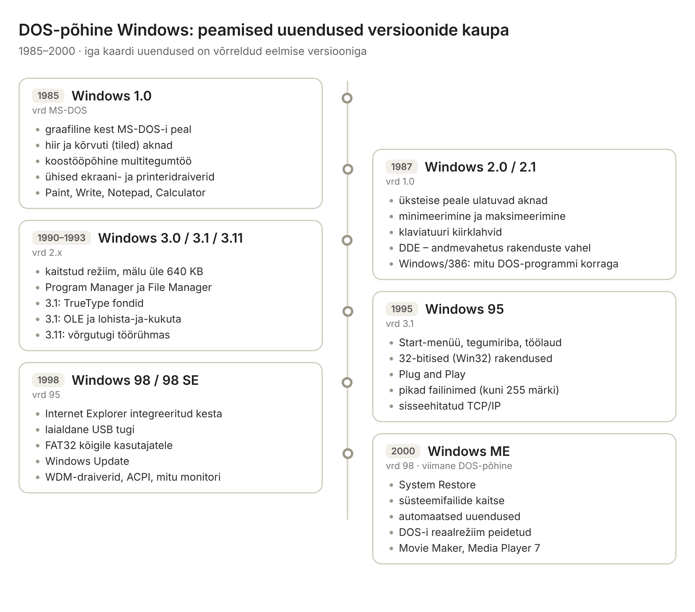
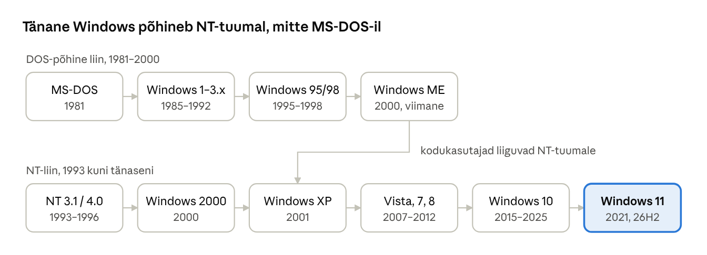
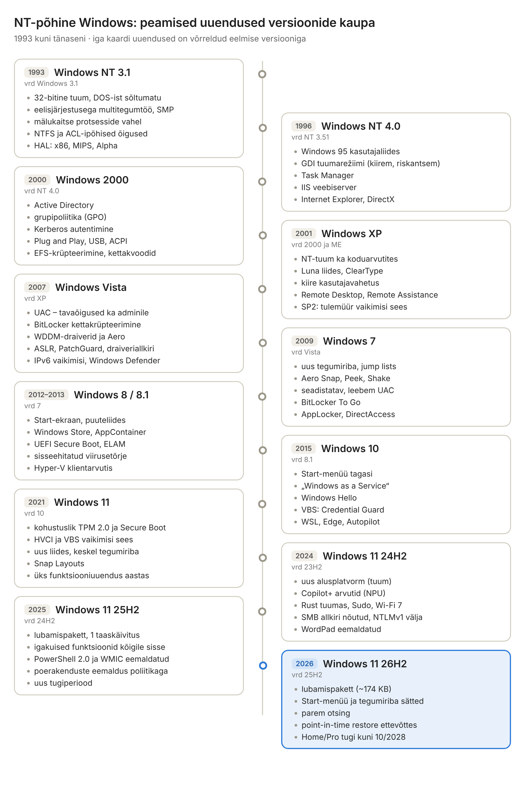

[← Sissejuhatus](00-sissejuhatus.md) · [Sisukord](../README.md) · [2. Operatsioonisüsteemi ülesanded →](02-os-i-ulesanded.md)

## 1. Windowsi ajalugu

Windows on arenenud MS-DOS-i graafilisest kestast üheks laiemalt kasutatavaks operatsioonisüsteemiks, mille tänane tuum pärineb 1993. aastal ilmunud Windows NT-st. 2026. aasta sügisel on toetatud kliendiversioon Windows 11 (viimane funktsiooniuuendus 26H2) ja serveriversioon Windows Server 2025.

### 1.1 MS-DOS

IBM-i personaalarvuti (1981) jaoks ostis Microsoft Seattle Computer Productsilt süsteemi 86-DOS, kohandas selle ja nimetas MS-DOS-iks. MS-DOS oli ühe kasutaja ja ühe ülesandega (single-tasking) käsurealõikesüsteem: korraga töötas üks programm, mälu kaitset polnud ning programm võis otse riistvara poole pöörduda. Need piirangud on hea lähtekoht, et mõista, milleks kaasaegne OS mälukaitset ja õigusi vajab.

### 1.2 Esimesed Windowsi versioonid

Windows 1.0 (1985) kuni Windows 3.x olid graafilised kasutajaliidesed, mis töötasid MS-DOS-i peal. Windows 95, 98 ja ME („9x-pere“) tutvustasid Start-menüüd, 32-bitiseid rakendusi ja Plug and Play’d, kuid alus oli endiselt DOS: üks vigane programm võis kogu süsteemi kokku jooksutada.

#### DOS-põhise liini ajajoon



Joonis: DOS-põhise Windowsi versioonid ja iga versiooni peamised uuendused võrreldes eelmisega. Allpool on samad uuendused täpsemalt lahti kirjutatud.

**1985 · Windows 1.0** – võrreldes puhta MS-DOS-iga:

- graafiline kasutajaliides ja hiirega juhtimine DOS-i peal;
- aknad paigutusid kõrvuti (tiled), üksteise peale neid tõsta ei saanud;
- koostööpõhine (cooperative) multitegumtöö: mitu Windowsi rakendust korraga, kuid iga programm pidi ise juhtimise loovutama;
- ühised seadmedraiverid ekraanile ja printerile – rakendus ei pidanud iga printerit eraldi toetama;
- kaasas rakendused: MS-DOS Executive (failihaldur), Paint, Write, Notepad, Calculator, Calendar, Cardfile.

**1987 · Windows 2.0 / 2.1** – võrreldes 1.0-ga:

- üksteise peale ulatuvad (overlapping) aknad;
- akende minimeerimine ja maksimeerimine;
- klaviatuuri kiirklahvid menüüde ja akende juhtimiseks;
- DDE (Dynamic Data Exchange) – rakendused said omavahel andmeid vahetada;
- Windows/386 kasutas 386-protsessori virtuaalset 8086-režiimi: mitu DOS-programmi said töötada korraga eraldi akendes;
- ilmusid esimesed Windowsi Word ja Excel.

**1990 · Windows 3.0, 1992 · Windows 3.1, 1993 · Windows for Workgroups 3.11** – võrreldes 2.x-ga:

- kaitstud režiim (protected mode): ligipääs üle 640 KB mälule, 386-režiimis ka virtuaalmälu (saalefail);
- Program Manager ja File Manager, uus kolmemõõtmeline välimus ja VGA 16 värvi;
- 3.1: TrueType skaleeritavad fondid;
- 3.1: OLE – objekti (nt Exceli tabeli) põimimine teise dokumenti;
- 3.1: multimeedia tugi (heli, MCI), lohista-ja-kukuta (drag and drop);
- 3.11: sisseehitatud võrgutugi – failide ja printerite jagamine töörühmas.

**1995 · Windows 95** – võrreldes Windows 3.1-ga:

- Start-menüü, tegumiriba ja töölaud; Program Manageri asemel Explorer;
- 32-bitised (Win32) rakendused ja eelisjärjestusega (preemptive) multitegumtöö 32-bitistele programmidele;
- Plug and Play – riistvara tuvastati ja seadistati suurel määral automaatselt;
- pikad failinimed (kuni 255 märki, VFAT);
- sisseehitatud TCP/IP ja sissehelistamisvõrgu (dial-up) tugi;
- paremklõpsu kontekstimenüü ja otseteed (shortcuts).

**1998 · Windows 98 / 98 SE** – võrreldes Windows 95-ga:

- Internet Explorer integreeriti kesta (Active Desktop, veebilaadne kaustavaade);
- laialdane USB tugi;
- FAT32 failisüsteem kõigile kasutajatele (suuremad kettad, väiksem raiskamine);
- Windows Update veebiteenus;
- WDM draiverimudel (ühine Windows 2000-ga), ACPI toitehaldus ja mitme monitori tugi;
- 98 SE: interneti ühiskasutus (Internet Connection Sharing).

**2000 · Windows ME** – võrreldes Windows 98-ga (viimane DOS-põhine Windows):

- System Restore – süsteemi taastamine varasemasse punkti;
- System File Protection – kaitses süsteemifaile ülekirjutamise eest;
- automaatsed uuendused (Automatic Updates);
- DOS-i reaalrežiim peideti, mis kiirendas käivitumist, kuid halvendas vanade DOS-programmide ühilduvust;
- Windows Movie Maker, Windows Media Player 7 ja UPnP tugi.

### 1.3 Windows NT

Windows NT (New Technology) loodi nullist, juhiks Dave Cutler. Eesmärgid olid töökindlus, turvalisus, kaasaskantavus eri protsessoriarhitektuuridele ja mitme kasutaja tugi. NT 3.1 ilmus 1993. NT-l on kasutajarežiim ja tuumarežiim, mälukaitse, ACL-ipõhine õiguste süsteem ning failisüsteem NTFS.



Joonis: DOS-põhine liin lõppes Windows ME-ga; Windows XP-st alates kasutavad ka koduarvutid NT-tuuma, millel põhineb ka Windows 11.

### 1.4 NT-põhised Windowsi versioonid

| Aasta | Versioon | Olulisem muutus |
| --- | --- | --- |
| 1993 | Windows NT 3.1 | 32-bitine tuum, mälukaitse, NTFS |
| 1996 | Windows NT 4.0 | Windows 95 kasutajaliides NT-le |
| 2000 | Windows 2000 | Active Directory, grupipoliitika, Plug and Play |
| 2001 | Windows XP | NT-tuum jõudis koduarvutitesse |
| 2007 | Windows Vista | UAC, BitLocker, uus graafikamudel |
| 2009 | Windows 7 | stabiilsus, kiirus |
| 2012 | Windows 8 / 8.1 | puutetundlik liides, UEFI Secure Boot |
| 2015 | Windows 10 | „Windows as a Service“, regulaarsed funktsiooniuuendused |
| 2021 | Windows 11 | kohustuslik TPM 2.0 ja Secure Boot, VBS vaikimisi |
| 2024 | Windows 11 24H2 | Copilot+ arvutid, uus tuumaväljalase |
| 2025 | Windows 11 25H2 | esimene puhas lubamispakett 24H2 peal |
| 2026 | Windows 11 26H2 | iga-aastane funktsiooniuuendus (enablement package) |

#### NT-põhise liini ajajoon ja peamised uuendused



Joonis: NT-põhise Windowsi versioonid Windows NT 3.1-st kuni Windows 11 26H2-ni; sinisega on märgitud praegune versioon. Allpool on samad uuendused täpsemalt lahti kirjutatud.

**1993 · Windows NT 3.1** – võrreldes Windows 3.1-ga:

- täielikult 32-bitine tuum, mis ei sõltu MS-DOS-ist;
- eelisjärjestusega multitegumtöö ja mitmelõimelisus (threads), mitme protsessori (SMP) tugi;
- mälukaitse: igal protsessil on oma aadressiruum, üks vigane programm ei jooksuta kogu süsteemi kokku;
- NTFS failisüsteem koos ACL-ipõhiste õigustega;
- turvamudel: kohustuslik sisselogimine (Ctrl+Alt+Del), kasutajakontod, turvalogi (audit);
- kaasaskantavus: riistvara abstraktsioonikiht (HAL) võimaldas töötada x86-, MIPS- ja Alpha-protsessoritel.

**1996 · Windows NT 4.0** – võrreldes NT 3.51-ga:

- Windows 95 kasutajaliides (Start-menüü, tegumiriba, Explorer);
- graafikaalamsüsteem (GDI) ja ekraanidraiverid viidi tuumarežiimi – kiirem, kuid vigane draiver võis nüüd tuuma kokku jooksutada;
- Task Manager (tegumihaldur);
- serveris IIS veebiserver ja tugevam domeenipõhine võrguhaldus;
- Internet Explorer ja DirectX-i (piiratud) tugi.

**2000 · Windows 2000** – võrreldes NT 4.0-ga:

- Active Directory – kataloogiteenus domeeni kasutajate, arvutite ja ressursside haldamiseks;
- grupipoliitika (Group Policy) arvutite ja kasutajate tsentraalseks seadistamiseks;
- Kerberos autentimine (NTLM-i kõrval);
- Plug and Play, ACPI ja USB tugi NT-liinis;
- NTFS 5.0: failide krüpteerimine (EFS), kettakvoodid; dünaamilised kettad ja tarkvaraline RAID;
- Windows Installer (MSI) tarkvara paigaldamiseks.

**2001 · Windows XP** – võrreldes Windows 2000 ja ME-ga:

- NT-tuum ka koduarvutites (Home ja Professional väljaanne), DOS-liin lõppes;
- uus Luna kasutajaliides ja ClearType fondisilumine;
- kiire kasutajavahetus (Fast User Switching) – mitu kasutajat sisse logitud korraga;
- Remote Desktop ja Remote Assistance;
- ühilduvusrežiim (Compatibility mode) vanadele programmidele;
- tooteaktiveerimine (Product Activation);
- SP2 (2004): Windows Firewall vaikimisi sees ja Security Center – esimene suur turvapööre.

**2007 · Windows Vista** – võrreldes XP-ga:

- UAC (User Account Control) – ka administraator töötab vaikimisi tavaõigustega ja kinnitab tõstetud õigusi eraldi;
- BitLocker kettakrüpteerimine;
- uus graafika- ja draiverimudel (WDDM) ning Aero kasutajaliides;
- ASLR, kohustuslik draiverite allkirjastamine ja tuumakaitse PatchGuard 64-bitises versioonis;
- Windows Defender (nuhkvaratõrje) kaasas;
- uus TCP/IP pinu, IPv6 vaikimisi sees; indekseeritud otsing Start-menüüs.

**2009 · Windows 7** – võrreldes Vistaga:

- uus tegumiriba: programmide kinnitamine (pin) ja hüpikloendid (jump lists);
- akende haldus Aero Snap, Peek ja Shake;
- seadistatav ja vähem pealetükkiv UAC;
- BitLocker To Go irdketaste krüpteerimiseks;
- AppLocker (lubatud rakenduste nimekiri) ja DirectAccess Enterprise-väljaandes;
- XP Mode (virtuaalne Windows XP vanadele rakendustele), teegid (Libraries) ja HomeGroup;
- väiksem mälukasutus ja kiirem töö samal riistvaral.

**2012 · Windows 8, 2013 · Windows 8.1** – võrreldes Windows 7-ga:

- puuteekraanile mõeldud Start-ekraan paanidega ja täisekraanirakendused;
- Windows Store – rakendused poest, liivakastis (AppContainer);
- UEFI Secure Boot ja ELAM (pahavaratõrje käivitub enne teisi draivereid);
- sisseehitatud viirusetõrje (Windows Defender asendas Microsoft Security Essentialsi);
- sisselogimine Microsofti kontoga ja sätete sünkroonimine;
- Hyper-V klientarvutis, Storage Spaces, File History, arvuti lähtestamine (Reset/Refresh);
- kiire käivitus (Fast Startup); 8.1 tõi tagasi Start-nupu ja töölauale käivitumise.

**2015 · Windows 10** – võrreldes Windows 8.1-ga:

- Start-menüü tagasi (koos paanidega), virtuaalsed töölauad ja Task View;
- „Windows as a Service“: kumulatiivsed igakuised uuendused ja regulaarsed funktsiooniuuendused (algul kaks korda aastas);
- Windows Hello (näo- ja sõrmejäljetuvastus) ning Windows Hello for Business;
- virtualiseerimispõhine turve (VBS): Credential Guard ja Device Guard;
- Microsoft Edge brauser, Cortana, DirectX 12;
- WSL – Linuxi rakendused Windowsis;
- haldus: Windows Update for Business, Windows Autopilot, MDM (Intune) tugi.

**2021 · Windows 11** – võrreldes Windows 10-ga:

- kohustuslik TPM 2.0, Secure Boot ja uuem protsessor (riistvaraline turve kui baasnõue);
- mälu terviklikkus (HVCI) ja VBS uutel seadmetel vaikimisi sees;
- uus kasutajaliides: keskel tegumiriba ja Start-menüü, ümarad nurgad;
- Snap Layouts / Snap Groups akende paigutamiseks;
- üks funktsiooniuuendus aastas; Home/Pro tugi 24 kuud, Enterprise/Education 36 kuud;
- Widgets, Teams-i vestlus tegumiribal, Androidi rakenduste alamsüsteem (WSA, lõpetati 2025);
- 22H2: Smart App Control, vahekaardid File Exploreris, Windows Terminal vaikimisi.

**2024 · Windows 11 24H2** – võrreldes 23H2-ga:

- uus alusplatvorm (uus tuumaväljalase), mis on aluseks ka 25H2 ja 26H2 versioonile;
- Copilot+ arvutid (NPU vähemalt 40 TOPS): Recall, Click to Do, reaalajas tõlgitud subtiitrid, Studio Effects;
- tuuma osad Rust-keeles (mäluohutum kood), Sudo for Windows, Wi-Fi 7 tugi;
- turvavaikeväärtused: SMB allkirjastamine nõutud, LSA kaitse, NTLMv1 eemaldatud;
- protsessor peab toetama SSE4.2/POPCNT käske;
- eemaldatud WordPad ja Steps Recorder, VBScript muudeti valikuliseks;
- väiksemad uuendused (checkpoint cumulative updates), Enterprise-väljaandes hotpatch.

**2025 · Windows 11 25H2** – võrreldes 24H2-ga:

- sama koodibaas kui 24H2: uus versioon tuli väikese lubamispaketina (enablement package) ühe taaskäivitusega;
- 24H2 igakuiste uuendustega tulnud funktsioonid lülitati kõigile sisse;
- eemaldati PowerShell 2.0 mootor ja käsureatööriist WMIC;
- Enterprise/Education administraator saab poliitikaga eemaldada eelinstallitud poerakendusi;
- tugiaja kell algas uuesti (Home/Pro 24 kuud, Enterprise/Education 36 kuud).

**2026 · Windows 11 26H2** – võrreldes 25H2-ga ([Windows Latest](https://www.windowslatest.com/2026/10/06/microsoft-reveals-whats-actually-new-in-windows-11-26h2-and-how-to-verify-it/)):

- sama hooldusharu kui 24H2 ja 25H2; lubamispakett on x64-arvutil ligikaudu 174 KB;
- Start-menüü väike ja suur suurus ning võimalus peita jaotisi; tegumiriba saab paigutada üles, vasakule või paremale;
- otsing: tulemuste eelvaade, kirjavigade taluvus, veebisoovituste väljalülitamine;
- tööarvutites lülitusid sisse varem „ajutiste ärikontrollidega“ peidetud funktsioonid (nt sätete varundamine);
- ettevõtte arvutites ajapunktipõhine taastamine (point-in-time restore), lisakontrollid Smart App Controlile, Windows Hello toetab rohkem sõrmejäljelugejaid;
- Task Manager näitab NPU ja tehisintellekti koormust, Settings Agent sätete otsimiseks loomulikus keeles;
- uus tugiperiood: Home/Pro kuni oktoobrini 2028.

**Windows 10 elutsükli lõpp.** Windows 10 tasuta tugi lõppes 14. oktoobril 2025; laiendatud turvauuenduste (ESU) programm pikendas tarbijate turvauuendusi aasta vörra, kuni 13. oktoobrini 2026 ([Pureinfotech](https://pureinfotech.com/windows-10-end-support-october-14-2025/)). Organisatsioonid saavad ESU-d osta kuni kolmeks aastaks, s.t hiljemalt 2028. aasta oktoobrini ([heise](https://heise.de/-10001284)). See tähendab, et 2026. aasta novembris ei saa tavaline Windows 10 koduarvuti enam turvaparandusi.

**Windows 11 versioonid.** Windows 11 26H2 ilmus 29. septembril 2026 ja jõudis oktoobri lõpuks kõigile sobivatele 24H2 ja 25H2 seadmetele ([Pureinfotech](https://pureinfotech.com/windows-11-26h2-released-force-install/), [Windows Latest](https://www.windowslatest.com/2026/10/27/microsoft-confirms-windows-11-26h2-is-now-available-for-everyone-and-it-installs-in-under-five-minutes/)). Kodu- ja Pro-versiooni tugi kestab kuni 9. oktoobrini 2028, Enterprise- ja Education-versioonil kuni 8. oktoobrini 2029 ([PCWorld](https://www.pcworld.com/article/3270715/windows-11-26h2-is-now-open-to-everyone-dont-expect-big-changes.html)). Erandlik on 26H1: see on mõeldud ainult uutele Snapdragon X2 protsessoriga seadmetele ega ole olemasolevate arvutite uuendus ([Microsoft Tech Community](https://techcommunity.microsoft.com/blog/Windows-ITPro-blog/what-to-know-about-windows-11-version-26h1/4491941)).

**Windows 11 miinimumnõuded** on 64-bitine kahetuumaline 1 GHz protsessor, 4 GB RAM, 64 GB salvestusruumi, TPM 2.0 ja Secure Boot ([Pureinfotech](https://pureinfotech.com/windows-11-25h2-system-requirements/)).

### 1.5 Windows Server

Windows Server kasutab sama NT-tuuma, kuid on häälestatud teenuste pakkumiseks: Active Directory, DNS, DHCP, failiteenused, IIS, Hyper-V. Serveril on pikk tugiperiood (LTSC, umbes 10 aastat), väiksem graafiline koormus (Server Core) ja litsentseerimine tuumade järgi.

Windows Server 2025 (üldkasutuses alates novembrist 2024) uuendused:

- **hotpatching** – turvauuendused paigaldatakse ilma taaskäivituseta; Standard- ja Datacenter-väljaandes Azure Arci kaudu ([Petri](https://petri.com/windows-server-2025-generally-available/));
- **SMB over QUIC** kõigis väljaannetes ja SMB-allkirjastamine vaikimisi nõutud väljuvatel ühendustel;
- uus Active Directory domeeni- ja metsatase, Hyper-V-s vaikimisi 2. põlvkonna virtuaalmasinad, GPU jagamine;
- eemaldatud või aegunud: WordPad, IIS 6 haldusliides, SMTP server, PowerShell 2.0 mootor; aegunuks kuulutatud ka WMIC, NTLM ja WSUS ([Petri](https://petri.com/windows-server-2025-generally-available/)).

### Näide: kooli arvutiklass 2026. aasta sügisel

Koolis on 20 arvutit: 12 Windows 11 24H2, 6 Windows 10 22H2 ja 2 vana masinat, millel peab töötama 1990. aastate DOS-i õppeprogramm.

- **Windows 11 24H2** – uuenda 26H2-le, sest 24H2 Home/Pro tugi lõppes 13.10.2026.
- **Windows 10** – tarbija-ESU lõppes 13.10.2026; arvutid tuleb uuendada Windows 11-le (kui riistvara lubab), viia organisatsiooni ESU alla või välja vahetada. Ilma uuendusteta arvutit ei tohi võrku lubada.
- **DOS-programm** – 64-bitine Windows 16-bitist koodi ei käita (ptk 5.4). Lahendus on emulaator (nt DOSBox) või võrgust eraldatud virtuaalmasin, mitte vana Windows võrgus.

Näide näitab, et OS-i versioon pole ainult mugavuse küsimus: see määrab turvauuendused, riistvaranõuded ja rakenduste ühilduvuse.

### Kokkuvõte

- Tänane Windows põhineb Windows NT tuumal, mitte MS-DOS-il.
- Windows 11 nõuab riistvaralist turvet (TPM 2.0, Secure Boot) ja saab üks kord aastas funktsiooniuuenduse.
- Windows 10 on 2026. aasta sügisest tarbijatele toetuseta; organisatsioonid saavad ESU-ga aega osta.
- Windows Server 2025 toob uuendused ilma taaskäivituseta ja liigub NTLM-ist eemale.

### Kontrollküsimused

1. Mis oli MS-DOS-i roll esimestes Windowsi versioonides?
2. Miks arendas Microsoft Windows NT, kuigi Windows 95 oli populaarne?
3. Nimeta kolm erinevust Windows NT ja Windows 9x vahel.
4. Mis vahe on Windows 11 kliendiversioonil ja Windows Serveril?
5. Mida tähendab „Windows as a Service“ ja kuidas see mõjutab IT-haldurit?
6. Mida peab organisatsioon tegema, kui tal on 2026. aastal veel Windows 10 arvuteid?
7. Miks on Windows 11 riistvaranõuded rangemad kui Windows 10 omad?

### Valikküsimused

1. Mis aastal ilmus Windows NT 3.1? a) 1985 b) 1990 c) 1993 d) 1995
2. Millal lõppes Windows 10 tasuta tugi? a) 14.01.2020 b) 14.10.2025 c) 13.10.2026 d) 10.10.2028
3. Milline väide Windows 11 26H1 kohta on õige? a) see on kõigile tasuta funktsiooniuuendus b) see on eelinstallitud vaid valitud uutele seadmetele c) see on serveriversioon d) see on Windows 12 testversioon
4. Mida võimaldab hotpatching Windows Server 2025-s? a) draiverite automaatset vahetamist b) turvauuendusi ilma taaskäivituseta c) virtuaalmasinate kiiret kloonimist d) Active Directory varundamist

### Praktiline ülesanne

Ava PowerShell ja selgita väljundit:

```powershell
Get-ComputerInfo -Property OsName, OsVersion, OsBuildNumber, WindowsVersion, OsArchitecture
winver
```

Leia [Windows release health](https://learn.microsoft.com/windows/release-health/) lehelt, mis kuupäeval lõpeb sinu versiooni tugi.

### Iseseisvad ülesanded

**1. Arvutipargi inventuur.** Kogu kodu, kooli või töökoha vähemalt viie arvuti andmed: Windowsi väljaanne, versioon (nt 24H2), järk (build), protsessor, TPM-i olemasolu. Leia Microsofti elutsükli lehelt iga versiooni toe lõppkuupäev. **Esita:** tabel ja iga arvuti kohta soovitus (jätka, uuenda, vaheta välja) koos ühe lause põhjendusega.

**2. Ajajoon ja põhjendus.** Koosta oma ajajoon ühe Windowsi versiooni kohta, mida oled ise kasutanud (nt Windows 7 või 10): ilmumise aasta, kolm uut võimalust, toe lõpp ja mis sai selle järel kasutajatest. **Esita:** pool lehekülge teksti ja vastus küsimusele „Miks ei saa Microsoft vana versiooni lõputult toetada?“

### Viited

- Krogh, E. (2017). *An Introduction to Windows Operating System*, 2. tr, ptk 1. Bookboon.
- Yosifovich, P., Ionescu, A., Russinovich, M., Solomon, D. (2017). *Windows Internals*, 7. tr, 1. osa, ptk 1. Microsoft Press.
- Allikad lingitud tekstis.

> 📝 **Test:** selle peatüki Google Formsi test luuakse skriptiga [`google-forms/looVormid.gs`](../google-forms/looVormid.gs).

---

[← Sissejuhatus](00-sissejuhatus.md) · [Sisukord](../README.md) · [2. Operatsioonisüsteemi ülesanded →](02-os-i-ulesanded.md)
