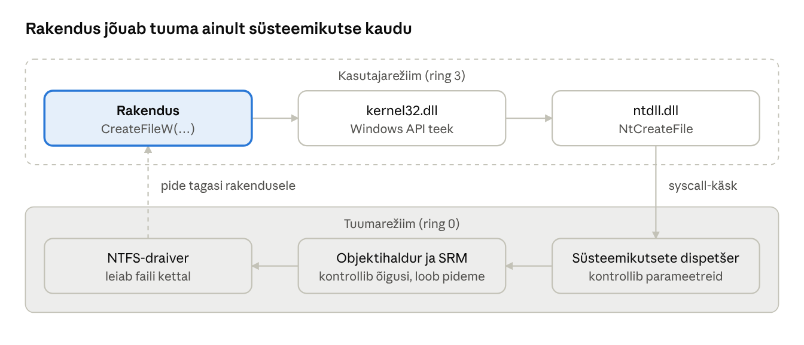

[← 2. Operatsioonisüsteemi ülesanded](02-os-i-ulesanded.md) · [Sisukord](../README.md) · [4. Windowsi arhitektuur →](04-arhitektuur.md)

## 3. Windowsi põhimõisted

Et Windowsi sisemust mõista, on vaja tunda kaheksat põhimõistet: API, .NET, objekt, pide, kasutaja- ja tuumarežiim, protsess ja lõim, teenus ning Unicode.

### 3.1 Windows API

**API** (Application Programming Interface, rakendusliides) on funktsioonide kogum, mille kaudu programm OS-ilt teenuseid küsib. Windowsi põhiliides on **Windows API** (varem Win32 API): C-keelsed funktsioonid nagu `CreateFile`, `CreateProcess`, `VirtualAlloc`. Programm ei kutsu tuuma otse välja, vaid teekide (DLL) kaudu: `kernel32.dll`, `user32.dll`, `advapi32.dll`, mis omakorda kutsuvad `ntdll.dll`-i dokumenteerimata *Native API* funktsioone.

Tänapäeval on lisaks:

- **WinRT / Windows App SDK** – objektorienteeritud kaasaegne API (WinUI 3 kasutajaliides);
- **COM** – komponentmudel, mida kasutavad nii Office kui ka paljud süsteemiteenused;
- **Windows AI API-d** – rakendus saab kasutada OS-i sisseehitatud keelemudelit või pildituvastust (vt ptk 21).

### 3.2 .NET

Algne õpik (2017) rääkis .NET Frameworkist, mis töötas ainult Windowsis. Praegu arendatakse **.NET-i** (endine .NET Core) kui avatud lähtekoodiga platvormiüleset raamistikku: sama C#-programm töötab Windowsis, Linuxis ja macOS-is. Uus põhiversioon ilmub igal novembril; paarisarvulised versioonid on pikaajalise toega (LTS). .NET Framework 4.8.1 on endiselt Windowsi osa vanade rakenduste jaoks, kuid uusi funktsioone sinna ei lisata. PowerShell 7 on ehitatud .NET-i peale, Windows PowerShell 5.1 aga .NET Frameworki peale.

### 3.3 Objektid ja pidemed

Windows haldab ressursse **objektidena** (object): protsess, lõim, fail, sündmus, mutex, registrivõti, token. Objekt on tuumamälus asuv andmestruktuur, millele rakendus otse ligi ei pääse. Rakendus saab objekti avamisel **pideme** (handle) – arvu, mis viitab kirjele protsessi pidemetabelis. Edaspidi kasutab rakendus pidet, nt `ReadFile(h, …)`.

Objektide kasutamise eelised:

- ühtne nimetamine ja leidmine (objektihaldur, ptk 5);
- ühtne turvakontroll – igal objektil on turvakirjeldaja ja kontroll toimub pideme avamisel;
- viidete loendus – objekt kustutatakse, kui keegi seda enam ei kasuta;
- ressursside piiramine protsessi kaupa.

### 3.4 Windows töötab kahes režiimis

Protsessoril on privileegitasemed. Windows kasutab kahte:

- **kasutajarežiim** (user mode, x86-l ring 3) – rakendused ja osa teenuseid; otsene ligipääs riistvarale ja tuumamälule puudub;
- **tuumarežiim** (kernel mode, ring 0) – tuum, draiverid, käivitav süsteem (executive); täielik ligipääs.

Rakendus läheb tuumarežiimi ainult **süsteemikutse** (system call) kaudu, mis kontrollib parameetreid ja õigusi. Kui kasutajarežiimi programm jookseb kokku, lõpetatakse ainult see protsess; vigane draiver tuumarežiimis võib peatada kogu süsteemi.



Joonis: Windows API funktsioon jõuab ntdll.dll kaudu süsteemikutseni; tuumas kontrollitakse õigusi ja rakendus saab tagasi ainult pideme, mitte otseligipääsu.

**Uus kiht: virtuaalsed usaldustasemed.** Alates Windows 10-st kasutab Windows hüperviisorit, et jagada mälu kaheks virtuaalseks usaldustasemeks (VTL 0 ja VTL 1). Tavaline tuum töötab VTL 0-s, turvatuum (Secure Kernel) ja tundlikud andmed VTL 1-s. Isegi tuumarežiimis töötav pahavara ei saa VTL 1 mälu lugeda. Arhitektuuri selgitab ptk 4.

### 3.5 Programm, protsess ja lõim

- **Programm** on kettal asuv staatiline fail (nt `notepad.exe`).
- **Protsess** (process) on käivitatud programmi eksemplar: oma virtuaalne aadressiruum, pidemetabel, turvatoken ja vähemalt üks lõim.
- **Lõim** (thread) on protsessi sees täidetav käsujada, mida planeerija protsessorile annab. Lõimedel on oma register- ja pinuolek, kuid nad jagavad protsessi mälu.

### 3.6 Teenused, funktsioonid ja rutiinid

Sõna „teenus“ tähendab Windowsis kolme asja:

1. **Windowsi teenus** (service) – taustaprotsess, mida juhib teenusehaldur (SCM, `services.exe`), nt Windows Update, DNS-klient. Paljud teenused jagavad ühte `svchost.exe` protsessi.
2. **Süsteemiteenus** (system service) – tuumafunktsioon, mida kutsutakse süsteemikutse kaudu (nt `NtCreateFile`).
3. **API-funktsioon** – dokumenteeritud funktsioon DLL-is (nt `CreateFileW`).

**Tuumarutiinid** on tuuma siseselt kasutatavad funktsioonid, mida draiverid saavad kutsuda.

### 3.7 Unicode

Windows hoiab tekste sisemiselt **UTF-16** kodeeringus: iga sümbol võtab 2 või 4 baiti. Seetõttu on API-funktsioonidel kaks kuju: `CreateFileW` (lai, Unicode) ja `CreateFileA` (ANSI, vana koodileht). Alates Windows 10 1903-st saab rakendus valida koodileheks ka **UTF-8**, mis lihtsustab platvormiüleseid programme. Unicode võimaldab üheaegselt kasutada täpitähti (õ, ä, ö, ü, š, ž), kirillitsat ja emotikone.

### Näide: garderoobinumber ja Notepad

**Võrdlus.** Teatris annad mantli garderoobi ja saad numbri. Sa ei pääse ise riidepuude juurde; numbri näitamisel toob garderoobitöötaja mantli. **Pide** on nagu see number: rakendus ei näe tuumamälus olevat failiobjekti, vaid saab arvu, mille alusel OS objekti leiab. Garderoobitöötaja kontrollib, et number oleks sinu oma – nii nagu OS kontrollib õigusi pideme avamisel.

**Windowsis.** Käivitad `notepad.exe` (programm kettal). Windows loob **protsessi** (PID nt 7420) oma aadressiruumi ja tokeniga ning sellesse esimese **lõime**. Kui avad faili `markmed.txt`, saab Notepad pideme (nt `0x1A4`). Pideme kaudu loeb ta faili, aga ei saa kirjutada teise protsessi mällu. Kui Notepad jookseb kokku, lõpetab Windows ainult selle protsessi ja vabastab kõik tema pidemed; brauser ja teised programmid töötavad edasi – see on kasutaja- ja tuumarežiimi eralduse kasu.

### Kokkuvõte

- Rakendused suhtlevad OS-iga API kaudu, mitte otse tuumaga.
- Ressursid on objektid; rakendus kasutab neid pidemete kaudu.
- Kasutaja- ja tuumarežiimi eraldus kaitseb süsteemi; VBS lisab hüperviisoriga veel ühe kihi.
- Protsess on konteiner, lõim on täitmise üksus.

### Kontrollküsimused

1. Mida tähendab lühend API ja milleks Windows API on?
2. Mis vahe on .NET Frameworkil ja tänapäevasel .NET-il?
3. Mis on objekt Windowsis ja miks Windows objekte kasutab?
4. Mis ülesanne on pidemel?
5. Nimeta Windowsi kaks protsessorirežiimi ja selgita, miks neid vaja on.
6. Mis on VTL 1 ja mida seal hoitakse?
7. Defineeri mõisted programm, protsess ja lõim.
8. Mis on Unicode ja miks Windows seda kasutab?

### Valikküsimused

1. Millises DLL-is on Native API funktsioonid? a) kernel32.dll b) user32.dll c) ntdll.dll d) gdi32.dll
2. Mis juhtub, kui kasutajarežiimi rakendus jookseb kokku? a) kogu süsteem peatub b) lõpetatakse ainult see protsess c) arvuti taaskäivitub d) kõik teenused peatuvad
3. Millist kodeeringut kasutab Windows tekstide sisemiseks hoidmiseks? a) ASCII b) UTF-8 c) UTF-16 d) Windows-1257
4. Mis on pide (handle)? a) protsessi nimi b) viide kirjele protsessi pidemetabelis c) failitee d) mäluaadress tuumas

### Praktiline ülesanne

Lae alla Sysinternalsi tööriist **Process Explorer**. Käivita Notepad ja leia selle protsess. Ava alumisel paneelil pidemete vaade (Ctrl+H) ja vasta: mitu pidet Notepadil on? Milliseid objektitüüpe (File, Key, Event, Thread) näed? Ava seejärel Notepadis fail ja vaata, kuidas pidemete arv muutub.

PowerShellis:

```powershell
Get-Process notepad | Select-Object Id, HandleCount, Threads
```

### Iseseisvad ülesanded

**1. Protsessi profiil.** Vali üks enda kasutatav rakendus (nt brauser või Teams). Leia Process Exploreri või PowerShelli abil: mitu protsessi rakendusel on, iga protsessi PID, lõimede arv, pidemete arv ja kasutaja, kelle õigustega see töötab. **Esita:** tabel ja selgitus, miks üks rakendus kasutab mitut protsessi.

**2. Unicode test.** Loo Notepadis fail, milles on eesti täpitähed (õäöüšž), kirillitsa ja üks emotikon. Salvesta see kordamisi kodeeringutega UTF-8, UTF-16 LE ja ANSI ning võrdle failide suurust (`Get-Item fail.txt | Select Length`) ja sisu uuesti avamisel. **Esita:** tabel failide suurustega ja selgitus, mis ANSI-faili puhul juhtus ja miks.

### Viited

- Krogh (2017), ptk 3.
- Yosifovich jt (2017), *Windows Internals* 7. tr, 1. osa, ptk 1–2.
- Microsoft Learn: [Programming reference for the Win32 API](https://learn.microsoft.com/windows/win32/api/).
- Microsoft Learn: [Sysinternals](https://learn.microsoft.com/sysinternals/).

> 📝 **Test:** selle peatüki Google Formsi test luuakse skriptiga [`google-forms/looVormid.gs`](../google-forms/looVormid.gs).

---

[← 2. Operatsioonisüsteemi ülesanded](02-os-i-ulesanded.md) · [Sisukord](../README.md) · [4. Windowsi arhitektuur →](04-arhitektuur.md)
