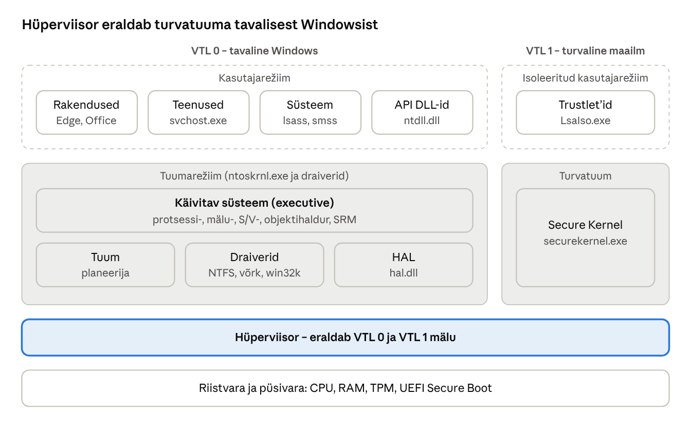

[← 3. Windowsi põhimõisted](03-pohimoisted.md) · [Sisukord](../README.md) · [5. Süsteemimehhanismid →](05-susteemimehhanismid.md)

## 4. Windowsi arhitektuur

Windows on kihiline süsteem: kasutajarežiimis töötavad rakendused, teenused ja süsteemiprotsessid; tuumarežiimis käivitav süsteem (executive), tuum, draiverid ja riistvara abstraktsioonikiht (HAL). Tänapäeva Windowsis on selle all veel hüperviisor, mis eraldab turvatuuma tavalisest tuumast.

### 4.1 Windows NT disainieesmärgid

- **laiendatavus** – koodi saab muuta ja lisada ilma kogu süsteemi ümber kirjutamata;
- **kaasaskantavus** – suurem osa koodist on C-s, riistvarast sõltuv osa on eraldatud (HAL); täna toetatakse x64 ja ARM64 arhitektuuri;
- **töökindlus ja robustsus** – mälukaitse, struktureeritud erinditetöötlus;
- **ühilduvus** – vanad rakendused peavad edasi töötama;
- **jõudlus** – mitmeprotsessoriline tugi, asünkroonne S/V;
- **turvalisus** – algselt USA kaitseministeeriumi C2-taseme nõuete järgi.

### 4.2 Windowsi ülesehitus

Kihid ülalt alla:



Joonis: tavaline Windows (vasakul) ja turvaline maailm (paremal) töötavad hüperviisori peal; isegi tuumarežiimi pahavara ei näe VTL 1 mälu. Sama sisu on all tabelina.

> 🖱️ **Proovi ise:** [klõpsatav arhitektuuri kaart](https://valdonolvak.github.io/Operatsioonis-steemi-ja-k-berturbe-alused/interaktiivne/04-arhitektuur.html#kaart). Iga komponendi juures näed selle rolli ja režiimi. Seejärel [pane kihid õigesse järjekorda](https://valdonolvak.github.io/Operatsioonis-steemi-ja-k-berturbe-alused/interaktiivne/04-arhitektuur.html#kihid).


| Kiht | Režiim | Näited |
| --- | --- | --- |
| Kasutajarakendused | kasutaja | Edge, Office, PowerShell |
| Alamsüsteemi DLL-id | kasutaja | kernel32.dll, user32.dll, ntdll.dll |
| Teenused ja süsteemiprotsessid | kasutaja | services.exe, svchost.exe, lsass.exe, smss.exe, csrss.exe |
| Isoleeritud kasutajarežiim (IUM) | kasutaja, VTL 1 | LsaIso.exe (Credential Guard) |
| Käivitav süsteem (executive) | tuum | protsessi-, mälu-, S/V-, objektihaldur, SRM |
| Tuum (kernel) | tuum | planeerija, katkestused, sünkroniseerimine |
| Draiverid | tuum | failisüsteemid, võrk, seadmed, win32k.sys |
| HAL | tuum | hal.dll |
| Turvatuum (Secure Kernel) | tuum, VTL 1 | securekernel.exe |
| Hüperviisor | hüperviisor | hvix64.exe / hvax64.exe |
| Riistvara ja püsivara | – | CPU, UEFI, TPM, Pluton |

Tuumarežiimi põhikomponendid asuvad failis `ntoskrnl.exe`.

### 4.3 Kasutajarežiim

Kasutajarežiimis on neli liiki protsesse:

1. **süsteemiprotsessid** – nt seansihaldur `smss.exe`, sisselogimine `winlogon.exe`, turva-autoriteet `lsass.exe`;
2. **teenuseprotsessid** – Windowsi teenused, enamasti `svchost.exe` sees;
3. **kasutajarakendused**;
4. **keskkonna alamsüsteemi serverprotsess** – `csrss.exe`.

Kasutajarežiimi koodil on oma virtuaalne aadressiruum ja töötab see protsessi tokeni õigustega.

### 4.4 Tuumarežiim

Tuumarežiimis jagavad kõik komponendid ühte aadressiruumi. Eelis on kiirus (pole režiimivahetust komponentide vahel), puudus on see, et vigane või pahatahtlik draiver pääseb ligi kogu tuumamälule. Seetõttu nõuab 64-bitine Windows, et tuumadraiverid oleksid Microsofti poolt allkirjastatud, ja **kernel patch protection** (PatchGuard) takistab tuuma muutmist jooksvalt.

### 4.5 Käivitava süsteemi teenused

Käivitav süsteem (Windows Executive) sisaldab haldureid:

- **protsessihaldur** – protsessid ja lõimed (ptk 7);
- **mäluhaldur** – virtuaalmälu (ptk 12);
- **S/V-haldur, PnP-haldur, toitehaldur** (ptk 14);
- **vahemäluhaldur** (ptk 13);
- **objektihaldur** (ptk 5);
- **konfiguratsioonihaldur** – register (ptk 6);
- **turvaviitemonitor (SRM)** – õiguste kontroll (ptk 18);
- **ALPC** – kiire protsessidevaheline sõnumivahetus (ptk 7).

### 4.6 Tuum

Kitsamas mõttes tuum (kernel) teeb madala taseme tööd: lõimede planeerimine ja kontekstivahetus, katkestuste ja erindite suunamine, protsessoritevaheline sünkroniseerimine. Tuum ise ei otsusta poliitikat (nt kellel on õigus faili avada) – see on käivitava süsteemi töö.

> 🖱️ **Proovi ise:** [kes seda teeb?](https://valdonolvak.github.io/Operatsioonis-steemi-ja-k-berturbe-alused/interaktiivne/04-arhitektuur.html#kes) Otsusta 14 ülesande puhul, kas neid teeb käivitav süsteem, tuum, HAL, draiver või hüperviisor.


### 4.7 Riistvara abstraktsioonikiht (HAL)

HAL peidab emaplaadi erinevused: katkestuskontrollerid, taimerid, protsessoritevahelised katkestused. Tänu HAL-ile ei pea tuum teadma iga kiibistiku eripära. Tänapäeval on suur osa sellest tööst standardiseeritud (ACPI, UEFI) ja HAL on väiksem kui 1990. aastatel.

### 4.8 Draiverid

Draiver on tuumamoodul (`.sys`), mis suhtleb seadmega või lisab funktsionaalsust. Liigid: seadmedraiverid, failisüsteemi draiverid, filtridraiverid (nt viirusetõrje), võrgudraiverid. Draiveriarendus käib raamistikega **KMDF** (tuumarežiim) ja **UMDF** (kasutajarežiim – turvalisem, sest vigane draiver ei jooksuta süsteemi kokku). Microsoft julgustab ka draivereid Rustis kirjutama (ptk 22).

### 4.9 Akna- ja graafikasüsteem

Graafiline alamsüsteem on `win32k.sys` (tuumarežiim) ja kasutajarežiimi teegid `user32.dll`, `gdi32.dll`. Kaasaegsed rakendused joonistavad DirectX-i kaudu ja ekraanipildi koostab **Desktop Window Manager** (`dwm.exe`). win32k on ajalooliselt olnud sage turvaauk; selle osad on Rustis ümber kirjutatud (`win32kbase_rs.sys`).

### 4.10 Süsteemiprotsessid

| Protsess | Ülesanne |
| --- | --- |
| System (PID 4) | tuumalõimede konteiner |
| Registry | registri andmed mälus |
| smss.exe | seansihaldur, käivitab seansid |
| csrss.exe | Windowsi alamsüsteemi serverprotsess |
| wininit.exe | käivitab services.exe ja lsass.exe |
| services.exe | teenusehaldur (SCM) |
| lsass.exe | autentimine, turvapoliitika |
| LsaIso.exe | Credential Guardi isoleeritud LSA (VTL 1) |
| winlogon.exe | sisse- ja väljalogimine, Ctrl+Alt+Del |
| explorer.exe | kasutaja graafiline kest |

> 🖱️ **Proovi ise:** [süsteemiprotsesside puu](https://valdonolvak.github.io/Operatsioonis-steemi-ja-k-berturbe-alused/interaktiivne/04-arhitektuur.html#protsessid). Klõpsa protsessidel ja tunne need kirjelduse järgi ära.


### 4.11 Virtualiseerimispõhine turve (VBS)

VBS kasutab hüperviisorit, et luua mälupiirkond, kuhu tavaline tuum ligi ei pääse. Selle peal töötavad:

- **mälu terviklikkus (HVCI)** – kontrollib, et tuumas käivitatakse ainult allkirjastatud koodi;
- **Credential Guard** – hoiab parooliräsid ja Kerberose võtmeid VTL 1-s;
- **VBS-enklaavid** – rakenduse saladuste kaitse (nt Recall, ptk 21).

VBS on uutes Windows 11 seadmetes vaikimisi sees ([Petri](https://petri.com/windows-11-2022-update-security-features/)).

### Võrdlus: Linux ja macOS

Kõik kolm süsteemi eraldavad kasutaja- ja tuumarežiimi, kuid tuum on ehitatud eri moodi. Linux on **monoliitne** tuum laaditavate moodulitega, macOS-i XNU on **hübriid** Machi mikrotuumast ja BSD-st, Windows NT on samuti hübriid (ptk 4.2).

|  | Windows | Linux | macOS |
| --- | --- | --- | --- |
| Tuuma tüüp | hübriid: NT executive + tuum | monoliitne, laaditavad moodulid | hübriid XNU: Mach + BSD + I/O Kit |
| Draiverid | `.sys`, Microsofti allkiri, KMDF/UMDF | tuumamoodulid `.ko`, enamasti tuuma lähtekoodis | DriverKit kasutajaruumis; tuumalaiendused (kext) on aegunud |
| Graafika | win32k.sys + DWM | X11 või Wayland kasutajaruumis | WindowServer kasutajaruumis |
| Riistvara abstraktsioon | HAL | arhitektuuripõhine kood tuumas | Apple’i enda riistvara, I/O Kit |
| Lähtekood | suletud | avatud (GPL) | tuum (Darwin/XNU) osaliselt avatud |

**Mida sellest õppida:** monoliitne tuum on kiire, kuid vigane moodul jooksutab kogu süsteemi kokku (*kernel panic*, Windowsi bugchecki vaste). macOS on viinud draiverid suures osas kasutajaruumi – sama suund on Windowsil UMDF-iga ja viirusetõrje tuumast väljaviimisega (ptk 19.3).

### Näide: miks Credential Guard peatab paroolivarga

**Olukord.** Ründaja on saanud tööjaamas administraatoriõigused ja käivitab tööriista, mis loeb `lsass.exe` mälust domeenikasutajate parooliräsid, et nendega teistesse arvutitesse siseneda (pass-the-hash).

- **Ilma VBS-ita:** lsass.exe hoiab räsid VTL 0 mälus. Administraator (või tuumadraiver) saab seda mälu lugeda – räsid lekivad.
- **Credential Guardiga:** saladused on `LsaIso.exe`-s VTL 1-s. lsass.exe küsib neilt ainult tulemust (nt Kerberose vastust), mitte räsi ennast. Ründaja näeb VTL 0 mälu, aga hüperviisor ei lase tal VTL 1-sse.

**Hoone võrdlus.** VTL 0 on kontorihoone, kus administraatoril on kõigi uste võtmed. VTL 1 on pangaseif hoone keldris, mille ukse avab ainult hüperviisor – hoone võtmed seda ei ava.

> 🖱️ **Proovi ise:** [Credential Guard paroolivarga vastu](https://valdonolvak.github.io/Operatsioonis-steemi-ja-k-berturbe-alused/interaktiivne/04-arhitektuur.html#cg). Käivita rünnak Credential Guardiga ja ilma ning vaata, mida ründaja konsoolis näeb.


### Kokkuvõte

- Windows on kihiline: rakendused → DLL-id → süsteemikutse → executive → tuum → HAL → riistvara.
- Tuumarežiimi komponendid jagavad aadressiruumi, mistõttu draiverite kvaliteet on kriitiline.
- Hüperviisor ja VBS lisavad turvakihi, mis kaitseb ka tuuma enda eest.

### Kontrollküsimused

> 🧪 **Interaktiivne test:** [kontrolli oma teadmisi](https://valdonolvak.github.io/Operatsioonis-steemi-ja-k-berturbe-alused/interaktiivne/04-test.html). Test koosneb 25 valikvastusega küsimusest. Iga vastuse järel näed selgitust ning lõpus saad valesti vastatud küsimusi korrata.


1. Nimeta Windows NT disainieesmärgid.
2. Joonista Windowsi kihiline arhitektuur ja märgi, mis on kasutaja- ja mis tuumarežiimis.
3. Mis vahe on käivitaval süsteemil (executive) ja tuumal?
4. Milleks on HAL?
5. Miks nõuab 64-bitine Windows allkirjastatud draivereid?
6. Mis eelis on UMDF-draiveril KMDF-draiveri ees?
7. Kirjelda VBS-i ja nimeta kaks selle peal töötavat turvafunktsiooni.

### Valikküsimused

1. Millises failis on Windowsi tuum ja käivitav süsteem? a) hal.dll b) ntoskrnl.exe c) win32k.sys d) csrss.exe
2. Milline protsess vastutab autentimise eest? a) smss.exe b) lsass.exe c) dwm.exe d) explorer.exe
3. Mis on HVCI? a) hüperviisoriga kaitstud koodi terviklikkus b) Hyper-V võrguliides c) kõvaketta krüpteering d) graafikadraiver
4. Mis kaitseb tuuma jooksva muutmise eest? a) UAC b) PatchGuard c) SmartScreen d) BitLocker

### Praktiline ülesanne

Ava **msinfo32** (Süsteemiteave) ja leia read „Virtualiseerimispõhine turve“ ja „Virtualiseerimispõhise turbe teenused töötavad“. Kontrolli sama PowerShellis:

```powershell
Get-CimInstance -ClassName Win32_DeviceGuard -Namespace root\Microsoft\Windows\DeviceGuard |
  Select-Object VirtualizationBasedSecurityStatus, SecurityServicesRunning
```

Ava Process Exploreris süsteemiprotsesside puu ja leia tabelis 4.10 nimetatud protsessid. Kas LsaIso.exe töötab?

### Iseseisvad ülesanded

**1. Turbe seisukorra kontroll.** Kontrolli oma (või õppe-VM-i) arvutis, kas on sees VBS, mälu terviklikkus (Windowsi turve → Seadme turve → Tuuma isoleerimine), Credential Guard ja Secure Boot. Kui mõni on väljas, uuri, mis selle põhjus võib olla (nt vana draiver, BIOS-i seadistus). **Esita:** tabel „funktsioon – olek – mida see kaitseb“.

**2. Draiveri riskianalüüs.** Käivita `driverquery /v /fo csv > draiverid.csv` ja ava fail Excelis. Leia kolm kolmanda osapoole (mitte Microsofti) tuumadraiverit. Uuri iga kohta, mis seadme või tarkvara juurde see kuulub. **Esita:** lühike tekst, miks just tuumarežiimis töötav kolmanda osapoole kood on süsteemile kõige suurem risk (vihje: ptk 4.4 ja 19).

### Viited

- Krogh (2017), ptk 4.
- Yosifovich jt (2017), *Windows Internals* 7. tr, 1. osa, ptk 2 ja 9.
- Microsoft Learn: [Virtualization-based Security](https://learn.microsoft.com/windows-hardware/design/device-experiences/oem-vbs).

> 📝 **Test:** selle peatüki Google Formsi test luuakse skriptiga [`google-forms/looVormid.gs`](../google-forms/looVormid.gs).

---

[← 3. Windowsi põhimõisted](03-pohimoisted.md) · [Sisukord](../README.md) · [5. Süsteemimehhanismid →](05-susteemimehhanismid.md)
