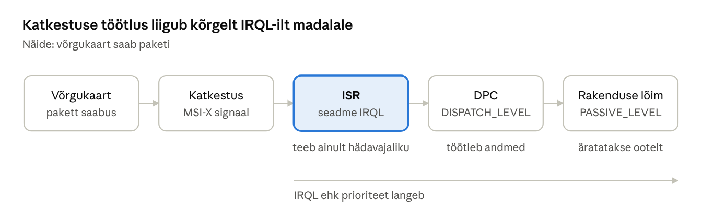

[← 4. Windowsi arhitektuur](04-arhitektuur.md) · [Sisukord](../README.md) · [6. Andmehaldus: register ja konfiguratsioonihaldur →](06-register.md)

## 5. Süsteemimehhanismid

Süsteemimehhanismid on tuuma üldised tööriistad, mida kõik teised komponendid kasutavad: katkestused ja erindid suunavad protsessori tähelepanu, objektihaldur hoiab ressursse korras ning WoW64 ja emulatsioon lasevad vanu või teise arhitektuuri rakendusi käitada.

### 5.1 Katkestused

**Katkestus** (interrupt) on asünkroonne sündmus, millega seade (klaviatuur, võrgukaart, taimer, SSD) annab protsessorile märku. Protsessor katkestab jooksva töö, salvestab oleku ja käivitab **katkestuse teenindusrutiini** (ISR).

Windows järjestab katkestused prioriteetide järgi, mida nimetatakse **IRQL**-iks (Interrupt Request Level). Kõrgema IRQL-iga katkestus võib madalama katkestada, mitte vastupidi. Tavaline kood töötab tasemel PASSIVE\_LEVEL, planeerija DISPATCH\_LEVEL-il, seadmekatkestused kõrgemal.

Et ISR oleks lühike, lükkab Windows aeganeelava töö edasi:

- **DPC** (Deferred Procedure Call) – täidetakse peagi madalamal IRQL-il;
- **APC** (Asynchronous Procedure Call) – täidetakse kindla lõime kontekstis, nt S/V lõpetamisel.



Joonis: ISR töötab kõrgel IRQL-il ja lükkab töö DPC-sse, mis omakorda äratab andmeid ootava lõime. Nii ei blokeeri üks seade pikalt teisi katkestusi.

Kaasaegsed seadmed kasutavad **MSI/MSI-X** katkestusi: seade kirjutab mällu sõnumi ja katkestused saab jagada eri protsessorituumade vahel. NVMe-SSD-l võib olla iga tuuma jaoks eraldi järjekord.

### 5.2 Erindid

**Erind** (exception) on sünkroonne sündmus, mille põhjustab täidetav käsk ise: nulliga jagamine, keelatud mäluaadress, leheviga, katkestuspunkt (breakpoint). Windows kasutab **struktureeritud erinditetöötlust** (SEH): programm saab koodiosa ümber panna `__try/__except` ploki. Kui rakendus erindit ei töötle, lõpetab Windows protsessi ja **Windows Error Reporting** salvestab krahhiaruande.

Tuumarežiimis töötlemata erind on fataalne – tulemuseks on süsteemi seiskumine (ptk 19).

|  | Katkestus | Erind |
| --- | --- | --- |
| Põhjus | väline seade või taimer | täidetav käsk |
| Ajastus | asünkroonne | sünkroonne |
| Näide | klahvivajutus, võrgupakett | nulliga jagamine, leheviga |

### 5.3 Objektihaldur

**Objektihaldur** (Object Manager) on käivitava süsteemi komponent, mis loob, nimetab, kaitseb ja kustutab kõiki tuumaobjekte. Objektil on päis (nimi, turvakirjeldaja, viidete arv) ja keha (tüübiomased andmed). Objektid on hierarhilises **nimeruumis**, nt `\Device\HarddiskVolume3`, `\BaseNamedObjects\MinuSündmus`, `\KnownDlls`. Ketta täht `C:` on tegelikult sümbolviide, mis osutab seadmeobjektile.

Objekti avamisel kontrollib objektihaldur turvaviitemonitori abil, kas küsijal on vajalikud õigused; edukal kontrollil lisatakse kirje protsessi pidemetabelisse. Kui viidete arv langeb nulli, objekt kustutatakse.

### 5.4 32-bitised rakendused 64-bitises süsteemis ja ARM64

**WoW64** (Windows-on-Windows 64) võimaldab käitada 32-bitiseid x86 programme 64-bitises Windowsis. WoW64 tõlgib süsteemikutsed, hoiab eraldi 32-bitiseid DLL-e kaustas `C:\Windows\SysWOW64` ning suunab osa registri- ja failiteid ümber (nt `Program Files (x86)`). 16-bitiseid DOS- ja Windows 3.x programme 64-bitine Windows ei käita.

Windows 11 jaoks on sama oluline **ARM64**. Snapdragon X protsessoriga sülearvutid käitavad ARM64 rakendusi omakeelselt ning x86/x64 rakendusi emulaatori **Prism** abil, mis tõlgib käske jooksvalt. Arendajad saavad koostada **ARM64EC** binaare, kus osa koodist on omakeelne ja osa emuleeritud. Emulatsioon ei toimi tuumadraiveritega: seadmel peab olema ARM64 draiver.

### Näide: uksekell ja kirja kohaletoimetamine

**Katkestus.** Ootad pakki. Sa ei käi iga minuti tagant ukse taga vaatamas (see oleks küsitlus, ptk 14.7), vaid teed tööd, kuni uksekell heliseb. Uksekell on katkestus. Uksel teed ainult hädavajaliku – võtad paki vastu ja allkirjastad (ISR). Paki avad hiljem, kui käed on vabad (DPC).

**Erind.** Programm arvutab keskmist hinnet: `summa / hinnete_arv`. Kui õpilasel pole ühtegi hinnet, on jagaja 0. Protsessor tekitab erindi `EXCEPTION_INT_DIVIDE_BY_ZERO` ja annab selle Windowsile. Kui programm erindit ei püüa, lõpetab Windows protsessi ja sündmusvaaturisse ilmub kirje *Application Error* (sündmus 1000) erindikoodiga `0xc0000094`. Uksekell tuleb väljast, nulliga jagamine tuleb programmist endast – see ongi katkestuse ja erindi vahe.

### Kokkuvõte

- Katkestus tuleb väljastpoolt, erind täidetavast käsust.
- IRQL, DPC ja APC hoiavad katkestuste töötluse lühikese ja prioriteetide järgi.
- Objektihaldur on kõigi tuumaobjektide ühtne värav, kus toimub ka turvakontroll.
- WoW64 ja Prism tagavad vanade ja teise arhitektuuri rakenduste töö.

### Kontrollküsimused

1. Mis vahe on katkestusel ja erindil? Too kummastki näide.
2. Mis on IRQL ja milleks Windows seda kasutab?
3. Miks lükkab Windows katkestuse töötluse osaliselt DPC-sse?
4. Mis on struktureeritud erinditetöötlus?
5. Millised on objektihalduri ülesanded?
6. Kuidas töötab WoW64 ja miks on 64-bitises Windowsis kaks System-kausta?
7. Kuidas käitab ARM64-arvuti x64 rakendusi ja mis seal ei tööta?

### Valikküsimused

1. Milline sündmus on erind? a) võrgupakett saabus b) taimer töötas c) programm jagas nulliga d) kasutaja vajutas klahvi
2. Kus asuvad 64-bitise Windowsi 32-bitised süsteemi-DLL-id? a) System32 b) SysWOW64 c) WinSxS d) Program Files
3. Mis on Prism? a) Windowsi failisüsteem b) x64 emulaator ARM64 Windowsis c) graafikadraiver d) turvaprotsessor

### Praktiline ülesanne

Lae alla Sysinternalsi **WinObj** ja vaata objektihalduri nimeruumi. Leia `\GLOBAL??` kaustast oma ketta täht `C:` ja vaata, millisele seadmeobjektile see viitab. Seejärel vaata katkestuste ja DPC-de koormust:

```powershell
Get-Counter '\Processor(_Total)\% Interrupt Time','\Processor(_Total)\% DPC Time' -SampleInterval 1 -MaxSamples 5
```

### Iseseisvad ülesanded

**1. Katkestuste jälgimine.** Mõõda PowerShelliga (`Get-Counter '\Processor(_Total)\Interrupts/sec' -SampleInterval 1 -MaxSamples 10`) katkestuste arvu sekundis kolmes olukorras: arvuti on jõude, käib YouTube’i video, kopeerid suurt faili. **Esita:** tabel ja selgitus, milline seade tekitas igas olukorras tõenäoliselt kõige rohkem katkestusi.

**2. Erindi jäljed.** Kirjuta PowerShellis või C#-s väike programm, mis jagab nulliga (PowerShellis `[int]$a = 0; 10 / $a`). Esmalt käivita see ilma veakäsitluseta, seejärel lisa `try { … } catch { … }`. **Esita:** mõlema käivituse väljund ja selgitus, mis vahe on erindil, mida programm käsitleb, ja erindil, mida ta ei käsitle.

### Viited

- Krogh (2017), ptk 5.
- Yosifovich jt, *Windows Internals* 7. tr, 2. osa (2021), ptk 8 „System mechanisms“.
- Microsoft Learn: [Windows on Arm](https://learn.microsoft.com/windows/arm/overview).

> 📝 **Test:** selle peatüki Google Formsi test luuakse skriptiga [`google-forms/looVormid.gs`](../google-forms/looVormid.gs).

---

[← 4. Windowsi arhitektuur](04-arhitektuur.md) · [Sisukord](../README.md) · [6. Andmehaldus: register ja konfiguratsioonihaldur →](06-register.md)
