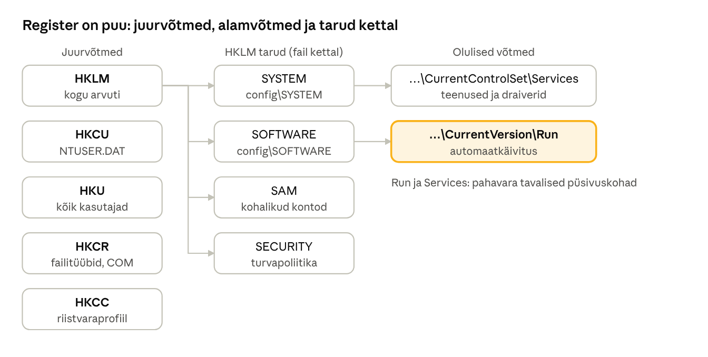

[← 5. Süsteemimehhanismid](05-susteemimehhanismid.md) · [Sisukord](../README.md) · [7. Protsessid, lõimed ja tööd →](07-protsessid-ja-loimed.md)

## 6. Andmehaldus: register ja konfiguratsioonihaldur

Windows hoiab oma ja rakenduste seadistust hierarhilises andmebaasis, mida nimetatakse **registriks** (registry). Registrit haldab tuumas **konfiguratsioonihaldur**; administraator muudab seda enamasti rühmapoliitika, Intune’i või PowerShelli kaudu, mitte käsitsi.

### 6.1 Register

Register koosneb **võtmetest** (key, sarnane kaustale) ja **väärtustest** (value, sarnane failile). Väärtusel on nimi, tüüp ja andmed. Levinumad tüübid:

| Tüüp | Sisu |
| --- | --- |
| REG\_SZ | tekst |
| REG\_EXPAND\_SZ | tekst keskkonnamuutujatega, nt `%SystemRoot%` |
| REG\_MULTI\_SZ | tekstide loend |
| REG\_DWORD | 32-bitine arv |
| REG\_QWORD | 64-bitine arv |
| REG\_BINARY | binaarandmed |

Registri juurvõtmed:

| Juurvõti | Lühend | Sisu |
| --- | --- | --- |
| HKEY\_LOCAL\_MACHINE | HKLM | kogu arvuti seadistus: riistvara, teenused, tarkvara, turvapoliitika |
| HKEY\_USERS | HKU | kõigi laaditud kasutajaprofiilide seadistus |
| HKEY\_CURRENT\_USER | HKCU | sisselogitud kasutaja seadistus (viide HKU alamvõtmele) |
| HKEY\_CLASSES\_ROOT | HKCR | failitüübid ja COM-klassid |
| HKEY\_CURRENT\_CONFIG | HKCC | jooksev riistvaraprofiil |



Joonis: HKLM koosneb taru-failidest kaustas `System32\config`; Run- ja Services-võtmed on esimesed kohad, mida turvaanalüüsil vaadatakse.

Registri andmed on kettal failides, mida nimetatakse **tarudeks** (hive): `C:\Windows\System32\config\SYSTEM`, `SOFTWARE`, `SAM`, `SECURITY` ning kasutaja `NTUSER.DAT` profiilikaustas.

Tähtsad kohad, mida IT-spetsialist peaks teadma:

- `HKLM\SYSTEM\CurrentControlSet\Services` – teenused ja draiverid;
- `HKLM\SOFTWARE\Microsoft\Windows\CurrentVersion\Run` ja `HKCU\…\Run` – automaatkäivitus (lemmik koht ka pahavarale);
- `HKLM\SOFTWARE\Policies` ja `HKCU\SOFTWARE\Policies` – rühmapoliitika seadistused.

> 🖱️ **Proovi ise:** [registriredaktor](https://valdonolvak.github.io/Operatsioonis-steemi-ja-k-berturbe-alused/interaktiivne/06-register.html#regedit). Sirvi registrit ohutult, lahenda ülesanded ja vaata iga muudatuse PowerShelli vastet. Seejärel harjuta [väärtuste tüüpe ja tarusid](https://valdonolvak.github.io/Operatsioonis-steemi-ja-k-berturbe-alused/interaktiivne/06-register.html#tyyp).


### 6.2 Konfiguratsioonihaldur

**Konfiguratsioonihaldur** (Configuration Manager, tuumas tähisega Cm) laadib tarud käivitamisel mällu, haldab registri lugemist ja kirjutamist, kontrollib õigusi (igal võtmel on ACL) ja tagab, et muudatused jõuaksid kettale. Töökindluse jaoks kasutab ta **logifaile** (`.LOG1`, `.LOG2`): muudatus kirjutatakse esmalt logisse, siis tarusse. Kui arvuti kaotab toite, taastatakse taru logi järgi.

> 🖱️ **Proovi ise:** [voolukatkestus registrisse kirjutamise ajal](https://valdonolvak.github.io/Operatsioonis-steemi-ja-k-berturbe-alused/interaktiivne/06-register.html#logi). Lülita vool välja suvalisel hetkel ja vaata, mis taaskäivitusel juhtub.


Registriga on seotud ka **virtualiseerimine**: kui vana rakendus üritab ilma administraatoriõiguseta kirjutada HKLM\\SOFTWARE alla, suunab Windows kirjutise kasutaja privaatsesse koopiasse. Microsoft Store’i (MSIX) rakendused saavad oma isoleeritud registrivaate.

### 6.3 Seadistuse haldus tänapäeval

Registrit ei peaks suures keskkonnas käsitsi muutma. Kasutatakse:

- **rühmapoliitikat (GPO)** domeenis;
- **Microsoft Intune’i** ja **CSP-sid** (Configuration Service Provider) pilvehalduses;
- **PowerShelli DSC-d** või muid konfiguratsiooni kui koodi tööriistu serverites;
- **turvabaasjooni** (security baselines), nt Microsofti ja CIS-i soovitused ning E-ITS-i meetmed.

### Näide: „arvuti avab käivitamisel tundmatu akna“

**Probleem.** Kasutaja teatab, et iga sisselogimise järel avaneb hetkeks must aken ja siis kaob.

1. Käivitad **Autorunsi** ja vaatad vahekaarti *Logon*. Leiad kirje `HKCU\Software\Microsoft\Windows\CurrentVersion\Run` → `Updater` = `C:\Users\mari\AppData\Roaming\upd\svc.exe`.
2. Faili allkirja veerg näitab *Not verified*, VirusTotali veerg mitut tuvastust.
3. Kirje asub HKCU all, seega lisati see kasutaja õigustega – administraatoriõigusi polnud vaja.
4. Isoleerid arvuti, eemaldad kirje ja faili, käivitad Defenderi võrguühenduseta skannimise ning uurid, kust fail tuli (ptk 22.5).

> 🖱️ **Proovi ise:** [Autorunsi jaht](https://valdonolvak.github.io/Operatsioonis-steemi-ja-k-berturbe-alused/interaktiivne/06-register.html#autoruns). Leia Run-võtmetest pahavara: vaata allkirja, VirusTotali tulemust, failiteed ja kirje asukohta.


**Rühmapoliitika näide.** Kui administraator seab GPO-s „Prohibit access to Control Panel and PC settings“, kirjutab Windows kasutaja registrisse väärtuse `HKCU\Software\Microsoft\Windows\CurrentVersion\Policies\Explorer\NoControlPanel = 1`. Explorer loeb seda väärtust ja peidab juhtpaneeli. Rühmapoliitika on seega mugav ja auditeeritav viis registri muutmiseks.

> 🖱️ **Proovi ise:** [rühmapoliitika registris](https://valdonolvak.github.io/Operatsioonis-steemi-ja-k-berturbe-alused/interaktiivne/06-register.html#gpo). Lülita poliitikaid sisse ja vaata, millise väärtuse Windows registrisse kirjutab ja mis töölaual muutub.


### Kokkuvõte

- Register on hierarhiline seadistusandmebaas: võtmed, väärtused, tarud.
- Konfiguratsioonihaldur tagab registri terviklikkuse logifailidega.
- Run-võtmed ja teenused on tavalised püsivuse (persistence) kohad, mida turvaanalüüs alati kontrollib.

### Kontrollküsimused

> 🧪 **Interaktiivne test:** [kontrolli oma teadmisi](https://valdonolvak.github.io/Operatsioonis-steemi-ja-k-berturbe-alused/interaktiivne/06-test.html). Test koosneb 25 valikvastusega küsimusest. Iga vastuse järel näed selgitust ning lõpus saad valesti vastatud küsimusi korrata.


1. Mis on register ja mida seal hoitakse?
2. Mis vahe on võtmel ja väärtusel?
3. Nimeta registri juurvõtmed ja nende sisu.
4. Mis on taru ja kus tarud kettal asuvad?
5. Mis on konfiguratsioonihalduri ülesanded?
6. Miks on Run-võtmed turvalisuse seisukohast olulised?
7. Miks ei muudeta suures keskkonnas registrit käsitsi ja mida kasutatakse selle asemel?

### Valikküsimused

1. Millises juurvõtmes on teenuste seadistus? a) HKCU b) HKCR c) HKLM d) HKCC
2. Mis fail sisaldab kasutaja registritaru? a) SAM b) NTUSER.DAT c) SYSTEM d) pagefile.sys
3. Mis tüüpi väärtus on 32-bitine arv? a) REG\_SZ b) REG\_BINARY c) REG\_DWORD d) REG\_MULTI\_SZ

### Praktiline ülesanne

Vaata automaatkäivitusega programme kahel viisil:

```powershell
Get-ItemProperty 'HKLM:\SOFTWARE\Microsoft\Windows\CurrentVersion\Run'
Get-ItemProperty 'HKCU:\SOFTWARE\Microsoft\Windows\CurrentVersion\Run'
Get-CimInstance Win32_StartupCommand | Select-Object Name, Command, Location
```

Käivita Sysinternalsi **Autoruns** ja võrdle tulemust. Mitu korda rohkem automaatkäivituskohti Autoruns näitab? Loo testvõti `HKCU:\Software\Opetus` ja sinna väärtus `Proov` (DWORD = 1), seejärel kustuta see.

### Iseseisvad ülesanded

**1. Registri muudatuse jälgimine.** Käivita Sysinternalsi **Process Monitor**, filtreeri `Operation is RegSetValue` ja muuda Windowsi seadetes üht lihtsat asja (nt tumerežiim või hiire kiirus). Leia, millisesse registrivõtmesse muudatus kirjutati. **Esita:** ekraanipilt, võtme täistee ning väärtuse nimi ja tüüp enne ja pärast muutmist.

**2. Rühmapoliitika registris.** Ava õppe-VM-is `gpedit.msc` ja lülita sisse kaks erinevat poliitikat (nt „Remove Recycle Bin icon from desktop“ ja „Prevent access to registry editing tools“). Leia `HKCU:\Software\Microsoft\Windows\CurrentVersion\Policies` alt vastavad väärtused. Seejärel lülita poliitikad välja. **Esita:** tabel „poliitika – registrivõti – väärtus“ ja vastus: miks on GPO parem kui registri käsitsi muutmine?

### Viited

- Krogh (2017), ptk 6.
- Yosifovich jt, *Windows Internals* 7. tr, 2. osa, ptk 10 „Management, diagnostics, and tracing“.
- Microsoft Learn: [Sysinternals Autoruns](https://learn.microsoft.com/sysinternals/downloads/autoruns).

> 📝 **Test:** selle peatüki Google Formsi test luuakse skriptiga [`google-forms/looVormid.gs`](../google-forms/looVormid.gs).

---

[← 5. Süsteemimehhanismid](05-susteemimehhanismid.md) · [Sisukord](../README.md) · [7. Protsessid, lõimed ja tööd →](07-protsessid-ja-loimed.md)
