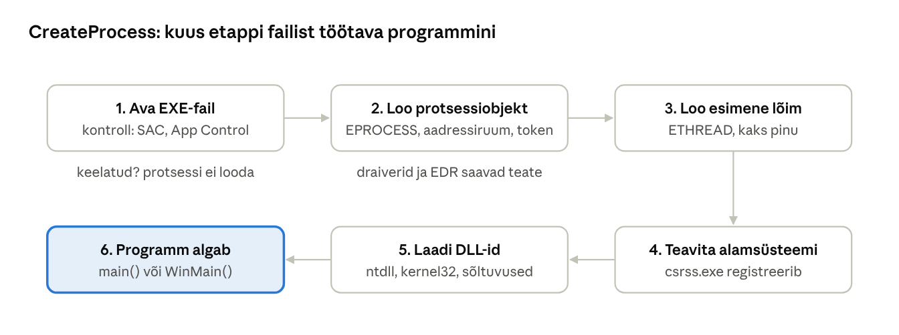
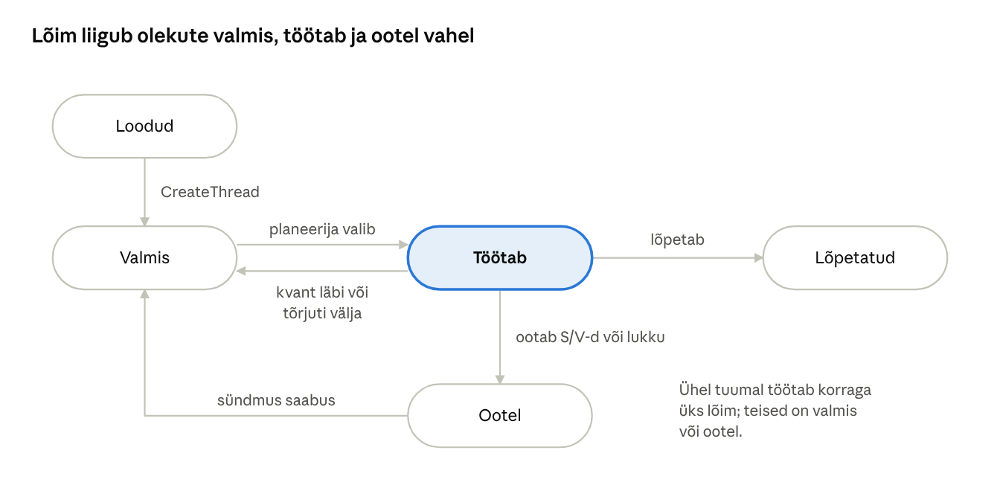

[← 6. Andmehaldus: register ja konfiguratsioonihaldur](06-register.md) · [Sisukord](../README.md) · [8. Lõimede sünkroniseerimine →](08-sunkroniseerimine.md)

## 7. Protsessid, lõimed ja tööd

Kui käivitad programmi, ei pane Windows lihtsalt EXE-faili protsessorisse tööle. Ta loob selle ümber kaitstud keskkonna, mida nimetatakse **protsessiks**, ja selle sees vähemalt ühe **lõime**, mis käske tegelikult täidab. Mitu protsessi saab omakorda koondada **tööks** (job), et neile ühiseid piiranguid seada.

Lühidalt:

- **protsess** on ressursside konteiner: oma mälu, avatud objektid ja õigused;
- **lõim** on täitmise üksus: just lõimi annab planeerija protsessorile;
- **töö** on protsesside rühm, mida saab koos piirata ja lõpetada.

Neid kolme kasutavad ka tänapäeva isolatsioonitehnoloogiad: AppContainer, Windowsi konteinerid ja Windows Sandbox.

> 🖱️ **Proovi ise:** [interaktiivne õpileht](https://valdonolvak.github.io/Operatsioonis-steemi-ja-k-berturbe-alused/interaktiivne/07-protsessid.html). Lehel on protsessi loomine samm-sammult, lõime olekumasin, mitmeülesandelisuse simulaator ja protsessipuu detektiiv.

### 7.1 Protsessid

**Programm** on kettal olev fail, näiteks `notepad.exe`. **Protsess** on selle programmi käivitatud eksemplar. Kui avad Notepadi kolm korda, on kettal üks programm, kuid töötab kolm protsessi. Igaühel on oma PID, oma mälu ja oma avatud failid.

Protsessil on:

| Osa | Mida see tähendab | Kus seda näeb |
| --- | --- | --- |
| **Privaatne virtuaalne aadressiruum** | Protsessi enda mälu. x64-l on kasutajarežiimile 128 TB virtuaalset aadressiruumi. Teine protsess seda otse lugeda ei saa. | Tegumihaldur → Üksikasjad → Mälu |
| **Käivitatav programm** | EXE-fail ja kõik laaditud DLL-id, nt `kernel32.dll` | Process Explorer → DLL-vaade (Ctrl+D) |
| **Pidemetabel** | Avatud objektid: failid, registrivõtmed, sündmused (ptk 3.3) | Process Explorer → pidemete vaade (Ctrl+H) |
| **Juurdepääsutoken** | Turvakontekst: kasutaja SID, rühmad, privileegid ja terviklikkuse tase | Process Explorer → Properties → Security |
| **Protsessi ID (PID)** ja vanemprotsessi ID | Unikaalne number ja see, kes protsessi käivitas | Tegumihaldur, `Get-Process` |
| **Vähemalt üks lõim** | Ilma lõimeta protsess ei saa midagi teha ja lõpetatakse | Process Explorer → Threads |

Tuumas kirjeldab protsessi andmestruktuur **EPROCESS**, kasutajarežiimis **PEB** (Process Environment Block), kus on näiteks käsurida ja laaditud DLL-ide loend.

**Näide: Notepad numbrites.** Käivitad Notepadi ja vaatad PowerShellis:

```powershell
Get-Process notepad | Select-Object Id, HandleCount, @{n='Threads';e={$_.Threads.Count}}, WorkingSet64
```

Tulemus võib olla `Id 7420, HandleCount 245, Threads 8, WorkingSet64 ≈ 40 MB`. Isegi lihtsal Notepadil on mitu lõime ja sadu pidemeid, sest Windowsi teegid loovad taustalõimi (nt lõimekogumi jaoks) ja avavad faile ning registrivõtmeid.

#### Juurdepääsutoken ja terviklikkuse tase

Token ütleb, **kelle õigustega** protsess töötab. Kui Mari käivitab Wordi, saab Word Mari tokeni ja tohib avada ainult neid faile, mida Mari tohib. Tokenis on ka **terviklikkuse tase** (integrity level), mis piirab, kas madalama taseme protsess saab kõrgema taseme protsessi või faile muuta:

| Tase | Kes sellega töötab |
| --- | --- |
| **System** | Windowsi teenused ja süsteemiprotsessid (lsass.exe, services.exe) |
| **High** | administraatoriõigustes käivitatud programm (UAC-i kinnitusega) |
| **Medium** | tavalised programmid, mida kasutaja käivitab |
| **Low** / AppContainer | brauseri sisuprotsessid ja muud liivakastis töötavad protsessid |

Madala tasemega protsess ei saa kirjutada keskmise tasemega objektidesse. Kui pahavara pääseb brauseri vea kaudu vahekaardi sisuprotsessi, ei saa ta sealt kasutaja dokumentidesse kirjutada.

#### Protsessi loomine

Kui topeltklõpsad Wordi ikoonil, kutsub Explorer välja funktsiooni `CreateProcess`. Protsess luuakse etappidena:

1. **EXE-faili avamine.** Windows avab `WINWORD.EXE` ja kontrollib, kas see on lubatud. Siin saavad käivituse peatada **Smart App Control**, **App Control for Business / AppLocker** ja Defender.
2. **Protsessiobjekti ja aadressiruumi loomine.** Tuumas luuakse EPROCESS ja Word saab oma virtuaalse aadressiruumi. Protsessihaldur teavitab registreerunud draivereid (nt EDR-tarkvara), et uus protsess sündis.
3. **Esimese lõime loomine.** Luuakse lõim koos pinuga, kuid see ei tööta veel.
4. **Alamsüsteemi teavitamine.** csrss.exe saab teada uuest protsessist.
5. **DLL-ide laadimine.** Uue protsessi sees laaditakse `ntdll.dll`, `kernel32.dll` ja muud vajalikud teegid.
6. **Täitmise algus.** Esimene lõim hakkab täitma Wordi koodi.



Joonis: juba esimeses etapis saab turvatarkvara käivituse peatada; teises etapis saavad draiverid ja EDR teate uuest protsessist, mistõttu jääb iga käivitus turvalogidesse.

Kui auditeerimine on sisse lülitatud, kirjutab Windows iga uue protsessi kohta turvalogisse sündmuse **4688** (*A new process has been created*). Sysmon kirjutab sündmuse 1. Need on intsidentide uurimisel ühed tähtsamad logikirjed.

> 🖱️ **Proovi ise:** [protsessi sünd samm-sammult](https://valdonolvak.github.io/Operatsioonis-steemi-ja-k-berturbe-alused/interaktiivne/07-protsessid.html#loomine). Vaata, kuidas Wordi protsess täitub ja mis jääb turvalogisse. Proovi ka varianti, kus AppLocker käivituse keelab.


**Protsesside tüübid tänapäeval:**

| Tüüp | Kirjeldus | Näide |
| --- | --- | --- |
| Tavaline protsess | täielik Win32 protsess | Notepad, Word |
| Kaitstud protsess (PP/PPL) | isegi administraator ei saa selle mälu lugeda ega seda lõpetada | lsass.exe LSA kaitsega, viirusetõrje teenus |
| AppContainer | piiratud liivakast: ligipääs ainult lubatud ressurssidele | Store’i rakendused, Edge’i sisuprotsessid |
| Minimaalne / Pico-protsess | ilma Windowsi DLL-ideta | WSL 1 Linuxi protsessid |
| Trustlet (IUM) | töötab VTL 1-s (ptk 4.11) | LsaIso.exe |

**Näide: miks lsass.exe on kaitstud.** Ründaja, kes on saanud administraatoriõigused, proovib Tegumihalduriga teha lsass.exe mälutõmmist, et sealt paroolide räsisid leida. Kui LSA kaitse (RunAsPPL) on sees, saab ta vea „Juurdepääs keelatud“. Isegi administraator ei saa kaitstud protsessi mällu, sest seda lubatakse ainult sama või kõrgema kaitsetasemega allkirjastatud protsessidele.

### 7.2 Lõimed

**Lõim** on protsessi sees täidetav käsujada. Kõik sama protsessi lõimed jagavad protsessi mälu ja pidemeid, kuid igal lõimel on oma:

- **registrite olek** – kus täitmine parajasti on (käsuloendur) ja millised on vahetulemused;
- **kaks pinu** – kasutajapinu (vaikimisi kuni 1 MB) ja väike tuumapinu, mida kasutatakse süsteemikutsete ajal;
- **prioriteet** – kui tähtis on lõim planeerijale (ptk 9);
- **lõime lokaalne mälu** (TLS) – andmed, mis kuuluvad ainult sellele lõimele;
- **olek** – valmis, töötab, ootel või lõpetatud.

Tuumas kirjeldab lõime **ETHREAD/KTHREAD**, kasutajarežiimis **TEB** (Thread Environment Block).

**Näide: lõimed Wordis.** Kui kirjutad Wordis teksti, töötab samal ajal mitu lõime:

- **kasutajaliidese lõim** joonistab tähed ekraanile ja reageerib klahvivajutustele;
- **õigekirjakontrolli lõim** kontrollib taustal sõnu ja joonistab punase lainelise joone;
- **automaatsalvestuse lõim** salvestab mõne minuti tagant OneDrive’i;
- **printimise lõim** saadab dokumendi printerile, kui vajutasid Ctrl+P.

Kui kõik see toimuks ühes lõimes, hanguks ekraan iga salvestamise ajal. Seepärast tehakse raske töö taustalõimedes ja kasutajaliidese lõim jääb kiireks.

**Lõime olekud.** Planeerija liigutab lõime nelja põhioleku vahel (ptk 9):

- **valmis** (ready) – lõim on valmis töötama ja ootab vaba protsessorit;
- **töötab** (running) – lõim täidab parajasti protsessoril käske;
- **ootel** (waiting) – lõim ootab sündmust, nt faili lugemise lõppu, klahvivajutust või lukku;
- **lõpetatud** (terminated) – lõim on töö lõpetanud.



Joonis: lõim ei lähe ootelt otse tööle – kui sündmus saabub, muutub ta valmis-olekusse ja ootab, kuni planeerija ta valib.

**Näide: automaatsalvestuse lõime päev.** Lõim on *ootel* (taimer pole veel aegunud). Taimer aegub ja lõim muutub *valmis*. Planeerija annab talle tuuma ja lõim *töötab*: koostab salvestatava faili. Siis kutsub ta `WriteFile` ja peab ootama ketast, nii et lõim on jälle *ootel*. Kui ketas lõpetab, muutub lõim *valmis*, saab uuesti protsessori ja läheb taimerit ootama. Kogu selle aja ei kasutanud lõim ootel olles üldse protsessoriaega.

Windowsis on tegelikult ka vahepealseid olekuid (nt *initialized*, *standby*, *deferred ready*), kuid nende mõistmiseks piisab neljast põhiolekust.

> 🖱️ **Proovi ise:** [lõime olekumasin](https://valdonolvak.github.io/Operatsioonis-steemi-ja-k-berturbe-alused/interaktiivne/07-protsessid.html#olekud). Juhi automaatsalvestuse lõime sündmustega ja vaata, millised üleminekud on lubatud.


**Lõimekogum.** Kaasaegses programmeerimises ei looda lõimi tavaliselt käsitsi. Lõime loomine ja hävitamine on suhteliselt kallis, seetõttu kasutatakse **lõimekogumit** (thread pool): Windows hoiab valmis paar lõime ja annab neile järjest ülesandeid. Programmeerija kirjutab näiteks C#-s `await File.ReadAllTextAsync(...)` või kasutab `Task`-i ja C++-s `std::jthread`-i, ning lõimede haldamise teeb raamistik.

### 7.3 Kiud

**Kiud** (fiber) on kasutajarežiimis hallatav kerge täitmisüksus. Lõimede vahel vahetab tuuma planeerija, kiudude vahel vahetab programm ise: ta otsustab, millal ühe kiu töö peatada ja teisega jätkata. Tuum kiude ei näe, tema jaoks on olemas ainult lõim, mille sees kiud vahelduvad.

**Näide.** Andmebaasiserver teenindab 10 000 klienti. 10 000 lõime looks palju pinusid ja kontekstivahetusi. Kiududega saab üks lõim teenindada paljusid kliente: kui üks kiud peab andmeid ootama, lülitab server teise kiu peale. SQL Server kasutas seda võimalust („lightweight pooling“).

Tänapäeval täidavad sama rolli **korutiinid** ja asünkroonne programmeerimine (`async/await`). Sarnane mehhanism **UMS** (User-Mode Scheduling) on Windows 11-st eemaldatud.

### 7.4 Tööd

**Töö** (job object) koondab protsesse, et neid koos hallata. Tööle saab seada näiteks järgmisi piiranguid:

- kõigi protsesside kogumälu (nt kokku kuni 2 GB);
- protsessoriaja osa (nt kuni 20%);
- protsesside arvu (nt uusi lapsprotsesse luua ei tohi);
- käitumist lõpetamisel (kui töö suletakse, lõpetatakse kõik selle protsessid korraga).

**Näide: arvutiklassi kontrolltöö.** Õpetaja kontrollib automaatselt õpilaste programme. Kui iga õpilase programm käivitatakse tööobjektis, mille mälupiirang on 512 MB ja ajapiirang 10 sekundit, ei saa lõputu tsükkel ega mälu söömine kogu serverit kinni panna. Aja lõppedes suletakse töö ja kõik programmi loodud protsessid lõpetatakse ühe korraga.

Tööobjektid on aluseks:

- **Windowsi konteineritele** (serveri konteinerid, ptk 20);
- **brauserite liivakastidele** (Edge ja Chrome piiravad sisuprotsesse tööobjektidega);
- **WSL 2 ja Windows Sandboxi** ressursipiirangutele.

> 🖱️ **Proovi ise:** [kellele see kuulub: protsessile, lõimele või tööle?](https://valdonolvak.github.io/Operatsioonis-steemi-ja-k-berturbe-alused/interaktiivne/07-protsessid.html#kellele)


### 7.5 Protsessihaldur

**Protsessihaldur** (Process Manager) on käivitava süsteemi osa, mis loob ja lõpetab protsesse, lõimi ja töid. Ta **ei planeeri** lõimi: seda teeb tuum (ptk 9). Protsessihaldur otsustab, et lõim on olemas; tuum otsustab, millal see töötab.

Protsessihaldur lubab draiveritel registreeruda teavituste saamiseks protsesside ja lõimede loomise kohta (nt `PsSetCreateProcessNotifyRoutineEx`). Nii näeb EDR-tarkvara iga uut protsessi ja saab selle käivitamise isegi peatada.

**Näide: EDR märkab rünnakut.** Kasutaja avab e-kirjast Wordi dokumendi. Makro käivitab käsu `powershell.exe -enc JABjAD0A…`. EDR saab protsessihaldurilt teate: uus protsess `powershell.exe`, vanem `WINWORD.EXE`, käsureal Base64-kodeeritud skript. Word ei pea tavaliselt PowerShelli käivitama, seega annab EDR häire ja peatab protsessi. Vanemprotsessi ja käsurea jälgimine on üks tõhusamaid ründe tuvastamise viise.

### 7.6 Mitmeülesandelisus

**Mitmeülesandelisus** (multitasking) tähendab, et mitu programmi näivad töötavat samaaegselt. Tähtis on vahet teha kahel mõistel:

- **samaaegsus** (concurrency) – ühe tuumaga arvutis vahetab OS lõimi nii kiiresti (iga mõnekümne millisekundi järel), et inimesele tundub, nagu töötaksid kõik korraga. Tegelikult töötab igal hetkel ainult üks lõim;
- **paralleelsus** (parallelism) – mitme tuumaga arvutis töötavad lõimed päriselt samal ajal, igaüks oma tuumal.

**Kontekstivahetus** (context switch) tähendab, et planeerija salvestab jooksva lõime registrid, valib järgmise lõime ja laadib selle registrid. Kontekstivahetus võtab mikrosekundeid. See on kiire, kuid mitte tasuta. Seetõttu on liiga palju aktiivseid lõimi kahjulik.

**Näide: üks tuum, kolm programmi.** Kuulad Spotifyt, kirjutad Wordis ja taustal laaditakse alla faili. Ühe tuumaga arvutis saab Spotify 30 ms, siis Word 30 ms, siis allalaadija 30 ms ja jälle Spotify. Sekundis toimub kümneid vahetusi ja muusika ei katke. Neljatuumalises arvutis saab iga programm oma tuuma ja töötab päriselt paralleelselt.

Windows kasutab **eelistavat** (preemptive) mitmeülesandelisust: OS võib lõime peatada igal ajal, ilma et lõim peaks protsessorit ise loovutama (vrd Windows 3.1 koostööpõhine mitmeülesandelisus, ptk 1). Nii ei saa üks hangunud programm kogu arvutit kinni hoida.

> 🖱️ **Proovi ise:** [mitmeülesandelisuse simulaator](https://valdonolvak.github.io/Operatsioonis-steemi-ja-k-berturbe-alused/interaktiivne/07-protsessid.html#multi). Muuda tuumade arvu ja ajakvanti ning vaata, kuidas planeerija aja jagab.


### 7.7 Protsessidevaheline suhtlus

Protsessid on teineteisest eraldatud ega näe teineteise mälu. Suhtlemiseks vajavad nad OS-i abi ehk **IPC** (Inter-Process Communication) mehhanisme:

| Mehhanism | Kasutus | Näide |
| --- | --- | --- |
| Jagatud mälu (failivastendus, memory-mapped file) | suured andmemahud, kõige kiirem | Edge’i protsessid jagavad renderdatud pilti |
| Nimega toru (named pipe) | kliendi-serveri suhtlus samas arvutis või võrgus (SMB kaudu) | prindispuuler `\\.\pipe\spoolss`, Docker `\\.\pipe\docker_engine` |
| Anonüümne toru | vanem- ja lapsprotsessi suhtlus | PowerShell loeb käivitatud käsu väljundit |
| Postkastipesa (mailslot) | ühesuunaline teavitus, aegunud | vanad võrguteavitused |
| Pesa (socket) | TCP/UDP võrgusuhtlus, ka Unixi domeenipesad (AF\_UNIX) | brauser ja veebiserver |
| ALPC | kiire sõnumivahetus OS-i komponentide vahel | rakendus ↔ lsass.exe, teenused |
| RPC / COM | kaugprotseduuride väljakutse | Exceli juhtimine skriptist, haldustööriistad |
| Aknasõnumid, lõikelaud | graafilised rakendused | kopeeri-kleebi Wordist Excelisse |

**Näide: Ctrl+C ja Ctrl+V.** Kopeerid Wordis tabeli ja kleebid Excelisse. Word ja Excel on eri protsessid ega näe teineteise mälu. Word annab andmed lõikelauale, mis on OS-i hallatav IPC-mehhanism, ja Excel küsib need sealt. Mõlemad suhtlevad OS-iga, mitte otse teineteisega.

IPC on ka **ründepind**. Kui teenus kuulab nimega toru ega kontrolli, kes ühendub, võib pahatahtlik programm saata sellele käske. Kui kõrgete õigustega teenus ühendub ründaja loodud toruga, võib ründaja kasutada selle õigusi (õiguste tõstmine). Seepärast peavad nimega torud ja RPC-liidesed alati kontrollima kliendi õigusi.

> 🖱️ **Proovi ise:** [vali õige IPC-mehhanism](https://valdonolvak.github.io/Operatsioonis-steemi-ja-k-berturbe-alused/interaktiivne/07-protsessid.html#ipc) eri olukordade jaoks.

### Võrdlus: Linux ja macOS

Protsessi ja lõime mõisted on samad, kuid loomise viis erineb. Unixi-laadsetes süsteemides (Linux, macOS) luuakse protsess kahe sammuga: `fork()` teeb vanemprotsessist koopia ja `exec()` laadib koopiasse uue programmi. Windowsi `CreateProcess` teeb sama ühe käsuga.

|  | Windows | Linux | macOS |
| --- | --- | --- | --- |
| Protsessi loomine | `CreateProcess` | `fork()` + `exec()` | `fork()` + `exec()`, `posix_spawn()` |
| Lõim | eraldi objekt (ETHREAD) | ülesanne (`task_struct`), luuakse `clone()`-ga | Machi lõim + POSIX-lõim |
| Teenuste haldus | services.exe (SCM) | systemd | launchd |
| Ressursipiirangud | tööobjekt (job) | cgroups v2 | launchd piirangud, QoS-klassid |
| Isolatsioon / konteinerid | tööobjektid + objektide nimeruumid | nimeruumid (namespaces) + cgroups | omakeelseid konteinereid pole; Docker kasutab Linuxi VM-i |
| Tööriistad | Tegumihaldur, `Get-Process` | `ps`, `top`, `htop`, `/proc` | Activity Monitor, `ps`, `top` |

**Mida sellest õppida:** Docker on Linuxi tuuma nimeruumide ja cgroupide kasutajaliides. Seetõttu töötavad Linuxi konteinerid Windowsis ja macOS-is tegelikult Linuxi virtuaalmasinas (WSL 2 või Docker Desktopi VM).

### Näide: restoraniköök ja brauser

**Võrdlus.** Restoran on arvuti, iga köök on **protsess**: oma ruum (aadressiruum), oma külmkapid ja nõud (pidemed) ning luba teatud toiduaineid kasutada (token). **Lõimed** on kokad samas köögis: nad jagavad köögi asju ja peavad omavahel kokku leppima, kes millist potti kasutab (ptk 8). **Töö** (job) on peokorraldus: mitu kööki saavad ühise eelarve ja tunnipiirangu ning kui pidu jäetakse ära, lõpetatakse korraga kõigi töö. **IPC** on köökidevaheline luuk, kust taldrikuid edasi antakse: kokad ei jookse teise kööki, vaid annavad asjad üle kokkulepitud kohas.

**Windowsis.** Ava Edge 10 vahekaardiga ja vaata Process Exploreris: näed üht peaprotsessi ning mitut renderdusprotsessi, GPU-protsessi ja võrguteenuse protsessi.

- Iga vahekaart töötab eraldi **AppContaineris** madala terviklikkuse tasemega. Kui veebilehe kood leiab brauserist vea, ei pääse see kasutaja failideni.
- Vahekaardi kokkujooksmine ei sulge kogu brauserit.
- Sisuprotsessid on **tööobjektis**, mis piirab nende ressursikasutust.
- Edge ja muud komponendid suhtlevad omavahel **IPC** kaudu (nimega torud, jagatud mälu).

Sama mudelit kasutab Windows ise: teenused jagatakse eri `svchost.exe` protsessidesse, et ühe teenuse viga ei viiks kaasa teisi.

### Näide: kahtlane protsessipuu

Turvaanalüütik vaatab Process Exploreris või EDR-i konsoolis protsessipuud. Tavaline puu näeb välja nii:

```
explorer.exe
 └─ WINWORD.EXE  C:\Users\mari\Documents\aruanne.docx
```

Kahtlane puu näeb välja nii:

```
explorer.exe
 └─ WINWORD.EXE  C:\Users\mari\Downloads\arve.docm
     └─ cmd.exe /c powershell -w hidden -enc JABjAD0A…
         └─ powershell.exe
             └─ rundll32.exe C:\Users\mari\AppData\Local\Temp\a.dll,Start
```

Mis on valesti?

1. **Word käivitab käsuviiba.** Tekstitöötlus ei pea tavaliselt `cmd.exe`-d ega PowerShelli käivitama.
2. **Peidetud aken ja kodeeritud käsk** (`-w hidden -enc`). Ründaja peidab, mida käsk teeb.
3. **DLL Temp-kaustast** käivitatakse `rundll32.exe` kaudu. See on levinud pahavara laadimise viis.
4. **Fail on `.docm`** ehk makrodega dokument ja pärineb Downloads-kaustast.

Sama loogikaga on kahtlane, kui `lsass.exe` vanem pole `wininit.exe`, kui `svchost.exe` vanem pole `services.exe` või kui `svchost.exe` asub mujal kui `C:\Windows\System32`.

> 🖱️ **Proovi ise:** [protsessipuu detektiiv](https://valdonolvak.github.io/Operatsioonis-steemi-ja-k-berturbe-alused/interaktiivne/07-protsessid.html#puu). Leia mitmest protsessipuust kahtlased ahelad.

### Kokkuvõte

- Protsess = aadressiruum + ressursid + turvatoken; lõim = täitmine.
- Programm on fail kettal, protsess on selle käivitatud eksemplar; ühest programmist võib olla mitu protsessi.
- Lõim liigub olekute *valmis → töötab → ootel → valmis* vahel; ootel lõim ei kasuta protsessoriaega.
- Ühe tuumaga on mitmeülesandelisus samaaegsus (kiire vahetamine), mitme tuumaga ka paralleelsus.
- Tööobjektid rühmitavad protsesse ja on konteinerite aluseks.
- Kaitstud protsessid ja AppContainer piiravad ka administraatori ning pahavara võimalusi.
- IPC on vajalik, kuid ka turvarisk; vanem-lapsprotsessi ahel on oluline ründe tunnus.

### Kontrollküsimused

> 🧪 **Interaktiivne test:** [kontrolli oma teadmisi](https://valdonolvak.github.io/Operatsioonis-steemi-ja-k-berturbe-alused/interaktiivne/07-test.html). Test koosneb 25 valikvastusega küsimusest. Iga vastuse järel näed selgitust ning lõpus saad valesti vastatud küsimusi korrata.

1. Mis vahe on programmil ja protsessil? Too näide.
2. Mis kuulub protsessi juurde?
3. Mis on juurdepääsutoken ja terviklikkuse tase? Too iga taseme kohta näide.
4. Kirjelda protsessi loomise etappe. Millises etapis saab turvatarkvara käivituse peatada?
5. Mis vahe on protsessil ja lõimel? Mida lõimed jagavad ja mis on igal lõimel oma?
6. Nimeta lõime põhiolekud ja selgita, miks lõim ei lähe ootelt otse tööle.
7. Mis on kiud ja millega on need tänapäeval asendunud?
8. Milleks kasutatakse tööobjekte? Too praktiline näide.
9. Mis vahe on samaaegsusel ja paralleelsusel?
10. Mis on kaitstud protsess (PPL) ja milleks seda vaja on?
11. Nimeta neli protsessidevahelise suhtluse mehhanismi ja too igaühe kohta näide.
12. Miks on `WINWORD.EXE` → `powershell.exe` ahel kahtlane?

### Valikküsimused

1. Mis kirjeldab protsessi turvakonteksti? a) PEB b) juurdepääsutoken c) pidemetabel d) TEB
2. Mis on kiire IPC-mehhanism suurte andmemahtude jaoks? a) postkastipesa b) aknasõnum c) jagatud mälu d) lõikelaud
3. Kes planeerib lõimi Windowsis? a) protsessihaldur b) tuum c) objektihaldur d) teenusehaldur
4. Milline neist on konteinerite aluseks? a) kiud b) tööobjekt c) mailslot d) TLS
5. Millise terviklikkuse tasemega töötab tavaliselt brauseri sisuprotsess? a) System b) High c) Medium d) Low

### Praktiline ülesanne

```powershell
Get-Process | Sort-Object CPU -Descending | Select-Object -First 10 Name, Id, CPU, @{n='Threads';e={$_.Threads.Count}}
Get-CimInstance Win32_Process -Filter "Name='svchost.exe'" | Select-Object ProcessId, ParentProcessId, CommandLine
```

Ava Process Exploreris üks `svchost.exe` protsess ja vaata vahekaarti Services. Seejärel ava Edge mitme vahekaardiga ja leia Process Exploreris Edge’i sisuprotsessid. Millise terviklikkuse tasemega (Integrity) need töötavad? Lisa veerg „Protection“ ja leia kõik kaitstud protsessid.

### Iseseisvad ülesanded

**1. Protsessipuu uurimine.** Käivita Process Exploreris puuvaade ja järgi ahelat `System` → `smss.exe` → … → `explorer.exe` → sinu avatud rakendus. Leia, milline protsess on iga süsteemiprotsessi vanem. **Esita:** joonistatud protsessipuu (vähemalt 8 protsessi) ja lühike selgitus, miks oleks kahtlane, kui `lsass.exe` vanem oleks `winword.exe`.

**2. Tööobjekt praktikas.** Kirjuta PowerShelli skript, mis käivitab Notepadi, loeb selle PID-i, lõimede arvu ja tööhulga ning lõpetab protsessi 10 sekundi pärast. Seejärel uuri Process Exploreris (vahekaart *Job*), kas Edge’i sisuprotsessid kuuluvad tööobjekti ja millised piirangud sellel on. **Esita:** skript, selle väljund ja ekraanipilt tööobjekti piirangutest.

### Viited

- Krogh (2017), ptk 7.
- Yosifovich jt, *Windows Internals* 7. tr, 1. osa, ptk 3 ja 4.
- Microsoft Learn: [Processes and Threads](https://learn.microsoft.com/windows/win32/procthread/processes-and-threads).
- Microsoft Learn: [Mandatory Integrity Control](https://learn.microsoft.com/windows/win32/secauthz/mandatory-integrity-control).
- Microsoft Learn: [Job Objects](https://learn.microsoft.com/windows/win32/procthread/job-objects).
- Microsoft Learn: [4688(S): A new process has been created](https://learn.microsoft.com/previous-versions/windows/it-pro/windows-10/security/threat-protection/auditing/event-4688).

> 📝 **Test:** selle peatüki Google Formsi test luuakse skriptiga [`google-forms/looVormid.gs`](../google-forms/looVormid.gs).

---

[← 6. Andmehaldus: register ja konfiguratsioonihaldur](06-register.md) · [Sisukord](../README.md) · [8. Lõimede sünkroniseerimine →](08-sunkroniseerimine.md)
