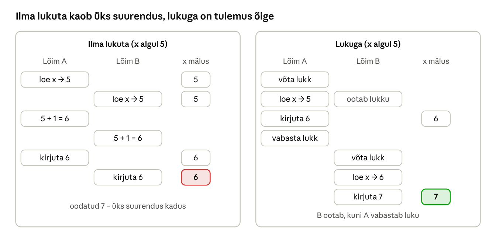

[← 7. Protsessid, lõimed ja tööd](07-protsessid-ja-loimed.md) · [Sisukord](../README.md) · [9. Protsesside planeerimine ühel protsessoril →](09-planeerimine-uhel-protsessoril.md)

## 8. Lõimede sünkroniseerimine

Kui mitu lõime kasutab samu andmeid, tuleb nende töö kooskõlastada, muidu tekivad võidujooksud (race condition) ja andmed rikutakse. Sünkroniseerimise eesmärk on tagada, et jagatud andmetega töötab korraga ainult üks lõim või et lõimed teeksid töid õiges järjekorras.

### 8.1 Koostöötavad lõimed

Lõimed teevad sageli **koostööd**: üks toodab andmeid, teine tarbib (tootja–tarbija probleem). Näiteks loeb üks lõim võrgust pakette puhvrisse ja teine töötleb neid. Tarbija peab ootama, kuni puhvris on andmeid, ja tootja peab ootama, kui puhver on täis.

### 8.2 Konkureerivad lõimed

Lõimed võivad ka **konkureerida** sama ressursi pärast (fail, mälupiirkond, printer). Klassikaline näide: kaks lõime suurendavad sama loendurit. Tehe `x = x + 1` koosneb kolmest sammust – loe, liida, kirjuta. Kui lõimed vahelduvad sammude vahel, läheb üks suurendus kaduma.



Joonis: aeg kulgeb ülalt alla. Vasakul loevad mõlemad lõimed vana väärtuse 5 ja kirjutavad 6; paremal laseb lukk lõimel B alustada alles siis, kui A on lõpetanud.

### 8.3 Kriitiline piirkond

**Kriitiline piirkond** (critical region / critical section) on koodiosa, mis kasutab jagatud ressurssi ja kus korraga tohib olla ainult üks lõim. Hea lahendus peab rahuldama nelja tingimust:

1. kaks lõime ei ole kunagi korraga kriitilises piirkonnas;
2. lahendus ei eelda midagi protsessorite arvu ega kiiruse kohta;
3. kriitilisest piirkonnast väljas olev lõim ei blokeeri teisi;
4. ükski lõim ei oota lõputult (näljutamise puudumine).

### 8.4 Vastastikune välistamine

**Vastastikune välistamine** (mutual exclusion) on põhimõte, et kui üks lõim on kriitilises piirkonnas, peavad teised ootama. Riistvara toetab seda **aatomikäskudega**: nt x86 `LOCK CMPXCHG` (võrdle ja vaheta) ning ARM64 LSE-laiendused. Nende peal on ehitatud kõik kõrgema taseme lukud.

Kaks ootamise viisi:

- **aktiivne ootamine** (busy waiting, spinlock) – lõim kontrollib tsüklis lukku; sobib väga lühikeseks ajaks ja tuumas kõrgel IRQL-il;
- **blokeeriv ootamine** – lõim pannakse ootele ja OS äratab ta, kui lukk vabaneb; ei raiska protsessoriaega.

### 8.5 Semafor

**Semafor** (semaphore, Dijkstra 1965) on loendur kahe aatomtehtega: **P/wait** (vähenda; kui väärtus on 0, oota) ja **V/signal** (suurenda, ärata ootaja). Loendav semafor sobib piiratud arvu ressursside jaoks, nt „maksimaalselt 5 samaaegset andmebaasiühendust“. Tootja–tarbija probleem lahendatakse kahe semafori (vabad kohad, täidetud kohad) ja ühe mutexiga.

### 8.6 Mutex

**Mutex** (mutual exclusion object) on semafor väärtustega 0 ja 1, millel on **omanik**: lukku saab vabastada ainult see lõim, kes selle võttis. Windowsis on mutex tuumaobjekt, mida saab kasutada ka protsesside vahel (nimega mutex). Kui omaniklõim lõpeb lukku vabastamata, saab järgmine ootaja teate `WAIT_ABANDONED`.

### 8.7 Sünkroniseerimismehhanismid Windowsis

| Mehhanism | Režiim | Kasutus |
| --- | --- | --- |
| Kriitiline sektsioon (CRITICAL\_SECTION) | kasutaja | kiire lukk ühe protsessi lõimede vahel |
| SRW-lukk (Slim Reader/Writer) | kasutaja | palju lugejaid või üks kirjutaja; väike ja kiire |
| Tingimusmuutuja (condition variable) | kasutaja | oota, kuni tingimus kehtib (koos SRW-luku või kriitilise sektsiooniga) |
| WaitOnAddress | kasutaja | oota, kuni mäluaadressi väärtus muutub (futexi sarnane) |
| Interlocked-funktsioonid | kasutaja | aatomtehted, nt `InterlockedIncrement` |
| Sündmus (event) | tuumaobjekt | üks lõim teavitab teisi |
| Mutex | tuumaobjekt | lukk ka protsesside vahel |
| Semafor | tuumaobjekt | loendav lukk |
| Ootetaimer (waitable timer) | tuumaobjekt | äratus kindlal ajal |
| Spinlukk, pushlukk, ERESOURCE | tuum | draiverite ja tuuma sisemised lukud |

Lõim ootab tuumaobjekte funktsioonidega `WaitForSingleObject` ja `WaitForMultipleObjects`. Kasutajarežiimi lukud (SRW, kriitiline sektsioon) on kiiremad, sest tavajuhul ei toimu süsteemikutset.

**Tava ja soovitus.** Uues koodis kasuta keele vahendeid: C# `lock`, `SemaphoreSlim`, `Channel<T>`, C++ `std::mutex`, `std::atomic`. Rust keelab andmevõidujooksud juba kompileerimisel.

### Näide: viimane kinopilet, parkla ja WC võti

**Võidujooks.** Kinos on vaba üks koht. Kaks kassapidajat vaatavad samal sekundil ekraanilt „vaba“, müüvad selle kumbki oma kliendile ja kirjutavad „hivatud“. Saalis on kaks inimest ühe tooli peal. Lahendus: koha kontroll ja müük peavad olema üks jagamatu samm (kriitiline piirkond lukuga) või andmebaasi tehing.

**Semafor.** Parklas on 5 kohta ja sissepääsu juures tabloo „vabu kohti: 5“. Iga sisenev auto vähendab arvu (P), iga lahkuv suurendab (V). Kui arv on 0, ootab tõkkepuu ees järjekord.

**Mutex.** Kohviku WC-l on üks võti. Võtme saab see, kes sisse läheb, ja tagastada saab ainult tema ise (omanik). Kui keegi läheb võtmega koju, jäävad teised lõputult ootama – Windowsis annab selle kohta teada `WAIT_ABANDONED`.

**Windowsis.** Kaks PowerShelli skripti kirjutavad samaaegselt samasse logifaili `Add-Content`-iga. Ilma lukuta segunevad read või tekib viga „fail on kasutusel“. Lahendus on nimega mutex: `$m = [System.Threading.Mutex]::new($false, 'Global\Logi')`, `$m.WaitOne()`, kirjutamine, `$m.ReleaseMutex()`.

### Kokkuvõte

- Võidujooks tekib, kui mitu lõime muudab jagatud andmeid kontrollimatult.
- Kriitilist piirkonda kaitstakse vastastikuse välistamisega.
- Semafor loendab, mutexil on omanik, sündmus teavitab.
- Windowsis on kiired kasutajarežiimi lukud ja tuumaobjektid, mis töötavad ka protsesside vahel.

### Kontrollküsimused

1. Mis on võidujooks? Too näide.
2. Mis vahe on koostöötavatel ja konkureerivatel lõimedel?
3. Mis on kriitiline piirkond ja millised neli tingimust peab hea lahendus täitma?
4. Mis vahe on aktiivsel ja blokeerival ootamisel? Millal on kumbki sobiv?
5. Kuidas töötab semafor?
6. Mille poolest erineb mutex semaforist?
7. Nimeta neli Windowsi sünkroniseerimismehhanismi ja nende kasutusala.

### Valikküsimused

1. Mis on mutexi eriomadus semafori ees? a) loendab mitu ressurssi b) tal on omanik c) ei vaja tuuma d) töötab ainult ühes lõimes
2. Milline mehhanism sobib „palju lugejaid, üks kirjutaja“ olukorraks? a) postkastipesa b) SRW-lukk c) ootetaimer d) sündmus
3. Mis põhjustab kaotatud suurenduse `x = x + 1` puhul? a) liiga väike mälu b) tehte mitteaatomilisus c) vale prioriteet d) leheviga

### Praktiline ülesanne

Käivita PowerShell 7-s võidujooksu demo. Esimene variant kaotab suurendusi, teine mitte:

```powershell
# Ilma lukuta
$c = [ref]0
1..8 | ForEach-Object -Parallel {
  $r = $using:c
  1..10000 | ForEach-Object { $r.Value++ }
} -ThrottleLimit 8
"Ilma lukuta: $($c.Value) (oodatud 80000)"

# Lukuga (Monitor = kriitiline sektsioon)
$d = [ref]0
$lukk = [object]::new()
1..8 | ForEach-Object -Parallel {
  $r = $using:d; $l = $using:lukk
  1..10000 | ForEach-Object {
    [System.Threading.Monitor]::Enter($l)
    try { $r.Value++ } finally { [System.Threading.Monitor]::Exit($l) }
  }
} -ThrottleLimit 8
"Lukuga: $($d.Value)"
```

Selgita, miks tulemused erinevad.

### Iseseisvad ülesanded

**1. Tootja ja tarbija.** Kirjuta PowerShell 7-s või C#-s programm, kus üks lõim paneb järjekorda arvud 1–20 ja teine võtab need sealt ning kirjutab ekraanile. Kasuta `System.Collections.Concurrent.BlockingCollection` (PowerShellis `[System.Collections.Concurrent.BlockingCollection[int]]::new(5)`), mille maksimaalne suurus on 5. **Esita:** kood, väljund ja selgitus, mis juhtub, kui järjekord on täis või tühi – millise ptk 8 mehhanismi see asendab?

**2. Sünkroniseerimine igapäevaelus.** Leia oma elust kolm olukorda, mis vastavad mutexile, semaforile ja sündmusele (event), nt ühine köök, parkla, kooli kell. **Esita:** tabel „olukord – mehhanism – mis juhtuks ilma selleta“.

### Viited

- Krogh (2017), ptk 8.
- Tanenbaum, Bos (2022), *Modern Operating Systems*, ptk 2.3.
- Microsoft Learn: [Synchronization](https://learn.microsoft.com/windows/win32/sync/synchronization).

> 📝 **Test:** selle peatüki Google Formsi test luuakse skriptiga [`google-forms/looVormid.gs`](../google-forms/looVormid.gs).

---

[← 7. Protsessid, lõimed ja tööd](07-protsessid-ja-loimed.md) · [Sisukord](../README.md) · [9. Protsesside planeerimine ühel protsessoril →](09-planeerimine-uhel-protsessoril.md)
