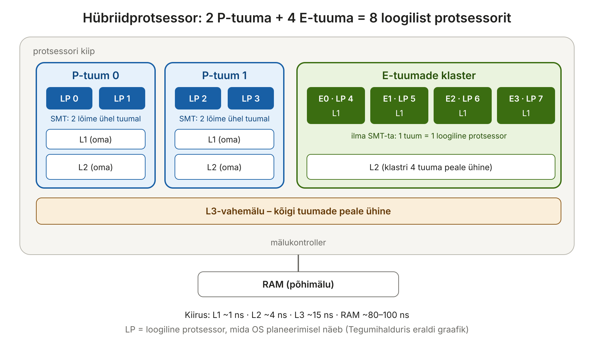
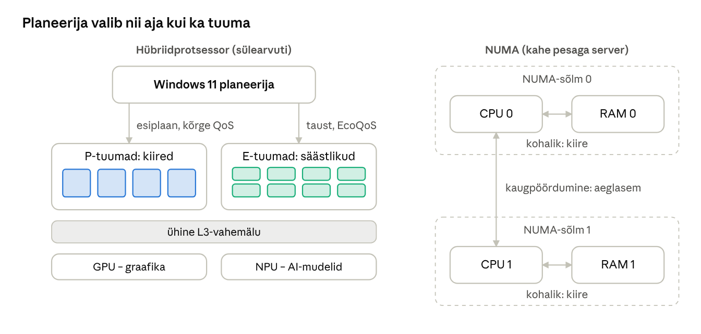

[← 9. Protsesside planeerimine ühel protsessoril](09-planeerimine-uhel-protsessoril.md) · [Sisukord](../README.md) · [11. Ummikud →](11-ummikud.md)

## 10. Planeerimine mitmel protsessoril

Peatükis 9 oli meil üks protsessor ja planeerija pidi otsustama ainult, **millal** milline lõim töötab. Peaaegu iga tänapäeva arvuti on aga mitmeprotsessoriline: telefonis on 6–8 tuuma, sülearvutis 8–24 ja serveris sadu loogilisi protsessoreid. Nüüd peab planeerija otsustama ka:

- **millisel tuumal** lõim töötab;
- hübriidprotsessoris ka seda, **millist tüüpi** tuumal (kiire või säästlik);
- serveris ka seda, **millise mälu lähedal** lõim töötab (NUMA).

Valel tuumal töötav lõim ei tee midagi valesti, kuid töötab aeglasemalt või kulutab rohkem voolu. Seepärast on mitme protsessori planeerimine eelkõige **jõudluse ja energia** küsimus.

> 🖱️ **Proovi ise:** [interaktiivne õpileht](https://valdonolvak.github.io/Operatsioonis-steemi-ja-k-berturbe-alused/interaktiivne/10-mitu-protsessorit.html). Lehel on Amdahli seaduse kalkulaator, afiinsuse simulaator, P- ja E-tuumade valik, NUMA-kalkulaator virtuaalmasinatele ja vale jagamise demo.

### 10.1 Mitmetuumalised protsessorid

**Mitmetuumaline protsessor** (multi-core) sisaldab ühes kiibis mitut täisväärtuslikku tuuma. Igal tuumal on oma kiire vahemälu ja kõik tuumad jagavad suuremat ühist vahemälu:

| Tase | Kellele | Suurus (ligikaudu) | Kiirus (ligikaudu) |
| --- | --- | --- | --- |
| L1 | igal tuumal oma | 32–64 KB | ~1 ns |
| L2 | igal tuumal oma (vahel tuumade rühmal ühine) | 1–3 MB | ~4 ns |
| L3 | kõigil tuumadel ühine | 8–64 MB | ~15 ns |
| RAM | kõigil ühine | 8–512 GB | ~80–100 ns |

Kui lõime andmed on juba tuuma L1- või L2-vahemälus, töötab ta mitu korda kiiremini, kui siis, kui andmeid tuleb tuua põhimälust. See on oluline põhjus, miks planeerija püüab lõime hoida samal tuumal (afiinsus, ptk 10.5).

**Samaaegne mitmelõimelisus** (SMT, Inteli nimetusega Hyper-Threading) laseb ühel füüsilisel tuumal täita kaht lõime korraga. Tuumas on palju täitmisüksusi (liitmine, korrutamine, mälu lugemine) ja üks lõim ei kasuta neid kunagi kõiki korraga. Teine lõim saab kasutada vabu üksusi. OS näeb ühte SMT-ga tuuma **kahe loogilise protsessorina**.

**Näide.** Protsessoril on 8 füüsilist tuuma ja SMT, seega näitab Tegumihaldur 16 loogilist protsessorit. Kaks lõime samal füüsilisel tuumal ei tööta aga kaks korda kiiremini kui üks. Tavaliselt saab SMT-st 10–30% lisa. Seepärast eelistab planeerija panna kaks rasket lõime **eri füüsilistele tuumadele**, mitte sama tuuma kahele loogilisele protsessorile.

**Hübriidprotsessorid.** Alates Intel 12. põlvkonnast (2021) ja ARM-i big.LITTLE / DynamIQ lahendustes on kiibis kahte tüüpi tuumi:

- **P-tuumad** (performance) – suured, kiired ja voolunõudlikud. Sobivad mängudele, kompileerimisele ja aktiivsele aknale;
- **E-tuumad** (efficiency) – väikesed ja säästlikud. Sobivad taustatööks: sünkroonimine, indekseerimine, uuendused.

Paljudes protsessorites on ainult P-tuumadel SMT ja E-tuumadel mitte. Uuemates mudelites on SMT ka P-tuumadelt ära jäetud, et säästa voolu.



Joonis: igal P-tuumal on oma L1 ja L2, E-tuumade klaster jagab ühist L2-te ja kõik tuumad jagavad L3-e. SMT-ga P-tuum paistab OS-ile kahe loogilise protsessorina, nii et 6 tuumast saab 8 loogilist protsessorit.

Lisaks võib kiibis olla GPU ja NPU, mida OS haldab eraldi planeerijatega (GPU-planeerimine WDDM-is, NPU MCDM-draiveri kaudu).

### 10.2 Mitme protsessori organiseerimine

| Mudel | Kirjeldus | Näide |
| --- | --- | --- |
| Asümmeetriline (AMP) | üks protsessor juhib, teised täidavad talle antud töid | vanad mitmeprotsessorilised süsteemid; tänapäeval nt nutikella eraldi säästuprotsessor |
| Sümmeetriline (SMP) | kõik protsessorid on võrdsed ja täidavad nii OS-i kui ka rakenduste koodi | iga tänapäeva Windowsi, Linuxi ja macOS-i arvuti |
| NUMA | protsessorid on sõlmedes; oma sõlme mälu on kiirem kui teise sõlme oma | kahe- või neljapesaline server |
| Klaster | mitu arvutit võrgu kaudu, igal oma OS | Hyper-V failover-klaster, superarvuti |

**NUMA** (Non-Uniform Memory Access) on tavaline serverites. Kahepesalises serveris on igal protsessoril oma mälukanalid ja oma mälu. Protsessor saab lugeda ka teise protsessori mälu, kuid see käib kahe protsessori vahelise ühenduse kaudu ja on umbes poolteist kuni kaks korda aeglasem.

**Näide.** Lõim töötab sõlme 0 protsessoril, kuid tema andmed on sõlme 1 mälus. Iga mälupöördumine võtab ~150 ns asemel ~90 ns. Andmebaas, mis teeb sekundis miljoneid pöördumisi, on märgatavalt aeglasem. Windows ja Hyper-V püüavad hoida lõime ja tema mälu **samas sõlmes**.



Joonis: sülearvutis valib planeerija tuuma tüübi (P või E), serveris NUMA-sõlme – lõim ja tema mälu peaksid asuma samas sõlmes.

### 10.3 Sümmeetriline multitöötlus

Windows on SMP-süsteem: tuum, draiverid ja rakendused võivad töötada igal protsessoril. Sellel on kaks tagajärge.

**1. Kõik jagatud tuumaandmed peavad olema lukkudega kaitstud.** Kaks tuuma võivad korraga täita sama tuumakoodi, näiteks lisada lõime samasse järjekorda.

**2. Vahemälud peavad olema koherentsed.** Igal tuumal on oma L1 ja L2. Kui tuum 0 muudab muutujat `x` oma vahemälus, peab tuum 1 seda teada saama, muidu loeb ta oma vahemälust vana väärtuse. Riistvara protokoll (nt **MESI**) jälgib iga vahemälurea olekut:

| Olek | Tähendus |
| --- | --- |
| **M**odified | rida on muudetud ainult selle tuuma vahemälus |
| **E**xclusive | rida on ainult selles vahemälus, muutmata |
| **S**hared | rida on mitme tuuma vahemälus, kõik loevad |
| **I**nvalid | rida on aegunud, tuleb uuesti tuua |

Kui tuum 0 kirjutab rea, mis on olekus *Shared*, märgitakse see teistes tuumades *Invalid* olekusse. Järgmisel lugemisel peavad nad selle uuesti tooma. See kõik toimub riistvaras ja programmeerija seda ei näe, kuid see maksab aega (ptk 10.4).

**Protsessorirühmad.** Windows toetab kuni 64 loogilist protsessorit ühe **protsessorirühma** (processor group) kohta ja mitut rühma ühes süsteemis. 128 loogilise protsessoriga serveris on kaks rühma. Vanemad rakendused, mis ei tea rühmadest, kasutavad ainult ühe rühma protsessoreid. Windows 11 ja Windows Server 2022 jagavad protsessi lõimi rühmade vahel vaikimisi automaatselt.

### 10.4 Mitu protsessorit ja sünkroniseerimine

Ühe protsessori süsteemis piisab kriitilise piirkonna kaitseks katkestuste keelamisest: kui katkestusi ei tule, ei saa planeerija ka lõime vahetada. **Mitme protsessori puhul see ei aita**, sest katkestuste keelamine kehtib ainult oma tuumale. Teine tuum töötab edasi ja võib samal ajal samu andmeid muuta.

Seetõttu kasutab tuum **spinlukke** (ptk 8.4): protsessor ootab aktiivselt tsüklis, kuni lukk vabaneb. Spinlukk on mõistlik, sest teine tuum vabastab luku tavaliselt mõne mikrosekundi jooksul. Ootele minek ja ärkamine võtaks kauem aega.

**Järjekorraga spinlukk** (queued spinlock). Kui 16 tuuma ootavad sama lukku ja kõik loevad tsüklis sama mäluaadressi, põrkab see vahemälurida tuumade vahel ja ühendussiin on ummistunud. Järjekorraga spinlukus ootab iga tuum **oma** muutujal ja eelmine omanik annab luku edasi järgmisele järjekorras. Windows kasutab seda tuumas laialt.

**Reeglid:** spinlukku tohib hoida väga lühikest aega ja luku all ei tohi lõim magama jääda. Kui lõim jääks spinlukku hoides ootele, keerleksid teised tuumad tühja.

**Vale jagamine** (false sharing). Vahemälu ei liiguta üksikuid baite, vaid 64-baidiseid **vahemäluridu**. Kui kaks tuuma muudavad **eri muutujaid**, mis juhtuvad asuma samal real, märgib MESI rea pärast iga kirjutust teises tuumas kehtetuks. Rida „põrkab“ tuumade vahel, kuigi lõimed ei jaga ühtegi andmeühikut.

**Näide.** Programm loeb kaheksas lõimes sõnu ja iga lõim suurendab oma loendurit massiivis `loendur[0..7]`. Kaheksa 8-baidist loendurit mahuvad täpselt ühte 64-baidisesse ritta. Kuigi lõimed ei jaga andmeid, töötab programm 8 tuumaga vaid veidi kiiremini kui ühega. Lahendus on **joondamine**: iga loendur pannakse eraldi vahemäluritta (C++-s `alignas(64)`, C#-s `[StructLayout]` või lihtsalt täitebaidid vahele). Pärast seda kasvab kiirus peaaegu lineaarselt.

> 🖱️ **Proovi ise:** [vale jagamise demo](https://valdonolvak.github.io/Operatsioonis-steemi-ja-k-berturbe-alused/interaktiivne/10-mitu-protsessorit.html#vale)

### 10.5 Planeerimine mitmel protsessoril

Planeerimise strateegiad:

| Strateegia | Kuidas | Pluss | Miinus |
| --- | --- | --- | --- |
| **Ühine järjekord** | kõik tuumad võtavad töö ühest järjekorrast | lihtne, koormus jaguneb ühtlaselt | järjekorra lukk muutub kitsaskohaks, lõimed hüppavad tuumade vahel |
| **Tuumapõhised järjekorrad** | igal tuumal oma järjekord | lukk pole kitsaskoht, lõim jääb samale tuumale | üks tuum võib olla ülekoormatud, teine jõude |
| **Koormuse tasakaalustamine** | jõudeolev tuum „varastab“ töö ülekoormatud tuumalt (work stealing) | ühendab mõlema eelised | lõim vahel siiski liigub |
| **Afiinsus** (affinity) | lõime hoitakse samal tuumal | vahemälu sisu jääb kasutatavaks | võib oodata, kuigi mõni teine tuum on vaba |
| **Rühmaplaneerimine** (gang scheduling) | koostöötavad lõimed käivitatakse korraga eri tuumadel | lõimed ei pea üksteist ootama | raske korraldada |

**Näide: afiinsus.** Lõim on töötanud tuumal 2 ja tema andmed on tuuma 2 L2-vahemälus. Ta läheb hetkeks ootele (loeb faili) ja ärkab. Tuum 2 on hõivatud, tuum 5 on vaba. Mis on parem: oodata mõni mikrosekund tuuma 2 järel või minna kohe tuumale 5 ja laadida andmed uuesti mälust? Sellele pole üht õiget vastust. Windows eelistab lõime **ideaalset** või **viimati kasutatud** protsessorit, kuid võtab vaba tuuma, kui eelistatu on hõivatud.

**Rühmaplaneerimine virtualiseerimises.** Virtuaalmasinal on 4 vCPU-d ja selle külalis-OS hoiab spinlukku vCPU 1 peal, mida vCPU 2 ootab. Kui hüperviisor peatab vCPU 1, kuid laseb vCPU 2-l töötada, keerleb vCPU 2 tühja. Seepärast püüavad hüperviisorid (VMware, Hyper-V) VM-i vCPU-sid käivitada võimalikult koos.

#### Miks 8 tuuma ei ole 8 korda kiirem: Amdahli seadus

Peaaegu igas programmis on osa, mida ei saa paralleelseks teha: algandmete lugemine, tulemuste kokkupanek, lukud. **Amdahli seadus** ütleb, et kui programmist osa *p* saab paralleelseks teha, on suurim kiirenemine *n* tuumaga:

```
kiirenemine = 1 / ((1 − p) + p / n)
```

**Näide.** Video kodeerimisest saab 90% teha paralleelselt (*p* = 0,9):

| Tuumi | Kiirenemine |
| --- | --- |
| 1 | 1,0× |
| 2 | 1,8× |
| 4 | 3,1× |
| 8 | 4,7× |
| 16 | 6,4× |
| lõpmata palju | 10× |

Isegi lõpmatu tuumade arvuga ei saa programm kiiremaks kui 10 korda, sest 10% tööst tehakse ikkagi ühel tuumal. Lisaks lisavad päris arvutis aeglust E-tuumad, ühine mälu ja lukud. Seepärast on iseseisva ülesande 1 tulemused kaugel lineaarsest.

> 🖱️ **Proovi ise:** [Amdahli seaduse kalkulaator](https://valdonolvak.github.io/Operatsioonis-steemi-ja-k-berturbe-alused/interaktiivne/10-mitu-protsessorit.html#amdahl) ja [afiinsuse simulaator](https://valdonolvak.github.io/Operatsioonis-steemi-ja-k-berturbe-alused/interaktiivne/10-mitu-protsessorit.html#afiinsus)

### 10.6 Mitmetöötlus Windowsis

- **Valmisolekujärjekorrad.** Windows hoiab protsessoritel oma valmisolekujärjekorrad (32 prioriteedi kaupa), nii et planeerimine ei vaja ühte globaalset lukku.
- **Ideaalne protsessor ja afiinsusmask.** Igal lõimel on **ideaalne protsessor** (eelistatud tuum, mille Windows annab lõime loomisel ringiratast, et lõimed jaguneksid ühtlaselt) ja **afiinsusmask** (lubatud protsessorid). Mask on bitimask: väärtus `1` tähendab ainult protsessorit 0, `3` protsessoreid 0 ja 1, `15` protsessoreid 0–3.
- **Tuuma valik.** Valmis lõime jaoks otsitakse esmalt vaba protsessorit, eelistatult ideaalset või viimati kasutatud. Kui vaba pole, võib lõim tõrjuda madalama prioriteediga lõime mõnel lubatud protsessoril.
- **Tuumade parkimine** (core parking) lülitab vähese koormusega tuumad süvaunne, et säästa energiat. Kui koormus kasvab, äratatakse need.
- **Hübriidplaneerimine.** Windows 11 kasutab protsessori vihjeid (Intel Thread Director, AMD ja Qualcommi vastavad mehhanismid) ning lõime QoS-taset (ptk 9.9). Esiplaani ja kõrge QoS-iga lõimed lähevad P-tuumadele, taustatöö ja EcoQoS E-tuumadele. Thread Director jälgib riistvaras, milliseid käske lõim täidab, ja annab OS-ile soovituse. Windows 10 hübriidprotsessoritega nii hästi ei toime.
- **CPU Sets** on API, millega rakendus (nt mäng) saab tuumi reserveerida, et taustatöö neid ei segaks.

**Millal afiinsust käsitsi muuta?** Peaaegu mitte kunagi. Windowsi planeerija teab tuumade koormust, temperatuuri ja tüüpi paremini kui inimene. Käsitsi afiinsus on mõistlik ainult erijuhtudel: vana tarkvara, mis ei tööta mitme tuumaga, litsents, mis on seotud tuumade arvuga, või katse, nagu ptk 9 iseseisvas ülesandes.

### Näide: videokõne akutoitel ja suur virtuaalmasin

**Sülearvuti.** Õpetaja peab akutoitel Teamsi tundi ja OneDrive sünkroonib taustal faile. Teamsi videotöötlus on esiplaanil ja kõrge QoS-iga – see läheb P-tuumadele, tausta hägustamine (Studio Effects) kasutab NPU-d. OneDrive’i sünkroonimine saab EcoQoS-i ja töötab E-tuumadel madala sagedusega. Pilt ei hangu ja aku kestab kauem kui siis, kui kõik töötab P-tuumadel.

**Server (VMware või Hyper-V).** Hostil on kaks 16-tuumalist protsessorit (kaks NUMA-sõlme, kummalgi 256 GB RAM-i). Administraator loob SQL Serveri VM-i 24 vCPU ja 384 GB mäluga – see ei mahu ühte sõlme.

- Hüperviisor jagab VM-i kahe sõlme vahel ja esitab külalisele **virtuaalse NUMA** (vNUMA) topoloogia.
- Kui SQL Server teab topoloogiat, hoiab ta lõimed ja puhvrid samas sõlmes.
- Kui vNUMA on vale (nt käsitsi valesti seatud „cores per socket“), teevad paljud päringud kaugpöördumisi ja jõudlus langeb märgatavalt.

**Rusikareegel:** võimaluse korral tee VM, mis mahub ühte NUMA-sõlme. Selles näites oleks hea valik näiteks 16 vCPU ja 192 GB: VM mahub tervenisti ühte sõlme ja hostile jääb ruumi.

> 🖱️ **Proovi ise:** [kas VM mahub ühte NUMA-sõlme?](https://valdonolvak.github.io/Operatsioonis-steemi-ja-k-berturbe-alused/interaktiivne/10-mitu-protsessorit.html#numa) ja [P- või E-tuum?](https://valdonolvak.github.io/Operatsioonis-steemi-ja-k-berturbe-alused/interaktiivne/10-mitu-protsessorit.html#hybriid)

### Kokkuvõte

- Mitmetuumalisus, SMT ja hübriidtuumad muudavad planeerimise ruumiliseks probleemiks: oluline pole ainult *millal*, vaid ka *kus*.
- SMT annab ühele füüsilisele tuumale kaks loogilist protsessorit, kuid mitte kahekordset kiirust.
- SMP nõuab koherentseid vahemälusid (MESI) ja lukke, eriti spinlukke; katkestuste keelamisest ei piisa.
- Vale jagamine aeglustab programmi, kui eri lõimede muutujad on samal vahemälureal.
- Afiinsus hoiab vahemälu sooja; koormuse tasakaalustamine hoiab tuumad hõivatud.
- Amdahli seaduse tõttu ei kasva kiirus tuumade arvuga lineaarselt.
- NUMA-s tuleb hoida lõim ja tema mälu samas sõlmes; VM-id peaksid mahtuma ühte sõlme.
- Windows 11 planeerija arvestab tuuma tüüpi ja lõime QoS-taset.

### Kontrollküsimused

> 🧪 **Interaktiivne test:** [kontrolli oma teadmisi](https://valdonolvak.github.io/Operatsioonis-steemi-ja-k-berturbe-alused/interaktiivne/10-test.html). Test koosneb 25 valikvastusega küsimusest. Iga vastuse järel näed selgitust ning lõpus saad valesti vastatud küsimusi korrata.

1. Mis vahe on mitmetuumalisusel ja SMT-l? Miks ei ole SMT-ga tuum kaks korda kiirem?
2. Miks on oluline, et lõime andmed oleksid tuuma L1- või L2-vahemälus?
3. Mis on hübriidprotsessor ja kuidas OS selle tuumi kasutab?
4. Mis vahe on AMP-l ja SMP-l?
5. Mis on NUMA ja miks see planeerimist mõjutab?
6. Mis on vahemälu koherentsus ja mida teeb MESI-protokoll?
7. Miks ei piisa mitmeprotsessorilises süsteemis katkestuste keelamisest?
8. Mis on spinlukk ja järjekorraga spinlukk? Millal neid kasutatakse?
9. Mis on vale jagamine ja kuidas seda vältida?
10. Mis on afiinsus ja ideaalne protsessor? Mida tähendab afiinsusmask 3?
11. Selgita Amdahli seadust. Kui palju kiireneb programm, millest 50% saab paralleelseks teha, 4 tuumaga?
12. Mis on protsessorirühm Windowsis?

### Valikküsimused

1. Mitu loogilist protsessorit mahub ühte Windowsi protsessorirühma? a) 16 b) 32 c) 64 d) 128
2. Millisele tuumale eelistab Windows 11 suunata EcoQoS-lõime? a) P-tuumale b) E-tuumale c) GPU-le d) NPU-le
3. Mis on „vale jagamine“? a) kaks protsessi jagavad sama faili b) eri muutujad samal vahemälureal põhjustavad liigset liiklust c) kasutaja jagab parooli d) lõim kasutab vale lukku
4. Kui suur on tavaline vahemälurida? a) 8 baiti b) 64 baiti c) 4 KB d) 1 MB

### Praktiline ülesanne

```powershell
Get-CimInstance Win32_Processor | Select-Object Name, NumberOfCores, NumberOfLogicalProcessors
(Get-CimInstance Win32_ComputerSystem).NumberOfLogicalProcessors
Start-Process notepad; $p = Get-Process notepad | Select-Object -First 1
$p.ProcessorAffinity
$p.ProcessorAffinity = 1   # ainult protsessor 0
```

> 🖱️ **Proovi ise:** [afiinsusmaski kalkulaator](https://valdonolvak.github.io/Operatsioonis-steemi-ja-k-berturbe-alused/interaktiivne/10-mitu-protsessorit.html#mask). Märgi lubatud protsessorid ja vaata, mis arv tuleb `ProcessorAffinity` väärtuseks kirjutada.

Ava Tegumihaldur → Jõudlus → CPU, paremklõps graafikul → „Muuda graafiku tüüpi: loogilised protsessorid“. Käivita PowerShellis koormus `1..4 | ForEach-Object -Parallel { while($true){} }` ja vaata, millised tuumad koormuse saavad. Lõpeta koormus Ctrl+C-ga. Hübriidprotsessoriga arvutis võrdle esiplaanil ja minimeeritud aknas käivitatud koormust.

Kas `NumberOfLogicalProcessors` on `NumberOfCores`-ist kaks korda suurem? Kui jah, on protsessoril kõigil tuumadel SMT. Kui see on suurem, kuid mitte kaks korda, on tegu hübriidprotsessoriga, kus SMT on ainult P-tuumadel.

### Iseseisvad ülesanded

**1. Paralleelsuse kasu mõõtmine.** Mõõda PowerShell 7-s, kui kaua võtab 8 suure arvutuse tegemine järjest ja paralleelselt: `Measure-Command { 1..8 | ForEach-Object { 1..3000000 | Measure-Object -Sum } }` vs `… ForEach-Object -Parallel { … } -ThrottleLimit 8`. Korda paralleelset varianti `-ThrottleLimit` väärtustega 1, 2, 4 ja 8. **Esita:** tabel ajakulu kohta ja vastus: miks kiirenemine ei ole lineaarne (vihje: Amdahli seadus, tuumade arv, E-tuumad, ühine mälu)?

**2. Serveri topoloogia.** Uuri ühe serveri (oma töökoha, kooli labori või tootja kodulehe näite) protsessorite ja mälu ülesehitust: pesade arv, tuumade arv pesa kohta, NUMA-sõlmed (Windowsis `Get-CimInstance Win32_Processor`, Sysinternalsi `Coreinfo`). **Esita:** skeem ja soovitus, kui suure (vCPU, RAM) VM-i võiks sellele luua, et see mahuks ühte NUMA-sõlme.

### Viited

- Krogh (2017), ptk 10.
- Yosifovich jt, *Windows Internals* 7. tr, 1. osa, ptk 4 (Multiprocessor systems).
- Microsoft Learn: [Processor Groups](https://learn.microsoft.com/windows/win32/procthread/processor-groups); [Multiple Processors](https://learn.microsoft.com/windows/win32/procthread/multiple-processors); [CPU Sets](https://learn.microsoft.com/windows/win32/procthread/cpu-sets).
- Sysinternals: [Coreinfo](https://learn.microsoft.com/sysinternals/downloads/coreinfo).

> 📝 **Test:** selle peatüki Google Formsi test luuakse skriptiga [`google-forms/looVormid.gs`](../google-forms/looVormid.gs).

---

[← 9. Protsesside planeerimine ühel protsessoril](09-planeerimine-uhel-protsessoril.md) · [Sisukord](../README.md) · [11. Ummikud →](11-ummikud.md)
