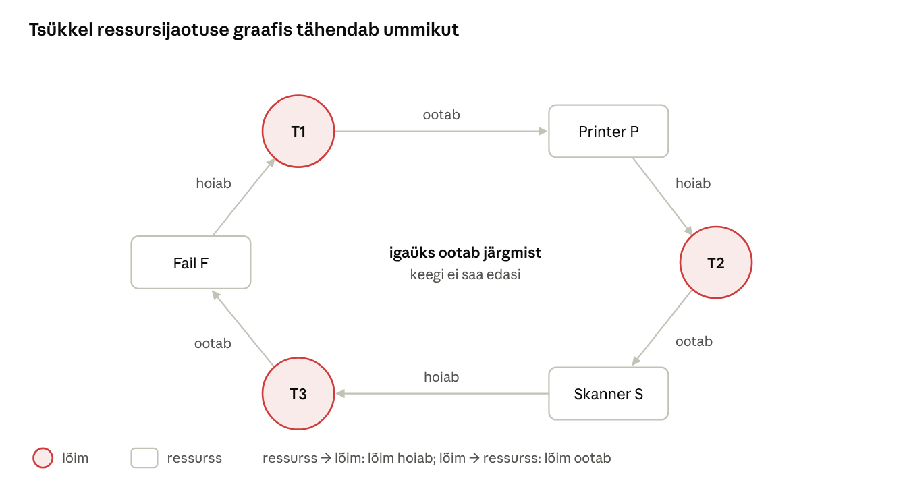
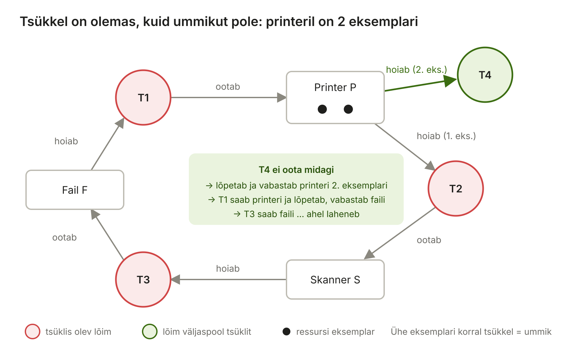

[← 10. Planeerimine mitmel protsessoril](10-planeerimine-mitmel-protsessoril.md) · [Sisukord](../README.md) · [12. Mäluhaldus →](12-maluhaldus.md)

## 11. Ummikud

**Ummik** (deadlock) on olukord, kus kaks või enam lõime ootavad üksteise käes olevaid ressursse ja ükski ei saa edasi minna. Ummik ei lahene iseenesest. Tavaliselt tuleb üks osaline lõpetada või tema ressurss jõuga vabastada.

Ummik on salakaval viga, sest see ei teki iga kord. Programm võib töötada testides tuhat korda korrektselt ja jääda kinni alles siis, kui kaks lõime satuvad õigel hetkel kokku – sageli suure koormuse all tootmisserveris. Kasutaja näeb vaid, et rakendus „ei vasta“ või päring „jääb rippuma“. Protsessor seejuures ei tööta: ummikus lõimed on ooteolekus ja ei kasuta protsessoriaega.

> 🖱️ **Proovi ise:** [interaktiivne õpileht](https://valdonolvak.github.io/Operatsioonis-steemi-ja-k-berturbe-alused/interaktiivne/11-ummikud.html). Lehel on söövate filosoofide simulaator, ressursijaotuse graafi analüsaator, pankuri algoritm, Coffmani tingimuste harjutus ja ummiku, elavluku ja näljutamise eristamine.

### 11.1 Ummikute näited

**Kaks lukku vastupidises järjekorras.** See on kõige levinum ummik programmides:

```csharp
// Lõim A: kannab raha kontolt 1 kontole 2
lock (konto1) {            // võtab luku L1
    Thread.Sleep(100);
    lock (konto2) { ... }  // ootab L2
}
// Lõim B: kannab raha kontolt 2 kontole 1
lock (konto2) {            // võtab luku L2
    Thread.Sleep(100);
    lock (konto1) { ... }  // ootab L1
}
```

Ajas juhtub järgmine:

| Aeg | Lõim A | Lõim B |
| --- | --- | --- |
| 1 | võtab `konto1` luku ✔ | võtab `konto2` luku ✔ |
| 2 | ootab `konto2` lukku … | ootab `konto1` lukku … |
| 3 | ootab igavesti | ootab igavesti |

Kui lõim B oleks alustanud hetk hiljem, oleks A jõudnud mõlemad lukud võtta ja ummikut poleks tekkinud. Seepärast on ummikud ajastusest sõltuvad ja raskesti korratavad.

**Andmebaas.** Tehing 1 lukustab rea X ja tahab rida Y, tehing 2 vastupidi. SQL Server tuvastab selle ja katkestab ühe tehingu (*deadlock victim*).

**Kasutajaliides.** Taustalõim ootab, et UI-lõim midagi teeks (nt uuendaks akent), UI-lõim aga ootab sünkroonselt taustalõime lõppu. Aken ei joonista end enam ümber ja Windows kirjutab tiitliribale „Ei vasta“. Tuntud näide on .NET-is `async`-meetodi tulemuse sünkroonne ootamine UI-lõimes (`.Result` või `.Wait()`): UI-lõim jääb ootama, kuid ülesande jätk tahab samuti UI-lõimes töötada.

**Söövad filosoofid** (Dijkstra, 1965). Viis filosoofi istub ümmarguse laua taga, igaühe vahel on üks kahvel. Söömiseks on vaja kahte kahvlit: vasakut ja paremat. Kui kõik võtavad korraga vasaku kahvli ja ootavad paremat, on igaühel üks kahvel ja keegi ei saa süüa. See on klassikaline ummiku mudel, kus ressursse (kahvleid) jagavad naabrid.

**Igapäevaelu.** Neljaviisilisel ristmikul ilma valgusfoorita on igast suunast üks auto ja kõik annavad teed paremalt tulijale. Või kaks ametiasutust, millest kumbki ootab enne oma otsust teise kinnitust.

**Sarnased probleemid** – need ei ole ummikud, kuid tulemus on sarnane: töö ei liigu.

| Probleem | Mis toimub | Näide |
| --- | --- | --- |
| **Ummik** (deadlock) | lõimed ootavad üksteist ega tee midagi | kaks lukku vastupidises järjekorras |
| **Elavlukk** (livelock) | lõimed on aktiivsed, reageerivad üksteisele, kuid ei jõua edasi | kaks inimest koridoris astuvad korraga samale poole, siis jälle korraga teisele poole |
| **Näljutamine** (starvation) | üks lõim ei saa kunagi ressurssi, sest teised on alati eespool, kuigi süsteem tervikuna töötab | madala prioriteediga lõim ei saa protsessorit |
| **Prioriteedi inversioon** | kõrge prioriteediga lõim ootab lukku, mida hoiab madala prioriteediga lõim, keda takistab keskmise prioriteediga lõim | Mars Pathfinder (ptk 9.8) |

Elavlukk tekib sageli ummiku „parandamisel“: kui lõim ei saa teist lukku, vabastab ta esimese ja proovib kohe uuesti. Kui kaks lõime teevad seda täpselt samas rütmis, ei saa kumbki kunagi mõlemat lukku. Lahendus on oodata enne uut katset **juhuslik aeg** (nagu Etherneti kokkupõrgete puhul). Windows leevendab näljutamist ja prioriteedi inversiooni sellega, et kaua oodanud valmis lõimed saavad ajutise prioriteeditõusu (ptk 9.7).

> 🖱️ **Proovi ise:** [söövate filosoofide simulaator](https://valdonolvak.github.io/Operatsioonis-steemi-ja-k-berturbe-alused/interaktiivne/11-ummikud.html#filosoofid) ja [ummik, elavlukk või näljutamine?](https://valdonolvak.github.io/Operatsioonis-steemi-ja-k-berturbe-alused/interaktiivne/11-ummikud.html#liigid)

### 11.2 Ummiku tekkimise tingimused

Coffmani järgi (1971) tekib ummik ainult siis, kui kehtivad **kõik neli** tingimust korraga:

| Tingimus | Tähendus | Kahe luku näites | Ristmikul |
| --- | --- | --- | --- |
| 1. **Vastastikune välistamine** | ressurssi saab korraga kasutada üks lõim | lukku saab hoida üks lõim | ristmiku ruudul saab olla üks auto |
| 2. **Hoia ja oota** | lõim hoiab ressurssi ja ootab samal ajal teist | A hoiab L1 ja ootab L2 | auto seisab oma kohal ja ootab |
| 3. **Eelistamise puudumine** | ressurssi ei saa lõimelt jõuga ära võtta | lukku ei saa A-lt ära võtta | autot ei tõsteta eest ära |
| 4. **Tsükliline ootamine** | lõimed moodustavad ahela, kus igaüks ootab järgmise ressurssi | A ootab B-d, B ootab A-d | iga auto ootab paremal olevat |

Tingimused on vajalikud: kui **ükski** neist ei kehti, ei saa ummikut tekkida. Kõik ummikute ennetamise võtted põhinevad sellel, et üks tingimus muudetakse võimatuks (ptk 11.3).

**Ressursijaotuse graaf.** Olukorda saab kujutada graafina:

- **ring** on lõim, **ristkülik** on ressurss, täpid ristküliku sees on ressursi **eksemplarid** (nt 2 printerit);
- nool **ressursilt lõimele** tähendab „lõim *hoiab* ressurssi“;
- nool **lõimelt ressursile** tähendab „lõim *ootab* ressurssi“.

Kui igal ressursil on üks eksemplar, tähendab **tsükkel graafis alati ummikut**.



Joonis: T1 ootab printerit, mida hoiab T2; T2 ootab skannerit, mida hoiab T3; T3 ootab faili, mida hoiab T1. Tsükli saab murda, kui kõik võtavad ressursid samas järjekorras.

Kui ressursil on **mitu eksemplari**, ei pruugi tsükkel tähendada ummikut. Kontrollimiseks tuleb graafi „taandada“: leia lõim, kelle soov saab praegu täidetud. Eelda, et see lõim lõpetab ja vabastab kõik oma ressursid. Korda seda. Kui kõik lõimed saavad lõpetada, ummikut pole. Lõimed, mis jäävad lõpuks järele, on ummikus.



Joonis: tsükkel T1 → P → T2 → S → T3 → F → T1 on olemas, kuid printeri teist eksemplari hoiab T4, kes ei oota midagi. T4 lõpetab, T1 saab printeri ja ahel laheneb.

> 🖱️ **Proovi ise:** [ressursijaotuse graafi analüsaator](https://valdonolvak.github.io/Operatsioonis-steemi-ja-k-berturbe-alused/interaktiivne/11-ummikud.html#graaf). Muuda, kes mida hoiab ja ootab, ning vaata, kas tekib ummik.

### 11.3 Kuidas OS ummikuid käsitleb

| Strateegia | Sisu | Kus kasutatakse |
| --- | --- | --- |
| **Ignoreerimine** („jaanalinnu algoritm“) | eeldatakse, et ummikud on harvad; lahendab kasutaja või arendaja | Windows, Linux üldiselt |
| **Tuvastamine ja taastamine** | perioodiliselt otsitakse tsükleid ja lõpetatakse osaline | andmebaasid (SQL Server, PostgreSQL) |
| **Vältimine** | enne ressursi andmist kontrollitakse, kas olek jääb ohutuks (pankuri algoritm) | teoorias; praktikas harva |
| **Ennetamine** | ühe neljast tingimusest muudetakse võimatuks | programmeerimistavad, tuuma lukkude järjestus |

#### Ignoreerimine

Miks ei kaitse Windows rakendusi ummikute eest? Täielik kaitse oleks kallis: OS peaks iga luku võtmise juures kontrollima kõiki teisi lõimi ja lukke. Windowsis on korraga tuhandeid lõimi ja sekundis miljoneid lukuoperatsioone. Lisaks ei tea OS ette, milliseid ressursse rakendus tulevikus tahab. Seepärast vastutab ummikute eest **arendaja** ja kasutaja „lahendab“ ummiku sellega, et sulgeb rippuva programmi Tegumihalduris.

#### Tuvastamine ja taastamine

Tuvastamiseks ehitatakse **ootegraaf** (wait-for graph): nool lõimelt A lõimele B tähendab, et A ootab ressurssi, mida hoiab B. Tsükkel ootegraafis on ummik.

**Taastamise** võimalused:

- **lõpeta üks osaline** (ohver) – vali see, kelle katkestamine on kõige odavam;
- **võta ressurss ära** (preemption) ja keri osaline tagasi varasemasse olekusse (*rollback*);
- **lõpeta kõik osalised** – lihtne, kuid kallis.

**SQL Server** teeb täpselt nii: luku monitor kontrollib vaikimisi iga 5 sekundi järel, kas ootajate vahel on tsükkel. Ohvriks valitakse tehing, mida on kõige odavam tagasi kerida, kui `SET DEADLOCK_PRIORITY` ei ütle teisiti. Ohvri tehing keritakse tagasi ja rakendus saab vea **1205**. Teine tehing saab lukud ja jätkab.

#### Vältimine: pankuri algoritm

Dijkstra **pankuri algoritmi** idee: pank ei laena raha nii, et ta ei suudaks enam kõigi klientide vajadusi rahuldada. Iga lõim (klient) ütleb ette oma **maksimaalse vajaduse**. Enne iga ressursi andmist kontrollib OS, kas pärast andmist jääb süsteem **ohutusse olekusse**. Ohutu olek tähendab, et leidub järjekord, milles kõik lõimed saavad oma maksimaalse vajaduse kätte ja lõpetada.

**Näide.** Süsteemis on 12 ühikut ressurssi (nt 12 GB mälu).

| Lõim | Maksimaalne vajadus | Praegu hoiab | Vajab veel |
| --- | --- | --- | --- |
| P0 | 10 | 5 | 5 |
| P1 | 4 | 2 | 2 |
| P2 | 9 | 2 | 7 |

Vabu ühikuid on 12 − 9 = **3**. Kas olek on ohutu?

1. P1 vajab veel 2 ≤ 3 → P1 saab lõpetada ja vabastab 4 ühikut → vaba 3 − 2 + 4 = **5**.
2. P0 vajab veel 5 ≤ 5 → lõpetab ja vabastab 10 → vaba **10**.
3. P2 vajab veel 7 ≤ 10 → lõpetab.

Järjekord P1 → P0 → P2 on olemas, **olek on ohutu**.

Nüüd küsib P2 ühe ühiku juurde. Kui see anda, hoiab P2 kolme ühikut ja vabu on 2. P1 saab lõpetada (vaba 4), kuid siis vajab P0 veel 5 ja P2 veel 6 – kumbki ei mahu. Olek oleks **ohtlik**, seega pankur keeldub ja P2 peab ootama, kuigi vabu ühikuid on olemas.

Ohtlik olek ei ole veel ummik, kuid sealt võib ummik tekkida. Pankuri algoritm on õpetlik, kuid üldotstarbelises OS-is ebapraktiline: programmid ei tea ette oma maksimaalset vajadust, lõimede arv muutub pidevalt ja kontroll iga taotluse juures on aeglane.

> 🖱️ **Proovi ise:** [pankuri algoritm](https://valdonolvak.github.io/Operatsioonis-steemi-ja-k-berturbe-alused/interaktiivne/11-ummikud.html#pankur). Anna lõimedele ressursse ja vaata, millal pankur keeldub.

#### Ennetamine

Ennetamine murrab ühe Coffmani tingimuse:

| Murtav tingimus | Võte | Näide |
| --- | --- | --- |
| Vastastikune välistamine | tee ressurss jagatavaks | lugejad-kirjutajad lukk (paljud võivad korraga lugeda); printeri järjekord (spooler) – programmid ei hoia printerit, vaid annavad töö järjekorda |
| Hoia ja oota | võta kõik vajalikud ressursid korraga või mitte ühtegi | `WaitForMultipleObjects(…, bWaitAll=TRUE)` |
| Eelistamise puudumine | kui teist ressurssi ei saa, vabasta oma ressursid ja proovi hiljem uuesti | `Monitor.TryEnter` ajalõpuga; andmebaasi tehingu tagasikerimine |
| Tsükliline ootamine | võta lukud **alati samas järjekorras** | kontode ülekandes lukusta alati väiksema numbriga konto esimesena |

**Lukkude järjekord** on praktikas kõige levinum ja tõhusam võte. Kahe konto näites ei sõltu järjekord ülekande suunast:

```csharp
var esimene = a.Id < b.Id ? a : b;
var teine   = a.Id < b.Id ? b : a;
lock (esimene) { lock (teine) { /* kanna raha */ } }
```

Nüüd võtavad mõlemad lõimed esmalt sama luku ja tsükkel ei saa tekkida. Windowsi tuumas on lukkudel samuti kindel järjekord ja draiverite testimisel kontrollib **Driver Verifieri** ummikute tuvastus, et draiverid järgiksid lukkude võtmisel ühtset järjekorda.

**Veel häid tavasid:**

- ära kutsu luku all välist koodi (tagasikutsed, sündmuskäsitlejad) – sa ei tea, milliseid lukke see võtab;
- hoia lukku võimalikult lühikest aega;
- ajalõpuga ootamise korral oota enne uut katset juhuslik aeg, et vältida elavlukku;
- UI-lõimes ära oota sünkroonselt (`.Result`, `.Wait()`), kasuta `await`.

> 🖱️ **Proovi ise:** [milline võte murrab millise tingimuse?](https://valdonolvak.github.io/Operatsioonis-steemi-ja-k-berturbe-alused/interaktiivne/11-ummikud.html#coffman)

### 11.4 Tööriistad ummikute leidmiseks

- **Ressursimonitor** (`resmon`) → CPU → paremklõps protsessil → „Analüüsi ooteahelat“. See kasutab Windowsi **Wait Chain Traversal** (WCT) funktsiooni ja näitab, millist lõime või protsessi valitud protsess ootab. Kui ahelas on tsükkel, on tegu ummikuga;
- **Process Explorer** – lõimede pinud (stack) ja ooteobjektid;
- **WinDbg** – käsud `!locks` (tuuma lukud), `!analyze -hang` (rippumise analüüs), `~*k` (kõigi lõimede pinud);
- **Driver Verifier** – draiverite lukureeglite kontroll;
- **Application Verifier** – kasutajarežiimi lukuvead;
- **SQL Serveri laiendatud sündmused** – vaikimisi `system_health` sessioon salvestab ummikugraafid (deadlock graph), mida saab SSMS-is graafiliselt vaadata;
- **Visual Studio Parallel Stacks** – lõimede ootamise visualiseerimine silumisel.

**Kuidas ummikut ära tunda?** Programm ei reageeri, kuid protsessori kasutus on null (lõimed ootavad). Kui programm ei reageeri ja protsessori kasutus on 100%, on tõenäolisemalt tegu lõputu tsükli või elavlukuga.

### Näide: ristmik ja kaks andmebaasitehingut

**Liiklus.** Neljaviisilisele ristmikule sõidab igast suunast korraga auto ja igaüks annab teed paremalt tulijale. Kõik neli Coffmani tingimust kehtivad: ristmiku osa saab olla korraga ühes autos (välistamine), auto seisab oma kohal ja ootab teist (hoia ja oota), kedagi ei tõsteta ära (eelistamise puudumine) ja ooteahel on ring (tsükkel). Praktikas lahendatakse see kokkuleppega: üks juht annab märku ja sõidab esimesena – see murrab tsükli. Valgusfoor murrab tsükli juba ette, sest määrab kindla järjekorra.

**Andmebaas.** Kooli õppeinfosüsteemis teeb üks päring „kanna hinne ja uuenda keskmist“ (lukustab tabeli `Hinded`, siis `Opilased`) ja teine „muuda õpilase rühma ja arvuta keskmine ümber“ (lukustab `Opilased`, siis `Hinded`). Koormuse all juhtub vahel, et kumbki hoiab ühte ja ootab teist. SQL Server tuvastab tsükli, katkestab ühe tehingu ja rakendus saab vea 1205 (*deadlock victim*).

**Parandus:** arendaja muudab mõlemad päringud lukustama tabeleid samas järjekorras (`Opilased` → `Hinded`), mis murrab tsüklilise ootamise. Lisaks lisab ta rakendusse vea 1205 korral tehingu uue katse, sest täiesti välistada ei saa ummikuid andmebaasis kunagi.

### Kokkuvõte

- Ummik vajab nelja tingimust korraga: välistamine, hoia ja oota, eelistamise puudumine ja tsükliline ootamine. Ühe murdmine väldib ummikut.
- Ummik ei ole sama mis elavlukk (lõimed on aktiivsed, kuid ei jõua edasi) ega näljutamine (üks lõim jääb ilma, teised töötavad).
- Ressursijaotuse graafis tähendab tsükkel ühe eksemplariga ressursside korral ummikut; mitme eksemplari korral tuleb graafi taandada.
- Üldotstarbelised OS-id ummikuid ei väldi, vaid jätavad vastutuse arendajale; andmebaasid tuvastavad ja lahendavad neid ise.
- Pankuri algoritm annab ressursse ainult siis, kui süsteem jääb ohutusse olekusse, kuid on praktikas ebapraktiline.
- Lukkude kindel järjekord on kõige tõhusam praktiline kaitse.

### Kontrollküsimused

> 🧪 **Interaktiivne test:** [kontrolli oma teadmisi](https://valdonolvak.github.io/Operatsioonis-steemi-ja-k-berturbe-alused/interaktiivne/11-test.html). Test koosneb 25 valikvastusega küsimusest. Iga vastuse järel näed selgitust ning lõpus saad valesti vastatud küsimusi korrata.

1. Defineeri ummik ja too kaks näidet.
2. Miks on ummikuid raske testimisel leida?
3. Nimeta ja selgita Coffmani nelja tingimust söövate filosoofide näitel.
4. Mis vahe on ummikul, elavlukul ja näljutamisel?
5. Mis on prioriteedi inversioon ja kuidas Windows seda leevendab?
6. Kuidas ressursijaotuse graafist ummikut ära tunda? Millal tsükkel ei tähenda ummikut?
7. Kirjelda nelja ummikute käsitlemise strateegiat.
8. Mis on ohutu olek pankuri algoritmis? Miks ei kasuta Windows pankuri algoritmi?
9. Kuidas SQL Server ummiku lahendab ja mida peaks rakendus vea 1205 korral tegema?
10. Milliste tööriistadega saab Windowsis ummikut tuvastada?
11. Rakendus ei reageeri ja selle protsessori kasutus on 0%. Teine rakendus ei reageeri ja selle protsessori kasutus on 100%. Mis võib kummagi põhjus olla?

### Valikküsimused

1. Milline võte murrab tsüklilise ootamise tingimuse? a) lukkude võtmine kindlas järjekorras b) suurem mälu c) kõrgem prioriteet d) rohkem tuumi
2. Kuidas lahendab SQL Server ummiku? a) taaskäivitab serveri b) katkestab ühe tehingu c) ootab lõputult d) kustutab tabeli
3. Mitu Coffmani tingimust peab kehtima, et tekiks ummik? a) üks b) kaks c) kolm d) kõik neli
4. Kaks lõime vabastavad konflikti korral kohe oma luku ja proovivad samal hetkel uuesti, kuid kumbki ei saa kunagi mõlemat lukku. Mis see on? a) ummik b) elavlukk c) näljutamine d) prioriteedi inversioon

### Praktiline ülesanne

Joonista ressursijaotuse graaf olukorrast: lõim T1 hoiab faili F ja ootab printerit P; T2 hoiab printerit P ja ootab skannerit S; T3 hoiab skannerit S ja ootab faili F. Kas tekib ummik? Paku kaks viisi, kuidas seda vältida. Kuidas olukord muutub, kui printereid on kaks ja teist hoiab lõim T4, kes ei oota midagi?

Windowsis: ava Ressursimonitor, vali mõni „Ei vasta“ olekus või ootav protsess ja käivita „Analüüsi ooteahelat“. Mida ahel näitab?

### Iseseisvad ülesanded

**1. Ummiku tekitamine ja lahendamine.** Kirjuta PowerShell 7-s või C#-s kaks lõime ja kaks lukku (`[System.Threading.Monitor]` või C# `lock`). Lõim 1 võtab lukud järjekorras A, B; lõim 2 järjekorras B, A; lisa lukkude vahele `Start-Sleep -Milliseconds 100`. Veendu, et programm jääb kinni, ja vaata Tegumihalduris, kui palju protsessoriaega see kasutab. Paranda programm nii, et mõlemad võtaksid lukud samas järjekorras. **Esita:** mõlemad koodid ja selgitus, millise Coffmani tingimuse parandus murdis.

**2. Ummiku analüüs päriselust.** Leia uudistest, foorumist või oma kogemusest üks näide, kus süsteem või protsess jäi üksteist ootama (IT-s või igapäevaelus, nt asutuste vahel, kus igaüks ootab teise allkirja). **Esita:** ressursijaotuse graaf, neli Coffmani tingimust selle näite peal ja ettepanek, kuidas ummikut vältida.

### Viited

- Krogh (2017), ptk 11.
- Coffman, E. G., Elphick, M., Shoshani, A. (1971). System Deadlocks. *ACM Computing Surveys*, 3(2).
- Tanenbaum, Bos (2022), *Modern Operating Systems*, ptk 6.
- Silberschatz, Galvin, Gagne (2018), *Operating System Concepts*, ptk 8 (Deadlocks).
- Microsoft Learn: [Wait Chain Traversal](https://learn.microsoft.com/windows/win32/debug/wait-chain-traversal); [Deadlocks guide (SQL Server)](https://learn.microsoft.com/sql/relational-databases/sql-server-deadlocks-guide).

> 📝 **Test:** selle peatüki Google Formsi test luuakse skriptiga [`google-forms/looVormid.gs`](../google-forms/looVormid.gs).

---

[← 10. Planeerimine mitmel protsessoril](10-planeerimine-mitmel-protsessoril.md) · [Sisukord](../README.md) · [12. Mäluhaldus →](12-maluhaldus.md)
