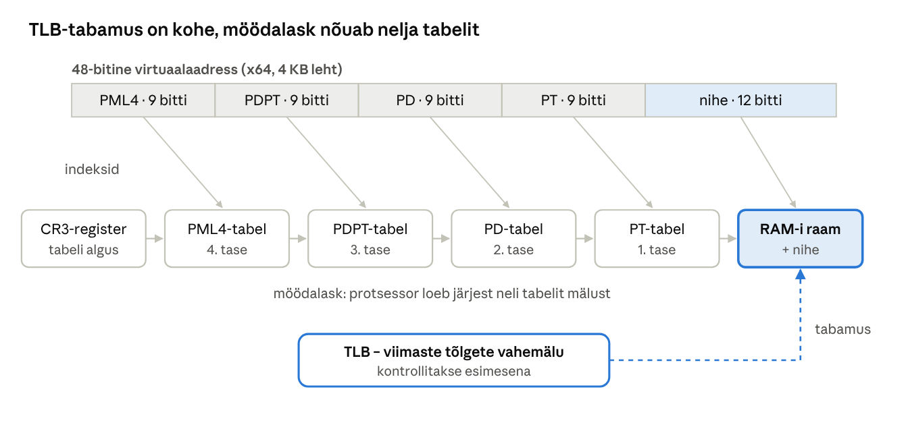
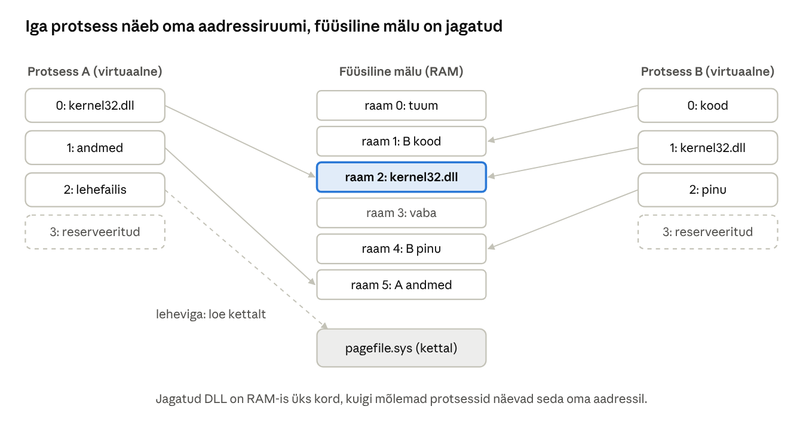

[← 11. Ummikud](11-ummikud.md) · [Sisukord](../README.md) · [13. Vahemälu →](13-vahemalu.md)

## 12. Mäluhaldus

Mäluhaldus annab igale protsessile oma privaatse virtuaalse aadressiruumi, vastendab selle füüsilisele mälule lehtede kaupa ja kaitseb protsesse üksteise eest. Windowsis teeb seda **mäluhaldur**. Tänapäeval kuulub mäluhalduse juurde ka hulk ründekaitseid (ASLR, DEP, CFG, varjupinu).

Mäluhaldusel on kolm põhieesmärki:

1. **Eraldamine ja kaitse.** Üks protsess ei tohi lugeda ega muuta teise protsessi ega tuuma mälu. Kui brauser kokku jookseb, ei tohi Word kaasa minna.
2. **Lihtsus programmeerijale.** Iga programm näeb sama suurt ja pidevat aadressiruumi ega pea teadma, kus RAM-is tema andmed tegelikult on.
3. **Rohkem mälu, kui on RAM-i.** Kauem kasutamata andmed saab ajutiselt viia kettale ja tuua tagasi, kui neid vaja on.

> 🖱️ **Proovi ise:** [interaktiivne õpileht](https://valdonolvak.github.io/Operatsioonis-steemi-ja-k-berturbe-alused/interaktiivne/12-maluhaldus.html). Lehel on killustumise demo, aadressi tõlkimise harjutus, lehtede asendamise simulaator, TLB kalkulaator, eraldatud mälu (commit) simulaator ja ründekaitsete harjutus.

### 12.1 Saalimine

**Saalimine** (swapping) tähendab terve protsessi viimist mälust kettale ja tagasi. Vanemates süsteemides oli see ainus viis mälust suurema töökoormusega toime tulla.

**Näide.** Arvutil on 1 MB mälu ja kolm 400 KB programmi. Korraga mahub mällu kaks. Kui kasutaja lülitub kolmandale programmile, kirjutab OS ühe programmi tervenisti kettale ja loeb kolmanda sisse. Iga selline vahetus võtab aega, sest kogu programm (400 KB) tuleb kirjutada ja lugeda – ka need osad, mida programm parajasti ei kasuta.

Kaasaegne OS viib kettale üksikuid **lehti** (4 KB), mitte tervet protsessi. Nii jäävad aktiivselt kasutatavad osad mällu ja kettale lähevad ainult kasutamata osad. Windows kasutab saalimist piiratud kujul: Store’i rakenduse peatamisel võib kogu tema tööhulga kirjutada faili `swapfile.sys`.

### 12.2 Mälumudelid

| Mudel | Kirjeldus | Probleem |
| --- | --- | --- |
| Üks pidev ala | programm saab ühe järjestikuse mälulõigu (MS-DOS) | kaitse puudub, üks programm korraga |
| Fikseeritud või muutuvad sektsioonid | mälu jagatakse osadeks, iga programm saab ühe | killustumine |
| Segmenteerimine | loogilised segmendid (kood, andmed, pinu) eri suurusega | väline killustumine; x64-l praktiliselt kasutusest väljas |
| Lehekülgedeks jaotamine (paging) | mälu jaotatakse võrdse suurusega lehtedeks (4 KB) | lehetabelid võtavad ruumi |

**Killustumine** (fragmentation) on mälu raiskamine, mis tekib, kui vaba mälu on olemas, kuid seda ei saa kasutada:

- **Väline killustumine** – vaba mälu on palju, kuid see on hajutatud väikesteks tükkideks. **Näide:** 64 KB mälus on vabad tükid 12 KB, 8 KB ja 10 KB, kokku 30 KB. Uus 20 KB programm ei mahu, sest ükski tükk pole piisavalt suur. Sama juhtub parklas, kus vabad kohad on üksikud ja buss ei mahu kuhugi.
- **Sisemine killustumine** – programm saab rohkem, kui vajab, ja ülejääk jääb kasutamata. **Näide:** lehe suurus on 4 KB ja programm vajab 9 KB. Ta saab kolm lehte (12 KB) ja 3 KB jääb tühjaks.

**Lehekülgedeks jaotamine** kaotab välise killustumise: virtuaalmälu jaotatakse **lehtedeks** (page) ja füüsiline mälu sama suurteks **raamideks** (frame). Iga leht võib asuda suvalises vabas raamis, seega pole vaja pidevat vaba ala. 20 KB programm saab 5 lehte, mis võivad olla RAM-is laiali. Alles jääb ainult väike sisemine killustumine viimases lehes.

> 🖱️ **Proovi ise:** [killustumise demo](https://valdonolvak.github.io/Operatsioonis-steemi-ja-k-berturbe-alused/interaktiivne/12-maluhaldus.html#killustumine)

### 12.3 Virtuaalmälu

**Virtuaalmälu** (virtual memory) annab programmile mulje pidevast suurest mälust. Programm kasutab ainult **virtuaalaadresse**. Iga virtuaalaadress tõlgitakse füüsiliseks aadressiks protsessori **mäluhaldusüksuses** (MMU) **lehetabelite** abil. Igal protsessil on oma lehetabelid, seega võib kahe protsessi sama aadress osutada eri kohtadele RAM-is.

#### Aadressi tõlkimine näitega

Lehe suurus on 4 KB = 4096 = 2¹² baiti. Seega on aadressi viimased 12 bitti (kolm viimast kuueteistkümnendnumbrit) **nihe lehe sees** ja ülejäänud osa on **lehe number**.

Programm loeb aadressilt `0x2A7F`:

1. lehe number = `0x2`, nihe = `0xA7F`;
2. lehetabelis on kirje: leht 2 → raam 5, olemas mälus;
3. füüsiline aadress = raam 5 + nihe = `0x5A7F`.

Teine protsess võib samuti lugeda aadressilt `0x2A7F`, kuid tema lehetabelis on leht 2 → raam 9, seega loeb ta füüsiliselt aadressilt `0x9A7F`. Protsessid ei näe üksteise mälu, sest nende lehetabelites pole viiteid teise protsessi raamidele.

**Lehetabeli kirje** sisaldab lisaks raami numbrile lippe:

| Lipp | Tähendus |
| --- | --- |
| Present (olemas) | leht on RAM-is; kui 0, tekib pöördumisel leheviga |
| Read/Write | kas lehele tohib kirjutada |
| User/Supervisor | kas kasutajarežiimi kood tohib lehte kasutada (tuuma lehed on kaitstud) |
| NX (No eXecute) | lehel olevat koodi ei tohi käivitada (DEP) |
| Accessed | lehte on hiljuti kasutatud – vajalik lehtede asendamisel |
| Dirty | lehte on muudetud – enne raami vabastamist tuleb see kettale kirjutada |

**Mitmetasemelised tabelid.** x64 protsessori 48-bitine aadressiruum (256 TB) koosneks 2³⁶ lehest. Ühetasemeline tabel võtaks iga protsessi kohta 512 GB! Seepärast on tabel **4-tasemeline** puu: aadress jaguneb nelja 9-bitiseks indeksiks ja 12-bitiseks nihkeks. Tabeleid luuakse ainult kasutatud aadressipiirkondade jaoks. Uuemad serveriprotsessorid toetavad 5-tasemelisi tabeleid (57-bitine aadress).



Joonis: virtuaalaadress jaguneb viieks osaks. Neli esimest on indeksid nelja taseme lehetabelitesse, viimane on nihe lehe sees. Kuna iga möödalask nõuab nelja lisapöördumist mällu, on TLB jõudluse jaoks hädavajalik.



**Animatsioon:** [Virtuaalmälu: aadressi tõlkimine ja leheviga](https://valdonolvak.github.io/Operatsioonis-steemi-ja-k-berturbe-alused/animatsioonid/maluhaldus.html) näitab kuut sammu: TLB-möödalask, lehetabeli läbikäik, TLB-tabamus, leheviga, lehe viimine lehefaili ja käsu kordamine.

**TLB** (Translation Lookaside Buffer) on protsessoris olev väike ja väga kiire vahemälu viimaste aadressitõlgete jaoks. **Näide:** mälupöördumine võtab 100 ns ja TLB kontroll 1 ns.

- TLB tabamus: 1 + 100 = **101 ns**.
- TLB möödalask: 1 + 4 × 100 (neli tabelit) + 100 = **501 ns**.
- Kui 99% pöördumistest tabab TLB-d, on keskmine aeg 0,99 × 101 + 0,01 × 501 ≈ **105 ns** – peaaegu sama kiire, kui tõlkimist poleks. Kui tabamusi on ainult 90%, on keskmine juba ≈ 141 ns.

Kuna programmid kasutavad mälu tavaliselt **lokaalselt** (samu ja lähedasi aadresse), on TLB tabamusmäär üle 99%.

**Lehekülje suurused:** tavaline 4 KB, suur leht 2 MB, hiiglaslik 1 GB. Suured lehed vähendavad TLB-möödalaskmisi. Kui TLB-s on 1536 kirjet, katab see 4 KB lehtedega vaid 6 MB mälu, 2 MB lehtedega aga 3 GB. Seepärast kasutavad suuri lehti andmebaasid (SQL Server) ja hüperviisorid.



Joonis: lehetabel tõlgib iga protsessi lehe eraldi; sama DLL võib olla mõlemal, kuid RAM-is üks kord. Kettale viidud lehe juurde tekib leheviga, reserveeritud lehel füüsilist mälu pole.

**Jagatud mälu.** Kui kümme programmi kasutavad `kernel32.dll`-i, on selle kood RAM-is ainult üks kord – kõigi lehetabelid osutavad samadele raamidele. Kui protsess tahab jagatud lehte muuta, kasutab Windows **kopeerimist kirjutamisel** (copy-on-write): protsess saab lehest oma koopia ja teised näevad endiselt originaali.

> 🖱️ **Proovi ise:** [aadressi tõlkimine](https://valdonolvak.github.io/Operatsioonis-steemi-ja-k-berturbe-alused/interaktiivne/12-maluhaldus.html#tolkimine) ja [TLB kalkulaator](https://valdonolvak.github.io/Operatsioonis-steemi-ja-k-berturbe-alused/interaktiivne/12-maluhaldus.html#tlb)

#### Leheviga

Kui programm pöördub lehe poole, mille lipp *Present* on 0, tekib **leheviga** (page fault). Protsessor katkestab käsu ja annab juhtimise mäluhaldurile:

1. mäluhaldur kontrollib, kas aadress on üldse lubatud. Kui ei ole (nt `NULL`-viit), saab programm vea *access violation* ja tavaliselt lõpetatakse;
2. kui leht on kuskil olemas, leitakse sellele vaba raam (vajadusel vabastatakse mõni teine leht);
3. leht loetakse raami, lehetabel uuendatakse ja katkestatud käsk käivitatakse uuesti. Programm ei saa sellest midagi teada, ta lihtsalt ootas veidi.

Leheveaid on kahte liiki:

- **pehme leheviga** – leht on mälus, kuid mitte protsessi tööhulgas (nt ootenimekirjas või teise protsessiga jagatud); lahendatakse mikrosekunditega;
- **kõva leheviga** – leht tuleb lugeda kettalt (lehefailist või EXE/DLL-failist); SSD-lt kümneid või sadu mikrosekundeid, HDD-lt millisekundeid – tuhandeid kordi aeglasem kui RAM.

Pehmeid lehevigu tekib igas arvutis tuhandeid sekundis ja need on normaalsed. Probleem on paljud **kõvad** lehevead.

#### Lehtede asendamine

Kui vaba raami pole, tuleb mõni leht RAM-ist välja viia. Milline? Parim oleks viia välja leht, mida kõige kauem ei vajata, kuid tulevikku ei tea keegi. Algoritmid:

| Algoritm | Kelle viib välja | Märkus |
| --- | --- | --- |
| **FIFO** | lehe, mis tuli mällu kõige varem | lihtne, kuid võib välja viia sageli kasutatava lehe |
| **LRU** (least recently used) | lehe, mida pole kõige kauem kasutatud | hea, kuid täpne arvestus on kallis |
| **Kell** (clock, teise võimaluse algoritm) | käib lehti ringiratast läbi; kui *Accessed* = 1, nullib selle ja annab teise võimaluse | LRU odav lähend, kasutatakse päris OS-ides |
| **Optimaalne** (OPT) | lehe, mida vajatakse kõige hiljem | võimatu (vajab tuleviku teadmist), kasutatakse võrdlusalusena |

**Näide.** Programm kasutab lehti järjekorras 7, 0, 1, 2, 0, 3, 0, 4, 2, 3, 0, 3, 2 ja RAM-is on 3 raami. Lehevigu tekib: FIFO 10, LRU 9, optimaalne 7. FIFO puhul on huvitav **Belady anomaalia**: mõne järjekorra korral tekib rohkem raamidega *rohkem* lehevigu (järjekord 1, 2, 3, 4, 1, 2, 5, 1, 2, 3, 4, 5 annab 3 raamiga 9 ja 4 raamiga 10 leheviga).

**Ülekoormus ehk *thrashing*.** Kui protsesside aktiivselt kasutatavad lehed ei mahu kokku RAM-i, viib OS välja lehe, mida kohe uuesti vaja on. Arvuti tegeleb peamiselt lehtede ketta ja mälu vahel liigutamisega, protsessor ootab ja kõik on väga aeglane. Lahendus on vähendada korraga töötavaid programme või lisada RAM-i.

> 🖱️ **Proovi ise:** [lehtede asendamise simulaator](https://valdonolvak.github.io/Operatsioonis-steemi-ja-k-berturbe-alused/interaktiivne/12-maluhaldus.html#asendamine)

### 12.4 Mäluhaldus Windowsis

**Aadressiruum.** 64-bitises Windowsis on igal protsessil 128 TB kasutajaruumi ja tuumal 128 TB. 32-bitisel protsessil on 2 GB (või lipuga *LargeAddressAware* 4 GB 64-bitises süsteemis).

**Reserveerimine ja eraldamine.** `VirtualAlloc` võimaldab mälu küsida kahes etapis:

| Etapp | Mis toimub | Mida see maksab |
| --- | --- | --- |
| **Reserveerimine** (reserve) | aadressivahemik jäetakse protsessile, mälu veel pole | ainult aadressiruumi |
| **Eraldamine** (commit) | OS lubab, et nendele aadressidele on mälu olemas (RAM-is või lehefailis) | suurendab eraldatud mälu kogust |
| **Kasutamine** (esimene pöördumine) | leheviga, OS annab nullitud raami, leht läheb tööhulka | füüsilist RAM-i |

**Näide.** Brauser reserveerib JavaScripti jaoks 4 GB aadressivahemikku, et objektid oleksid järjest. Eraldab sellest esialgu 200 MB. Neist on veebilehel kasutusel 50 MB, ainult need on RAM-is. Ülejäänud 150 MB on lubatud, kuid RAM-i veel ei võta.

**Eraldatud mälu kogus** (commit charge) ei tohi ületada **eraldatud mälu limiiti** (commit limit) = RAM + lehefailid. Tegumihalduris on see „Eraldatud: 14/20 GB“. Kui limiit saab täis, ei anna Windows uut eraldatud mälu ja rakendus saab vea (nt „Out of memory“), isegi kui RAM-is on parajasti vaba ruumi. Seepärast ei tohi lehefaili keelata.

**Tööhulk** (working set) on protsessi lehed, mis on parajasti füüsilises mälus. Tegumihalduri veerg „Mälu“ näitab tavaliselt privaatset tööhulka. Mälupuuduses vähendab **tööhulga haldur** tööhulki: kauem kasutamata lehed eemaldatakse.


Joonis: tööhulgast eemaldatud leht läheb muutmata kujul **ootenimekirja** (standby) ja muudetud kujul **muudetud nimekirja** (modified). Muudetud lehtede kirjutaja kirjutab need lehefaili ja siis lähevad ka need ootele. Kui protsess vajab lehte uuesti, tuleb see ootenimekirjast tagasi pehme leheveaga. Vabastatud lehed nullitakse enne teisele protsessile andmist, et keegi ei näeks teise protsessi andmeid.

Seetõttu ei tähenda väike „vaba“ mälu Ressursimonitoris probleemi: ootenimekirjas olev mälu on kasutatav vahemälu, mida saab kohe vabastada. Windowsi põhimõte on: **kasutamata RAM on raisatud RAM**.

**Lehefail** `pagefile.sys` hoiab muudetud lehti, mida mälus enam ei hoita. Lehefaili ei tohi tavaliselt keelata: see on vajalik eraldatud mälu limiidi ja krahhitõmmise jaoks. Vaikimisi haldab Windows lehefaili suurust ise.

**Mälu tihendamine** (memory compression, Windows 10+): enne kettale kirjutamist tihendatakse lehed mälus. Protsess *Memory Compression* hoiab tihendatud lehti. Tavaliselt mahub 3–4 lehte ühe asemele. RAM-ist tihendatud lehe lahtipakkimine on palju kiirem kui SSD-lt lugemine.

**SysMain** (endine SuperFetch) laadib kasutusmustrite järgi rakendusi ette ootenimekirja. Kui avad igal hommikul Outlooki, on selle failid juba mälus ja see käivitub kiiremini.

**Mälukaardistatud failid.** EXE- ja DLL-faile ei loeta mällu tervenisti. Windows vastendab faili aadressiruumi ja lehed loetakse alles siis, kui neid kasutatakse. Seepärast võib programm käivituda kiiresti, kuigi fail on suur.

> 🖱️ **Proovi ise:** [eraldatud mälu ja tööhulga simulaator](https://valdonolvak.github.io/Operatsioonis-steemi-ja-k-berturbe-alused/interaktiivne/12-maluhaldus.html#commit)

#### Ründekaitsed mäluhalduses

Paljud ründed põhinevad sellel, et ründaja kirjutab mällu oma koodi või muudab tagastusaadressi ja paneb programmi oma koodi käivitama. Mäluhalduse kaitsed teevad selle raskemaks:

| Kaitse | Mida teeb | Mille vastu |
| --- | --- | --- |
| **DEP / NX** | andmelehti (pinu, kuhi) ei saa käivitada | ründaja ei saa pinusse kirjutatud koodi käivitada |
| **ASLR** | moodulite, pinu ja kuhja aadressid on igal käivitusel juhuslikud | ründaja ei tea, kuhu hüpata |
| **CFG** (Control Flow Guard) | kaudsed hüpped ainult lubatud sihtkohtadesse | muudetud funktsiooniviitade ärakasutamine |
| **Riistvaraline varjupinu** (CET shadow stack) | tagastusaadressi koopia on eraldi kaitstud pinus; erinevus tuvastatakse | tagastusaadressi ülekirjutamine (ROP-ründed) |
| **HVCI / mälu terviklikkus** | tuumas ei saa lehte korraga kirjutada ja käivitada; seda kontrollib hüperviisor | allkirjastamata koodi käivitamine tuumas |

**Näide.** Vanas programmis on puhvri ületäitumise viga: kasutaja sisestatud tekst kirjutatakse pinusse ilma pikkust kontrollimata. Ründaja saadab pika teksti, mis kirjutab üle tagastusaadressi. Ilma kaitseteta hüppab programm ründaja koodile. DEP-iga ei saa pinus olevat koodi käivitada. ASLR-iga ei tea ründaja, kus on kasulikud koodijupid. Varjupinuga märkab protsessor, et tagastusaadress on muudetud, ja lõpetab programmi.

> 🖱️ **Proovi ise:** [milline kaitse aitab?](https://valdonolvak.github.io/Operatsioonis-steemi-ja-k-berturbe-alused/interaktiivne/12-maluhaldus.html#kaitsed)

### 12.5 Mäluhaldur

**Mäluhaldur** (Memory Manager) on käivitava süsteemi komponent, mis

- vastendab virtuaalaadresse ja haldab lehetabeleid;
- lahendab lehevigu;
- haldab tööhulki ja füüsiliste lehtede nimekirju (vaba, nullitud, ootel, muudetud);
- haldab jagatud mälu ja mälukaardistatud faile (sektsiooniobjektid).

Ta käitab ka süsteemilõimi: **tööhulga haldur** (vähendab mälupuuduses tööhulki), **muudetud lehtede kirjutaja** (kirjutab muudetud lehed lehefaili) ja **nulllehe lõim** (täidab vabad lehed nullidega, et need oleksid valmis uutele protsessidele).

### 12.6 Kuhjahaldur

Rakendused ei kasuta väikeste objektide jaoks `VirtualAlloc`-i, sest see eraldab mälu vähemalt 4 KB lehtede kaupa. 20-baidise sõne jaoks oleks see raiskamine. Selle asemel kasutatakse **kuhja** (heap). **Kuhjahaldur** (Heap Manager) jagab suure mälupiirkonna väikesteks plokkideks (`HeapAlloc`, C `malloc`, C++ `new`). Windowsis on kaks kuhjatüüpi:

- **NT-kuhi** – traditsiooniline, madala killustumisega kiht (LFH);
- **segmentkuhi** (segment heap) – uuem, turvalisem ja säästlikum; vaikimisi Store’i rakendustel, Edge’il ja paljudel süsteemiprotsessidel.

Kuhjas tuleb mälu ise vabastada (`free`, `delete`). Hallatud keeltes (C#, Java) teeb seda **prügikoristaja** (garbage collector). Levinud vead:

- **mäluleke** – mälu eraldatakse, kuid ei vabastata kunagi; protsessi mälukasutus kasvab pidevalt;
- **kuhjaületäitumine** – plokki kirjutatakse rohkem, kui see mahutab, ja kirjutatakse üle naabri andmed;
- **kasutamine pärast vabastamist** (use-after-free) – programm kasutab plokki, mis on juba vabastatud ja võib-olla kellelegi teisele antud. See on üks levinumaid brauserite turvavigu.

Rust ja hallatud keeled (C#) väldivad neid vigu keele tasemel.

### 12.7 Pinud

**Pinu** (stack) hoiab funktsioonide kohalikke muutujaid ja tagastusaadresse. Igal lõimel on kasutajapinu (vaikimisi reserveeritakse 1 MB) ja väike tuumapinu. Pinu kasvab vajadusel; kui see saab täis, tekib erind *stack overflow* – tavaliselt lõputu rekursiooni tõttu.

| | Pinu | Kuhi |
| --- | --- | --- |
| Mida hoiab | kohalikud muutujad, parameetrid, tagastusaadressid | dünaamiliselt loodud objektid |
| Kes vabastab | automaatselt, kui funktsioon lõpeb | programmeerija või prügikoristaja |
| Kiirus | väga kiire (ainult pinuviida liigutamine) | aeglasem (tuleb leida sobiv plokk) |
| Suurus | väike (1 MB lõime kohta) | suur (piiratud eraldatud mälu limiidiga) |
| Tüüpiline viga | pinuületäitumine, tagastusaadressi ülekirjutamine | mäluleke, use-after-free |

Pinuületäitumise rünnete vastu kasutatakse **pinukanaarilinde** (kompilaatori lipp `/GS`: tagastusaadressi ette pannakse juhuslik väärtus, mille muutumist kontrollitakse enne funktsioonist väljumist) ja varjupinu.

### Võrdlus: Linux ja macOS

Kõik kolm kasutavad sama riistvaralist põhimõtet (lehetabelid, TLB), kuid mälupuuduse korral käituvad erinevalt.

|  | Windows | Linux | macOS |
| --- | --- | --- | --- |
| Lehe suurus | 4 KB, suured lehed 2 MB | 4 KB, huge pages 2 MB / 1 GB | 16 KB Apple Siliconil |
| Kettale saalimine | `pagefile.sys`, `swapfile.sys` | swap-partitsioon või -fail | dünaamilised swap-failid kaustas `/private/var/vm` |
| Mälu tihendamine | Memory Compression | zswap, zram | tihendatud mälu (compressed memory) |
| Ülejaotus (overcommit) | ei: eraldatud mälu piir | vaikimisi lubatud | lubatud |
| Kui mälu saab otsa | eraldamine ebaõnnestub, rakendus saab vea | **OOM killer** lõpetab ühe protsessi | süsteem palub rakendusi sulgeda |
| Vaatamine | Ressursimonitor, RAMMap | `free -h`, `vmstat`, `/proc/meminfo` | Activity Monitor → Memory, `vm_stat` |

**Mida sellest õppida:** Linux lubab programmidel küsida rohkem mälu, kui seda on, ja lahendab puuduse hiljem protsessi lõpetamisega. Windows keeldub juba eraldamisel. Seetõttu jälgivad Linuxi serverite administraatorid OOM killeri logisid (`dmesg`), Windowsi administraatorid aga eraldatud mälu (*Committed Bytes*) ja lehefaili suurust.

### Näide: hotelli toanumbrid ja 60 brauseri vahekaarti

**Võrdlus.** Hotellis ei tea külaline, kus tema tuba füüsiliselt asub; ta teab ainult numbrit 214. Vastuvõtt (MMU ja lehetabel) teab, et tuba 214 on teise korruse idatiivas. Kaks eri reisiseltskonda võivad kumbki rääkida „oma toast nr 1“, aga need on eri toad – nii on ka kahe protsessi aadress `0x1000` eri kohtades. Kui hotell on täis, viiakse mõne pikaajalise külalise kohvrid hoiuruumi (lehefail); kui külaline neid küsib, tuleb oodata (kõva leheviga). Vastuvõtja ei otsi iga kord registrit läbi, vaid mäletab viimaseid päringuid peast (TLB).

**Windowsis.** Õpilase sülearvutis on 8 GB RAM-i ja Edge’is 60 vahekaarti.

1. Tegumihaldur näitab: *Kasutusel 7,4 GB*, *Tihendatud 1,8 GB*, *Eraldatud 14/20 GB*. Eraldatud mälu (commit) on suurem kui RAM, sest osa on lehefailis.
2. Windows tihendab kauem kasutamata lehti mälus ja kirjutab osa lehefaili.
3. Vanale vahekaardile naastes tekib palju kõvu lehevigu, leht laadib mõne sekundi.
4. Edge paneb mitteaktiivsed vahekaardid magama (unerežiimis vahekaardid), et vabastada nende tööhulk.

**Järeldus:** aeglus ei tähenda viga – virtuaalmälu töötab, kuid tööhulk ei mahu RAM-i. Lahendus on lisamälu või vähem korraga avatud vahekaarte, mitte lehefaili keelamine. Kui lehefaili keelata, langeks eraldatud mälu limiit 20 GB-lt 8 GB-le ja brauser saaks mäluvea juba palju varem.

### Kokkuvõte

- Virtuaalmälu eraldab protsessid ja laseb kasutada rohkem mälu, kui on RAM-i.
- Lehekülgedeks jaotamine kaotab välise killustumise; alles jääb väike sisemine killustumine.
- Lehetabelid ja TLB tõlgivad aadresse; leheviga toob puuduva lehe mällu. Pehmed lehevead on odavad, kõvad kallid.
- Kui RAM saab täis, valib asendusalgoritm (praktikas kella-algoritmi sarnane) välja viidava lehe; liiga väike RAM põhjustab ülekoormust (thrashing).
- Windows kasutab tööhulki, ootenimekirja, tihendamist ja lehefaili. Eraldatud mälu ei tohi ületada RAM-i ja lehefaili summat.
- Mäluhaldusega on seotud olulised ründekaitsed: DEP, ASLR, CFG, varjupinu, HVCI.

### Kontrollküsimused

> 🧪 **Interaktiivne test:** [kontrolli oma teadmisi](https://valdonolvak.github.io/Operatsioonis-steemi-ja-k-berturbe-alused/interaktiivne/12-test.html). Test koosneb 25 valikvastusega küsimusest. Iga vastuse järel näed selgitust ning lõpus saad valesti vastatud küsimusi korrata.

1. Millised on mäluhalduse kolm põhieesmärki?
2. Mis vahe on saalimisel ja lehekülgedeks jaotamisel?
3. Kirjelda nelja mälumudelit ja nende puudusi. Mis vahe on välisel ja sisemisel killustumisel?
4. Mis on virtuaalmälu ja kuidas toimub aadressi tõlkimine? Tõlgi aadress `0x3B12`, kui leht 3 asub raamis 8.
5. Miks on x64 lehetabelid mitmetasemelised? Mis on TLB ja miks see on vajalik?
6. Mis vahe on pehmel ja kõval leheveal?
7. Kirjelda FIFO, LRU ja kella-algoritmi. Mis on Belady anomaalia?
8. Mis on ülekoormus (thrashing) ja kuidas see avaldub?
9. Mis vahe on mälu reserveerimisel ja eraldamisel (commit)? Millest sõltub eraldatud mälu limiit?
10. Mis on tööhulk ja ootenimekiri? Miks ei ole väike „vaba“ mälu Windowsis probleem?
11. Miks kasutab Windows mälu tihendamist?
12. Nimeta kolm mäluga seotud ründekaitset ja selgita, mille vastu need aitavad.
13. Mis vahe on kuhjal ja pinul? Nimeta kummagi tüüpiline viga.

### Valikküsimused

1. Mis on tavaline lehekülje suurus x64 Windowsis? a) 512 B b) 4 KB c) 64 KB d) 1 MB
2. Mis on TLB? a) failisüsteemi tabel b) aadressitõlgete vahemälu c) lehefail d) tuumapinu
3. Mida teeb ASLR? a) krüpteerib mälu b) muudab moodulite aadressid juhuslikuks c) tihendab mälu d) suurendab lehefaili
4. Kus hoitakse tihendatud lehti? a) pagefile.sys b) swapfile.sys c) protsessis Memory Compression d) TPM-is
5. Millest koosneb eraldatud mälu limiit? a) ainult RAM b) RAM + lehefailid c) kõvaketta suurus d) 128 TB

### Praktiline ülesanne

```powershell
Get-CimInstance Win32_OperatingSystem | Select-Object TotalVisibleMemorySize, FreePhysicalMemory, TotalVirtualMemorySize
Get-CimInstance Win32_PageFileUsage | Select-Object Name, AllocatedBaseSize, CurrentUsage, PeakUsage
Get-Counter '\Memory\Page Faults/sec','\Memory\Pages/sec','\Memory\Committed Bytes','\Memory\Commit Limit' -MaxSamples 3
Get-MMAgent
```

`Page Faults/sec` loendab kõiki lehevigu (ka pehmeid), `Pages/sec` aga lehti, mis loeti kettalt või kirjutati kettale (kõvad lehevead). Kõrge `Page Faults/sec` on normaalne, pidevalt kõrge `Pages/sec` viitab mälupuudusele.

Ava Ressursimonitor → Mälu ja tuvasta riba värvid: kasutusel, muudetud, ootel, vaba. Ava Tegumihaldur → Jõudlus → Mälu ja leia „Tihendatud“ ja „Eraldatud“. Ava Sysinternalsi **RAMMap** ja vaata, milliseid lehti on ootenimekirjas. Kontrolli protsessi mitigatsioone: `Get-ProcessMitigation -Name notepad.exe`.

### Iseseisvad ülesanded

**1. Mälusurve katse.** Ava õppe-VM-is (4 GB RAM) järjest 5, 15 ja 30 brauseri vahekaarti suurte veebilehtedega. Mõõda iga kord Tegumihaldurist: kasutusel, tihendatud, eraldatud (commit) ning `Get-Counter '\Memory\Page Faults/sec','\Memory\Pages/sec'`. **Esita:** tabel ja graafik ning järeldus, millal hakkas süsteem kasutama lehefaili ja kuidas see kasutaja jaoks välja paistis.

**2. Ründekaitsete kaardistus.** Käivita `Get-ProcessMitigation -System` ning kolme rakenduse kohta (`notepad.exe`, `msedge.exe`, mõni vanem programm). Võrdle DEP-i, ASLR-i, CFG ja varjupinu (`UserShadowStack`) olekut. **Esita:** tabel ja selgitus, miks vanemal programmil võib osa kaitseid puududa ning kuidas see mõjutab ründe võimalusi.

### Viited

- Krogh (2017), ptk 12.
- Yosifovich jt, *Windows Internals* 7. tr, 1. osa, ptk 5 „Memory management“.
- Silberschatz, Galvin, Gagne (2018), *Operating System Concepts*, ptk 9–10 (Main memory, Virtual memory).
- Microsoft Learn: [Memory Management](https://learn.microsoft.com/windows/win32/memory/memory-management); [Exploit protection reference](https://learn.microsoft.com/defender-endpoint/exploit-protection-reference).
- Sysinternals: [RAMMap](https://learn.microsoft.com/sysinternals/downloads/rammap).

> 📝 **Test:** selle peatüki Google Formsi test luuakse skriptiga [`google-forms/looVormid.gs`](../google-forms/looVormid.gs).

---

[← 11. Ummikud](11-ummikud.md) · [Sisukord](../README.md) · [13. Vahemälu →](13-vahemalu.md)
