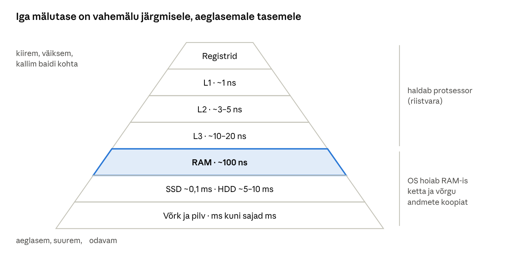

[← 12. Mäluhaldus](12-maluhaldus.md) · [Sisukord](../README.md) · [14. Sisend ja väljund →](14-sisend-valjund.md)

## 13. Vahemälu

**Vahemälu** (cache) on kiire ja väike mälu, kuhu hoitakse aeglasemast allikast loetud andmete koopiat, et järgmine pöördumine oleks kiirem. Vahemälu töötab, sest programmid kasutavad samu ja lähestikku asuvaid andmeid korduvalt (**ajaline** ja **ruumiline lokaalsus**). Windowsis hoiab failide vahemälu **vahemäluhaldur**.

Vahemälu on arvutis igal pool: protsessoris, kettal, failisüsteemis, brauseris, DNS-is ja pilveteenustes. Põhimõte on alati sama: **hoia lähedal koopiat sellest, mida tõenäoliselt varsti uuesti vaja läheb**.

> 🖱️ **Proovi ise:** [interaktiivne õpileht](https://valdonolvak.github.io/Operatsioonis-steemi-ja-k-berturbe-alused/interaktiivne/13-vahemalu.html). Lehel on ajaskaala ja keskmise pöördumisaja kalkulaator, massiivi läbimise demo, kirjutusviiside simulaator, failide vahemälu ja ettelugemise simulaator, DNS-i vahemälu ajajoon ning kirjutusviisi valiku harjutus.

### 13.1 Põhimõisted

- **Tabamus** (hit) – vajalikud andmed on vahemälus;
- **möödalask** (miss) – andmeid vahemälus pole ja need tuleb tuua aeglasemast allikast;
- **tabamusmäär** (hit rate) – mitu protsenti pöördumistest on tabamused;
- **väljatõrjumine** (eviction) – kui vahemälu on täis, tuleb uute andmete jaoks mõni vana koopia eemaldada. Tavaliselt eemaldatakse kõige kauem kasutamata andmed (LRU, vt ptk 12.3);
- **soe ja külm vahemälu** – külm vahemälu on tühi (nt pärast taaskäivitust), soe sisaldab juba sageli kasutatavaid andmeid.

**Keskmine pöördumisaeg** sõltub tabamusmäärast:

```
keskmine aeg = tabamuse aeg + möödalaskmise osakaal × möödalaskmise lisaaeg
```

**Näide.** L1-vahemälu vastab 1 ns-ga, RAM 100 ns-ga.

| L1 tabamusmäär | Keskmine pöördumisaeg |
| --- | --- |
| 0% (vahemälu pole) | 1 + 1,00 × 100 = 101 ns |
| 90% | 1 + 0,10 × 100 = 11 ns |
| 95% | 1 + 0,05 × 100 = 6 ns |
| 99% | 1 + 0,01 × 100 = 2 ns |

Väike vahemälu muudab mälu keskmiselt 50 korda kiiremaks. Iga protsent tabamusmäära juures on oluline: 95% ja 99% vahel on kolmekordne vahe.

> 🖱️ **Proovi ise:** [keskmise pöördumisaja kalkulaator ja ajaskaala](https://valdonolvak.github.io/Operatsioonis-steemi-ja-k-berturbe-alused/interaktiivne/13-vahemalu.html#hierarhia)

#### Lokaalsus

**Ajaline lokaalsus** – kui andmeid kasutati äsja, kasutatakse neid tõenäoliselt varsti uuesti. Näiteks tsükli muutuja `i`, mida suurendatakse miljon korda, või fail, mida kasutaja just avas.

**Ruumiline lokaalsus** – kui kasutati mingit aadressi, kasutatakse tõenäoliselt varsti ka selle naabreid. Näiteks massiivi läbimine järjest või faili lugemine algusest lõpuni.

Protsessori vahemälu ei too RAM-ist üksikut baiti, vaid terve **vahemälurea** (64 baiti). Kui programm loeb `int`-massiivi (4 baiti elemendi kohta) järjest, toob esimene möödalask vahemällu 16 elementi ja järgmised 15 pöördumist on tabamused.

**Näide: kahemõõtmelise massiivi läbimine.** C#-s ja C-s on kahemõõtmeline massiiv mälus **ridade kaupa**: kõigepealt kogu rida 0, siis rida 1 jne.

```csharp
int[,] m = new int[4000, 4000];
// Kiire: ridade kaupa – järgmine element on mälus kõrval
for (int r = 0; r < 4000; r++) for (int c = 0; c < 4000; c++) sum += m[r, c];
// Aeglane: veergude kaupa – iga järgmine element on 16 000 baidi kaugusel
for (int c = 0; c < 4000; c++) for (int r = 0; r < 4000; r++) sum += m[r, c];
```

Mõlemad tsüklid teevad täpselt sama arvu liitmisi. Teine on siiski mitu korda aeglasem, sest peaaegu iga pöördumine on vahemälust möödalask. Algoritmi õigsus on sama, jõudlus mitte.

> 🖱️ **Proovi ise:** [massiivi läbimise demo](https://valdonolvak.github.io/Operatsioonis-steemi-ja-k-berturbe-alused/interaktiivne/13-vahemalu.html#lokaalsus)

### 13.2 Vahemälude hierarhia

| Tase | Ligikaudne maht | Ligikaudne pöördumisaeg | Kui 1 ns oleks 1 sekund |
| --- | --- | --- | --- |
| Protsessori registrid | sadu baite | alla 1 ns | alla sekundi |
| L1-vahemälu | kümneid KB tuuma kohta | \~1 ns | 1 sekund |
| L2-vahemälu | 1–3 MB tuuma kohta | \~3–5 ns | 4 sekundit |
| L3-vahemälu | kümneid MB | \~10–20 ns | 15 sekundit |
| RAM | 8–512 GB | \~80–100 ns | üle poolteise minuti |
| NVMe-SSD | TB | \~50–100 µs | ligi päev |
| Kõvaketas (HDD) | TB | \~5–10 ms | 2–3 kuud |
| Võrgu- või pilvesalvesti | piiramatu | ms kuni sajad ms | kuni mitu aastat |

Viimane veerg näitab erinevusi inimlikus mõõtkavas. Kui L1-vahemälust andmete saamine võtaks sekundi, tuleks RAM-ist andmeid oodata nagu kohvi järele ja kõvakettalt nagu kirja, mis saadeti välismaale laevaga. Seepärast on vahemälu nii oluline.

Iga tase on vahemälu järgmisele. OS haldab peamiselt RAM-i kui ketta- ja võrguandmete vahemälu; protsessori vahemälusid haldab riistvara.



Joonis (ei ole mõõtkavas): ülemised tasemed haldab protsessor ise; OS-i vahemäluhaldur kasutab RAM-i ketta- ja võrguandmete vahemäluna.

**Kuhu andmed vahemälus paigutatakse?** Protsessori vahemälu peab väga kiiresti leidma, kas aadress on vahemälus. Seepärast ei saa iga rida asuda suvalises kohas:

| Organisatsioon | Kuidas | Plussid ja miinused |
| --- | --- | --- |
| Otsevastendus (direct-mapped) | iga mäluaadress saab olla ainult ühes kindlas vahemälureas | väga kiire ja lihtne, kuid kaks sageli kasutatavat aadressi võivad üksteist pidevalt välja tõrjuda |
| Hulgaassotsiatiivne (set-associative) | aadress saab olla ühes kindlas hulgas, hulgas on nt 8 või 12 kohta | tavaline tänapäeva protsessorites, hea kompromiss |
| Täisassotsiatiivne | aadress võib olla ükskõik kus | kõige paindlikum, kuid otsimine on kallis; kasutatakse väikestes vahemäludes, nt TLB |

#### Kirjutamine vahemällu

Lugemisega on lihtne: kui koopia on vahemälus, kasuta seda. Kirjutamisel tuleb otsustada, **millal jõuab muudatus päris salvestisse**:

- **läbikirjutus** (write-through) – andmed kirjutatakse korraga vahemällu ja püsisalvestisse; turvaline, kuid aeglasem, sest kirjutaja peab ootama aeglast seadet;
- **tagasikirjutus** (write-back) – andmed kirjutatakse vahemällu ja märgitakse **muudetuks** (dirty); püsisalvestisse kirjutatakse need hiljem. Kiire, sest rakendus ei oota, ja mitu muudatust samale plokile kirjutatakse kettale ühe korraga. Toitekatkestusel võivad aga kettale jõudmata andmed kaduda.

**Näide.** Programm salvestab sama faili ploki 10 korda järjest.

| | Läbikirjutus | Tagasikirjutus |
| --- | --- | --- |
| Kettale kirjutamisi | 10 | 1 (kui laisk kirjutaja jõuab kirjutada) |
| Rakenduse ooteaeg | 10 × ketta kirjutusaeg | peaaegu null |
| Voolukatkestus enne kettale jõudmist | andmed on kettal | viimased muudatused on kadunud |

Seepärast kasutavad serverite RAID-kontrollerid tagasikirjutust ainult siis, kui neil on **akutoega vahemälu** (BBWC/FBWC): voolukatkestuse korral hoiab aku vahemälu sisu alles, kuni vool taastub. Ja seepärast peab serveriruumis olema **UPS**.

> 🖱️ **Proovi ise:** [läbikirjutus vs tagasikirjutus](https://valdonolvak.github.io/Operatsioonis-steemi-ja-k-berturbe-alused/interaktiivne/13-vahemalu.html#kirjutus) ja [milline kirjutusviis sobib?](https://valdonolvak.github.io/Operatsioonis-steemi-ja-k-berturbe-alused/interaktiivne/13-vahemalu.html#valik)

#### Vahemälu kehtivus

Vahemälu sisaldab **koopiat**. Kui originaal muutub, võib koopia olla aegunud. Seda probleemi tuleb lahendada igal tasemel:

- protsessorites jälgib riistvara (MESI-protokoll, ptk 10.3), et kõik tuumad näeksid uusimat väärtust;
- võrgus ja veebis on igal koopial **eluaeg** (TTL, time to live). Kuni TTL kehtib, kasutatakse koopiat ilma originaali kontrollimata.

**Näide: DNS.** Administraator kolib kooli veebilehe uuele serverile ja muudab DNS-kirjet: `www.kool.ee` → uus IP-aadress. Kirje TTL on 3600 sekundit (1 tund). Arvutid, mis küsisid nime hiljuti, kasutavad oma DNS-i vahemälust **kuni tund aega vana aadressi** ja jõuavad vanale serverile. Seepärast tehakse enne kolimist TTL väiksemaks (nt 300 s) ja testarvutis tühjendatakse vahemälu käsuga `ipconfig /flushdns`.

> 🖱️ **Proovi ise:** [DNS-i vahemälu ja TTL](https://valdonolvak.github.io/Operatsioonis-steemi-ja-k-berturbe-alused/interaktiivne/13-vahemalu.html#dns)

### 13.3 Vahemäluhaldur

Windowsi **vahemäluhaldur** (Cache Manager) töötab koos mäluhalduri ja failisüsteemidega:

- vahemälu on **virtuaalsete plokkide** põhine: faili osad vastendatakse süsteemi aadressiruumi vaadetena, vajalikud lehed laadib mäluhaldur lehevea kaudu;
- vahemälu suurus muutub dünaamiliselt vastavalt vabale mälule – kui RAM-i on vaja programmidele, väheneb vahemälu;
- **laisk kirjutaja** (lazy writer) kirjutab muudetud andmed kettale taustal, tavaliselt sekundi jooksul;
- **intelligentne ettelugemine** (read-ahead) tuvastab järjestikuse lugemise mustri ja loeb järgmised plokid ette;
- rakendus saab vahemälust mööda minna (`FILE_FLAG_NO_BUFFERING`) või nõuda läbikirjutust (`FILE_FLAG_WRITE_THROUGH`); andmebaasid teevad nii, sest neil on oma puhver.


Joonis: lugemisel kontrollitakse, kas faili osa on juba RAM-is. Tabamuse korral kopeeritakse andmed kohe rakendusele, möödalaskmise korral loetakse kettalt (ja ettelugemisega ka järgmised plokid). Kirjutamisel kopeeritakse andmed RAM-i ja `WriteFile` lõpeb kohe; laisk kirjutaja viib muudetud lehed hiljem kettale. Läbikirjutus läheb otse kettale.

**Ettelugemise näide.** Videomängija loeb 4 GB videot järjest, 64 KB kaupa. Pärast paari järjestikust lugemist märkab vahemäluhaldur mustrit ja hakkab lugema järgmisi plokke ette, enne kui mängija neid küsib. Mängija leiab andmed juba RAM-ist ega pea kettal ootama. Kui programm loeb faili juhuslikest kohtadest (nt andmebaas), ettelugemine ei aita ja seda ei tehta.

> 🖱️ **Proovi ise:** [failide vahemälu ja ettelugemise simulaator](https://valdonolvak.github.io/Operatsioonis-steemi-ja-k-berturbe-alused/interaktiivne/13-vahemalu.html#ettelugemine)

**Miks andmebaasid vahemälust mööda lähevad?** SQL Serveril on oma puhvrikogum (buffer pool), mis teab paremini, milliseid andmeid hoida. Kui ka Windows hoiaks samu andmeid vahemälus, oleks iga leht RAM-is kaks korda. Lisaks peab andmebaas teadma, et tehingulogi on **tõesti kettal**, enne kui ta ütleb kliendile „tehing õnnestus“. Seepärast kasutab ta läbikirjutust ja `FlushFileBuffers`-it.

**Kus seda näha?**

- Tegumihaldur → Jõudlus → Mälu: „Vahemällu salvestatud“ (Cached) – sisaldab ka ootenimekirja (ptk 12.4);
- Ressursimonitor → Mälu: sinine „Ootel“ (Standby) on suures osas failide vahemälu;
- jõudlusloendurid `\Cache\Copy Read Hits %` (vahemälu tabamusmäär), `\Cache\Lazy Write Flushes/sec` (laisa kirjutaja tühjendused), `\Memory\Cache Bytes`;
- Sysinternalsi **RAMMap** → *File Summary*: millised failid on parajasti vahemälus.

### 13.4 Vahemälud mujal Windowsis

- **Seadme kirjutusvahemälu** – kettal ja kontrolleril on oma vahemälu. Seadmehaldur → ketas → Poliitikad. Eemaldatavatel ketastel on alates Windows 10 1809 vaikimisi „Kiire eemaldamine“ (vahemälu väljas), seega USB-pulga väljatõmbamine on ohutum. Sisemistel ketastel on kirjutusvahemälu sees, sest see on palju kiirem.
- **Storage Spaces ja Storage Spaces Direct** – kiirem SSD võib olla aeglasemate ketaste vahemälu.
- **SMB-kliendi vahemälu, BranchCache, ühenduseta failid** – võrgufailide koopiad lokaalselt. BranchCache’iga laaditakse sama fail filiaali ainult ühe korra üle WAN-i, edasi jagavad arvutid seda kohapeal.
- **DNS-kliendi vahemälu** – nimede lahendamise tulemused (`ipconfig /displaydns`, tühjendamine `ipconfig /flushdns`).
- **OneDrive’i failid nõudmisel** – pilvefail laaditakse kettale alles avamisel. Failil „Hoia alati selles seadmes“ on koopia alati kohapeal.
- **Brauseri vahemälu** – piltide, skriptide ja stiilide koopiad. Kui veebileht ei uuene pärast muutmist, aitab Ctrl+F5 (laadi uuesti ilma vahemäluta).
- **Mandaatide vahemälu** – domeeniarvuti mäletab viimaste kasutajate parooliräsisid, et sisselogimine töötaks ka ilma domeenikontrollerita (vt ptk 18).

### 13.5 Vahemälu ja turvalisus

Vahemälu teeb arvuti kiireks, kuid tekitab ka turvaküsimusi:

- **Ajastuse kõrvalkanalid.** Ründaja saab mõõta, kui kiiresti mingi aadress vastab: kiire vastus tähendab, et andmed olid vahemälus, ja järelikult kasutas neid hiljuti mõni teine programm. **Spectre** ja **Meltdown** (2018) kasutasid seda, et lugeda protsessori spekulatiivse täitmise kaudu tuuma või teise protsessi mälu. Kaitseks on mikrokoodi, OS-i ja brauserite uuendused – üks põhjus, miks uuendusi tuleb paigaldada.
- **DNS-i vahemälu mürgitamine.** Kui ründaja suudab DNS-serveri vahemällu sokutada vale vastuse, suunatakse kõik kasutajad võltsserverile, kuni TTL kehtib. Kaitse: DNSSEC, juhuslikud lähteportid, ainult usaldusväärsed edastusserverid.
- **Tundlikud andmed vahemälus.** Brauseri vahemälus võivad olla pangaväljavõtted, mandaatide vahemälus paroolide räsid. Avalikus arvutis kasuta privaatset akent ja logi välja.

### Võrdlus: Linux

| | Windows | Linux |
| --- | --- | --- |
| Failide vahemälu | vahemäluhaldur, ootenimekiri | lehevahemälu (page cache) |
| Kuidas näha | Tegumihaldur, RAMMap | `free -h` (veerg *buff/cache*) |
| Muudetud andmete kettale kirjutamine | laisk kirjutaja | taustalõimed (*writeback*), `sync` |
| Vahemälu tühjendamine katseks | RAMMap → *Empty Standby List* | `echo 3 > /proc/sys/vm/drop_caches` |

Mõlemas süsteemis kehtib: kui `free` või Tegumihaldur näitab, et peaaegu kogu mälu on kasutusel, on suur osa sellest tavaliselt failide vahemälu, mis vabastatakse kohe, kui programmid mälu vajavad.

### Näide: õpilase kirjutuslaud ja tabeli teistkordne avamine

**Võrdlus.** Referaadi kirjutamisel on kõige vajalikum raamat lahti laual (L1), paar raamatut riiulil käeulatuses (RAM), ülejäänud raamatukogu hoidlas (SSD) ja haruldane teos tuleb tellida teisest raamatukogust (pilv). Sa ei too iga lause jaoks raamatut hoidlast, vaid hoiad laual neid, mida parajasti kasutad (ajaline lokaalsus), ja kui võtad riiulist peatüki 3, on tõenäoline, et vajad ka peatükki 4 (ruumiline lokaalsus – ettelugemine).

**Windowsis.** Õpetaja avab hommikul 200 MB hindetabeli võrgukettalt.

- Esimene avamine võtab 20 sekundit: andmed tulevad võrgust ja kettalt (külm vahemälu).
- Ta sulgeb Exceli ja avab faili uuesti – nüüd 3 sekundit, sest faili lehed on veel RAM-is ootenimekirjas (soe vahemälu).
- Kui ta salvestab, näeb Excel, et salvestamine on kohe valmis – tegelikult kirjutab laisk kirjutaja andmed võrgukettale mõne sekundi jooksul taustal. Seetõttu ei tohi sülearvutit kohe pärast salvestamist kaant kinni löödes võrgust lahti ühendada, enne kui kirjutamine on lõppenud.
- Järgmisel hommikul pärast taaskäivitust on vahemälu jälle külm ja esimene avamine taas aeglane.

### Kokkuvõte

- Vahemälu kasutab ajalist ja ruumilist lokaalsust; keskmine pöördumisaeg sõltub tugevalt tabamusmäärast.
- Mäluhierarhia tasemete kiirused erinevad miljoneid kordi; iga tase on vahemälu järgmisele.
- Tagasikirjutus on kiire, läbikirjutus turvaline; tagasikirjutusel on vaja UPS-i või akutoega vahemälu.
- Vahemälu sisaldab koopiat, mis võib aeguda; võrgus kasutatakse TTL-i.
- Windowsi vahemäluhaldur kasutab mäluhalduri lehti, laiska kirjutajat ja ettelugemist.
- Vahemälu võib olla ka ründepind: ajastuse kõrvalkanalid, DNS-i vahemälu mürgitamine.

### Kontrollküsimused

> 🧪 **Interaktiivne test:** [kontrolli oma teadmisi](https://valdonolvak.github.io/Operatsioonis-steemi-ja-k-berturbe-alused/interaktiivne/13-test.html). Test koosneb 25 valikvastusega küsimusest. Iga vastuse järel näed selgitust ning lõpus saad valesti vastatud küsimusi korrata.

1. Mis on vahemälu ja miks see töötab?
2. Selgita ajalist ja ruumilist lokaalsust ning too kummagi kohta näide.
3. Arvuta keskmine pöördumisaeg, kui vahemälu vastab 2 ns-ga, RAM 100 ns-ga ja tabamusmäär on 98%.
4. Miks on kahemõõtmelise massiivi läbimine ridade kaupa kiirem kui veergude kaupa?
5. Kirjelda mäluhierarhiat registritest pilveni.
6. Mis vahe on läbikirjutusel ja tagasikirjutusel? Millal kasutada kumbagi?
7. Miks vajab RAID-kontrolleri tagasikirjutav vahemälu akut?
8. Mis on TTL ja miks tuleb enne serveri kolimist DNS-kirje TTL-i vähendada?
9. Mis ülesanded on Windowsi vahemäluhalduril?
10. Mida teeb laisk kirjutaja? Mida teeb ettelugemine?
11. Miks lülitavad andmebaasid failisüsteemi vahemälu välja?
12. Kuidas saab vahemälu olla turvarisk?

### Valikküsimused

1. Milline on kiireim? a) L3 b) RAM c) L1 d) NVMe-SSD
2. Mis on tagasikirjutuse risk? a) aeglus b) andmekadu toitekatkestusel c) suur mälukasutus d) vigased failinimed
3. Mis Windowsi komponent kirjutab muudetud vahemälulehed taustal kettale? a) laisk kirjutaja b) PnP-haldur c) objektihaldur d) SysMain
4. Kui suur on tavaline protsessori vahemälurida? a) 1 bait b) 64 baiti c) 4 KB d) 1 MB
5. Milline käsk tühjendab Windowsi DNS-kliendi vahemälu? a) `ipconfig /release` b) `ipconfig /flushdns` c) `netsh winsock reset` d) `nslookup`

### Praktiline ülesanne

```powershell
Get-Counter '\Cache\Copy Read Hits %','\Cache\Lazy Write Flushes/sec','\Memory\Cache Bytes' -MaxSamples 5
ipconfig /displaydns | Select-Object -First 20
```

Kopeeri suur fail (nt 2 GB) kaks korda järjest ühest kaustast teise ja võrdle aegu (`Measure-Command { Copy-Item … }`). Miks on teine kord kiirem? Vaata seadmehalduris oma ketta ja USB-pulga kirjutusvahemälu poliitikat.

Lisaks: käivita `ipconfig /displaydns`, leia mõni kirje ja selle *Time To Live*. Käivita käsk minuti pärast uuesti – kuidas TTL muutus? Tühjenda vahemälu `ipconfig /flushdns` ja vaata uuesti.

### Iseseisvad ülesanded

**1. Külm ja soe vahemälu.** Vali 1–2 GB fail (nt video). Mõõda faili lugemise aeg `Measure-Command { Get-FileHash .\video.mp4 }` kolm korda järjest. Seejärel taaskäivita arvuti (või tühjenda ootenimekiri RAMMapiga) ja mõõda uuesti üks kord. **Esita:** tabel nelja mõõtmisega ja selgitus, miks esimene mõõtmine pärast taaskäivitust on aeglasem ning milline Windowsi komponent teisel korral aitas.

**2. Vahemälu ja andmete turvalisus.** Uuri seadmehalduris oma süsteemiketta ja USB-pulga kirjutusvahemälu poliitikat. Kirjelda olukorda (nt elektrikatkestus kooli serveriruumis), kus tagasikirjutav vahemälu põhjustab andmekadu, ja nimeta kaks meedet riski vähendamiseks (nt UPS, akutoega kontrolleri vahemälu, läbikirjutus). **Esita:** ekraanipildid ja ühe lõigu pikkune analüüs.

### Viited

- Krogh (2017), ptk 13.
- Yosifovich jt, *Windows Internals* 7. tr, 2. osa, ptk 11 „Caching and file systems“.
- Hennessy, J. L., Patterson, D. A. (2017). *Computer Architecture: A Quantitative Approach*, 6. tr, ptk 2.
- Microsoft Learn: [File caching](https://learn.microsoft.com/windows/win32/fileio/file-caching).
- Sysinternals: [RAMMap](https://learn.microsoft.com/sysinternals/downloads/rammap).

> 📝 **Test:** selle peatüki Google Formsi test luuakse skriptiga [`google-forms/looVormid.gs`](../google-forms/looVormid.gs).

---

[← 12. Mäluhaldus](12-maluhaldus.md) · [Sisukord](../README.md) · [14. Sisend ja väljund →](14-sisend-valjund.md)
