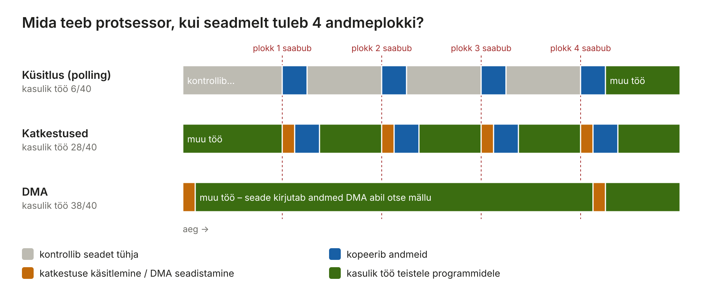
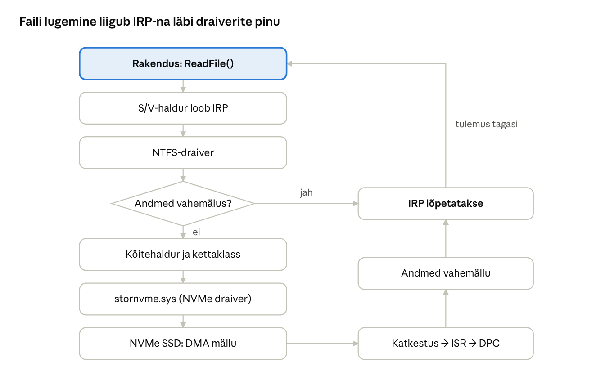

[← 13. Vahemälu](13-vahemalu.md) · [Sisukord](../README.md) · [15. Failisüsteemid Windowsis →](15-failisusteemid.md)

## 14. Sisend ja väljund

Sisend-väljund (S/V, input/output, I/O) on OS-i kõige mitmekesisem osa: seadmed erinevad kiiruse, andmeedastuse viisi ja vigade poolest miljoneid kordi. OS peidab erinevused draiverite ja ühtse S/V-mudeli taha. Windowsis käib iga S/V päring **IRP**-na (I/O Request Packet) läbi draiverite pinu.

**Miks see oluline on?** Rakenduse kirjutaja ei taha teada, kas fail asub NVMe-kettal, USB-pulgal, võrgukaustas või OneDrive’is. Ta kutsub välja ühe funktsiooni (`ReadFile`) ja OS korraldab ülejäänu. Võrdlus: hotelli külaline helistab vastuvõttu ja ütleb „palun rätikuid“. Ta ei pea teadma, kas rätikud tulevad pesumajast, laost või naaberhotellist – vastuvõtt (S/V-haldur) teab, kellele päring edasi anda (draiver), ja annab teada, kui see on täidetud.

> 🖱️ **Proovi ise:** [interaktiivne õpileht](https://valdonolvak.github.io/Operatsioonis-steemi-ja-k-berturbe-alused/interaktiivne/14-sisend-valjund.html). Lehel on seadmete kiiruste võrdlus, küsitluse, katkestuste ja DMA simulaator, sünkroonse ja asünkroonse S/V võrdlus, puhvri simulaator, IRP teekond draiverite pinus ning toiteolekute harjutus.

### 14.1 S/V probleemid

- **kiiruste erinevus** – klaviatuur annab mõned baidid sekundis, NVMe-SSD üle 10 GB/s;
- **erinevad andmesüksused** – plokid, märgid, paketid;
- **vead** – ajutised ja püsivad;
- **jagamine** – mõnda seadet saab kasutada korraga üks protsess (printer), teist paljud (ketas);
- **turve** – rakendus ei tohi seadet otse juhtida.

Kui suured on kiiruste erinevused?

| Seade | Ligikaudne kiirus | 1 GB edastamiseks kuluks |
| --- | --- | --- |
| Klaviatuur (kiire trükkija) | ~10 baiti/s | üle 3 aasta |
| Hiir | ~ sadu baite/s | nädalaid |
| USB 2.0 mälupulk | ~30 MB/s | ~35 s |
| 1 Gbit/s Ethernet | ~118 MB/s | ~9 s |
| Kõvaketas (HDD) | ~150–250 MB/s | ~5 s |
| SATA SSD | ~550 MB/s | ~2 s |
| NVMe SSD (PCIe 4/5) | ~7–14 GB/s | alla 0,2 s |

Klaviatuuri ja NVMe-ketta kiirus erineb ligi **miljard korda**. Üks ja sama S/V-süsteem peab teenindama mõlemat – seepärast on vaja eri võtteid: aeglaste seadmete jaoks katkestused, kiirete jaoks DMA ja asünkroonne S/V.

> 🖱️ **Proovi ise:** [seadmete kiiruste võrdlus](https://valdonolvak.github.io/Operatsioonis-steemi-ja-k-berturbe-alused/interaktiivne/14-sisend-valjund.html#kiirused)

### 14.2 Plokkseadmed ja märkseadmed

- **Plokkseade** (block device) salvestab andmeid kindla suurusega plokkidena, mida saab lugeda suvalises järjekorras: SSD, HDD, USB-mälupulk. Saab küsida „anna plokk nr 1 234 567“ ja sama küsimus annab alati sama vastuse (kuni keegi plokki ei muuda).
- **Märkseade** (character device) edastab märkide voogu ilma aadressideta: klaviatuur, hiir, jadaport. Klaviatuurilt ei saa küsida „anna 50. klahvivajutus“ – saab ainult lugeda järgmise.
- **Võrguseade** käsitleb pakette ja moodustab omaette klassi. Paketid võivad kaduda, tulla vales järjekorras või korduda, mida plokk- ja märkseadmetel ei juhtu.

| | Plokkseade | Märkseade | Võrguseade |
| --- | --- | --- | --- |
| Andmeühik | plokk (nt 4 KB) | bait/märk | pakett |
| Suvaline juurdepääs | jah | ei | ei |
| Tüüpiline kasutus | failisüsteem | sisestus, jadaliides | sokkel (socket) |
| Näited | SSD, HDD, mälukaart | klaviatuur, hiir, COM-port | Ethernet, Wi-Fi |

Failisüsteem (ptk 15) saab töötada ainult plokkseadme peal, sest ta peab saama hüpata suvalisse kohta kettal.

### 14.3 Andmevood

Programmi jaoks on fail, seade või võrguühendus **voog** (stream) – baidijada, mida loetakse ja kirjutatakse samade funktsioonidega (`ReadFile`, `WriteFile`). Igal protsessil on kolm standardset voogu:

| Number | Nimi | Vaikimisi |
| --- | --- | --- |
| 0 | standardsisend (stdin) | klaviatuur |
| 1 | standardväljund (stdout) | ekraan |
| 2 | standardviga (stderr) | ekraan |

Voogusid saab **ümber suunata**, ilma et programm sellest teaks:

```cmd
dir C:\Windows > failid.txt          :: väljund faili
dir C:\pole_olemas 2> vead.txt       :: veateated faili
sort < nimed.txt                     :: sisend failist
ipconfig | findstr IPv4              :: ühe programmi väljund teise sisendiks
```

PowerShellis liiguvad konveieris (pipeline) **objektid**, mitte baidid. `Get-Process | Sort-Object CPU` saadab edasi protsessiobjektid koos omadustega. Seepärast ei pea PowerShellis teksti tükeldama nagu `cmd`-s või Linuxi shellis.

### 14.4 S/V vigade käsitlemine

Vead tuleb lahendada võimalikult seadme lähedal: kontroller kordab lugemist, draiver proovib uuesti, failisüsteem kasutab varukoopiat (ReFS-i peegel) või logi, ja alles siis antakse viga rakendusele. Püsivatest vigadest annavad märku SMART-andmed ja sündmuslogi (`Disk`, `Ntfs`, `stornvme`).

**Näide.** Kõvaketta sektorit ei õnnestu esimesel korral lugeda.

1. Kettakontroller proovib uuesti ja kasutab veaparanduskoodi (ECC). Õnnestub – keegi ei saa midagi teada, SMART-loendur suureneb.
2. Kui see ei õnnestu, annab kontroller vea draiverile. Draiver proovib mõne korra uuesti ja kirjutab sündmuslogisse hoiatuse (`Disk`, sündmus 7 või 153).
3. Kui ka see ei aita, saab NTFS vea. Peegeldatud köite korral loeb ta andmed teiselt kettalt.
4. Alles siis saab rakendus vea (nt „Andmeviga – tsükliline liiasuskontroll“).

Administraatori jaoks on oluline, et sündmuslogis korduvad kettavead on hoiatus enne ketta lõplikku riket. Varunda andmed ja vaheta ketas.

### 14.5 Sünkroonne ja asünkroonne S/V

- **Sünkroonne** – lõim ootab, kuni operatsioon lõpeb; lihtne programmeerida.
- **Asünkroonne** – lõim annab päringu üle ja jätkab tööd; teade lõpust tuleb sündmuse, tagasikutse või **S/V lõpetamispordi** (I/O completion port, IOCP) kaudu. IOCP on Windowsi suure jõudlusega serverite (IIS, SQL Server) alus.
- **I/O Ring** (Windows 11) – uus API, kus rakendus paneb päringud jagatud mälus järjekorda ja saab tulemused samast kohast; vähem süsteemikutseid. Sarnane Linuxi io\_uringiga.

**Võrdlus.** Sünkroonne S/V on nagu kohvikus leti ees ootamine, kuni kohv valmis saab – sa ei saa vahepeal midagi muud teha. Asünkroonne on nagu helisev märguandja: tellid, saad märguandja, istud lauda ja töötad edasi; kui kohv on valmis, märguandja heliseb.

**Miks see serveris oluline on?** Veebiserveril on 1000 samaaegset klienti ja iga päring vajab andmebaasist vastust (10 ms ootamist).

- **Sünkroonselt** on vaja 1000 lõime, sest iga lõim ootab oma vastust. Igal lõimel on oma pinu (1 MB) ja planeerija peab neid kõiki haldama.
- **Asünkroonselt (IOCP)** piisab mõnest lõimest tuuma kohta. Lõim saadab päringu andmebaasi teele, võtab kohe järgmise kliendi ja tuleb esimese juurde tagasi siis, kui vastus on saabunud.

```csharp
// Sünkroonne: lõim on lugemise ajal blokeeritud
string tekst = File.ReadAllText("suur.txt");
// Asünkroonne: lõim vabaneb ootamise ajaks muuks tööks
string tekst = await File.ReadAllTextAsync("suur.txt");
```

Kasutajaliideses tähendab sünkroonne S/V UI-lõimes, et aken „ei vasta“, kuni fail on loetud (vt ka ptk 11.1).

> 🖱️ **Proovi ise:** [sünkroonne vs asünkroonne server](https://valdonolvak.github.io/Operatsioonis-steemi-ja-k-berturbe-alused/interaktiivne/14-sisend-valjund.html#asunkroonne)

### 14.6 Puhvri kasutamine

**Puhver** (buffer) on mälupiirkond, kus andmeid hoitakse seadme ja programmi vahel. Puhver tasandab kiiruste erinevusi (klaviatuuripuhver, võrgukaardi järjekord), võimaldab koguda väikesed kirjutused suuremaks ja lubab programmil jätkata enne, kui seade on valmis. **Topeltpuhver** – üht täidetakse, teist tühjendatakse.

**Näide: video voogedastus.** Võrk ei too andmeid ühtlaselt – vahel tuleb korraga palju, vahel mitu sekundit mitte midagi. Videomängija vajab aga iga sekund täpselt sama palju andmeid. Seepärast laeb mängija enne esitamist mõne sekundi videot **puhvrisse**. Kui võrk korraks katkeb, mängib video edasi puhvrist. Kui puhver saab tühjaks, näeb kasutaja ringi „Puhverdamine…“. Suurem puhver = vähem katkestusi, kuid pikem ootamine alguses.

**Näide: klaviatuur.** Kui arvuti on hõivatud ja sa trükid, salvestatakse klahvivajutused klaviatuuripuhvrisse. Kui programm jälle reageerib, ilmuvad kõik tähed korraga ekraanile – ükski ei kadunud.

**Topeltpuhver** on tavaline graafikas: ekraanikaart näitab ühte pilti (esipuhver), samal ajal joonistab mäng järgmist (tagapuhver). Kui joonistamine on valmis, vahetatakse puhvrid. Ilma selleta näeks kasutaja poolikult joonistatud kaadreid.

> 🖱️ **Proovi ise:** [video puhvri simulaator](https://valdonolvak.github.io/Operatsioonis-steemi-ja-k-berturbe-alused/interaktiivne/14-sisend-valjund.html#puhver)

### 14.7 Küsitlus

**Küsitlus** (polling) tähendab, et protsessor kontrollib tsüklis seadme olekuregistrit. See raiskab protsessoriaega aeglaste seadmete puhul, kuid on väga kiirete seadmete puhul mõnikord parem kui katkestus, sest väldib katkestuse kulu. Näiteks võrgukaardid lülituvad suure koormuse all katkestustelt küsitlusele.

**Võrdlus.** Ootad pakki. Küsitlus tähendab, et käid iga viie minuti järel postkasti vaatamas – enamasti asjata, ja muud tööd teha ei jõua. Katkestus on nagu uksekell: teed oma tööd ja kuller annab ise märku. Kui aga kullerid tulevad iga 10 sekundi järel, on mõistlikum seista ukse juures, kui iga kord tööde juurest tõusta.

### 14.8 Katkestused

Seade annab katkestusega teada, et operatsioon on lõppenud või andmed on saabunud (ptk 5). Katkestuse käsitlemine maksab aga ka midagi: protsessor peab katkestama oma töö, salvestama oleku, käivitama ISR-i ja hiljem DPC.

**Kaasaegsed seadmed** kasutavad **MSI-X** katkestusi (iga järjekord võib saata katkestuse eri tuumale) ja **katkestuste koondamist** (interrupt moderation): 10 Gbit/s võrgukaart võib saada sekundis üle miljoni paketi. Kui iga pakett tekitaks katkestuse, kuluks kogu protsessoriaeg katkestustele. Seepärast kogub kaart pakette ja annab ühe katkestuse näiteks iga 50 paketi kohta.

### 14.9 Otsemälupöördus

**DMA** (Direct Memory Access) laseb seadmel kanda andmeid otse mällu ilma protsessorita; protsessor saab katkestuse alles lõpus.

**Näide.** 1 GB faili lugemiseks ilma DMA-ta peaks protsessor ise kopeerima seadmelt mällu iga sõna – sadu miljoneid operatsioone. DMA-ga ütleb draiver kontrollerile: „loe plokid 1000–263 143 ja kirjuta need RAM-i aadressile X“. Kontroller teeb kõik ise ja annab lõpus ühe katkestuse. Protsessor teeb vahepeal teiste programmide tööd.



Joonis: küsitluse korral kontrollib protsessor seadet tühja ja kopeerib andmeid ise; katkestustega teeb ta vahepeal muud tööd, kuid kopeerib endiselt ise; DMA puhul seadistab ta ülekande ja saab lõpus ühe katkestuse.

> 🖱️ **Proovi ise:** [küsitluse, katkestuste ja DMA simulaator](https://valdonolvak.github.io/Operatsioonis-steemi-ja-k-berturbe-alused/interaktiivne/14-sisend-valjund.html#kysitlus). Muuda seadme kiirust ja vaata, millal on küsitlus katkestustest parem.

**Turvarisk.** Kuna DMA-seade saab kirjutada mis tahes mäluaadressile, on see turvarisk. Ründaja, kellel on lühiajaline füüsiline juurdepääs lukustatud sülearvutile, võib ühendada Thunderbolt- või PCIe-pordiga pahatahtliku seadme ja lugeda mälust krüptovõtmeid või muuta tuuma koodi (nt *Thunderspy*, 2020). Kaitse: **IOMMU** ja Windowsi **Kernel DMA Protection**, mis lubab välisseadmele ainult talle määratud mälupiirkonnad. Kas kaitse on sees, näeb `msinfo32` alt.

### 14.10 S/V-seadmete draiverid

**Draiver** on tarkvara, mis tõlgib OS-i üldised päringud (loe, kirjuta) konkreetse seadme käskudeks. Draiverid on kihtides:

- **funktsioonidraiver** – põhiline seadme juhtija (nt `stornvme.sys`);
- **siini draiver** – tuvastab siinil seadmed (PCI, USB);
- **filtridraiverid** – asuvad teiste vahel ja muudavad või jälgivad päringuid (viirusetõrje failifilter, BitLocker).

**Näide: USB-pulga draiverite pinu** (ülevalt alla):

| Kiht | Draiver | Ülesanne |
| --- | --- | --- |
| Failisüsteemi filter | `WdFilter.sys` (Defender) | kontrollib avatavaid faile pahavara suhtes |
| Failisüsteem | `exfat.sys` / `ntfs.sys` | failid ja kaustad |
| Köite filter | `fvevol.sys` (BitLocker To Go) | krüpteerib ja dekrüpteerib plokke |
| Köide ja partitsioon | `volmgr.sys`, `partmgr.sys` | köited ja partitsioonid |
| Kettaklass | `disk.sys` | üldine ketas |
| Funktsioonidraiver | `usbstor.sys` | USB-massmäluseade |
| Siini draiver | `usbhub3.sys`, `usbxhci.sys` | USB-siin ja kontroller |

Iga kiht teeb oma osa ja annab IRP edasi järgmisele. Tänu sellele saab BitLockeri või viirusetõrje lisada ilma failisüsteemi või kettadraiverit muutmata.

**Draiverid ja turvalisus.** Tuumarežiimi draiveril on täielik võim: viga draiveris võib kogu süsteemi kokku jooksutada (sinine ekraan) ja turvaauk annab ründajale tuuma õigused.

- **19. juulil 2024** põhjustas CrowdStrike Falconi turbetarkvara vigane uuendus tuumadraiveris umbes **8,5 miljoni** Windowsi arvuti krahhi – lennujaamad, haiglad ja pangad seisid. See on peamine põhjus, miks Microsoft soovitab draiverid ja turbetarkvara viia võimalikult palju **kasutajarežiimi** (UMDF).
- **BYOVD** (Bring Your Own Vulnerable Driver) – ründaja paigaldab legaalse, digitaalselt allkirjastatud, kuid haavatava draiveri ja kasutab selle viga tuuma õiguste saamiseks. Kaitse: Microsofti **haavatavate draiverite blokeerimisloend** (Windows 11 22H2-st vaikimisi sees) ja **HVCI** (mälu terviklikkus).

Windows Update levitab draivereid tootjate eest. Alates 2024. aastast on Microsofti draiveriprogrammis rangemad nõuded ning soovitus viia draiverid kasutajarežiimi (UMDF) või kirjutada mäluturvalises keeles.

### 14.11 S/V Windowsis

Tavaline faili lugemine:

1. Rakendus kutsub `ReadFile`.
2. `ntdll.dll` teeb süsteemikutse `NtReadFile`.
3. S/V-haldur loob IRP ja saadab selle failisüsteemi draiverile (NTFS).
4. Kui andmed on vahemälus, kopeeritakse need sealt; muidu saadab NTFS päringu edasi helitugevushaldurile ja kettadraiverile.
5. Kettadraiver programmeerib kontrolleri, kontroller teeb DMA ja annab katkestuse.
6. ISR → DPC → IRP lõpetatakse ja tulemus jõuab rakenduseni.



Joonis: kui andmed on vahemälus, lõpeb päring kohe; muidu liigub IRP draiverite pinus alla seadmeni ning lõpetatakse katkestuse ja DPC kaudu.

**IRP** on nagu saatekiri, mis liigub osakonnast osakonda: igaüks loeb, mida temalt oodatakse, teeb oma osa ja saadab kirja edasi. Kui töö on tehtud, liigub kiri sama teed tagasi ja igaüks saab vajadusel tulemust kontrollida (nt BitLocker dekrüpteerib loetud andmed).

> 🖱️ **Proovi ise:** [IRP teekond draiverite pinus](https://valdonolvak.github.io/Operatsioonis-steemi-ja-k-berturbe-alused/interaktiivne/14-sisend-valjund.html#irp)

### 14.12 S/V-haldur

**S/V-haldur** (I/O Manager) loob ja suunab IRP-sid, haldab draiverite pinu, tagab ühtse liidese kõigile seadmetele ja failisüsteemidele ning toetab asünkroonset S/V-d ja tühistamist.

### 14.13 Plug and Play haldur

**PnP-haldur** tuvastab seadmed, laadib nende draiverid, jagab ressursse (katkestused, mälualad) ja teavitab rakendusi seadmete lisamisest või eemaldamisest. Seadmed tuvastatakse riistvara ID-de järgi (nt `PCI\VEN_8086&DEV_…`: VEN = tootja, DEV = seade). Seadmete paigaldamist saab ettevõttes piirata rühmapoliitikaga (nt USB-salvestite keelamine).

Enne PnP-d (Windows 95 eelne aeg) pidi kasutaja seadme paigaldamisel ise valima katkestuse numbri ja S/V-pordi aadressi hüppelülititega kaardil. Kui kaks seadet kasutasid sama katkestust, ei töötanud kumbki. PnP tegi selle automaatseks.

### 14.14 Toitehaldur

**Toitehaldur** (Power Manager) koordineerib süsteemi ja seadmete toiteolekuid (ACPI).

| Olek | Nimi | Mis on toite all | Ärkamine |
| --- | --- | --- | --- |
| S0 | töötab | kõik | – |
| S0 madal tarve | Modern Standby | RAM, osa riistvarast; võrk ühendatud | kohe |
| S3 | unerežiim | ainult RAM | paar sekundit |
| S4 | talveunerežiim | mitte midagi; RAM-i sisu on failis `hiberfil.sys` | kümmekond sekundit |
| S5 | väljalülitatud | mitte midagi | täielik käivitus |

Kaasaegsed sülearvutid kasutavad **Modern Standby**-d (S0 madala energiaga ooteolek): arvuti on nutitelefoni moodi võrgus ja uuendab e-kirju ka ooterežiimis. Sellistes arvutites S3 sageli puudub (`powercfg /a`).

Seadmetel on olekud **D0** (töötab) kuni **D3** (välja lülitatud). Näiteks võib Wi-Fi kaart olla D3-s, kui arvuti töötab, kuid võrku pole vaja.

**Kiire käivitus** (Fast Startup) on hübriid väljalülitusest ja talveunest: kasutajaseansid suletakse, kuid tuumaseanss salvestatakse `hiberfil.sys`-i. Järgmisel käivitamisel loetakse see failist ja Windows käivitub kiiremini. **Tagajärg administraatorile:** „Lülita välja“ ei käivita tuuma uuesti puhtalt – Tegumihalduri tööaeg (Up time) ei nullita ja osa uuendusi ning draiveriprobleeme laheneb alles **„Taaskäivita“** valimisel, mis teeb alati täieliku käivituse.

> 🖱️ **Proovi ise:** [milline toiteolek?](https://valdonolvak.github.io/Operatsioonis-steemi-ja-k-berturbe-alused/interaktiivne/14-sisend-valjund.html#toide)

### Võrdlus: Linux

| | Windows | Linux |
| --- | --- | --- |
| Seadmed | seadmehaldur, PnP-haldur | `/dev`-kataloogi failid, `udev` |
| Plokk- ja märkseade | peidetud draiverimudelisse | `ls -l /dev` näitab tüüpi `b` või `c` |
| Seadmete loend | `Get-PnpDevice` | `lsblk`, `lsusb`, `lspci` |
| Draiverid | `.sys` failid, `driverquery` | tuumamoodulid, `lsmod`, `modprobe` |
| Asünkroonne S/V | IOCP, I/O Ring | epoll, io\_uring |

Linuxi põhimõte „kõik on fail“ tähendab, et ka seadmed on failid: `/dev/sda` on esimene ketas, `/dev/ttyS0` jadaport. Windowsis on seadmetel samuti nimed (`\Device\HarddiskVolume3`), kuid need on peidetud objektihalduri nimeruumi (ptk 5).

### Näide: USB-pulk arvutiklassis

**Mis juhtub, kui õpilane paneb arvutisse USB-pulga:**

1. USB-kontroller tuvastab uue seadme ja annab katkestuse.
2. **PnP-haldur** küsib seadmelt riistvara-ID (`USB\VID_0781&PID_5581`) ja leiab sobiva draiveri (`usbstor.sys`).
3. Draiver laaditakse, seade saab nime, partitsioonid tuvastatakse ja exFAT-köide ühendatakse tähena `E:`.
4. PnP-haldur teavitab rakendusi; Explorer avab akna ja Defender skannib köite.
5. Pulga eemaldamisel saadetakse IRP-d, mis sulgevad failid; kuna eemaldatavatel ketastel on kiire eemaldamine (vahemälu väljas), ei kao andmed ka ilma „turvalise eemaldamiseta“, kui faili parajasti ei kirjutata.

**Kooli poliitika.** IT-juht soovib, et õpilased saaksid pulgalt lugeda, kuid mitte kirjutada (andmelekete vältimiseks). Rühmapoliitika *Removable Disks: Deny write access* paneb Windowsi keelduma kirjutamis-IRP-dest. Kirjutamiskatse annab kasutajale veateate „Juurdepääs keelatud“; lugemine töötab.

**Miks see turvalisuse jaoks oluline on?** USB-pulk on üks levinumaid viise, kuidas andmed asutusest lahkuvad või pahavara sisse tuleb. Ründajad on jätnud parklasse pahavaraga pulki lootuses, et keegi need tööarvutisse paneb. Lisaks USB-salvestite piiramisele saab rühmapoliitikaga lubada ainult kindlaid seadmeid riistvara-ID järgi.

### Kokkuvõte

- S/V on mitmekesine; seadmete kiirused erinevad kuni miljard korda. OS ühtlustab selle IRP-de ja draiveripinude abil.
- Plokkseadmeid saab lugeda suvalisest kohast, märkseadmed annavad voo, võrguseadmed pakette.
- Standardvoogusid saab ümber suunata ilma programmi muutmata.
- Asünkroonne S/V (IOCP, I/O Ring) võimaldab väheste lõimedega teenindada tuhandeid päringuid.
- Puhver tasandab kiiruste ja ajastuse erinevusi.
- Küsitlus sobib väga kiiretele seadmetele, katkestused aeglastele; DMA vabastab protsessori andmete kopeerimisest, kuid vajab IOMMU kaitset.
- Draiverid on kihtides; vigane või haavatav tuumadraiver ohustab kogu süsteemi.
- PnP- ja toitehaldur haldavad seadmete elutsüklit ja energiat; Fast Startup ei ole täielik taaskäivitus.

### Kontrollküsimused

> 🧪 **Interaktiivne test:** [kontrolli oma teadmisi](https://valdonolvak.github.io/Operatsioonis-steemi-ja-k-berturbe-alused/interaktiivne/14-test.html). Test koosneb 25 valikvastusega küsimusest. Iga vastuse järel näed selgitust ning lõpus saad valesti vastatud küsimusi korrata.

1. Milliseid probleeme tekitab S/V operatsioonisüsteemile?
2. Mis vahe on plokk-, märk- ja võrguseadmel? Too igaühe kohta kaks näidet.
3. Mis on standardvood? Mida teeb käsk `dir > failid.txt 2> vead.txt`?
4. Kuidas käsitletakse S/V vigu kihtide kaupa?
5. Mis vahe on sünkroonsel ja asünkroonsel S/V-l? Miks kasutavad serverid IOCP-d?
6. Milleks on puhver? Too kaks näidet.
7. Võrdle küsitlust ja katkestusi. Millal on küsitlus parem? Mis on katkestuste koondamine?
8. Mis on DMA ja millist turvariski see tekitab? Kuidas Windows sellest kaitseb?
9. Kirjelda USB-pulga draiverite pinu. Mis on filtridraiver?
10. Miks on vigane tuumadraiver ohtlik? Mis on BYOVD?
11. Kirjelda faili lugemise teekonda rakendusest kettani.
12. Mis on S/V-, PnP- ja toitehalduri ülesanded?
13. Mis vahe on S3-l, S4-l ja Modern Standby-l? Miks on Fast Startupi korral oluline vahe „Lülita välja“ ja „Taaskäivita“ vahel?

### Valikküsimused

1. Mis on IRP? a) katkestuse prioriteet b) S/V päringupakett c) draiveri allkiri d) failisüsteem
2. Milline seade on plokkseade? a) hiir b) klaviatuur c) SSD d) jadaport
3. Mis kaitseb pahatahtliku DMA eest? a) UAC b) IOMMU / Kernel DMA Protection c) ASLR d) SmartScreen
4. Mis on S4? a) tööolek b) unerežiim c) talveunerežiim d) Modern Standby
5. Milline standardvoog on number 2? a) sisend b) väljund c) viga d) logi

### Praktiline ülesanne

```powershell
Get-PnpDevice -PresentOnly | Group-Object Class | Sort-Object Count -Descending | Select-Object -First 10 Name, Count
Get-PnpDevice -Class DiskDrive | Get-PnpDeviceProperty DEVPKEY_Device_DriverVersion
driverquery /v | Select-Object -First 15
powercfg /a
powercfg /energy /output $env:TEMP\energia.html
```

Ava seadmehaldur → Vaade → „Seadmed ühenduste järgi“ ja leia oma SSD teekond PCI siinilt kettani. Ava `energia.html` ja nimeta kaks probleemi, mida aruanne leidis. Kontrolli `msinfo32` alt, kas „Kernel DMA Protection“ on sees.

Proovi `cmd`-s voogude ümbersuunamist: `dir C:\Windows > failid.txt`, `dir C:\pole_olemas 2> vead.txt` ja `type failid.txt | find /c /v ""`. Mida iga käsk tegi?

### Iseseisvad ülesanded

**1. Seadme teekond.** Vali oma arvutist üks seade (nt võrgukaart, kaamera või SSD). Leia seadmehaldurist selle riistvara-ID, draiveri fail(id), draiveri versioon ja kuupäev ning seadme vanem-seade vaates „Seadmed ühenduste järgi“. **Esita:** ekraanipildid ja skeem: siin → kontroller → seade → draiver.

**2. Toite- ja seadmeprobleemide aruanne.** Käivita administraatorina `powercfg /energy` ja `powercfg /sleepstudy` (Modern Standby arvutis) või `powercfg /batteryreport`. Leia aruandest kolm seadet või rakendust, mis kulutavad energiat või takistavad unerežiimi. **Esita:** loetelu ja iga kohta soovitus, mida kasutaja või administraator saaks teha.

### Viited

- Krogh (2017), ptk 14.
- Yosifovich jt, *Windows Internals* 7. tr, 1. osa, ptk 6 „I/O system“.
- Microsoft Learn: [Kernel DMA Protection](https://learn.microsoft.com/windows/security/hardware-security/kernel-dma-protection-for-thunderbolt); [Modern Standby](https://learn.microsoft.com/windows-hardware/design/device-experiences/modern-standby); [I/O Completion Ports](https://learn.microsoft.com/windows/win32/fileio/i-o-completion-ports); [Microsoft recommended driver block rules](https://learn.microsoft.com/windows/security/application-security/application-control/app-control-for-business/design/microsoft-recommended-driver-block-rules).

> 📝 **Test:** selle peatüki Google Formsi test luuakse skriptiga [`google-forms/looVormid.gs`](../google-forms/looVormid.gs).

---

[← 13. Vahemälu](13-vahemalu.md) · [Sisukord](../README.md) · [15. Failisüsteemid Windowsis →](15-failisusteemid.md)
