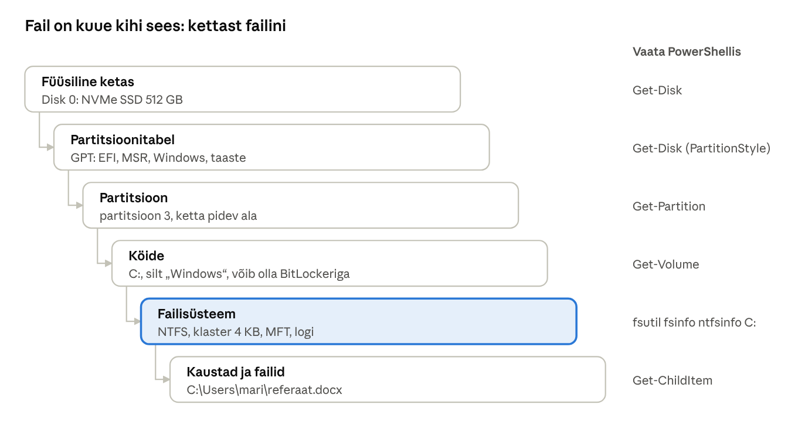
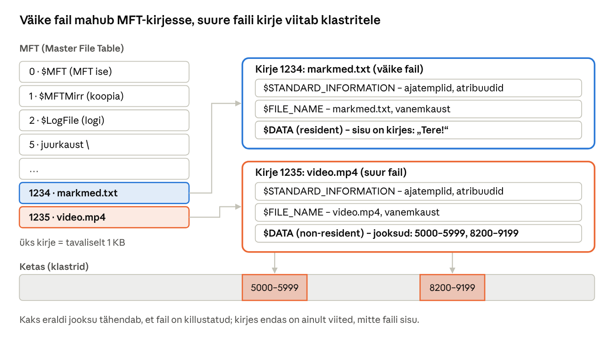
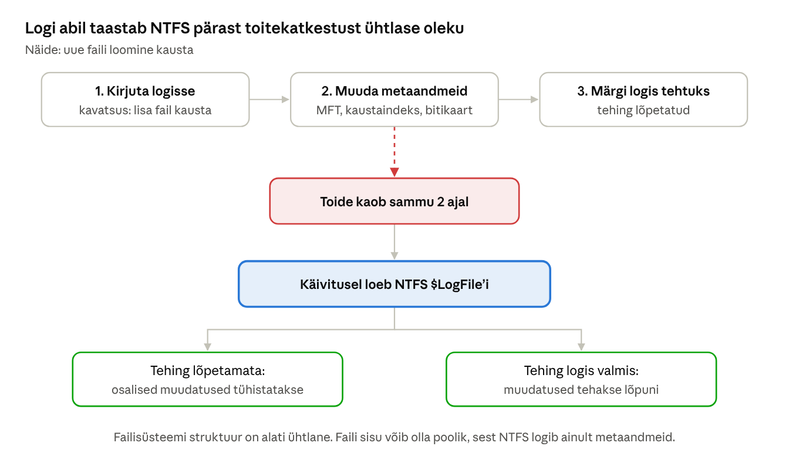
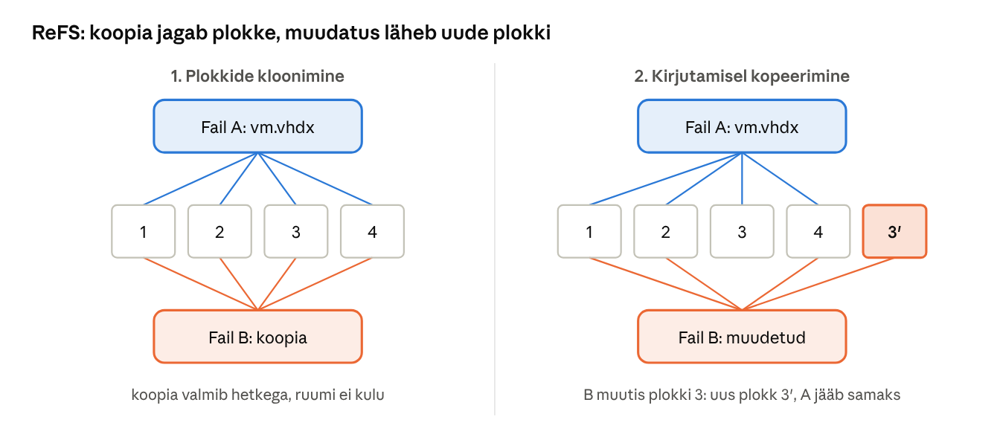
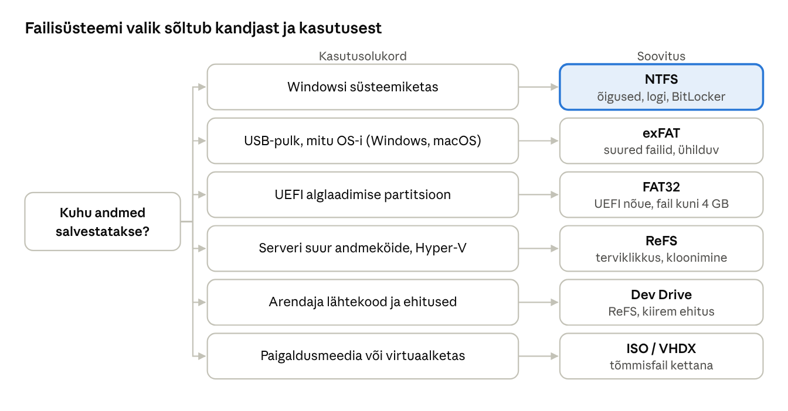
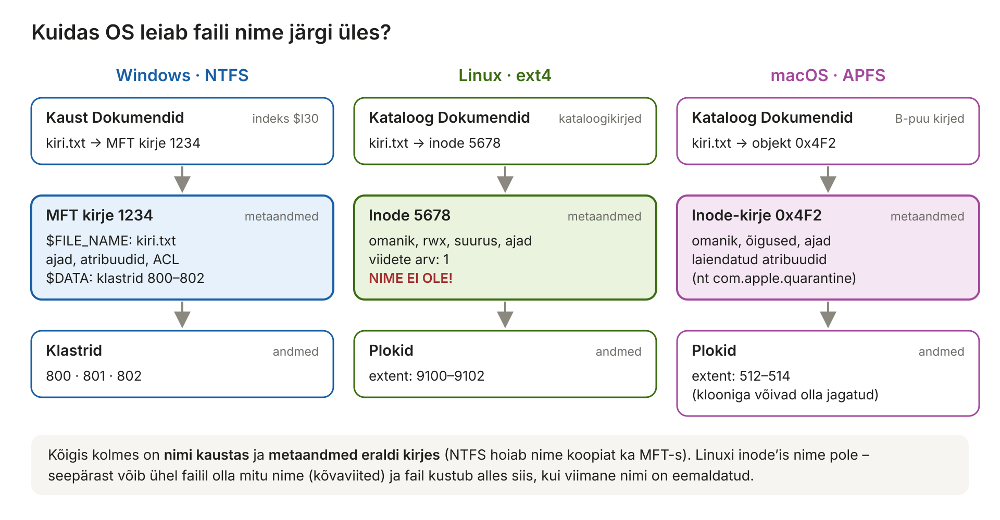

[← 14. Sisend ja väljund](14-sisend-valjund.md) · [Sisukord](../README.md) · [16. Salvestushaldus →](16-salvestushaldus.md)

## 15. Failisüsteemid Windowsis

**Failisüsteem** (file system) korraldab, kuidas failid ja kaustad kettale salvestatakse, leitakse ja kaitstakse. Windows 11 süsteemiketas on NTFS; välised kandjad on sageli exFAT või FAT32; serverites ja arendajate Dev Drive’il kasutatakse ReFS-i. Linuxis on levinuim **ext4** ja macOS-is **APFS** – neid käsitlevad ptk 15.8 ja 15.9.

**Miks failisüsteemi vaja on?** Ketas ise teab ainult numbritega plokke: „plokk 0, plokk 1, … plokk 500 miljonit“. Ta ei tea midagi failidest, kaustadest, nimedest ega õigustest. Failisüsteem on nagu **raamatukogu kataloog**: raamatud (andmed) on riiulitel, kuid ilma kataloogita ei leiaks keegi midagi üles. Failisüsteem jätab meelde, milline fail millistes plokkides asub, mis on tema nimi, kellele ta kuulub ja millal teda muudeti.

> 🖱️ **Proovi ise:** [interaktiivne õpileht](https://valdonolvak.github.io/Operatsioonis-steemi-ja-k-berturbe-alused/interaktiivne/15-failisusteemid.html). Lehel on FAT-tabeli simulaator, klastri suuruse kalkulaator, faili elutsükli simulaator Windowsi, Linuxi ja macOS-i jaoks (salvestamine, avamine, muutmine, kustutamine, taastamine), failinimede kontroll kolmes OS-is, Linuxi õiguste kalkulaator ja failisüsteemi valiku harjutus.



Joonis: failisüsteem on üks kiht kuuest. Kui „ketas ei avane“, tuleb kindlaks teha, millises kihis viga on – ketas, partitsioon, köide (nt lukus BitLocker) või failisüsteem.

### Põhimõisted

| Mõiste | Tähendus | Näide |
| --- | --- | --- |
| **Sektor** | väikseim ühik, mida ketas lugeda või kirjutada oskab | 512 baiti või 4 KB |
| **Klaster** (allocation unit, Linuxis *plokk*) | väikseim ühik, mille failisüsteem failile annab | tavaliselt 4 KB |
| **Metaandmed** | andmed faili kohta: nimi, suurus, ajad, omanik, õigused, asukoht kettal | „kiri.txt, 2 KB, muudetud 12.11.2026“ |
| **Kaust / kataloog** | eriline fail, mis seob nimed failide kirjetega | `Dokumendid` |
| **Tee** (path) | faili asukoht kaustapuus | `C:\Users\mari\kiri.txt`, `/home/mari/kiri.txt` |
| **Köide** (volume) | vormindatud ala, millel on üks failisüsteem | `C:`, `/`, `Macintosh HD` |

**Miks on klaster oluline?** Fail saab alati terve arvu klastreid. 1-baidine fail võtab 4 KB klastriga kettal 4 KB ruumi. Kui kaustas on 100 000 väikest faili (nt veebiarenduse `node_modules`), võib „Suurus kettal“ olla mitu korda suurem kui „Suurus“ – vaata faili või kausta atribuute Exploreris. Suurem klaster (nt 64 KB) tähendab vähem metaandmeid suurtele failidele (videod), kuid rohkem raisatud ruumi väikestele.

> 🖱️ **Proovi ise:** [klastri suuruse kalkulaator](https://valdonolvak.github.io/Operatsioonis-steemi-ja-k-berturbe-alused/interaktiivne/15-failisusteemid.html#klaster)

### 15.1 FAT

**FAT** (File Allocation Table) on 1970. aastate lihtne failisüsteem: kettal on tabel, mis näitab iga klastri järgmist klastrit. Variandid FAT12, FAT16 ja FAT32. FAT32 puudused: ühe faili suurus kuni 4 GB, õigusi ja logimist pole, toitekatkestusel võib struktuur rikneda. FAT32 on endiselt UEFI süsteemipartitsiooni (EFI System Partition) failisüsteem.

**Kuidas FAT-tabel töötab?** Kaustas on kirje „kiri.txt, algab klastrist 5“. FAT-tabelis on iga klastri kohta üks lahter, mis ütleb, milline klaster tuleb järgmisena:

```
FAT[5] = 8      → fail jätkub klastris 8
FAT[8] = 9      → fail jätkub klastris 9
FAT[9] = EOF    → faili lõpp
```

Faili lugemiseks käiakse ahel läbi: 5 → 8 → 9. Kui fail kasvab ja kõrval vaba ruumi pole, lisatakse ahelasse mõni kauge klaster – nii tekib **killustumine** (HDD-l aeglane).

**Kustutamine FAT-is:** kaustakirje esimene märk asendatakse erimärgiga (0xE5) ja faili klastrid märgitakse FAT-is vabaks. **Andmed ise jäävad kettale**, kuni need üle kirjutatakse. Seepärast saavad taastetööriistad (nt PhotoRec) mälukaardilt kogemata kustutatud fotosid sageli tagasi tuua – kui kaarti pärast kustutamist ei kasutatud.

> 🖱️ **Proovi ise:** [FAT-tabeli simulaator](https://valdonolvak.github.io/Operatsioonis-steemi-ja-k-berturbe-alused/interaktiivne/15-failisusteemid.html#fat)

**exFAT** (2006) on FAT-i edasiarendus mälukaartidele ja USB-pulkadele: suured failid, suured kettad, kerge struktuur, töötab Windowsis, macOS-is, Linuxis ja telefonides. Õigusi ja logimist ei ole.

### 15.2 NTFS

**NTFS** (NT File System, 1993) on Windowsi põhifailisüsteem. Põhiomadused:

- **MFT** (Master File Table) – iga fail ja kaust on MFT kirje; väikesed failid mahuvad otse kirjesse;
- **logimine** (journaling) – metaandmete muudatused kirjutatakse logisse `$LogFile`; krahhi järel taastatakse ühtlane olek;
- **õigused** – iga faili ja kausta kohta ACL (ptk 18);
- **tihendamine** ja **EFS-krüpteerimine** failide kaupa;
- **kettakvoodid** kasutajate kaupa;
- **kõvaviited, sümbolviited, ühenduspunktid** (junctions);
- **alternatiivsed andmevood** (ADS) – näiteks `Zone.Identifier` vood märgivad internetist alla laaditud faile („Mark of the Web“), mille alusel SmartScreen ja Office hoiatavad;
- **muudatuste päevik** (USN Journal) – varundus- ja indekseerimisprogrammid saavad teada, mis muutus;
- **varikoopiad** (Volume Shadow Copy) – hetkeseisud varunduseks ja „Eelmised versioonid“.



Joonis: iga fail on MFT kirje, mis koosneb atribuutidest. Väikese faili sisu ($DATA) on kirje sees; suure faili $DATA sisaldab ainult jooksude loendit ehk viiteid kettal olevatele klastritele.



Joonis: NTFS kirjutab kavatsuse enne muudatust logisse. Pärast katkestust loeb ta logi ja kas tühistab pooleli jäänud tehingu või viib selle lõpuni – seetõttu ei pea NTFS-i puhul pärast iga krahhi `chkdsk`-i tegema, nagu FAT-i puhul.

### 15.3 ReFS ja Dev Drive

**ReFS** (Resilient File System, Windows Server 2012) on loodud suurte andmemahtude ja töökindluse jaoks:

- **terviklikkusvood** (integrity streams) – kontrollsummad tuvastavad vaikse andmeriknemise; Storage Spaces peegliga parandatakse viga automaatselt;
- **kirjutamisel kopeerimine** metaandmetele – logi pole vaja;
- **plokkide kloonimine** – suure faili koopia tehakse hetkega, viidates samadele plokkidele (kasulik Hyper-V ja varunduse jaoks);
- Windows Server 2025-s **dedubleerimine ja tihendamine** kõigis väljaannetes ([HKU AI Hub / Microsoft](https://aihub.hkuspace.hku.hk/2024/11/04/windows-server-2025-now-generally-available-with-advanced-security-improved-performance-and-cloud-agility/)).



Joonis: 100 GB virtuaalketta koopia tekib ReFS-il sekundiga, sest koopia viitab samadele plokkidele. Kui koopiat muudetakse, kirjutatakse muudetud plokk uude kohta ja algne fail jääb puutumata. Sama põhimõtet kasutavad ka Linuxi Btrfs ja macOS-i APFS.

ReFS-il puuduvad mõned NTFS-i omadused (nt EFS, kettakvoodid), ja Windowsi kliendis ei saa sellelt käivitada.

**Dev Drive** on Windows 11 arendajatele mõeldud ReFS-köide, millel Microsoft Defender töötab **jõudlusrežiimis**: reaalajakontroll toimub asünkroonselt. Microsofti andmetel kiirendab see ehitusaegu kuni 30% ([Windows Developer Blog](https://blogs.windows.com/windowsdeveloper/2023/06/01/dev-drive-performance-security-and-control-for-developers/)). Jõudlusrežiim töötab ainult Dev Drive’il, mitte NTFS-süsteemikettal ([Microsoft Learn](https://learn.microsoft.com/defender-endpoint/microsoft-defender-endpoint-antivirus-performance-mode)). Turvalisuse mõttes on see kompromiss: Dev Drive’ile ei panda allalaadimisi ega kahtlase päritoluga faile.

### 15.4 SSD-ketaste tugi

SSD-l puuduvad liikuvad osad ning pöördumisaeg ei sõltu andmete asukohast, seega pole killustatuse eemaldamist vaja. Windows tuvastab SSD automaatselt ja:

- saadab **TRIM**-käske (NVMe-l *Deallocate*): failisüsteem teatab, millised plokid on vabad, et SSD saaks neid ette kustutada;
- teeb ajastatud optimeerimisel (`Optimize-Volume`) ainult TRIM-i, mitte killustatuse eemaldamist;
- kasutab NVMe mitme järjekorra tuge (ptk 5, 14).

### 15.5 Optiliste ketaste ja tõmmisfailide failisüsteemid

CD-de failisüsteem on **ISO 9660** (laiendustega Joliet pikkade nimede jaoks), DVD-del ja Blu-ray’del **UDF** (Universal Disk Format). Optilisi seadmeid kasutatakse harva, kuid samad vormingud elavad edasi **ISO-tõmmistes**: Windowsi paigaldustõmmis on ISO-fail, mille saab Exploreris topeltklõpsuga ühendada virtuaalseks kettaks. Virtuaalmasinate kettatõmmised on **VHD/VHDX** failid, mida saab samuti ühendada (`Mount-VHD`, `Mount-DiskImage`).

ISO- ja VHD-failid ei pruugi kanda „Mark of the Web“ märget sisu failidele edasi, mistõttu kasutati neid 2022–2023 pahavara levitamiseks; Microsoft on seda vahepeal parandanud, kuid e-kirjaga tulnud tõmmisfaile tuleb endiselt kahtlustada.

### 15.6 Pilvefailid

OneDrive kasutab **Cloud Files API**-t: failid on kettal kohtäitjatena (placeholders) ja laaditakse alla avamisel. Failisüsteemi filtridraiver `cldflt.sys` vahendab päringuid. Kasutaja näeb olekuikoone: ainult pilves, lokaalselt saadaval, alati selles seadmes.

| Failisüsteem | Kus kasutatakse | Õigused | Logimine | Märkus |
| --- | --- | --- | --- | --- |
| FAT32 | EFI-partitsioon, vanad kandjad | ei | ei | fail kuni 4 GB |
| exFAT | mälukaardid, USB | ei | ei | platvormiülene |
| NTFS | Windowsi süsteemiketas | jah | jah | kõige rohkem funktsioone |
| ReFS | serverid, Dev Drive | jah | kirjutamisel kopeerimine | terviklikkusvood, plokkide kloonimine |
| UDF / ISO 9660 | DVD, ISO-tõmmised | ei | ei | ainult lugemiseks tõmmistes |



Joonis: süsteemikettale NTFS, eemaldatavale kandjale exFAT, EFI-partitsioonile FAT32 ja suurtele serveriköidetele ReFS.

> 🖱️ **Proovi ise:** [milline failisüsteem sobib?](https://valdonolvak.github.io/Operatsioonis-steemi-ja-k-berturbe-alused/interaktiivne/15-failisusteemid.html#valik)

### 15.7 Faili elutsükkel Windowsis: salvestamine, avamine ja kustutamine

**Salvestamine (uus fail).** Kasutaja salvestab Notepadis faili `C:\Users\mari\Dokumendid\kiri.txt`.

1. Notepad kutsub `CreateFile` ja seejärel `WriteFile` (ptk 14.11).
2. Objektihaldur tõlgib `C:` köite seadmeks (`\Device\HarddiskVolume3`) ja annab ülejäänud tee NTFS-ile.
3. NTFS kontrollib kausta `Dokumendid` **ACL-i** (ptk 18): kas Maril on õigus sinna faile luua?
4. NTFS võtab vaba **MFT kirje**, kirjutab sinna nime, ajad ja õigused ning lisab nime kausta indeksisse (`$I30`). Kõik metaandmete muudatused kirjutatakse esmalt **logisse** (`$LogFile`).
5. Faili sisu läheb esialgu **vahemällu** (ptk 13). Laisk kirjutaja leiab `$Bitmap`-ist vabad klastrid, kirjutab andmed kettale ja märgib klastrite asukoha MFT kirjesse.
6. Kui fail laaditi internetist alla, lisab brauser alternatiivse andmevoo `Zone.Identifier` (Mark of the Web).

Paljud rakendused (Word, Excel) salvestavad **turvaliselt**: nad kirjutavad uue versiooni ajutisse faili ja alles siis **nimetavad selle ümber** õigeks nimeks. Kui vool katkeb salvestamise ajal, jääb alles vähemalt vana versioon.

**Avamine.** Kui Mari avab faili, otsib NTFS teed osade kaupa: juurkaust `\` → `Users` → `mari` → `Dokumendid` → `kiri.txt`. Iga kaust on B-puu, nii et ka tuhandete failidega kaustas leitakse nimi kiiresti. Leitud MFT kirje põhjal kontrollitakse õigusi ja Mari protsess saab **käepideme** (handle). Edasised lugemised kasutavad käepidet ja vahemälu – teed uuesti ei otsita.

**Kustutamine.** Windowsis on kustutamisel kaks etappi:

| Toiming | Mis tegelikult juhtub | Kas saab taastada? |
| --- | --- | --- |
| **Delete** (prügikasti) | fail **teisaldatakse** peidetud kausta `C:\$Recycle.Bin\<kasutaja SID>\` ja nimetatakse ümber `$R…`-failiks; kõrvale tehakse `$I…`-fail algse tee ja kustutamise ajaga | jah, prügikastist „Taasta“ |
| **Shift+Delete** või prügikasti tühjendamine | MFT kirje märgitakse vabaks, nimi eemaldatakse kausta indeksist ja klastrid märgitakse `$Bitmap`-is vabaks | **andmed on kettal alles**, kuni need üle kirjutatakse |
| USB-pulgalt või võrgukaustast kustutamine | prügikasti ei kasutata, kustutatakse kohe | ainult varukoopiast |

**Miks see turvalisuse jaoks oluline on?**

- HDD-lt saab „jäädavalt“ kustutatud faile sageli taastada. Enne arvuti äraandmist tuleb ketas turvaliselt tühjendada või kasutada **BitLockerit** – siis on vanad andmed loetamatud.
- **SSD-l** saadab Windows pärast kustutamist TRIM-käsu ja SSD kustutab plokid ise – taastamine on enamasti võimatu.
- `cipher /w:C:\` kirjutab köite vaba ruumi üle, et vanu andmeid ei saaks taastada.
- Lunavara kustutab esimese asjana varikoopiad (`vssadmin delete shadows`), et ohver ei saaks faile taastada.

> 🖱️ **Proovi ise:** [faili elutsükli simulaator](https://valdonolvak.github.io/Operatsioonis-steemi-ja-k-berturbe-alused/interaktiivne/15-failisusteemid.html#elutsukkel) – vali Windows, Linux või macOS ja vaata samm-sammult, mis kettal toimub.

### 15.8 Failihaldus Linuxis

Linuxi levinuim failisüsteem on **ext4** (2008). Serverites kasutatakse ka **XFS**-i (Red Hati vaikimisi), töökohtadel ja NAS-ides **Btrfs**-i (kirjutamisel kopeerimine, hetktõmmised).

**Üks puu.** Linuxis ei ole ketta tähti. Kõik köited **ühendatakse** (mount) ühte kaustapuusse, mille juur on `/`:

| Kaust | Mis seal on |
| --- | --- |
| `/` | juurkaust |
| `/home/mari` | kasutaja Mari failid (Windowsis `C:\Users\mari`) |
| `/etc` | süsteemi seadistusfailid (tekstifailid) |
| `/var/log` | logid |
| `/tmp` | ajutised failid |
| `/mnt`, `/media` | ühendatud kettad ja USB-pulgad |
| `/dev` | seadmed failidena (ptk 14) |

Millised kettad kuhu ühendatakse, on kirjas failis `/etc/fstab` (tavaliselt ketta UUID järgi). Käsud `lsblk -f` ja `df -h` näitavad ketaste failisüsteeme ja vaba ruumi.

**Inode.** ext4-s on iga faili metaandmed **inode**’is: omanik, grupp, õigused, suurus, ajad, viidete arv ja viited andmeplokkidele. **Faili nime inode’is ei ole!** Nimi on ainult kataloogis, mis seob nime inode’i numbriga (joonis 15-f). Seetõttu:

- ühel failil võib olla mitu nime (**kõvaviited**, `ln fail teine_nimi`) – inode’i viidete arv on siis 2;
- inode’id võivad otsa saada, kuigi vaba ruumi on: väga paljude väikeste failide korral annab süsteem vea „No space left on device“. Kontroll: `df -i`;
- `ls -i` näitab inode’i numbrit, `stat fail` kõiki metaandmeid.



Joonis: kõigis kolmes failisüsteemis viib kaustas olev nimi metaandmete kirjeni ja see omakorda andmeplokkideni. Linuxis on nimi ainult kataloogis.

**Õigused.** Igal failil on omanik, grupp ja kolm õiguste komplekti: **omanik**, **grupp**, **teised**. Igaühes on `r` (lugemine, 4), `w` (kirjutamine, 2) ja `x` (käivitamine, 1).

```bash
ls -l aruanne.txt
# -rw-r----- 1 mari opetajad 2048 nov 12 09:30 aruanne.txt
#  ↑omanik: rw-  grupp: r--  teised: ---
chmod 640 aruanne.txt     # 6 = rw-, 4 = r--, 0 = ---
chown mari:opetajad aruanne.txt
```

Linuxis on ka POSIX ACL-id (`setfacl`), kuid igapäevaselt piisab `rwx`-õigustest. Windowsi NTFS ACL-id on palju detailsemad (ptk 18).

> 🖱️ **Proovi ise:** [Linuxi õiguste kalkulaator](https://valdonolvak.github.io/Operatsioonis-steemi-ja-k-berturbe-alused/interaktiivne/15-failisusteemid.html#oigused)

**Salvestamine.** Programm kutsub `open()` (lipuga `O_CREAT`) ja `write()`. Tuuma **VFS** (Virtual File System) kiht suunab päringu õigele failisüsteemile. ext4 võtab vaba inode’i, lisab kataloogi nime ja inode’i numbri seose ning kirjutab metaandmete muudatused **logisse** (journal, vaikimisi režiim *ordered*). Andmed lähevad **lehevahemällu** (page cache) ja kirjutatakse kettale taustal, vaikimisi umbes 30 sekundi jooksul. Kui programm peab olema kindel, et andmed on kettal, kutsub ta `fsync()` – nii teevad andmebaasid.

**Avamine.** Tee `/home/mari/kiri.txt` lahendatakse osade kaupa: `/` → `home` → `mari` → `kiri.txt`. Iga sammu juures kontrollitakse kataloogi `x`-õigust (kas kataloogi tohib „läbida“). Tuum hoiab hiljuti leitud nimesid **dentry vahemälus**, nii et sama tee leidmine on teisel korral kiire. Programm saab **failikirjeldaja** (file descriptor – väike number, nt 3).

**Kustutamine.** Käsk `rm` (süsteemikutse `unlink()`) **eemaldab nime** kataloogist ja vähendab inode’i viidete arvu. Fail kaob alles siis, kui:

1. viidete arv on 0 (ühtegi nime pole jäänud) **ja**
2. ükski protsess ei hoia faili lahti.

Siis vabastatakse inode ja andmeplokid. **Prügikasti `rm` ei kasuta** – terminalis kustutatud fail on kohe läinud. Graafilised keskkonnad (GNOME, KDE) kasutavad prügikasti kaustas `~/.local/share/Trash/` (failid alamkaustas `files/`, algne asukoht `info/*.trashinfo` failides).

**Tüüpiline administraatori probleem:** server teatab, et ketas on täis. Administraator kustutab 20 GB suuruse logifaili, kuid `df -h` näitab ikka täis ketast. Põhjus: veebiserver hoiab logifaili endiselt lahti. Nimi on kadunud, kuid inode ja plokid on alles, kuni protsess faili sulgeb. Lahendus: `lsof +L1` näitab kustutatud, kuid avatud faile; taaskäivita teenus. (Parem viis on logi tühjendada: `truncate -s 0 logifail`.)

**Muud erinevused Windowsiga:**

- **suur- ja väiketähed** on erinevad: `Kiri.txt` ja `kiri.txt` on kaks eri faili;
- **peidetud failid** algavad punktiga: `.bashrc`, `.ssh/`;
- failinimes on keelatud ainult `/` ja nullmärk – tühikud ja täpitähed on lubatud, kuid käsureal tülikad;
- faili laiend (`.txt`) on ainult nime osa; faili tüübi määrab sisu (`file kiri.txt`).

### 15.9 Failihaldus macOS-is

macOS kasutab alates High Sierrast (2017) **APFS**-i (Apple File System), mis on loodud SSD-de jaoks. Varem kasutati HFS+-i.

**Konteiner ja köited.** APFS-is on kettal **konteiner** ja selle sees mitu **köidet**, mis jagavad sama vaba ruumi – köidetele ei pea ette suurust määrama. Tavalises Macis on näiteks:

- **System** – macOS ise; **ainult lugemiseks** (alates macOS Catalinast) ja krüptograafiliselt allkirjastatud (*Signed System Volume*, alates macOS Big Surist). Pahavara ei saa süsteemifaile muuta;
- **Data** – kasutajate failid ja rakendused;
- **Preboot**, **Recovery**, **VM** (saalefailid).

Kasutaja näeb ühte ketast „Macintosh HD“, sest System ja Data köide on ühendatud **püsiviidetega** (firmlinks). Välised kettad ühendatakse kausta `/Volumes`.

**Kirjutamisel kopeerimine.** APFS ei kirjuta olemasolevaid plokke kunagi üle. Muudatus kirjutatakse uude kohta ja alles siis uuendatakse metaandmete puud. Seetõttu ei vaja APFS logi: toitekatkestuse järel on alles kas vana või uus olek, mitte pool kummastki.

- **Kloonid** – kui kopeerida Finderis fail samal köitel, ei kopeerita andmeid. Uus fail viitab samadele plokkidele ja koopia tekib hetkega ega võta lisaruumi. Kui ühte muudetakse, kirjutatakse ainult muudetud plokid uude kohta (sama põhimõte nagu ReFS-i plokkide kloonimisel, joonis 15-d).
- **Hetktõmmised** – Time Machine teeb kohalikke hetktõmmiseid (`tmutil listlocalsnapshots /`). Hetktõmmis hoiab vanu plokke alles.

**Salvestamine.** Paljud Maci rakendused salvestavad **automaatselt** ja hoiavad versioone (Fail → Taasta → Sirvi kõiki versioone). Salvestamisel kirjutatakse uus versioon ajutisse faili ja see nimetatakse aatomiliselt ümber. Kui fail laaditi internetist alla, lisab brauser **laiendatud atribuudi** `com.apple.quarantine` – see on Windowsi Mark of the Webi vaste. Selle alusel kontrollib **Gatekeeper** esimesel avamisel, kas rakendus on allkirjastatud ja notariseeritud.

```bash
xattr -l ~/Downloads/rakendus.dmg       # näitab laiendatud atribuute
# com.apple.quarantine: 0083;6732a1b4;Safari;…
ls -l@ ~/Downloads                      # atribuudid ls-i väljundis
```

**Avamine.** Tee lahendatakse nagu Linuxis (macOS põhineb BSD-l): `/Users/mari/Documents/kiri.txt`. APFS hoiab kataloogide kirjeid B-puudes. **Spotlight** indekseerib failid, nii et otsing (`mdfind kiri`) ei pea ketast läbi käima. Finder loob kaustadesse peidetud failid `.DS_Store` kausta vaate seadetega.

**Kustutamine.**

| Toiming | Mis juhtub |
| --- | --- |
| Liiguta prügikasti (⌘ + Backspace) | fail teisaldatakse kausta `~/.Trash`; „Tõsta tagasi“ (Put Back) viib algsesse kohta |
| Tühjenda prügikast või „Kustuta kohe“ (⌥ + ⌘ + Backspace) | kirje eemaldatakse; plokid vabanevad – **kui neid ei jaga kloon ega hetktõmmis** |
| `rm` terminalis | kustutatakse kohe, prügikasti ei kasutata |

**Huvitav tagajärg:** kui kustutada Macis suur fail, ei pruugi vaba ruum kohe suureneda. Kui faili plokid on mõnes Time Machine’i kohalikus hetktõmmises, jäävad need alles, kuni hetktõmmis kustub. macOS näitab sellist ruumi kui „vabastatavat“ (purgeable). Sama juhtub Windowsis varikoopiatega ja Linuxis Btrfs-i hetktõmmistega.

**Muud omadused:**

- APFS eristab vaikimisi **suur- ja väiketähti mitte** (nagu Windows), kuid säilitab need;
- **FileVault** krüpteerib kogu Data köite (Apple Siliconi ja T2-kiibiga Macides on kettad alati riistvaraliselt krüpteeritud);
- Windowsi NTFS-ketast saab macOS ainult lugeda, kirjutamiseks on vaja lisatarkvara – seepärast sobib failide vahetamiseks exFAT.

### 15.10 Võrdlus: salvestamine, avamine ja kustutamine

| | Windows (NTFS) | Linux (ext4) | macOS (APFS) |
| --- | --- | --- | --- |
| Metaandmete kirje | MFT kirje | inode | inode-kirje B-puus |
| Kus on nimi | kausta indeksis (ja MFT-s) | ainult kataloogis | kataloogi kirjes |
| Kaitse krahhi eest | metaandmete logi | logi (journal) | kirjutamisel kopeerimine |
| Kirjutamine kettale | laisk kirjutaja (~1 s) | writeback (~30 s) | taustal, kirjutamisel kopeerimine |
| Internetist pärit faili märge | ADS `Zone.Identifier` | vaikimisi pole | `com.apple.quarantine` |
| Prügikast | `C:\$Recycle.Bin\<SID>` | `~/.local/share/Trash` (töölaual) | `~/.Trash` |
| Käsurea kustutamine | `Remove-Item` / `del` – ilma prügikastita | `rm` – ilma prügikastita | `rm` – ilma prügikastita |
| Kustutatud, kuid avatud fail | kustutamine lükatakse edasi või keelatakse (fail on kasutusel) | nimi kaob, ruum vabaneb alles sulgemisel | nimi kaob, ruum vabaneb alles sulgemisel |
| Failikoopia samal kettal | uued klastrid (ReFS-il kloon) | uued plokid (Btrfs/XFS-il reflink) | kloon, lisaruumi ei võta |
| Failinimes keelatud | `< > : " / \ \| ? *`, nimed `CON`, `NUL` jt | `/` | `/` (Finderis ka `:`) |

**Miks Windows ei luba avatud faili kustutada, aga Linux lubab?** Windowsis tuleb sageli teade „Toimingut ei saa lõpule viia, sest fail on avatud programmis X“. Windows seob avatud faili tema nimega. Linuxis ja macOS-is on nimi ja fail eraldi (inode), nii et nime saab eemaldada ka siis, kui fail on lahti – fail ise kaob, kui viimane protsess selle sulgeb. Seetõttu saab Linuxis uuendada programme nende töötamise ajal ilma taaskäivituseta.

> 🖱️ **Proovi ise:** [failinimede kontroll kolmes OS-is](https://valdonolvak.github.io/Operatsioonis-steemi-ja-k-berturbe-alused/interaktiivne/15-failisusteemid.html#nimed)

### Failisüsteemide võrdlus: Linux ja macOS

Windows jätab failisüsteemid ketta tähtedena (`C:`, `D:`) eraldi. Linux ja macOS ühendavad kõik köited ühte puusse, mille juur on `/`. Uuemad failisüsteemid (APFS, Btrfs, ReFS) kasutavad kirjutamisel kopeerimist.

|  | Windows | Linux | macOS |
| --- | --- | --- | --- |
| Põhifailisüsteem | NTFS | ext4 (ka XFS, Btrfs) | APFS |
| Töökindlus | metaandmete logi | ext4: logi; Btrfs: kirjutamisel kopeerimine | kirjutamisel kopeerimine |
| Hetktõmmised | varikoopiad (VSS) | LVM- või Btrfs-hetktõmmised | APFS-hetktõmmised (Time Machine) |
| Failide kloonimine | ReFS-i plokkide kloonimine | reflink (Btrfs, XFS) | APFS-i kloonid |
| Krüpteerimine | BitLocker, EFS | LUKS / dm-crypt, fscrypt | FileVault, APFS-i omakeelne krüpteerimine |
| Õigused | ACL | `rwx` + POSIX ACL | `rwx` + ACL |
| Suur- ja väiketähed | ei erista (vaikimisi) | eristab: `Fail.txt` ≠ `fail.txt` | ei erista (vaikimisi) |
| Köidete paiknemine | ketta tähed | üks puu, nt `/home`, `/mnt/usb` | üks puu, välised kettad `/Volumes` |
| Ühilduvus | loeb ja kirjutab exFAT-i ja FAT32 | loeb ja kirjutab NTFS-i (ntfs3), exFAT-i, FAT32 | loeb NTFS-i, kirjutab exFAT-i ja FAT32 |

**Mida sellest õppida:** õppevahendeid jagades sobivad exFAT ja FAT32, sest kõik kolm OS-i nii loevad kui ka kirjutavad neid vaikimisi; suurte failide tõttu on exFAT parem valik. Linuxi serverisse faile kopeerides tuleb arvestada suur- ja väiketähtede eristamisega – Windowsis töötav veebilehe link `Pilt.JPG` võib Linuxis viia veani 404, kui fail on `pilt.jpg`.

### Näide: 6 GB video ja e-kirjaga tulnud arve

**Probleem 1.** Õpetaja kopeerib 6 GB tunnisalvestust USB-pulgale ja saab teate „Fail on sihtfailisüsteemi jaoks liiga suur“, kuigi pulgal on 20 GB vaba. Põhjus: pulk on vormindatud FAT32-ga, mille faili suurus on piiratud 4 GB-ga. Lahendus: varunda pulga sisu ja vorminda see exFAT-iks (`Format-Volume -DriveLetter E -FileSystem exFAT`) – siis loevad seda ka teleri ja Maci.

**Probleem 2.** Raamatupidaja laadis e-kirjast alla faili `arve.docm`. Faili avamisel kuvab Word kollase riba „KAITSTUD VAADE“ ja makrod on blokeeritud. Miks Word teab, et fail tuli internetist?

```powershell
Get-Content .\arve.docm -Stream Zone.Identifier
# [ZoneTransfer]
# ZoneId=3            <- 3 = internet
# HostUrl=https://…
```

Brauser kirjutas faili juurde NTFS-i **alternatiivse andmevoo** `Zone.Identifier` („Mark of the Web“). Kui sama fail kopeerida FAT32-pulgale, kaob andmevoog, sest FAT32 seda ei toeta – üks põhjus, miks failisüsteemi valik mõjutab ka turvalisust.

### Kokkuvõte

- NTFS on Windowsi põhifailisüsteem: MFT, logi, ACL-id, ADS, varikoopiad.
- ReFS keskendub terviklikkusele ja suurtele mahtudele; Dev Drive kasutab ReFS-i arendajate kiirendamiseks.
- SSD vajab TRIM-i, mitte killustatuse eemaldamist.
- Failisüsteem hoiab nime kaustas, metaandmeid eraldi kirjes (MFT kirje, inode) ja andmeid klastrites või plokkides.
- Windowsis läheb kustutatud fail prügikasti; jäädaval kustutamisel jäävad andmed kettale, kuni need üle kirjutatakse (SSD-l kustutab TRIM need kiiresti).
- Linux (ext4) ühendab kõik kettad ühte puusse, kasutab inode’e ja `rwx`-õigusi; fail kaob alles siis, kui ühtegi nime pole ja keegi seda lahti ei hoia.
- macOS (APFS) kasutab kirjutamisel kopeerimist, kloone ja hetktõmmiseid; süsteemiköide on ainult lugemiseks ja allkirjastatud.
- Internetist pärit faile märgivad Windows (`Zone.Identifier`) ja macOS (`com.apple.quarantine`).

### Kontrollküsimused

> 🧪 **Interaktiivne test:** [kontrolli oma teadmisi](https://valdonolvak.github.io/Operatsioonis-steemi-ja-k-berturbe-alused/interaktiivne/15-test.html). Test koosneb 25 valikvastusega küsimusest. Iga vastuse järel näed selgitust ning lõpus saad valesti vastatud küsimusi korrata.

1. Mis on FAT32 peamised piirangud?
2. Miks kasutatakse USB-pulkadel sageli exFAT-i?
3. Nimeta viis NTFS-i omadust.
4. Mis on MFT?
5. Mis on alternatiivne andmevoog ja kuidas seda kasutab „Mark of the Web“?
6. Mis vahe on NTFS-il ja ReFS-il?
7. Mis on Dev Drive ja milline turvakompromiss sellega kaasneb?
8. Miks ei tehta SSD-l killustatuse eemaldamist?
9. Mis on ISO-tõmmis ja VHDX-fail?
10. Mis on klaster ja miks võtab 1-baidine fail kettal 4 KB?
11. Kirjelda, mis toimub NTFS-is faili salvestamisel ja kustutamisel. Miks saab HDD-lt kustutatud faile sageli taastada, SSD-lt aga mitte?
12. Mis on inode? Miks ei ole Linuxis faili nimi inode’is ja mis sellest tuleneb?
13. Administraator kustutas Linuxi serveris suure logifaili, kuid ketas on ikka täis. Miks ja kuidas seda kontrollida?
14. Mida tähendab Linuxis `chmod 750 skript.sh`?
15. Mis on APFS-i kloon ja hetktõmmis? Miks ei pruugi Macis faili kustutamine vaba ruumi suurendada?
16. Mis on `com.apple.quarantine` ja millise Windowsi mehhanismiga see sarnaneb?

### Valikküsimused

1. Mis on FAT32-l ühe faili maksimumsuurus? a) 2 GB b) 4 GB c) 16 GB d) 2 TB
2. Millises NTFS-i struktuuris on kirje iga faili kohta? a) FAT b) MFT c) USN d) VSS
3. Mis on ReFS-i terviklikkusvoogude eesmärk? a) krüpteerimine b) vaikse andmeriknemise tuvastamine c) tihendamine d) kvootide jälgimine
4. Mida saadab Windows SSD-le vabade plokkide kohta? a) SMART b) TRIM c) DMA d) IRP\_MJ\_FLUSH
5. Kus hoitakse Linuxis faili õigusi ja omanikku? a) kataloogis b) inode’is c) FAT-tabelis d) failinimes
6. Milline on macOS-i põhifailisüsteem? a) HFS b) ext4 c) APFS d) NTFS

### Praktiline ülesanne

```powershell
Get-Volume | Select-Object DriveLetter, FileSystem, FileSystemLabel, Size, SizeRemaining
fsutil fsinfo ntfsinfo C:
fsutil behavior query DisableDeleteNotify   # 0 = TRIM sees
Get-Item $env:USERPROFILE\Downloads\*.* -Stream Zone.Identifier -ErrorAction SilentlyContinue | Select-Object -First 5 FileName, Stream
Get-Content "$env:USERPROFILE\Downloads\<mõni_fail>" -Stream Zone.Identifier
```

**Linux (WSL-is või Linuxi VM-is):**

```bash
lsblk -f                          # kettad ja failisüsteemid
df -h; df -i                      # vaba ruum ja vabad inode'id
echo tere > a.txt; ln a.txt b.txt; ls -li a.txt b.txt   # sama inode, viidete arv 2
stat a.txt
chmod 640 a.txt; ls -l a.txt
```

**macOS (Terminalis):**

```bash
diskutil apfs list                # konteiner ja köited
xattr -l ~/Downloads/*            # quarantine-atribuudid
tmutil listlocalsnapshots /       # kohalikud hetktõmmised
```

Loo virtuaalmasinas Dev Drive (Seaded → Süsteem → Salvestus → Täpsemad salvestussätted → Kettad ja köited) ja kontrolli `fsutil devdrv query D:`. Laadi alla Windows 11 ISO-tõmmis, ühenda see ja vaata köite failisüsteemi.

### Iseseisvad ülesanded

**1. Failisüsteemide võrdlus katses.** Loo õppe-VM-is kolm 8 GB virtuaalketast ja vorminda need FAT32, exFAT ja NTFS failisüsteemiga (Windows ei luba üle 32 GB FAT32 köidet tavatööriistaga vormindada). Proovi igale kopeerida 5 GB fail, määrata kaustale õigusi (vahekaart Turve) ja lisada failile alternatiivne andmevoog (`Set-Content fail.txt -Stream Salajane -Value 'test'`). **Esita:** tabel „funktsioon – FAT32 – exFAT – NTFS“ tulemustega.

**2. Varikoopiad ja eelmised versioonid.** Lülita õppe-VM-is köitele sisse süsteemikaitse, loo taastepunkt (`Checkpoint-Computer -Description Test`), muuda dokumenti ja taasta selle eelmine versioon (paremklõps → Atribuudid → Eelmised versioonid). Kontrolli `vssadmin list shadows`. **Esita:** ekraanipildid ja vastus: miks kustutab lunavara tavaliselt esimese asjana varikoopiad ja miks ei asenda varikoopia varundust?

**3. Kolm OS-i, üks fail.** Loo samanimeline fail Windowsis, Linuxis (WSL või VM) ja võimalusel macOS-is. Uuri igas: kus asub prügikast, mis juhtub kustutamisel prügikasti ja käsurealt (`Remove-Item`, `rm`), kas saad luua failid `Kiri.txt` ja `kiri.txt` samasse kausta ning kas saad luua faili nimega `CON.txt` või `aruanne:2026.txt`. **Esita:** võrdlustabel ja selgitus, miks tulemused erinevad.

### Viited

- Krogh (2017), ptk 15.
- Yosifovich jt, *Windows Internals* 7. tr, 2. osa, ptk 11.
- Linuxi tuuma dokumentatsioon: [ext4 Data Structures and Algorithms](https://docs.kernel.org/filesystems/ext4/index.html).
- Apple: [About Apple File System](https://developer.apple.com/documentation/foundation/about-apple-file-system); [Signed system volume security](https://support.apple.com/guide/security/secd698747c9/web).
- Microsoft Learn: [Resilient File System overview](https://learn.microsoft.com/windows-server/storage/refs/refs-overview); [Set up a Dev Drive](https://learn.microsoft.com/windows/dev-drive/).

> 📝 **Test:** selle peatüki Google Formsi test luuakse skriptiga [`google-forms/looVormid.gs`](../google-forms/looVormid.gs).

---

[← 14. Sisend ja väljund](14-sisend-valjund.md) · [Sisukord](../README.md) · [16. Salvestushaldus →](16-salvestushaldus.md)
