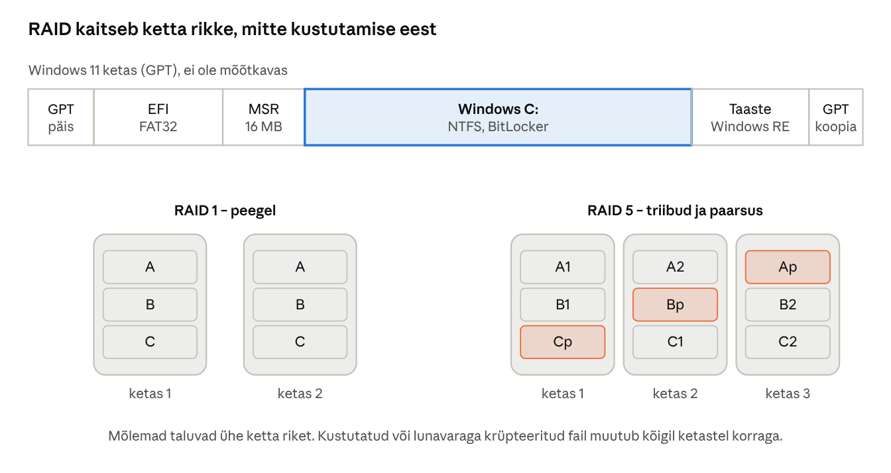
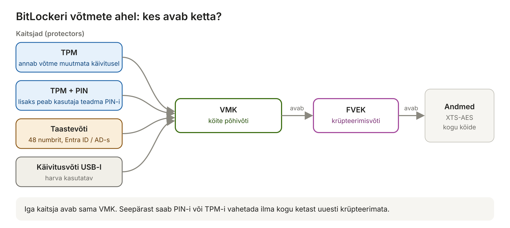
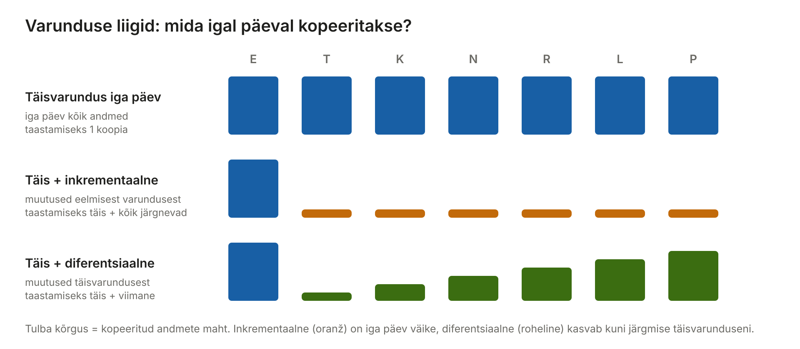

[← 15. Failisüsteemid Windowsis](15-failisusteemid.md) · [Sisukord](../README.md) · [17. Võrguvõimalused Windowsis →](17-vork.md)

## 16. Salvestushaldus

Salvestushaldus otsustab, kuidas füüsilised kettad jagatakse partitsioonideks ja köideteks, kuidas andmeid kaitstakse riketest (peegeldamine, paarsus) ja varguse eest (krüpteerimine) ning kuidas serverid salvestusruumi jagavad. Windowsis on selleks kettahaldus, Storage Spaces, BitLocker ja SMB-failiteenus.

**Miks see oluline on?** Andmed on organisatsiooni kõige väärtuslikum osa: arvuti saab poest uue osta, aga kaotatud hinnetabelit, raamatupidamist või lõputööd mitte. Salvestushaldus vastab kolmele küsimusele:

1. **Kuidas ketas on jaotatud?** – partitsioonid ja köited;
2. **Mis juhtub, kui ketas läheb rikki?** – RAID ja Storage Spaces;
3. **Mis juhtub, kui andmed kustutatakse, krüpteeritakse lunavaraga või varastatakse?** – varundus ja BitLocker.

Igal ohul on oma kaitse ja **ükski meede ei kaitse kõige eest**. See on peatüki kõige olulisem mõte.

> 🖱️ **Proovi ise:** [interaktiivne õpileht](https://valdonolvak.github.io/Operatsioonis-steemi-ja-k-berturbe-alused/interaktiivne/16-salvestushaldus.html). Lehel on HDD ja SSD kiiruste kalkulaator, partitsioonide uurija, RAID-simulaator koos paarsuse arvutamisega, BitLockeri olukordade simulaator, varundusplaani koostaja ja harjutus „milline kaitse aitab?“.

### 16.1 Salvestamine kettal

HDD salvestab andmeid magnetiliselt pöörlevatel plaatidel; pöördumisaeg koosneb otsinguajast ja pöördeviitest. SSD salvestab andmeid NAND-välkmällu; kirjutada saab ainult kustutatud plokki, mistõttu SSD kontroller teeb kulumise ühtlustamist ja prügikoristust. NVMe-SSD ühendub otse PCIe-siiniga ja on SATA-SSD-st mitu korda kiirem.

**Miks on HDD juhuslikul lugemisel nii aeglane?** Iga lugemise jaoks peab lugemispea liikuma õigele rajale (**otsinguaeg**, ~4–9 ms) ja ootama, kuni õige sektor pea alt läbi pöörleb (**pöördeviide**). 7200 p/min ketas teeb ühe pöörde 8,3 ms-ga, keskmiselt tuleb oodata pool pööret ehk ~4,2 ms. Kokku ~12 ms ühe juhusliku lugemise kohta – ainult umbes **80–120 lugemist sekundis** (IOPS). NVMe-SSD-l pole liikuvaid osi ja ta teeb **sadu tuhandeid** juhuslikke lugemisi sekundis. Seepärast muutub vana arvuti pärast HDD vahetamist SSD vastu märgatavalt kiiremaks: Windowsi käivitamine koosneb tuhandetest väikestest juhuslikest lugemistest.

| | HDD | SATA SSD | NVMe SSD |
| --- | --- | --- | --- |
| Juhuslik lugemine (IOPS) | ~100 | ~90 000 | ~500 000 ja rohkem |
| Järjestikune kiirus | ~200 MB/s | ~550 MB/s | ~3 000–14 000 MB/s |
| Liikuvad osad | jah – kardab põrutust | ei | ei |
| Hind GB kohta | madalaim | keskmine | keskmine |
| Kasutus | arhiiv, varundus, NAS | vanemad arvutid | süsteemiketas, serverid |

**SSD kulumine.** Välkmälu rakku saab kirjutada piiratud arv kordi. SSD kirjutab andmed **lehtedena** (mõni KB), kuid kustutada saab ainult terve **ploki** (sadu lehti). Kui fail muutub, kirjutab kontroller uue versiooni uude kohta ja märgib vana kehtetuks; hiljem korjab **prügikoristus** kehtivad lehed kokku ja kustutab ploki. **Kulumise ühtlustamine** (wear leveling) jaotab kirjutused kõigile rakkudele. Tootja annab vastupidavuse **TBW**-na (terabytes written), nt 600 TBW 1 TB kettal – tavakasutajal kulub selleks üle kümne aasta. Kulumist näeb käsuga `Get-StorageReliabilityCounter` (veerg *Wear*) või SMART-andmetest.

> 🖱️ **Proovi ise:** [HDD ja SSD kiiruse kalkulaator](https://valdonolvak.github.io/Operatsioonis-steemi-ja-k-berturbe-alused/interaktiivne/16-salvestushaldus.html#ketas)

### 16.2 Kõvaketaste korraldus

**Partitsioonitabelid:**

|  | MBR | GPT |
| --- | --- | --- |
| Aasta | 1983 | 2000ndad (UEFI osa) |
| Max ketta suurus | 2 TB | praktiliselt piiramatu (9,4 ZB) |
| Partitsioone | 4 primaarset (või laiendatud) | 128 (Windowsis) |
| Varukoopia | puudub | päise koopia ketta lõpus, CRC |
| Käivitus | BIOS | UEFI (nõutud Windows 11-l) |

**Tavaline Windows 11 ketas (GPT):** EFI süsteemipartitsioon (FAT32, \~100–260 MB), Microsofti reserveeritud partitsioon (MSR, 16 MB), Windowsi partitsioon (NTFS) ja taastepartitsioon (Windows RE).

| Partitsioon | Milleks | Mis juhtub, kui see kustutada? |
| --- | --- | --- |
| **EFI** (ESP) | UEFI püsivara loeb siit alglaaduri `bootmgfw.efi` | Windows ei käivitu; parandamine `bcdboot` käsuga |
| **MSR** | Windowsi sisemiseks kasutuseks, failisüsteemi pole | probleemid kettahalduse toimingutel |
| **Windows** (C:) | OS, programmid, kasutajate failid | kõik andmed kaovad |
| **Taaste** (WinRE) | taastekeskkond: lähtestamine, käsuviip, süsteemitaaste | arvuti käivitub, kuid tõrkeotsing on raskem |

**Miks MBR asendus GPT-ga?** MBR salvestab partitsiooni suuruse 32-bitise sektorite arvuna: 2³² × 512 baiti = 2 TB. Lisaks on MBR-is ainult üks partitsioonitabeli koopia ketta alguses – kui see rikneb, kaovad kõik partitsioonid. GPT-l on päisest koopia ketta lõpus ja kontrollsumma (CRC), nii et viga tuvastatakse ja parandatakse. Vana MBR-ketta saab ilma andmeid kaotamata teisendada käsuga `mbr2gpt /convert` (seejärel tuleb püsivaras lülitada UEFI-režiimile).

> 🖱️ **Proovi ise:** [partitsioonide uurija](https://valdonolvak.github.io/Operatsioonis-steemi-ja-k-berturbe-alused/interaktiivne/16-salvestushaldus.html#partitsioon)

**Põhikettad ja dünaamilised kettad.** Põhiketas (basic disk) kasutab tavalisi partitsioone. Dünaamiline ketas võimaldas tarkvaralist RAID-i, kuid on aegunud; selle asemel kasutatakse **Storage Spaces**’it.

**Köide** (volume) on vormindatud ala, millel on failisüsteem ja tavaliselt ketta täht või ühenduspunkt.

**RAID-tasemed:**

| Tase | Meetod | Talub rikkeid | Kasutatav maht |
| --- | --- | --- | --- |
| RAID 0 | triibutus (striping) | 0 ketast | 100% |
| RAID 1 | peegeldamine | 1 ketas | 50% |
| RAID 5 | triibutus + paarsus | 1 ketas | (n−1)/n |
| RAID 6 | topeltpaarsus | 2 ketast | (n−2)/n |
| RAID 10 | peegeldatud triibud | 1 ketas paari kohta | 50% |



Joonis: RAID 1 hoiab igast plokist kahte koopiat; RAID 5 jaotab andmed ja paarsuse (p) kolmele kettale, nii et ükskõik millise ketta sisu saab ülejäänutest taastada.

**Kuidas paarsus töötab?** Paarsus arvutatakse tehtega **XOR** (välistav või): kui bitid on samad, on tulemus 0, kui erinevad, siis 1. XOR-il on kasulik omadus – kui teada kõiki osi peale ühe, saab puuduva välja arvutada.

```
Ketas 1 (A1):   1 0 1 1
Ketas 2 (A2):   0 1 1 0
Paarsus (Ap):   1 1 0 1     = A1 XOR A2
-- ketas 2 läheb rikki --
A2 = A1 XOR Ap: 0 1 1 0     ← andmed taastatud!
```

**Arvutusnäide.** Neli 4 TB ketast:

| Tase | Kasutatav maht | Võib rikki minna |
| --- | --- | --- |
| RAID 0 | 16 TB | 0 ketast – üks rike ja kõik on kadunud |
| RAID 1 (2 paari) / RAID 10 | 8 TB | 1 ketas igast paarist |
| RAID 5 | 12 TB | 1 ketas |
| RAID 6 | 8 TB | 2 ketast |

**Ohtlik hetk on taastamine.** Kui RAID 5-s läheb üks ketas rikki, on massiiv *degraded* olekus: andmed on alles, kuid varu pole. Uue ketta peale taastamine (rebuild) loeb kõiki teisi kettaid algusest lõpuni – suurte ketaste puhul tunde või päevi. Kui selle aja jooksul tekib teisel kettal lugemisviga või rike, on andmed kadunud. Seepärast kasutatakse suurte (üle ~4 TB) ketaste puhul **RAID 6** või **RAID 10** ja hoitakse **varuketast** (hot spare), mis võetakse kohe kasutusele.

**Riist- või tarkvaraline RAID?** Riistvaraline RAID-kontroller teeb arvutused ise ja sageli on tal akutoega vahemälu (ptk 13). Tarkvaraline RAID (Storage Spaces, Linuxi `mdadm`) kasutab protsessorit, kuid ei sõltu kindlast kontrollerist – kui kontroller läheb rikki, ei pea otsima täpselt samasugust.

> 🖱️ **Proovi ise:** [RAID-simulaator](https://valdonolvak.github.io/Operatsioonis-steemi-ja-k-berturbe-alused/interaktiivne/16-salvestushaldus.html#raid) – vali tase, „lõhu“ kettaid ja vaata, kas andmed jäävad alles.

**Storage Spaces** koondab kettad **kogumisse** (pool) ja loob sellest virtuaalkettaid tüübiga *simple*, *mirror* (2- või 3-suunaline) või *parity*.

| Storage Spaces tüüp | Sarnane RAID-iga | Kasutatav maht | Talub rikkeid |
| --- | --- | --- | --- |
| Simple | RAID 0 | 100% | 0 |
| Two-way mirror | RAID 1 / 10 | 50% | 1 ketas |
| Three-way mirror | – | 33% | 2 ketast |
| Parity | RAID 5 | ~67–90% | 1 ketas |
| Dual parity | RAID 6 | ~50–80% | 2 ketast |

Erinevalt klassikalisest RAID-ist võivad Storage Spaces’i kettad olla **eri suurusega** ja kogumisse saab hiljem kettaid lisada. **Õhuke eraldus** (thin provisioning) lubab luua virtuaalketta, mis on suurem kui olemasolev ruum – kettaid lisatakse siis, kui ruum hakkab otsa saama. **Kihid** (tiering) hoiavad sagedamini kasutatud andmeid SSD-l ja harvemini kasutatuid HDD-l. **Storage Spaces Direct** (S2D) teeb sama klastri serverite lokaalsete ketastega (hüperkonvergentne taristu).

**BitLocker** krüpteerib terve köite (XTS-AES). Võti on kaitstud TPM-iga, soovi korral lisaks PIN-iga. Taastevõti tuleb hoida turvaliselt (Entra ID, Active Directory, Microsofti konto). Uutel Windows 11 seadmetel lülitub **seadme krüpteerimine** sageli automaatselt sisse – administraator peab teadma, kus taastevõtmed asuvad, enne kui ketast või emaplaati vahetatakse.

**Mille eest BitLocker kaitseb?** Varastatud sülearvuti puhul saab varas ketta välja võtta ja teise arvutisse ühendada – ilma krüpteerimiseta loeks ta kõiki faile, ka Windowsi parooli teadmata. BitLockeriga näeb ta ainult juhuslikke baite. **BitLocker ei kaitse** töötava arvuti puhul: kui kasutaja on sisse loginud, on andmed avatud ka pahavarale.

**Kuidas võtmed töötavad?** Andmed on krüpteeritud võtmega **FVEK**. See on omakorda krüpteeritud **köite põhivõtmega (VMK)**, mida saab avada mitu **kaitsjat** (protectors):



Joonis: TPM, PIN, taastevõti või käivitusvõti avavad sama VMK, VMK avab FVEK-i ja FVEK krüpteerib andmeid. Kaitsjat vahetades ei pea ketast uuesti krüpteerima.

**TPM** annab VMK välja ainult siis, kui arvuti käivitusahel (püsivara, Secure Boot, alglaadur) on täpselt sama nagu krüpteerimisel. TPM mõõdab käivitust registritesse (PCR). Kui midagi muutub – BIOS-i uuendus, Secure Boot välja lülitatud, ketas teises arvutis, emaplaat vahetatud –, keeldub TPM võtit andmast ja arvuti küsib **48-kohalist taastevõtit**.

| Olukord | Mis juhtub |
| --- | --- |
| Tavaline käivitus | TPM annab võtme, kasutaja ei märka midagi |
| Ketas varastati ja ühendati teise arvutisse | teises arvutis pole õiget TPM-i – andmed on loetamatud |
| Ründaja käivitab arvuti Linuxi USB-pulgalt | käivitusahel on muutunud – TPM võtit ei anna |
| BIOS-i uuendus või emaplaadi vahetus | arvuti küsib taastevõtit (BIOS-i uuendamisel peata BitLocker ajutiselt: `Suspend-BitLocker`) |
| Varastatakse sisselülitatud, kuid lukustatud sülearvuti | TPM-üksi režiimis on võti mälus; tugevamaks kaitseks kasuta **TPM + PIN** |

**BitLocker To Go** krüpteerib USB-pulga parooliga – kaotatud pulga sisu on kaitstud.

> 🖱️ **Proovi ise:** [BitLockeri olukordade simulaator](https://valdonolvak.github.io/Operatsioonis-steemi-ja-k-berturbe-alused/interaktiivne/16-salvestushaldus.html#bitlocker)

### 16.3 Andmete salvestamine serverites

| Lahendus | Kirjeldus | Näide |
| --- | --- | --- |
| DAS (Direct Attached Storage) | kettad otse serveris | serveri NVMe-kettad |
| NAS (Network Attached Storage) | failitaseme jagamine võrgus | SMB- või NFS-ketas |
| SAN (Storage Area Network) | plokitaseme salvestusvõrk | iSCSI, Fibre Channel, NVMe-oF |
| Hüperkonvergentne | arvutus ja salvestus samades sõlmedes | S2D, Azure Local, vSAN |
| Pilvesalvestus | teenusena | Azure Files, OneDrive, SharePoint |

**DAS, NAS või SAN?** Lihtne vahe: **NAS** jagab **faile** (arvuti näeb võrgukausta `\\server\jagatud`), **SAN** jagab **plokke** (arvuti näeb tavalist ketast, mille ise vormindab). SAN-i kasutavad virtualiseerimisklastrid ja andmebaasid, sest neile on vaja kiiret plokitaseme ligipääsu. **iSCSI**-s nimetatakse ketast kasutavat arvutit **initsiaatoriks** (initiator), ketast pakkuvat seadet **sihtmärgiks** (target) ja jagatud ketast **LUN**-iks.

**Jagatud kausta õigused.** Windowsi failiserveris kehtivad korraga **jagamise õigused** (share permissions) ja **NTFS-õigused**. Võrgu kaudu ligi pääsedes kehtib neist **rangem**. Näiteks kui jagamisel on „Kõik: täielik juurdepääs“, kuid NTFS-is on õpilastel ainult „Lugemine“, saavad õpilased ainult lugeda. Tavaline praktika: jagamise õigused laiad (Autenditud kasutajad: muutmine) ja täpsed piirangud NTFS-is.

**SMB 1.0** on vana ja ohtlik – selle haavatavust kasutas 2017. aastal lunavara WannaCry. Alates Windows 10 versioonist 1709 pole SMB1 vaikimisi paigaldatud; serverites kontrolli `Get-SmbServerConfiguration | Select EnableSMB1Protocol`.

**SMB 3.x** failiteenus pakub krüpteerimist, allkirjastamist, mitmekanalit (multichannel) ja RDMA-d. Windows Server 2025 toob **SMB over QUIC**-i kõigisse väljaannetesse: failijagamine üle interneti ilma VPN-ita, TLS 1.3 krüpteeringuga ([Petri](https://petri.com/windows-server-2025-public-preview/)). **Storage Replica** dubleerib köiteid teise serverisse või saidile.

### 16.4 Varundus

**Varundus.** Kettapeegel ei ole varukoopia: kustutatud või lunavara poolt krüpteeritud fail peegeldub kohe. Kasuta reeglit **3-2-1-1-0**: 3 koopiat, 2 eri kandjal, 1 väljaspool asutust, 1 võrguühenduseta või muutumatu (immutable), 0 viga taastetestis.

| Reegli osa | Mille eest kaitseb | Näide |
| --- | --- | --- |
| **3** koopiat | ühe koopia rike | originaal + 2 varukoopiat |
| **2** eri kandjat | sama tüüpi kandjate korraga rike | ketas + pilv või lint |
| **1** väljaspool asutust | tulekahju, vargus, üleujutus | pilv, teise maja NAS |
| **1** võrguühenduseta või muutumatu | lunavara, mis krüpteerib ka võrgus olevad varukoopiad | lahtiühendatud USB-ketas, muutumatu pilvesalvestus |
| **0** viga taastetestis | varukoopia, mida ei saa taastada | regulaarne proovitaastamine |

**Varunduse liigid:**

| Liik | Mida kopeeritakse | Pluss | Miinus |
| --- | --- | --- | --- |
| **Täisvarundus** | kõik andmed | taastamine lihtne – üks koopia | aeglane, võtab palju ruumi |
| **Inkrementaalne** | muutused **eelmisest** varundusest | kiire ja väike | taastamiseks on vaja täisvarundust ja kõiki järgnevaid |
| **Diferentsiaalne** | muutused **viimasest täisvarundusest** | taastamiseks täisvarundus + viimane | kasvab iga päevaga |



Joonis: täisvarundus kopeerib iga kord kõik; inkrementaalne ainult eelmise päeva muutused; diferentsiaalne kõik muutused alates täisvarundusest.

**RPO ja RTO** – kaks numbrit, millega varundusplaani hinnatakse:

- **RPO** (Recovery Point Objective) – **kui palju andmeid võib kaduda**. Kui varundus tehakse kord ööpäevas kell 22, ja server läheb rikki järgmisel päeval kell 21, kaob peaaegu ööpäeva töö: RPO = 24 h.
- **RTO** (Recovery Time Objective) – **kui kiiresti peab töö taastuma**. Kui 2 TB taastamine pilvest võtab 2 päeva, kuid kool vajab e-päevikut tunni jooksul, plaan ei tööta.

**Varikoopia (VSS) ja hetktõmmis ei ole varukoopia.** Need asuvad samal kettal: kui ketas läheb rikki või lunavara kustutab varikoopiad (`vssadmin delete shadows`), kaovad ka need. Need sobivad kiireks taastamiseks („Eelmised versioonid“), mitte ainsaks kaitseks.

> 🖱️ **Proovi ise:** [varundusplaani koostaja](https://valdonolvak.github.io/Operatsioonis-steemi-ja-k-berturbe-alused/interaktiivne/16-salvestushaldus.html#varundus) ja [milline kaitse aitab?](https://valdonolvak.github.io/Operatsioonis-steemi-ja-k-berturbe-alused/interaktiivne/16-salvestushaldus.html#kaitse)

### Võrdlus: Linux ja macOS

| | Windows | Linux | macOS |
| --- | --- | --- | --- |
| Kettad ja partitsioonid | Kettahaldus, `diskpart`, `Get-Disk` | `lsblk`, `fdisk`, `parted` | Kettautiliit, `diskutil list` |
| Paindlikud köited | Storage Spaces | **LVM** (loogilised köited, mida saab suurendada) | APFS-i konteiner (köited jagavad ruumi) |
| Tarkvaraline RAID | Storage Spaces | `mdadm`, ZFS, Btrfs | AppleRAID (`diskutil appleRAID`) |
| Ketta krüpteerimine | BitLocker | LUKS (`cryptsetup`) | FileVault |
| Varundus | Windows Server Backup, failiajalugu | `rsync`, Borg, restic, Timeshift | Time Machine |
| Hetktõmmised | VSS | LVM, Btrfs, ZFS | APFS-i hetktõmmised |

**ZFS** (Linuxis ja FreeBSD-s) ühendab failisüsteemi ja RAID-i ühte: kontrollsummad tuvastavad vaikse riknemise ja hetktõmmised on hetkelised – sarnaselt ReFS-i ja Storage Spaces’i kombinatsiooniga.

### Näide: kooli failiserveri kolm halba päeva

Failiserveris on neli 4 TB ketast Storage Spaces’i kahesuunalises peeglis (kasutatav maht \~8 TB) ja varundus käib igal ööl NAS-ile ning kord nädalas võrguühenduseta kettale.

1. **Esmaspäev – ketas rikkis.** `Get-PhysicalDisk` näitab üht ketast olekus *Lost Communication*, virtuaalketas on *Degraded*, kuid kasutajad töötavad edasi. Administraator vahetab ketta ja Storage Spaces taastab peegli. **RAID töötas.**
2. **Kolmapäev – lunavara.** Õpetaja arvutist käivitatud pahavara krüpteerib võrguketta failid. Peegel kirjutas krüpteeritud failid hetkega mõlemale kettale ja ka öine NAS-i koopia võib olla rikutud. Taastatakse võrguühenduseta kettalt eelmise nädala seisu ja varikoopiatest. **Aitas ainult 3-2-1-1-0.**
3. **Reede – emaplaadi vahetus.** Pärast hooldust küsib arvuti BitLockeri taastevõtit, sest TPM on uus. Võti leitakse Entra ID-st (või AD-st). Kui seda poleks salvestatud, oleksid andmed kadunud ka omanikule.

**Õppetund:** iga kaitsemeede kaitseb kindla ohu eest – RAID riistvararikke, varundus kustutamise ja lunavara, BitLocker varguse eest.

### Kokkuvõte

- Windows 11 nõuab GPT-ketast ja UEFI-d.
- RAID ja Storage Spaces kaitsevad ketta rikke eest, mitte kustutamise ega lunavara eest.
- BitLocker kaitseb varastatud seadme andmeid; taastevõtme haldus on kriitiline.
- Serverite salvestus liigub hüperkonvergentsi ja pilve suunas; SMB over QUIC lihtsustab kaugligipääsu.
- HDD juhuslik lugemine on aeglane (otsinguaeg + pöördeviide), SSD kulub kirjutamisel, kuid kulumise ühtlustamine pikendab eluiga.
- RAID 5 paarsus põhineb XOR-il; suurte ketaste taastamine on riskantne, seepärast eelistatakse RAID 6 või 10.
- NAS jagab faile, SAN plokke; võrgukaustas kehtib rangem jagamise ja NTFS-i õigustest.
- Varundusplaani hinnatakse RPO ja RTO järgi; varikoopia ei ole varukoopia.

### Kontrollküsimused

> 🧪 **Interaktiivne test:** [kontrolli oma teadmisi](https://valdonolvak.github.io/Operatsioonis-steemi-ja-k-berturbe-alused/interaktiivne/16-test.html). Test koosneb 25 valikvastusega küsimusest. Iga vastuse järel näed selgitust ning lõpus saad valesti vastatud küsimusi korrata.

1. Mis vahe on HDD-l ja SSD-l salvestamise põhimõttes?
2. Võrdle MBR- ja GPT-partitsioonitabelit.
3. Millised partitsioonid on tavalisel Windows 11 kettal?
4. Selgita RAID 0, 1, 5 ja 10 erinevusi.
5. Mis on Storage Spaces ja Storage Spaces Direct?
6. Kuidas BitLocker andmeid kaitseb ja miks on taastevõti oluline?
7. Mis vahe on NAS-il ja SAN-il?
8. Miks ei ole RAID varukoopia? Selgita 3-2-1-1-0 reeglit.
9. Miks teeb HDD sekundis ainult ~100 juhuslikku lugemist?
10. Kuidas arvutatakse RAID 5 paarsus? Kui A1 = 1100 ja Ap = 1010, siis mis on A2?
11. Miks on RAID 5 taastamine suurte ketastega riskantne?
12. Millal küsib BitLocker taastevõtit ja kuidas seda vältida BIOS-i uuendamisel?
13. Mis vahe on inkrementaalsel ja diferentsiaalsel varundusel?
14. Mis on RPO ja RTO? Too näide.
15. Jagamise õigus on „Täielik juurdepääs“, NTFS-i õigus „Lugemine“. Mida saab kasutaja võrgu kaudu teha?

### Valikküsimused

1. Mis on MBR-ketta maksimaalne suurus? a) 2 TB b) 16 TB c) 256 TB d) piiramatu
2. Milline RAID-tase ei talu ühtegi ketta riket? a) RAID 0 b) RAID 1 c) RAID 5 d) RAID 6
3. Mis protokoll võimaldab SMB-failijagamist üle interneti ilma VPN-ita? a) NFS b) iSCSI c) SMB over QUIC d) FTP
4. Mis kaitseb BitLockeri võtit vaikimisi? a) parool b) TPM c) USB-võti d) Secure Boot
5. Mitu 4 TB ketast on vaja RAID 6 jaoks, et kasutatav maht oleks 8 TB? a) 2 b) 3 c) 4 d) 6
6. Milline varundus kopeerib muutused alates viimasest täisvarundusest? a) täis b) inkrementaalne c) diferentsiaalne d) peegeldus

### Praktiline ülesanne

```powershell
Get-Disk | Select-Object Number, FriendlyName, PartitionStyle, Size, BusType
Get-Partition | Select-Object DiskNumber, PartitionNumber, Type, Size, DriveLetter
Get-BitLockerVolume | Select-Object MountPoint, VolumeStatus, EncryptionMethod, KeyProtector
Get-PhysicalDisk | Get-StorageReliabilityCounter | Select-Object DeviceId, Temperature, Wear, ReadErrorsTotal
```

Lisa virtuaalmasinale kolm tühja 10 GB ketast. Loo Serveri halduris või PowerShellis kogum ja 2-suunaline peegel:

```powershell
$k = Get-PhysicalDisk -CanPool $true
New-StoragePool -FriendlyName Kogum1 -StorageSubSystemFriendlyName 'Windows Storage*' -PhysicalDisks $k
New-VirtualDisk -StoragePoolFriendlyName Kogum1 -FriendlyName Peegel -ResiliencySettingName Mirror -Size 8GB |
  Get-Disk | Initialize-Disk -PassThru | New-Partition -AssignDriveLetter -UseMaximumSize | Format-Volume -FileSystem ReFS
```

Eemalda üks ketas virtuaalmasinast ja kontrolli, kas andmed on loetavad. Mida näitab `Get-VirtualDisk`?

### Iseseisvad ülesanded

**1. Varundusplaan.** Koosta väikesele organisatsioonile (nt 15 töötajaga kool, raamatupidamisbüroo või oma pere) varundusplaan reegli 3-2-1-1-0 järgi. Määra: mida varundatakse, kui tihti, kuhu (kolm koopiat), milline koopia on võrguühenduseta või muutumatu, kes vastutab ja kuidas taastamist testitakse. **Esita:** üheleheküljeline plaan ja hinnang, kui palju andmeid võib halvimal juhul kaduda (RPO) ning kui kiiresti töö taastub (RTO).

**2. BitLockeri taaste harjutus.** Lülita õppe-VM-is (vTPM-iga) sisse BitLocker, salvesta taastevõti faili ja vaata seda käsuga `manage-bde -protectors -get C:`. Tekita taasteolukord (nt `manage-bde -forcerecovery C:` ja taaskäivitus) ning ava ketas taastevõtmega. **Esita:** sammude kirjeldus ja vastus: kus peaks organisatsioon taastevõtmeid hoidma ja kes neile ligi pääseb?

**3. RAID-i otsus.** Kool ostab failiserveri jaoks kuus 8 TB ketast. Võrdle RAID 5, RAID 6 ja RAID 10 (või Storage Spaces’i parity, dual parity ja mirror) kasutatavat mahtu, rikketaluvust ja taastamise riski. **Esita:** tabel ja põhjendatud soovitus ning selgitus, miks ka parima RAID-i kõrvale on vaja varundust.

### Viited

- Krogh (2017), ptk 16.
- Microsoft Learn: [BitLocker recovery overview](https://learn.microsoft.com/windows/security/operating-system-security/data-protection/bitlocker/recovery-overview).
- Microsoft Learn: [Storage Spaces overview](https://learn.microsoft.com/windows-server/storage/storage-spaces/overview); [BitLocker overview](https://learn.microsoft.com/windows/security/operating-system-security/data-protection/bitlocker/); [SMB over QUIC](https://learn.microsoft.com/windows-server/storage/file-server/smb-over-quic).

> 📝 **Test:** selle peatüki Google Formsi test luuakse skriptiga [`google-forms/looVormid.gs`](../google-forms/looVormid.gs).

---

[← 15. Failisüsteemid Windowsis](15-failisusteemid.md) · [Sisukord](../README.md) · [17. Võrguvõimalused Windowsis →](17-vork.md)
