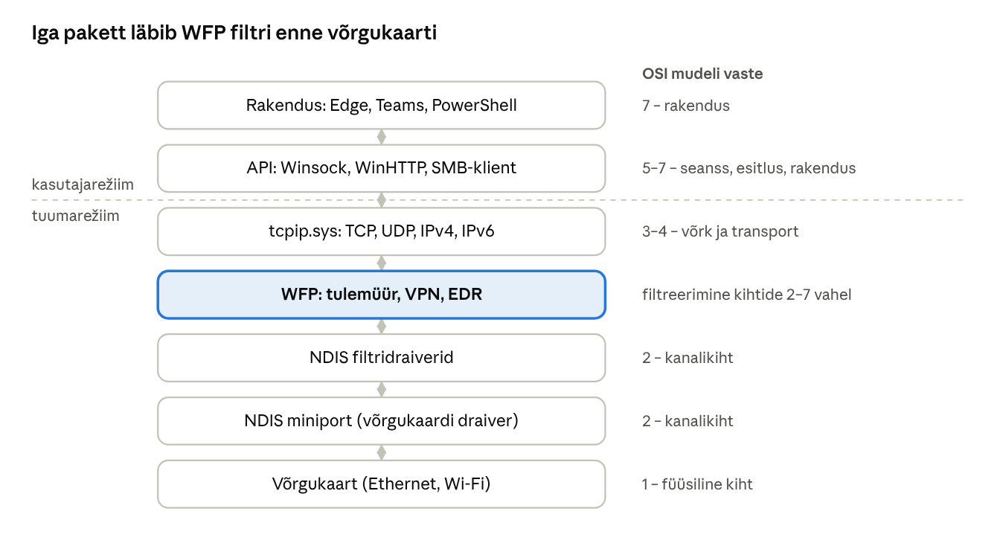
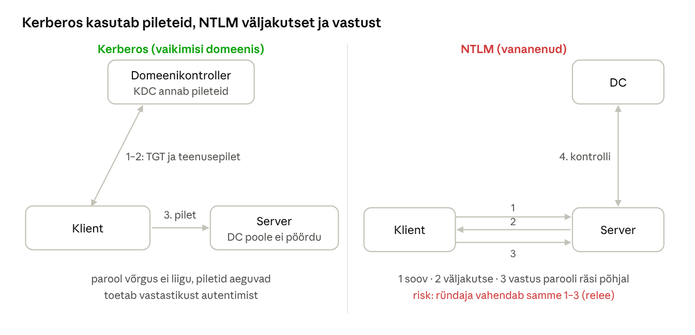

[← 16. Salvestushaldus](16-salvestushaldus.md) · [Sisukord](../README.md) · [18. Windowsi turvalisus →](18-turvalisus.md)

## 17. Võrguvõimalused Windowsis

Windowsi võrgupinu on kihiline: rakendused kasutavad API-sid (Winsock, WinHTTP, SMB), nende all on transpordi- ja võrguprotokollid (TCP, UDP, QUIC, IPv4/IPv6) ning kõige all NDIS-draiverid, mis juhivad võrgukaarti. Liiklust filtreerib Windows Filtering Platform (WFP), millele toetuvad tulemüür ja turvatarkvara.

**Miks see oluline on?** Peaaegu iga tänapäeva programm kasutab võrku: brauser, Teams, OneDrive, Windows Update, viirusetõrje. Samas tuleb enamik rünnakuid ka võrgust. Administraator peab oskama kahte asja: **leida, miks võrk ei tööta**, ja **aru saada, mis võrgus liigub ja kes seda näeb**. Mõlemaks on vaja teada, kuidas andmed arvutist võrku ja tagasi liiguvad.

> 🖱️ **Proovi ise:** [interaktiivne õpileht](https://valdonolvak.github.io/Operatsioonis-steemi-ja-k-berturbe-alused/interaktiivne/17-vork.html). Lehel on kapseldamise animatsioon, IP-alamvõrgu kalkulaator, DHCP ja DNS-i samm-sammult simulaator, TCP ühenduse ja pordi kontroll, Kerberose ja NTLM-i võrdlus koos releerünnakuga ning tõrkeotsingu mäng.

### Põhimõisted

Võrguside jagatakse **kihtideks**. Iga kiht lahendab ühe probleemi ja kasutab alumise kihi teenust – nagu postisüsteem: kirjutad kirja (rakendus), paned ümbrikusse aadressiga (IP), postiljon viib selle järgmisse postkontorisse (Ethernet, Wi-Fi).

| TCP/IP kiht | OSI kiht | Mida teeb | Näited | Aadress |
| --- | --- | --- | --- | --- |
| Rakendus | 5–7 | programmide omavaheline „keel“ | HTTP, DNS, SMB, RDP | URL, failinimi |
| Transport | 4 | ühendus kahe programmi vahel, järjekord, kordamine | TCP, UDP, QUIC | **port** (nt 443) |
| Võrk | 3 | marsruutimine üle mitme võrgu | IPv4, IPv6, ICMP | **IP-aadress** |
| Kanal ja füüsiline | 1–2 | edastamine ühe võrgulõigu piires | Ethernet, Wi-Fi | **MAC-aadress** |

Saatmisel lisab iga kiht andmetele oma päise – seda nimetatakse **kapseldamiseks**:


Joonis: HTTP-päring on TLS-iga krüpteeritud, see on TCP-segmendis, mis on IP-paketis, mis on Ethernet-kaadris. Ruuter vaatab ainult IP-päist, tulemüür ka porti, veebiserver alles HTTP-päringut.

**Olulised mõisted:**

- **IP-aadress** – arvuti aadress võrgus, nt `192.168.1.57`. **Alamvõrgu mask** (nt `/24` ehk `255.255.255.0`) näitab, milline osa aadressist on võrgu number: kõik `192.168.1.x` aadressid on samas võrgus ja suhtlevad otse.
- **Vaikelüüs** (default gateway) – ruuter, kuhu saadetakse kõik paketid, mis lähevad teise võrku (nt internetti).
- **Privaatsed aadressid** – `10.x.x.x`, `172.16–31.x.x`, `192.168.x.x` – kasutatakse kodu- ja asutusevõrkudes. Internetti minnes asendab ruuter need oma avaliku aadressiga (**NAT**).
- **APIPA** – `169.254.x.x`. Windows annab endale sellise aadressi, kui DHCP-server ei vastanud. Selle nägemine tähendab peaaegu alati, et arvuti ei saanud võrgust aadressi.
- **Port** – number, mis ütleb, millisele programmile pakett on mõeldud. Üks IP-aadress, palju teenuseid: veebiserver 443, kaugtöölaud 3389.
- **MAC-aadress** – võrgukaardi füüsiline aadress, kasutusel ainult kohalikus võrgulõigus. IP-aadress → MAC-aadress tõlkimiseks on **ARP** (`arp -a`).
- **IPv6** – 128-bitine aadress, nt `2001:db8::57`. Windows eelistab IPv6-t, kui see on olemas.

**Levinud pordid**, mida administraator peab teadma:

| Port | Protokoll | Teenus |
| --- | --- | --- |
| 53 | UDP/TCP | DNS |
| 67/68 | UDP | DHCP |
| 80 / 443 | TCP (443 ka UDP – QUIC) | HTTP / HTTPS |
| 88 | TCP/UDP | Kerberos |
| 135, 49152–65535 | TCP | RPC (Windowsi haldus) |
| 389 / 636 | TCP | LDAP / LDAPS (Active Directory) |
| 445 | TCP | SMB (failijagamine) – ei tohi olla internetti avatud |
| 3389 | TCP/UDP | RDP (kaugtöölaud) – ei tohi olla internetti avatud |
| 5985 / 5986 | TCP | WinRM (PowerShelli kaugjuhtimine) |
| 22 | TCP | SSH (ka Windowsis OpenSSH) |

Harjuta pordinumbreid: [milline port?](https://valdonolvak.github.io/Operatsioonis-steemi-ja-k-berturbe-alused/interaktiivne/17-vork.html#pordid)

> 🖱️ **Proovi ise:** [kapseldamise animatsioon](https://valdonolvak.github.io/Operatsioonis-steemi-ja-k-berturbe-alused/interaktiivne/17-vork.html#kapseldamine) ja [IP-alamvõrgu kalkulaator](https://valdonolvak.github.io/Operatsioonis-steemi-ja-k-berturbe-alused/interaktiivne/17-vork.html#ip)

### 17.1 Võrguteenused

| Teenus | Roll |
| --- | --- |
| DHCP-klient | saab IP-aadressi, lüüsi ja DNS-serverid |
| DNS-klient | nimede lahendamine, vahemälu; Windows 11 toetab DNS over HTTPS-i (DoH) |
| SMB-klient ja -server | failide ja printerite jagamine |
| Network Location Awareness (NLA) | tuvastab võrgu profiili: domeen, privaatne, avalik |
| WinRM | PowerShelli kaugjuhtimine |
| Remote Desktop | kaugtöölaud (RDP) |
| Windows Defender Firewall | pakettide filtreerimine (ptk 18) |

**DHCP – kuidas arvuti aadressi saab.** Arvuti ühendamisel toimub neljasammuline vestlus (**DORA**):

1. **Discover** – arvuti saadab kogu võrku: „Kas siin on DHCP-server?“ (tal endal veel aadressi pole);
2. **Offer** – server pakub: „Võta 192.168.1.57, mask /24, lüüs 192.168.1.1, DNS 192.168.1.10“;
3. **Request** – arvuti vastab: „Võtan selle“;
4. **Acknowledge** – server kinnitab ja annab aadressi **rendiks** (nt 8 päevaks). Poole aja pealt uuendab arvuti renti ise.

Kui ükski server ei vasta, võtab Windows APIPA-aadressi `169.254.x.x` ja internet ei tööta. Käsud: `ipconfig /release`, `ipconfig /renew`.

**DNS – kuidas nimi muutub IP-aadressiks.** Kui kirjutad brauserisse `www.ria.ee`:

1. Windows vaatab **DNS-kliendi vahemälu** (`ipconfig /displaydns`, ptk 13);
2. siis faili `C:\Windows\System32\drivers\etc\hosts`;
3. siis küsib seadistatud **DNS-serverilt** (kodus ruuter, koolis domeenikontroller);
4. kui serveril vastust pole, küsib ta järjest **juurserverilt** („kes teab `.ee`-d?“), `.ee` serverilt („kes teab `ria.ee`-d?“) ja `ria.ee` serverilt, mis annab lõpuks IP-aadressi.

Vastus salvestatakse vahemällu TTL-i ajaks. **DNS on ka sagedane ründe sihtmärk**: kui pahavara muudab `hosts`-faili või DNS-serveri seadet, suunatakse kasutaja võltslehele. Seepärast on DNS-i seadete kontroll tõrkeotsingu ja intsidendi uurimise osa.

**Võrgu profiil (NLA).** Windows otsustab iga võrgu kohta, kas see on *domeen*, *privaatne* või *avalik*. Avalikus võrgus (kohvik, rong) on tulemüür rangem ja failide jagamine keelatud. Kui koolivõrk on ekslikult märgitud avalikuks, ei näe arvutid üksteist.

> 🖱️ **Proovi ise:** [DHCP ja DNS-i simulaator](https://valdonolvak.github.io/Operatsioonis-steemi-ja-k-berturbe-alused/interaktiivne/17-vork.html#dhcpdns)

**Aegunud ja eemaldatud:** SMB 1.0 ei ole vaikimisi paigaldatud (WannaCry 2017 levis just selle kaudu); NetBIOS ja LLMNR tuleks domeenis keelata, sest neid kasutatakse parooliräside püüdmiseks; NTLM-ist liigutakse Kerberose poole (17.4).

### 17.2 Võrgu-API-d

- **Winsock** (Windows Sockets) – BSD pesade põhine API TCP/UDP jaoks; toetab ka Unixi domeenipesi (AF\_UNIX);
- **WinHTTP ja WinINet** – HTTP-kliendid (teenused vs kasutajarakendused);
- **HTTP Server API (http.sys)** – tuumarežiimi HTTP-server, millel töötavad IIS ja paljud teenused; toetab HTTP/2 ja HTTP/3 (QUIC);
- **MsQuic** – Microsofti avatud lähtekoodiga QUIC-teek, kasutusel HTTP/3 ja SMB over QUIC jaoks;
- **RPC ja nimega torud** – Windowsi teenuste kaugkutsed (AD, haldustööriistad);
- **.NET `HttpClient`, `Socket`** – hallatud koodi liidesed.

**Pesa (socket)** on ühenduse ots: IP-aadress + port + protokoll. TCP-ühendust määrab neli väärtust: lähte-IP, lähteport, siht-IP, sihtport. Brauser avab iga ühenduse jaoks juhusliku **lähtepordi** (49152–65535), nii et samale serverile saab olla mitu ühendust korraga. `Get-NetTCPConnection` näitab kõiki ühendusi ja `OwningProcess` ütleb, milline programm neid kasutab – nii leiab ka pahavara, mis „helistab koju“.

**TCP, UDP või QUIC?**

| | TCP | UDP | QUIC |
| --- | --- | --- | --- |
| Ühendus | kolmesammuline käepigistus (SYN, SYN-ACK, ACK) | ühendust pole | käepigistus koos TLS-iga ühes sammus |
| Kaotatud paketid | saadetakse uuesti, järjekord tagatud | kaovad | saadetakse uuesti |
| Krüpteerimine | eraldi (TLS) | puudub | alati sisse ehitatud (TLS 1.3) |
| Kasutus | veeb, SMB, RDP, e-post | DNS, DHCP, video, mängud | HTTP/3, SMB over QUIC |

**Pordi olek** on tõrkeotsingul oluline: kui server vastab SYN-ile SYN-ACK-iga, on port **avatud**; kui RST-iga, siis **suletud** (teenus ei tööta); kui ei vasta üldse, siis on vahel tõenäoliselt **tulemüür**, mis paketid vaikselt ära viskab. `Test-NetConnection -Port` näitab just seda.

> 🖱️ **Proovi ise:** [TCP ühendus ja pordi olek](https://valdonolvak.github.io/Operatsioonis-steemi-ja-k-berturbe-alused/interaktiivne/17-vork.html#tcp)

### 17.3 Võrgudraiverid Windowsis

- **NDIS** (Network Driver Interface Specification) – võrgukaartide draiverite raamistik: *miniport*-draiver juhib kaarti, *protokolli*draiver (TCP/IP) teenindab ülemist kihti, *filtri*draiverid asuvad nende vahel;
- **tcpip.sys** – Windowsi TCP/IP pinu (IPv4 ja IPv6; IPv6 on eelistatud);
- **WFP** (Windows Filtering Platform) – filtreerimisraamistik, kuhu tulemüür, VPN-id ja EDR-id lisavad oma reegleid;
- **AFD** (`afd.sys`) – Winsocki tuumapoolne osa;
- **jõudlusfunktsioonid** – RSS (vastuvõtu jagamine tuumade vahel), RSC, kontrollsummade ja TCP segmenteerimise mahalaadimine võrgukaardile, RDMA (SMB Direct).



Joonis: rakenduse andmed liiguvad API kaudu tuuma TCP/IP pinusse; WFP kontrollib iga ühendust enne, kui NDIS-draiverid selle võrgukaardile annavad.

### 17.4 Autentimine võrgus: NTLM-ist Kerberoseni

**Kerberos** on domeeni vaikimisi autentimisprotokoll: kasutaja saab domeenikontrollerilt (KDC) piletid ja parool võrgus ei liigu. **NTLM** on vanem väljakutse-vastuse protokoll, mis on haavatav releerünnetele ja räside murdmisele.

**Kerberos lihtsustatult** (võrdlus: festivali käepael):

1. **Sisselogimisel** tõestab kasutaja domeenikontrollerile oma parooli (räsi abil, parooli ennast ei saadeta) ja saab **TGT** (*ticket-granting ticket*) – „käepaela“, mis kehtib vaikimisi 10 tundi.
2. **Kui kasutaja avab failiserveri**, näitab ta domeenikontrollerile TGT-d ja saab **teenusepileti** just sellele serverile (nt `cifs/fs01.kool.local`).
3. **Failiserver** kontrollib piletit oma võtmega – ta ei pea domeenikontrollerilt küsima ega parooli nägema.

Pilet kehtib ainult kindlale teenusele ja piiratud aja. Kerberos nõuab, et arvutite **kellad** oleksid kuni 5 minuti täpsusega sünkroonis – vale kellaga arvuti ei saa domeenis sisse logida.

**NTLM-i probleem – relee.** NTLM-is saadab server väljakutse (juhusliku arvu) ja klient vastab sellega, mis on arvutatud parooli räsist. Kui ründaja on kliendi ja serveri vahel, saab ta väljakutse ja vastuse lihtsalt **edasi anda** teisele serverile ja logida sisse kasutaja nimel – parooli teadmata. Seda nimetatakse **NTLM-releeks**. Kaitse: SMB ja LDAP allkirjastamine, EPA, NTLM-i keelamine.

**LLMNR ja NetBIOS-i mürgitamine.** Kui kasutaja trükib vale serveri nime (`\\fileserver` asemel `\\filesrver`), ei leia DNS seda ja Windows küsib kogu kohalikult võrgult: „Kas keegi on filesrver?“ Ründaja tööriist (nt Responder) vastab: „Mina!“ ja Windows saadab talle NTLM-autentimise – ründaja saab räsi murdmiseks või releeks. Seepärast tuleb LLMNR ja NetBIOS domeenis rühmapoliitikaga välja lülitada.

> 🖱️ **Proovi ise:** [Kerberos vs NTLM – kas ründaja saab vahele tulla?](https://valdonolvak.github.io/Operatsioonis-steemi-ja-k-berturbe-alused/interaktiivne/17-vork.html#kerberos)

Microsoft avaldas 2026. aasta alguses kolmeetapilise plaani NTLM-i vaikimisi keelamiseks: 1) parem auditeerimine Windows 11 24H2 ja Server 2025-s; 2) 2026. aasta teisel poolel uued võimalused **IAKerb** ja **Local KDC**, mis katavad olukorrad, kus seni langeti NTLM-ile tagasi; 3) järgmises Windows Serveri versioonis ja vastavas kliendis on võrgu-NTLM vaikimisi keelatud, kuid poliitikaga taaslubatav ([The Hacker News](https://thehackernews.com/2026/02/microsoft-begins-ntlm-phase-out-with.html), [Petri](https://petri.com/microsoft-disable-ntlm-default-windows/)). Administraator peaks juba praegu auditeerima, millised rakendused NTLM-i kasutavad.



Joonis: Kerberose korral saab klient domeenikontrollerilt ajapiiranguga pileti ja esitab selle serverile; NTLM-i korral vastab klient serveri väljakutsele parooli räsi abil, mida ründaja saab vahendada (relee) või murda.

### Võrdlus: Linux ja macOS

| Ülesanne | Windows | Linux | macOS |
| --- | --- | --- | --- |
| IP-seaded | `Get-NetIPConfiguration`, `ipconfig` | `ip a`, `ip route` | `ifconfig`, `networksetup -getinfo Wi-Fi` |
| Seadistamine | Seaded, `New-NetIPAddress` | NetworkManager (`nmcli`), netplan (Ubuntu) | Süsteemiseaded → Võrk |
| DNS | DNS-klient, `Resolve-DnsName` | systemd-resolved, `resolvectl`, `dig` | `scutil --dns`, `dig` |
| Ühendused | `Get-NetTCPConnection`, `netstat -ano` | `ss -tunap` | `netstat -an`, `lsof -i` |
| Tulemüür | Defender Firewall (WFP) | nftables / iptables, `ufw`, firewalld | pf, rakenduste tulemüür |
| Liikluse salvestamine | `pktmon` | `tcpdump` | `tcpdump` |
| Kaughaldus | WinRM, RDP, OpenSSH | SSH | SSH, ekraani jagamine |

Kõigi kolme võrgupinu põhineb samadel standarditel (TCP/IP), nii et Windowsi arvuti suhtleb Linuxi serveri ja Maciga probleemideta – erinevad ainult tööriistad.

### Näide: „internet ei tööta“ – kihthaaval altpoolt üles

Kasutaja ütleb, et ükski veebileht ei avane. Hea tõrkeotsing liigub võrgupinus alt üles ja kontrollib iga kihti ühe käsuga:

| Kiht | Käsk | Hea tulemus |
| --- | --- | --- |
| 1–2 võrgukaart | `Get-NetAdapter` | *Status: Up*, kiirus näha |
| 3 IP-aadress | `Get-NetIPConfiguration` | IPv4 aadress, lüüs, DNS (mitte 169.254.x.x) |
| 3 lüüs | `Test-NetConnection 192.168.1.1` | *PingSucceeded: True* |
| 3 internet | `Test-NetConnection 1.1.1.1` | vastus tuleb |
| 7 DNS | `Resolve-DnsName www.ria.ee` | IP-aadress tagastatakse |
| 4 port | `Test-NetConnection www.ria.ee -Port 443` | *TcpTestSucceeded: True* |
| tulemüür/proksi | `Get-NetFirewallProfile`, `netsh winhttp show proxy` | ootamatut keeldu ega proksit pole |

**Lahendus antud juhul:** aadress oli `169.254.12.7`, mis tähendab, et DHCP-server ei vastanud. Pärast võrgukaabli kontrolli ja käsku `ipconfig /renew` saadi aadress `192.168.1.57` ja internet töötas. Kui esimesed kolm kihti oleksid korras olnud ja ainult DNS ebaõnnestunud, oleks probleem olnud DNS-serveris, mitte võrgukaardis.

**Kuidas tulemusi lugeda?**

| Mida näed | Tõenäoline põhjus |
| --- | --- |
| Võrgukaart *Disconnected* | kaabel, Wi-Fi, lüliti port |
| Aadress `169.254.x.x` | DHCP-server ei vasta |
| Lüüs ei vasta | vale lüüs, VLAN, ruuter maas |
| `1.1.1.1` vastab, kuid `Resolve-DnsName` ebaõnnestub | DNS-server või -seadistus |
| Nimi laheneb, kuid port 443 ei vasta | tulemüür, proksi või server maas |
| Ühel lehel töötab, teisel mitte | probleem on selles serveris, mitte sinu arvutis |

> 🖱️ **Proovi ise:** [tõrkeotsingu mäng](https://valdonolvak.github.io/Operatsioonis-steemi-ja-k-berturbe-alused/interaktiivne/17-vork.html#torkeotsing) – leia viga ise.

### Kokkuvõte

- Windowsi võrgupinu: API-d → TCP/IP ja QUIC → WFP → NDIS → võrgukaart.
- QUIC ja HTTP/3 on Windowsi osa; SMB over QUIC laiendab failijagamist internetti.
- Vanad protokollid (SMB1, NetBIOS, LLMNR, NTLM) on turvarisk ja neist loobutakse.
- Andmed kapseldatakse kihtide kaupa: rakendus → TCP/UDP (port) → IP (aadress) → Ethernet (MAC).
- DHCP annab aadressi neljas sammus (DORA); `169.254.x.x` tähendab, et DHCP ei vastanud.
- DNS lahendab nime vahemälu, `hosts`-faili ja DNS-serverite kaudu.
- Kerberos kasutab ajapiiranguga teenusepileteid; NTLM-i vastust saab releeda.
- Tõrkeotsing käib kihthaaval alt üles.

### Kontrollküsimused

> 🧪 **Interaktiivne test:** [kontrolli oma teadmisi](https://valdonolvak.github.io/Operatsioonis-steemi-ja-k-berturbe-alused/interaktiivne/17-test.html). Test koosneb 25 valikvastusega küsimusest. Iga vastuse järel näed selgitust ning lõpus saad valesti vastatud küsimusi korrata.

1. Nimeta viis Windowsi võrguteenust ja nende rolli.
2. Mis on Winsock ja mis on http.sys?
3. Mis on NDIS-i miniport-, protokolli- ja filtridraiveri roll?
4. Mis on WFP ja kes seda kasutavad?
5. Miks on SMB 1.0 vaikimisi eemaldatud?
6. Mis vahe on Kerberosel ja NTLM-il?
7. Kirjelda Microsofti NTLM-ist loobumise kolme etappi.
8. Milleks on QUIC ja kus Windows seda kasutab?
9. Mis on kapseldamine? Millist päist vaatab ruuter, tulemüür ja veebiserver?
10. Kas aadressid `192.168.1.57/24` ja `192.168.2.10/24` on samas alamvõrgus? Mida on vaja, et need suhtleksid?
11. Kirjelda DHCP DORA protsessi. Mida tähendab aadress `169.254.x.x`?
12. Kirjelda, kuidas Windows lahendab nime `www.ria.ee` IP-aadressiks.
13. Mis vahe on TCP-l, UDP-l ja QUIC-il? Mida tähendab pordi olek „avatud“, „suletud“ ja „filtreeritud“?
14. Nimeta viis levinud porti ja nende teenused. Miks ei tohi porte 445 ja 3389 internetti avada?
15. Kuidas töötab NTLM-relee ja LLMNR-i mürgitamine?

### Valikküsimused

1. Milline komponent on Windowsi pakettide filtreerimise raamistik? a) NDIS b) WFP c) AFD d) RSS
2. Mis on domeenis vaikimisi autentimisprotokoll? a) NTLM b) Kerberos c) LDAP d) RADIUS
3. Millise protokolli kaudu levis WannaCry? a) RDP b) SMB 1.0 c) DNS d) HTTP/3
4. Mis on IAKerb? a) uus tulemüür b) Kerberose laiendus, kui kliendil pole otseühendust domeenikontrolleriga c) NTLM-i uus versioon d) DNS-i turvalaiendus
5. Millist porti kasutab RDP? a) 22 b) 445 c) 3389 d) 5985
6. Arvuti aadress on 169.254.33.7. Mis on tõenäoline põhjus? a) DNS ei tööta b) DHCP-server ei vastanud c) tulemüür blokeerib d) IPv6 on välja lülitatud

### Praktiline ülesanne

```powershell
Get-NetIPConfiguration
Get-NetAdapter | Select-Object Name, InterfaceDescription, LinkSpeed, Status
Resolve-DnsName www.ria.ee -Type A
Test-NetConnection www.ria.ee -Port 443
Get-NetTCPConnection -State Established | Select-Object -First 10 LocalPort, RemoteAddress, RemotePort, OwningProcess
Get-SmbConnection
Get-WindowsOptionalFeature -Online -FeatureName SMB1Protocol
```

Salvesta võrguliiklus Windowsi sisseehitatud tööriistaga ja ava see Wiresharkis:

```powershell
pktmon start --capture --pkt-size 0 -f $env:TEMP\v6rk.etl
# ava brauseris mõni leht
pktmon stop
pktmon etl2pcap $env:TEMP\v6rk.etl --out $env:TEMP\v6rk.pcapng
```

Domeenikeskkonnas: ava sündmusvaatur → Applications and Services Logs → Microsoft → Windows → NTLM → Operational ja leia, millised teenused kasutavad NTLM-i.

### Iseseisvad ülesanded

**1. Veebilehe avamise analüüs.** Salvesta `pktmon`-iga või Wiresharkiga liiklus, kui avad brauseris ühe HTTPS-lehe (nt `www.ria.ee`). Leia salvestisest DNS-päring ja -vastus, TCP kolmesammuline käepigistus (SYN, SYN-ACK, ACK) või QUIC-pakettide algus ja TLS Client Hello koos serveri nimega (SNI). **Esita:** ekraanipildid ja selgitus, millises võrgupinu kihis iga leitud pakett tekkis.

**2. Vanad protokollid minu võrgus.** Kontrolli õppe- või koolivõrgus: kas SMB1 on paigaldatud (`Get-WindowsOptionalFeature -Online -FeatureName SMB1Protocol`), kas LLMNR ja NetBIOS on lubatud (võrgukaardi IPv4 seaded → Täpsemalt → WINS) ning kas domeenis kasutatakse NTLM-i (NTLM Operational logi). **Esita:** tulemused ja iga protokolli kohta üks lause, milliseks rünnakuks seda saab kasutada.

**3. Avatud pordid minu arvutis.** Käivita `Get-NetTCPConnection -State Listen | Select LocalAddress, LocalPort, OwningProcess` ja leia `Get-Process -Id` abil iga kuulava pordi programm. Linuxis (WSL või VM) kasuta `ss -tlnp`. **Esita:** tabel „port – programm – kas see peab olema avatud?“ ja ettepanek, milliseid teenuseid võiks välja lülitada.

### Viited

- Krogh (2017), ptk 17.
- Russinovich, M., Solomon, D., Ionescu, A. (2012). *Windows Internals*, 6. tr, 1. osa, ptk 7 „Networking“ (7. tr-s eraldi võrgupeatükki pole).
- Microsoft Learn: [Windows Filtering Platform](https://learn.microsoft.com/windows/win32/fwp/windows-filtering-platform-start-page); [Packet Monitor](https://learn.microsoft.com/windows-server/networking/technologies/pktmon/pktmon).

> 📝 **Test:** selle peatüki Google Formsi test luuakse skriptiga [`google-forms/looVormid.gs`](../google-forms/looVormid.gs).

---

[← 16. Salvestushaldus](16-salvestushaldus.md) · [Sisukord](../README.md) · [18. Windowsi turvalisus →](18-turvalisus.md)
