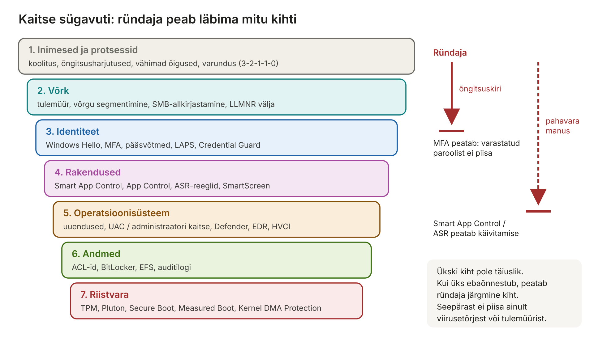
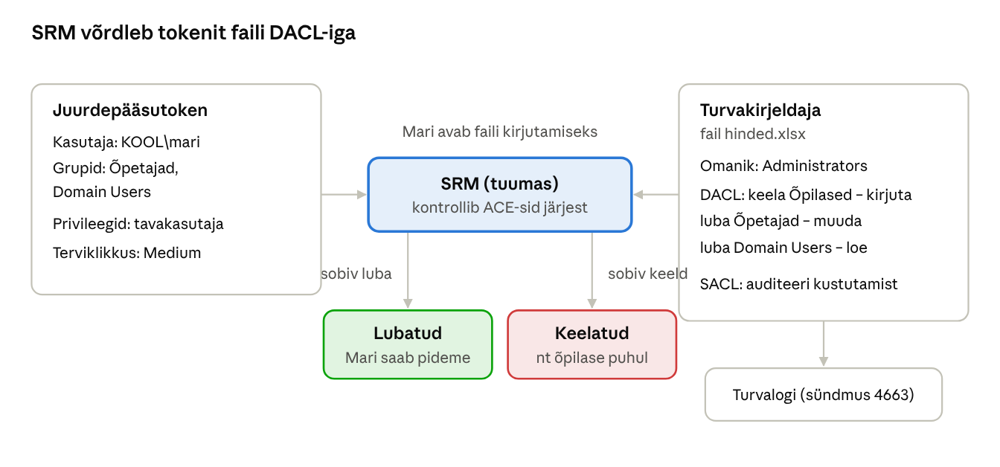
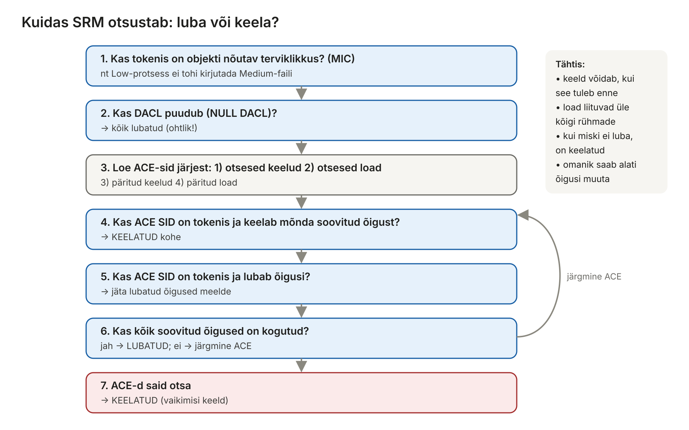
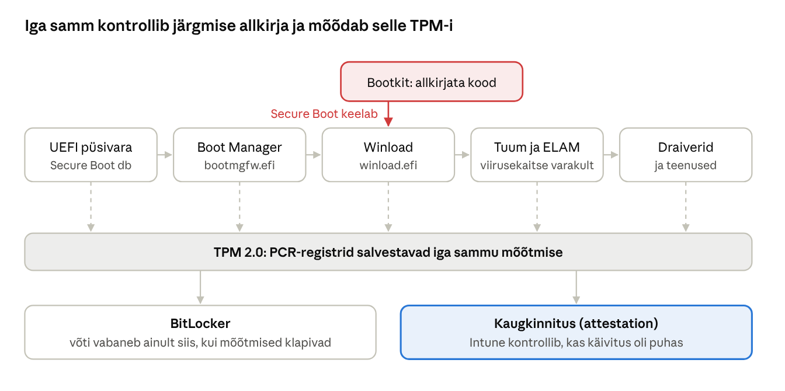

[← 17. Võrguvõimalused Windowsis](17-vork.md) · [Sisukord](../README.md) · [19. Kui Windows jookseb kokku →](19-krahhid.md)

## 18. Windowsi turvalisus

Windowsi turvamudel põhineb kolmel sambal: **identiteet** (kes sa oled – SID ja token), **juurdepääsukontroll** (mida sa tohid – turvakirjeldaja ja ACL) ning **audit** (mida sa tegid – turvalogi). 2026. aasta Windows lisab neile riistvaralise usaldusahela (TPM, Pluton, Secure Boot), paroolivaba autentimise ja rakenduste kontrolli.

**Kuidas seda peatükki lugeda?** Turvalisus on lai teema ja koosneb paljudest mõistetest. Need on tegelikult seotud ühe lihtsa küsimusega: **kes tohib mida teha ja kuidas me seda kontrollime?** Peatükk liigub järgmises järjekorras:

1. miks turvalisust vaja on ja millised on põhimõtted (18.1);
2. millised Windowsi osad turvalisuse eest vastutavad (18.2);
3. kuidas Windows teab, **kes** sa oled (SID, token, autentimine) ja **mida** sa tohid (ACL, UAC) (18.3);
4. kuidas kaitsta pahavara eest (18.4–18.5);
5. kuidas kaitsta võrgust tulevate rünnete eest (18.6);
6. miks uuendused on kõige olulisem kaitse (18.7).

> 🖱️ **Proovi ise:** [interaktiivne õpileht](https://valdonolvak.github.io/Operatsioonis-steemi-ja-k-berturbe-alused/interaktiivne/18-turvalisus.html). Lehel on CIA-harjutus, SID-i lahtiharutaja, juurdepääsutokeni uurija, DACL-i kontrolli simulaator samm-sammult, UAC-i ja administraatori kaitse võrdlus, autentimismeetodite ja rünnete maatriks, lunavararünnaku ahel koos kaitsekihtidega, tulemüürireeglite simulaator ja turvalogi analüüs.

### 18.1 Turvalisus arvutisüsteemides

Infoturbe eesmärgid on **konfidentsiaalsus**, **terviklus** ja **käideldavus** (CIA). OS peab kaitsma andmeid teiste kasutajate, pahavara ja füüsilise varguse eest. Iga OS-i turvamehhanism vastab küsimusele: kes, mida, millise objektiga ja kas see logitakse.

**CIA-kolmik koolinäidetega:**

| Eesmärk | Tähendus | Mis juhtub, kui see rikutakse? | Kaitse |
| --- | --- | --- | --- |
| **Konfidentsiaalsus** (confidentiality) | andmeid näevad ainult need, kellel on õigus | õpilaste hinded või terviseandmed lekivad internetti | õigused (ACL), krüpteerimine, MFA |
| **Terviklus** (integrity) | andmeid ei muudeta loata ega märkamatult | õpilane muudab e-päevikus oma hinnet; pahavara muudab süsteemifaili | õigused, digiallkirjad, auditilogi, Secure Boot |
| **Käideldavus** (availability) | andmed ja teenused on vajadusel kättesaadavad | lunavara krüpteerib failiserveri; e-päevik on rünnaku tõttu maas | varundus, RAID, uuendused, DDoS-kaitse |

Sageli lisatakse veel **autentsus** (kas teade on tõesti saatjalt) ja **mittesalgamine** (saatja ei saa hiljem eitada, et saatis – digiallkiri).

**Kolm „A“-d** – juurdepääsukontrolli etapid:

1. **Autentimine** (authentication) – *kes sa oled?* Kasutaja tõestab oma identiteeti: parool, PIN, sõrmejälg, pääsvõti.
2. **Autoriseerimine** (authorization) – *mida sa tohid?* Süsteem kontrollib õigusi: kas Mari tohib faili muuta?
3. **Arvestus / audit** (accounting) – *mida sa tegid?* Tegevused logitakse, et hiljem saaks uurida.

Neid aetakse sageli segi: sisselogimine (autentimine) ei tähenda veel, et kasutaja tohib kõike teha (autoriseerimine).

**Turvalisuse põhimõtted**, millele kogu peatükk toetub:

- **Vähimad õigused** (least privilege) – kasutaja ja programm saavad ainult need õigused, mida töö jaoks on vaja. Õpetaja ei vaja domeeni administraatori õigusi; veebiserver ei vaja SYSTEM-õigusi. Kui konto häkitakse, on kahju väiksem.
- **Kaitse sügavuti** (defense in depth) – mitu kaitsekihti üksteise järel. Kui üks ebaõnnestub, peatab ründaja järgmine.
- **Nullusaldus** (zero trust) – ühtegi kasutajat ega seadet ei usaldata automaatselt ainult sellepärast, et ta on „sisevõrgus“. Iga päringut kontrollitakse.
- **Vaikimisi turvaline** (secure by default) – turvalised sätted on vaikimisi sees; ebaturvalise valiku peab teadlikult tegema.
- **Ründepinna vähendamine** – mida vähem teenuseid, avatud porte ja programme, seda vähem kohti, kust sisse tulla.



Joonis: turvalisus koosneb kihtidest – inimestest riistvarani. Õngitsuskirjaga varastatud parool peatub MFA-l, pahavara manus rakenduste kontrollil. Ükski kiht üksi ei piisa.

> 🖱️ **Proovi ise:** [kas see rikub konfidentsiaalsust, terviklust või käideldavust?](https://valdonolvak.github.io/Operatsioonis-steemi-ja-k-berturbe-alused/interaktiivne/18-turvalisus.html#cia)

### 18.2 Turvalisus Windows NT-s

NT turvakomponendid:

| Komponent | Roll |
| --- | --- |
| SRM (Security Reference Monitor) | tuumas: kontrollib iga objekti avamist, loob auditikirjeid |
| LSA (`lsass.exe`) | autentimine, turvapoliitika, tokenite loomine |
| SAM | kohalike kontode andmebaas (registrisse peidetud) |
| Active Directory / Entra ID | domeeni- ja pilvekontod |
| Winlogon ja LogonUI | sisselogimise kasutajaliides |
| Credential Guard (`LsaIso.exe`) | parooliräsid ja Kerberose piletid VTL 1-s |

**Mis toimub sisselogimisel?** See protsess seob kõik komponendid kokku:

1. Kasutaja vajutab **Ctrl+Alt+Del** (või avab lukustuskuva). See klahvikombinatsioon on **turvaline tähelepanujada** (Secure Attention Sequence) – seda saab kinni püüda ainult Windows ise, mitte ükski programm. Nii ei saa pahavara näidata võltsitud sisselogimisakent.
2. **Winlogon** ja **LogonUI** kuvavad sisselogimisakna. Sisestamise viisi (parool, PIN, nägu, kiipkaart) pakuvad **mandaadipakkujad** (credential providers).
3. Sisestatud andmed lähevad **LSA**-le (`lsass.exe`). Domeenikonto puhul kasutab LSA **Kerberost** (ptk 17.4) ja küsib domeenikontrollerilt, kohaliku konto puhul kontrollib **SAM**-i andmebaasist.
4. Kui kontroll õnnestub, loob LSA **juurdepääsutokeni**: kasutaja SID, kõigi tema rühmade SID-id, privileegid ja terviklikkuse tase.
5. Winlogon käivitab kasutaja seansi (`userinit.exe` → `explorer.exe`) ja **seob tokeni** esimese protsessiga. Iga järgmine protsess, mille kasutaja käivitab, pärib selle tokeni koopia.
6. Turvalogisse kirjutatakse sündmus **4624** (edukas sisselogimine) või **4625** (ebaõnnestunud).

**Miks on `lsass.exe` ründajate sihtmärk?** Seal hoitakse sisselogitud kasutajate mandaate (parooliräsid, Kerberose pileteid), et kasutaja ei peaks igale teenusele parooli uuesti sisestama. Tööriist **Mimikatz** loeb neid lsass-i mälust. Ründaja, kes saab administraatori räsi, saab sellega logida sisse teistesse arvutitesse ilma parooli teadmata (**pass-the-hash**). Kaitsed: **LSA kaitse** (lsass töötab kaitstud protsessina) ja **Credential Guard** (mandaadid on eraldi virtualiseeritud keskkonnas VTL 1, kuhu isegi tuum ei pääse – ptk 4).

### 18.3 Turvamehhanismid Windowsis

**SID** (Security Identifier) on kasutaja, rühma või arvuti unikaalne tunnus, nt `S-1-5-21-…-1001`. Tuntud SID-id: `S-1-5-18` (LocalSystem), `S-1-5-32-544` (Administrators).

**Miks SID, mitte nimi?** Nime saab muuta (Mari abiellub ja temast saab Mari Tamm), kuid kõik õigused peavad alles jääma. Seepärast salvestatakse ACL-idesse SID, mitte nimi. Kui konto kustutada ja luua uuesti sama nimega, saab see **uue SID-i** – vanad õigused enam ei kehti. (Seepärast näeb vahel õiguste loendis tundmatut SID-i: konto on kustutatud.)

**SID-i ülesehitus:**

```
S - 1 - 5 - 21-3623811015-3361044348-30300820 - 1013
│   │   │   └──────────── domeeni või arvuti osa ──────────┘   └ RID
│   │   └ autoriteet (5 = NT Authority)
│   └ versioon
└ „SID“
```

**RID** (Relative ID) on viimane number. Mõned on alati samad: **500** – sisseehitatud Administrator, **501** – Guest, **512** – Domain Admins, **513** – Domain Users; tavakasutajad alates **1000** (domeenis tavaliselt 1100+).

| Tuntud SID | Kes see on |
| --- | --- |
| `S-1-1-0` | Everyone (kõik) |
| `S-1-5-11` | Authenticated Users (kõik sisselogitud kasutajad) |
| `S-1-5-18` | LocalSystem (SYSTEM) – kõige võimsam konto arvutis |
| `S-1-5-19` / `S-1-5-20` | LocalService / NetworkService – piiratud teenusekontod |
| `S-1-5-32-544` | kohalik Administrators rühm |
| `S-1-5-32-545` | kohalik Users rühm |
| `S-1-16-8192` | terviklikkuse tase Medium |

> 🖱️ **Proovi ise:** [SID-i lahtiharutaja](https://valdonolvak.github.io/Operatsioonis-steemi-ja-k-berturbe-alused/interaktiivne/18-turvalisus.html#sid)

**Juurdepääsutoken** (access token) luuakse sisselogimisel ja kinnitatakse iga protsessi külge. Sisaldab kasutaja SID-i, rühmade SID-e, privileege (nt `SeDebugPrivilege`, `SeBackupPrivilege`) ja **terviklikkuse taset** (Low, Medium, High, System).

**Võrdlus:** token on nagu töötaja **ID-kaart**, mida ta kogu päeva kaasas kannab. Kaardil on nimi (kasutaja SID), osakonnad (rühmade SID-id), erioskused (privileegid) ja turvatase (terviklikkus). Iga ukse juures (objekti avamisel) näitab ta kaarti ja uks (SRM) otsustab, kas lasta sisse. Kaarti ei uuendata päeva jooksul – **kui administraator lisab kasutaja rühma, kehtib see alles pärast uut sisselogimist**, sest token luuakse sisselogimisel. See on tõrkeotsingus väga sage põhjus, miks „õigused ei hakka tööle“.

**Privileegid** on õigused teha **süsteemi tasemel** toiminguid (mitte konkreetse failiga):

| Privileeg | Mida lubab | Miks see on ohtlik |
| --- | --- | --- |
| `SeDebugPrivilege` | avada mis tahes protsessi, ka süsteemi omi | lubab lugeda lsass-i mälust paroole (Mimikatz) |
| `SeBackupPrivilege` | lugeda kõiki faile, olenemata ACL-ist | varundus vajab seda, kuid ründaja saab nii kopeerida SAM-i |
| `SeRestorePrivilege` | kirjutada kõiki faile | saab asendada süsteemifaile |
| `SeTakeOwnershipPrivilege` | võtta mis tahes objekti omanikuks | omanik saab õigusi muuta |
| `SeImpersonatePrivilege` | tegutseda teise kasutaja nimel | teenustel vajalik, kuid „Potato“-rünnetega saab SYSTEM-õigused |
| `SeShutdownPrivilege` | arvuti välja lülitada | tavaline, ohutu |

**Terviklikkuse tasemed** (Mandatory Integrity Control, MIC) lisavad õigustele veel ühe kontrolli: **madalama tasemega protsess ei tohi kirjutada kõrgema tasemega objekti** – isegi kui ACL lubaks.

| Tase | Kes | Näide |
| --- | --- | --- |
| **Low** / AppContainer | liivakastis protsessid | brauseri vahelehe protsess |
| **Medium** | tavaline kasutaja | Word, Explorer, tavaline PowerShell |
| **High** | tõstetud administraator | „Käivita administraatorina“ |
| **System** | teenused, tuum | `services.exe`, `lsass.exe` |

**Näide:** brauseri vaheleht töötab Low-tasemel. Kui veebilehel olev pahavara saab vahelehe üle kontrolli, ei saa ta kirjutada sinu dokumentidesse ega registrisse (need on Medium) – ta on „liivakastis“.

> 🖱️ **Proovi ise:** [juurdepääsutokeni uurija](https://valdonolvak.github.io/Operatsioonis-steemi-ja-k-berturbe-alused/interaktiivne/18-turvalisus.html#token)

**Turvakirjeldaja** (security descriptor) on igal objektil: omanik, **DACL** (kes mida tohib – ACE-de loend „luba“/„keela“) ja **SACL** (mida auditeerida). Juurdepääsu kontrollil võrdleb SRM tokenit DACL-iga; esimene sobiv keelav ACE võidab.



Joonis: SRM võrdleb tokeni SID-e DACL-i kirjetega; Mari on Õpetajate rühmas ja saab muutmisõiguse, õpilase puhul võidaks keelav kirje. SACL määrab, mida turvalogisse kirjutatakse.

**Kuidas SRM täpselt otsustab?** See algoritm on Windowsi juurdepääsukontrolli süda ja seda tasub osata, sest enamik õiguste probleeme on selgitatav sellega:



Joonis: kõigepealt kontrollitakse terviklikkuse taset, siis loetakse ACE-sid kindlas järjekorras. Keeld peatab kohe; load kogutakse kokku; kui kõiki soovitud õigusi ei leitud, on vastus „keelatud“.

Olulised reeglid:

1. **ACE-de järjekord:** Windows sorteerib kirjed nii, et **otsesed** (sellele objektile määratud) on enne **päritud** (ülemkaustast tulnud) ja keelud on enne lubasid. Seepärast võidab otsene keeld otsese loa, kuid **otsene luba võidab päritud keelu**.
2. **Load liituvad:** kui Mari on rühmades „Õpetajad“ (loe) ja „Klassijuhatajad“ (kirjuta), saab ta mõlemad.
3. **Vaikimisi keeld:** kui ükski kirje ei luba, on juurdepääs keelatud. Õigusi ei pea „ära keelama“ – piisab, kui neid ei anta.
4. **NULL DACL vs tühi DACL:** kui DACL **puudub** (NULL), on kõigil kõik õigused – väga ohtlik. Kui DACL on olemas, kuid **tühi**, pole kellelgi õigusi.
5. **Omanik** saab alati objekti õigusi lugeda ja muuta – nii ei saa keegi end kogemata failist välja lukustada.
6. **Keela säästlikult.** Keelav kirje „Everyone – keela“ kehtib ka administraatoritele ja võib lõhkuda süsteemi. Parem on luba mitte anda.

**`icacls` lühendid**, mida näed käsurealt:

| Lühend | Õigus |
| --- | --- |
| `F` | täielik juurdepääs (full) |
| `M` | muutmine (modify – loe, kirjuta, kustuta) |
| `RX` | lugemine ja käivitamine |
| `R` / `W` | ainult lugemine / ainult kirjutamine |
| `(OI)(CI)` | pärandub failidele (object inherit) ja alamkaustadele (container inherit) |
| `(I)` | päritud ülemkaustast |

```
C:\> icacls D:\Hinded
D:\Hinded KOOL\Õpetajad:(OI)(CI)(M)
          KOOL\Õpilased:(OI)(CI)(DENY)(W)
          BUILTIN\Administrators:(I)(OI)(CI)(F)
```

**Audit.** SACL ütleb, milliseid toiminguid turvalogisse kirjutada. Kuid SACL üksi ei piisa – peab olema sisse lülitatud ka **auditipoliitika** (`auditpol` või rühmapoliitika „Advanced Audit Policy“). Olulisemad turvalogi sündmused:

| Sündmus | Tähendus | Millele viitab |
| --- | --- | --- |
| **4624** | edukas sisselogimine (tüüp 2 – klaviatuur, 3 – võrk, 10 – RDP) | kes ja kust sisse logis |
| **4625** | ebaõnnestunud sisselogimine | paljud järjest → parooli äraarvamine |
| **4740** | konto lukustati | ründe või unustatud parooli tunnus |
| **4672** | sisselogimisel anti eriõigused (admin) | administraatori tegevus |
| **4688** | uus protsess loodi | mis programme käivitati (ptk 7) |
| **4663** | objektile pöörduti (SACL-i järgi) | kes avas või kustutas faili |
| **4720 / 4732** | kasutaja loodi / lisati kohalikku rühma | võimalik tagaukse loomine |
| **1102** | turvalogi tühjendati | ründaja peidab jälgi – väga kahtlane! |

> 🖱️ **Proovi ise:** [DACL-i kontrolli simulaator](https://valdonolvak.github.io/Operatsioonis-steemi-ja-k-berturbe-alused/interaktiivne/18-turvalisus.html#acl) ja [turvalogi analüüs](https://valdonolvak.github.io/Operatsioonis-steemi-ja-k-berturbe-alused/interaktiivne/18-turvalisus.html#logi)

**UAC** (User Account Control): administraator töötab vaikimisi kahe tokeniga – tavalisega ja täieliku administraatori omaga, mida kasutatakse ainult kinnituse järel.

**Miks UAC loodi?** Windows XP ajal töötasid peaaegu kõik kasutajad administraatoritena. Iga programm – ka pahavara – sai kohe täielikud õigused. Windows Vista (2007) tõi UAC-i: administraator logib sisse **jagatud tokeniga** (split token). Igapäevased programmid töötavad tavakasutaja tokeniga (Medium). Kui programm vajab administraatori õigusi, kuvatakse **turvalisel töölaual** (ekraan tumeneb, teised programmid ei saa nuppu vajutada) küsimus „Kas lubate…?“. Alles siis kasutatakse täielikku tokenit (High).

**UAC-i piirangud:** Microsoft ise ütleb, et UAC **ei ole turvapiir** – see on mugavusfunktsioon, mis vähendab vahingut. Kasutajad harjuvad „Jah“ vajutama ja on teada palju viise, kuidas pahavara saab UAC-st mööda hiilida (UAC bypass), sest tavaline ja administraatori token kuuluvad samale kontole ja jagavad sama profiili. **Administraatori kaitse** (Administrator protection) on UAC-i järglane: kasutajal pole püsivaid administraatoriõigusi, vaid iga tõstmise jaoks luuakse Windows Helloga kinnitatud ajutine eraldi konto token. Funktsioon jõudis Windows 11-sse 2026. aasta augusti lõpus vaikimisi väljalülitatuna ([Itelio / Microsoft Message Center](https://www.itelio.com/en/microsoft-message-center/mc1444375)), ja oktoobri 2026 turvauuendusest on see Windows 11 turvabaasjoontes vaikimisi sisse lülitatud ([Pupuweb / MC1506291](https://pupuweb.com/mc1506291-manage-administrator-protection-within-windows-11-security-baseline/)).

**Autentimine tänapäeval.** Paroolidel on mitu probleemi: inimesed valivad nõrku paroole, kasutavad sama parooli mitmes kohas (kui üks leht lekib, proovitakse seda igal pool – *credential stuffing*) ja sisestavad parooli õngitsuslehele. **Mitmikautentimine (MFA)** nõuab kaht eri tüüpi tõendit:

| Tüüp | Näide |
| --- | --- |
| midagi, mida **tead** | parool, PIN |
| midagi, mis sul **on** | telefon, turvavõti, TPM-iga arvuti, ID-kaart |
| midagi, mis sa **oled** | sõrmejälg, nägu |

Kõik MFA-meetodid pole võrdsed. SMS-koodi saab õngitsuslehele sisestada samamoodi nagu parooli ja ründaja võib telefoninumbri üle võtta (SIM-vahetus). Rakenduse teavituse puhul saadab ründaja vahel kümneid päringuid, kuni kasutaja tüdineb ja vajutab „Kinnita“ (*MFA fatigue*) – seepärast küsib Microsoft Authenticator numbrit, mis on ekraanil. **Õngitsuskindlad** on ainult meetodid, mis on seotud õige veebilehe aadressiga: pääsvõtmed, FIDO2-turvavõtmed, Windows Hello for Business, ID-kaart.


- **Windows Hello / Windows Hello for Business** – PIN, näo- või sõrmejäljetuvastus; võti on seotud TPM-iga, parool võrgus ei liigu;
- **pääsvõtmed** (passkeys, FIDO2) – paroolivaba ja õngitsuskindel veebiautentimine;
- **LAPS** – iga arvuti kohaliku administraatori parool on erinev ja vahetub automaatselt (Windows LAPS on OS-i sisse ehitatud);
- **LSA kaitse** – lsass.exe töötab kaitstud protsessina (PPL), mis takistab paroolide varastamist mälust.

**Miks on Windows Hello PIN turvalisem kui parool?** Tundub vastupidi – 6-kohaline PIN on lühem. Kuid PIN on **seotud selle arvuti TPM-iga** ja kehtib ainult selles seadmes. Parooli saab ründaja kasutada kõikjal maailmas; PIN-i saab kasutada ainult siis, kui ründaja istub sinu arvuti taga. TPM kaitseb ka äraarvamise eest: pärast mitut valet katset lukustub ta ajutiselt.

**Miks on pääsvõti õngitsuskindel?** Pääsvõti on krüptograafiline võtmepaar: privaatvõti jääb seadmesse, avalik võti on teenuse juures. Pääsvõti on **seotud domeeniga** (nt `login.microsoftonline.com`). Kui õngitsusleht on `login-microsoft0nline.com`, ei paku brauser sellele pääsvõtit üldse – kasutaja ei saa seda kogemata ründajale anda, isegi kui leht näeb täpselt sama välja.

**Miks LAPS?** Kui kõigil kooli 200 arvutil on sama kohaliku administraatori parool ja ründaja saab selle ühest arvutist (nt räsi Mimikatziga), pääseb ta kohe kõigisse 200 arvutisse (**külgliikumine**). LAPS teeb iga arvuti parooli erinevaks ja vahetab seda regulaarselt; parooli näevad AD-s või Entra ID-s ainult volitatud administraatorid.

> 🖱️ **Proovi ise:** [UAC ja administraatori kaitse](https://valdonolvak.github.io/Operatsioonis-steemi-ja-k-berturbe-alused/interaktiivne/18-turvalisus.html#uac) ning [millise ründe vastu milline autentimine aitab?](https://valdonolvak.github.io/Operatsioonis-steemi-ja-k-berturbe-alused/interaktiivne/18-turvalisus.html#auth)

**Riistvaraline usaldusahel:**

- **UEFI Secure Boot** – käivitatakse ainult allkirjastatud alglaadur;
- **Measured Boot ja TPM** – käivitusahela mõõtmised salvestatakse TPM-i, BitLocker ja kaugkinnitus (attestation) kasutavad neid;
- **Microsoft Pluton** – protsessorisse integreeritud turvaprotsessor, mille püsivara uuendatakse Windows Update’i kaudu ([Redmond Magazine](https://redmondmag.com/articles/2022/04/07/microsoft-outlines-new-security-protections-coming-to--windows-11.aspx)).



Joonis: Secure Boot peatab allkirjata koodi, Measured Boot salvestab iga sammu räsi TPM-i. Kui keegi muudab alglaadurit, ei klapi mõõtmised – BitLocker küsib taastevõtit ja Intune märgib seadme mitteühilduvaks.

**Tähelepanu 2026: Secure Booti sertifikaatide vahetus.** 2011. aastal väljastatud Microsofti Secure Booti sertifikaadid aeguvad: KEK CA 2011 24. juunil, UEFI CA 2011 27. juunil ja Windows Production PCA 2011 19. oktoobril 2026; asemele tulevad 2023. aasta sertifikaadid ([Microsoft Support](https://support.microsoft.com/help/5062710), [UW–Madison KB](https://kb.wisc.edu/159935)). Seade, mis uusi sertifikaate ei saa, ei saa enam Secure Booti ja alglaaduri turvaparandusi. Kontroll PowerShellis on praktilises ülesandes.

### 18.4 Kaitse nuhkvara ja pahavara eest

Algse õpiku Windows Defender on nüüd **Microsoft Defender Antivirus**, mis kasutab:

- allkirju ja heuristikat;
- **pilvekaitset** ja masinõpet – tundmatu fail saadetakse sekunditega pilve analüüsiks;
- **käitumisjälgimist** ja **AMSI**-t (Antimalware Scan Interface) – skriptid (PowerShell, VBA, JavaScript) kontrollitakse enne käivitamist ka siis, kui need on hajutatud;
- **ründepinna vähendamise reegleid** (ASR) – nt keelab Office’il lapsprotsesside loomise;
- **kontrollitud kaustale juurdepääsu** – lunavarakaitse;
- **rikkumiskaitset** (Tamper Protection) – pahavara ei saa Defenderit välja lülitada.

Organisatsioonides lisandub **EDR** (nt Microsoft Defender for Endpoint), mis kogub telemeetriat ja võimaldab intsidendile reageerida.

**Viirusetõrje vs EDR.** Klassikaline viirusetõrje küsib: „Kas see fail on pahavara?“ – ja vastab allkirjade ning heuristika põhjal. Kaasaegne ründaja kasutab aga sageli täiesti legaalseid tööriistu (PowerShell, RDP, varundustarkvara), mida viirusetõrje ei saa blokeerida. **EDR** (Endpoint Detection and Response) kogub kõigi arvutite tegevuste kohta andmeid (protsessid, võrguühendused, sisselogimised) ja otsib **käitumismustreid**: „Word käivitas PowerShelli, mis laadis internetist faili ja proovis lugeda lsass-i mälu“. Iga samm eraldi võib olla süütu, koos on see rünnak. EDR võimaldab ka arvuti võrgust eraldada ühe klõpsuga.

**ASR-reeglite näited** (ründepinna vähendamine):

- Office’i rakendused ei tohi luua lapsprotsesse (makro ei saa käivitada PowerShelli);
- e-posti klient ei tohi käivitada käivitatavaid faile;
- keela lsass-ist mandaatide varastamine;
- keela allkirjastamata protsessid USB-lt;
- keela haavatavate allkirjastatud draiverite kasutamine.

**Kontrollitud kaustale juurdepääs** lubab kaustu `Dokumendid`, `Pildid` jne muuta ainult usaldusväärsetel programmidel. Kui tundmatu programm (nt lunavara) proovib faile krüpteerida, keelatakse see.

**Rakenduste kontroll:**

- **Smart App Control** – lubab käivitada ainult allkirjastatud või pilve AI-mudeli järgi usaldusväärseid rakendusi ning blokeerib internetist tulnud skriptid; saadaval puhtal paigaldusel ([Dark Reading](https://www.darkreading.com/remote-workforce/microsoft-details-new-security-features-for-windows-11), [Petri](https://petri.com/windows-11-2022-update-security-features/));
- **App Control for Business** (endine WDAC) ja **AppLocker** – organisatsiooni lubatud rakenduste poliitika;
- **haavatavate draiverite blokeerimisloend** – vaikimisi sees;
- **SmartScreen** – hoiatab tundmatute allalaadimiste ja õngitsuslehtede eest.

### 18.5 Viirusekaitse

Pahavara liigid: viirus (nakatab faile), uss (levib ise võrgus), troojalane (maskeerub kasulikuks), lunavara (krüpteerib ja väljapressib), nuhkvara, juurkomplekt (rootkit, peidab end tuumas), botid. Kaasaegne pahavara on sageli **failivaba**: kasutab PowerShelli, WMI-d ja teisi süsteemi enda tööriistu („living off the land“).

| Liik | Kuidas levib / töötab | Tuntud näide |
| --- | --- | --- |
| **Viirus** | nakatab teisi faile, vajab käivitamist | Brain (1986) |
| **Uss** | levib ise võrgus, kasutades turvaauku | WannaCry (2017) – SMB1 kaudu |
| **Troojalane** | maskeerub kasulikuks programmiks | Emotet – Wordi makro kaudu |
| **Lunavara** | krüpteerib failid, nõuab lunaraha; sageli ka varastab andmed ja ähvardab need avaldada (*topeltväljapressimine*) | LockBit, Conti |
| **Nuhkvara / infovaras** | varastab paroole, küpsiseid, krüptorahakotte | RedLine, Lumma |
| **Juurkomplekt** | peidab end tuumas või püsivaras | TDL-4 |
| **Bot** | arvuti on ründaja juhitava võrgu osa | Mirai (IoT-seadmed) |

**„Living off the land“ näited** – ründaja kasutab Windowsi enda tööriistu, mida viirusetõrje ei saa lihtsalt keelata:

- `powershell -enc <base64>` – peidetud (kodeeritud) skript; AMSI kontrollib selle sisu enne käivitamist;
- `certutil -urlcache -f http://…` – sertifikaadi tööriistaga faili allalaadimine;
- `rundll32`, `mshta`, `regsvr32` – koodi käivitamine süsteemi programmide kaudu;
- `vssadmin delete shadows /all` – varikoopiate kustutamine enne krüpteerimist;
- `wevtutil cl Security` – turvalogi tühjendamine (sündmus 1102).

**Lunavararünnaku tüüpilised etapid** – iga etapp on võimalus rünnak peatada:

1. **Sissetung** – õngitsuskiri, varastatud parool (VPN, RDP), turvaauk avalikus serveris;
2. **Kinnistumine** – pahavara jääb käivituma ka pärast taaskäivitust (ajastatud ülesanne, teenus);
3. **Õiguste tõstmine** – mandaatide varastamine lsass-ist, haavatav draiver;
4. **Külgliikumine** – sama administraatori parooliga teistesse arvutitesse, domeeni administraatori õigused;
5. **Andmete väljavedu** – andmed kopeeritakse ründaja serverisse (topeltväljapressimiseks);
6. **Varukoopiate hävitamine** – varikoopiad, võrgus olevad varukoopiad;
7. **Krüpteerimine** – sageli öösel või nädalavahetusel, kõigis arvutites korraga.

> 🖱️ **Proovi ise:** [lunavararünnaku ahel – milline kaitse millise etapi peatab?](https://valdonolvak.github.io/Operatsioonis-steemi-ja-k-berturbe-alused/interaktiivne/18-turvalisus.html#ahel)

Kasutaja saab skannida Windowsi turbe rakenduses (kiir-, täis-, kohandatud ja **võrguühenduseta skannimine**, mis käivitub enne Windowsi laadimist ja leiab juurkomplekte).

### 18.6 Windowsi tulemüür

**Windows Defender Firewall** on olekupõhine (stateful) hostitulemüür, mis töötab WFP peal. Omadused:

- profiilid **domeen**, **privaatne**, **avalik** – eri reeglid eri võrkudes;
- sissetulev liiklus vaikimisi keelatud, väljaminev lubatud;
- reeglid programmi, pordi, protokolli, IP-aadressi, teenuse ja kasutaja järgi;
- **IPsec-ühenduse turvareeglid**;
- logimine faili `pfirewall.log`.

Pakett lubatakse, kui see kuulub olemasolevasse ühendusse või vastab lubavale reeglile; keelav reegel võidab lubava.

**Mida tähendab „olekupõhine“?** Tulemüür jätab meelde iga väljamineva ühenduse. Kui sinu brauser ühendub serveriga `www.ria.ee:443`, siis serveri vastuseid lastakse sisse, kuigi sissetulev liiklus on üldiselt keelatud – sest tulemüür teab, et need kuuluvad sinu algatatud ühendusse. Kui aga keegi internetist proovib ise ühendust sinu arvutiga alustada, keelatakse see.

**Reeglite hindamise järjekord:**

1. kas pakett kuulub olemasolevasse ühendusse? → luba;
2. kas mõni **keelav** reegel sobib? → keela (keelamine võidab);
3. kas mõni **lubav** reegel sobib? → luba;
4. muidu kehtib **vaikimisi tegevus** (sissetulev: keela, väljaminev: luba).

**Miks profiilid on olulised?** Sama sülearvuti võib olla hommikul koolivõrgus (domeen), õhtul kodus (privaatne) ja vahepeal kohvikus (avalik). Avalikus võrgus on failijagamine ja võrgutuvastus välja lülitatud, et kohviku naabrid ei näeks sinu arvutit.

```powershell
# Luba kaugtöölaud ainult kooli haldusvõrgust
New-NetFirewallRule -DisplayName "RDP haldusvõrgust" -Direction Inbound -Protocol TCP `
  -LocalPort 3389 -RemoteAddress 10.10.99.0/24 -Profile Domain -Action Allow
# Blokeeri Notepadi väljaminev liiklus
New-NetFirewallRule -DisplayName "Notepad keelatud" -Direction Outbound `
  -Program "C:\Windows\System32\notepad.exe" -Action Block
```

**Väljaminev liiklus** on vaikimisi lubatud, sest muidu peaks iga programmi jaoks reegli tegema. Kõrge turvatasemega serverites lubatakse ka väljaminevat liiklust ainult vajalikesse kohtadesse – nii ei saa pahavara „koju helistada“.

> 🖱️ **Proovi ise:** [tulemüürireeglite simulaator](https://valdonolvak.github.io/Operatsioonis-steemi-ja-k-berturbe-alused/interaktiivne/18-turvalisus.html#tulemuur)

### 18.7 Windows Update

Windows saab:

- **kumulatiivse kvaliteediuuenduse** iga kuu teisel teisipäeval („Patch Tuesday“) ja valikulise eelvaate neljandal nädalal;
- **funktsiooniuuenduse** kord aastas (Windows 11 26H2 jne), enamasti väikese lüliti-paketina (enablement package);
- **draiveri- ja püsivarauuendusi**, Defenderi allkirju mitu korda päevas;
- **hotpatch** – Windows 11 Enterprise 24H2+ x64 seadmetel alates aprillist 2025 turvauuendused ilma taaskäivituseta, kvartaalse tsükliga (baaskuu taaskäivitusega, kaks hotpatch-kuud) Autopatchi kaudu ([Microsoft Tech Community](https://techcommunity.microsoft.com/blog/windows-itpro-blog/hotpatch-for-client-frequently-asked-questions/4413582)).

Haldusvahendid: **Windows Autopatch** ja **Intune** (pilv), **WSUS** (aegunud, kuid veel olemas), **Configuration Manager**. **Kohaletoimetamise optimeerimine** (Delivery Optimization) jagab uuendusi arvutite vahel.

**Miks on uuendused kõige olulisem kaitse?** Kui Microsoft avaldab paranduse, saavad ründajad uuendust analüüsida ja leida, millist viga see parandab. Sageli ilmub töötav ründekood mõne päeva jooksul. Iga uuendamata arvuti on seejärel lihtne sihtmärk. WannaCry (mai 2017) kasutas viga, mille parandus oli avaldatud juba kaks kuud varem (märtsis) – nakatusid ainult uuendamata arvutid.

**Kuidas organisatsioon uuendusi paigaldab?** Mitte kõigile korraga – kui uuendus põhjustab probleeme, peatuks kogu asutus. Kasutatakse **ringe**:

1. **Testring** – IT-osakonna arvutid (esimesed päevad);
2. **Pilootring** – 5–10% kasutajatest eri osakondadest;
3. **Lai ring** – kõik ülejäänud;
4. **Kriitilised serverid** – hoolduse ajal, varundus enne.

Kui uuendus parandab aktiivselt ärakasutatavat viga (*zero-day*), lühendatakse ringe ja paigaldatakse kohe.

### Võrdlus: Linux ja macOS

Kõigil kolmel on kasutajad, rühmad ja failide õigused, kuid lisakaitsed on eri nimedega ja kohati eri loogikaga.

|  | Windows | Linux | macOS |
| --- | --- | --- | --- |
| Kasutaja tunnus | SID | UID, GID | UID, GID |
| Administraator | Administrators; UAC / administraatori kaitse | `root`; `sudo` | admin-rühm; `sudo`, parooli või Touch ID kinnitus |
| Failiõigused | DACL / SACL | `rwx` (omanik, rühm, teised) + POSIX ACL | `rwx` + ACL |
| Kohustuslik juurdepääsukontroll | terviklikkuse tasemed, AppContainer | SELinux, AppArmor | System Integrity Protection, liivakast (sandbox) |
| Rakenduste usaldus | Smart App Control, App Control, SmartScreen | paketihalduri allkirjad, distro hoidlad | Gatekeeper, notariseerimine, XProtect |
| Privaatsusload | Seaded → Privaatsus ja turve | sõltub distrost ja paketivormingust | TCC: kaamera, mikrofon, failid luba rakenduse kaupa |
| Ketta krüpteerimine | BitLocker + TPM | LUKS (+ TPM) | FileVault + Secure Enclave |
| Käivituse kaitse | Secure Boot, Measured Boot, TPM, Pluton | Secure Boot (shim), TPM | Apple Silicon Secure Boot, Secure Enclave |

**Mida sellest õppida:** põhimõtted on samad – vähimad õigused, allkirjastatud kood, krüpteeritud ketas, riistvaraline usaldusahel. Linuxi `chmod 777` on sama vale nagu Windowsis õigus „Everyone: Full control“.

### Näide: hindefail ja programmi paigaldamine

**Juurdepääs failile.** Failiserveris on kaust `\\srv\Hinded`. Õpilane Jaan avastab kausta tee ja proovib avada faili `hinded.xlsx`.

1. Jaani tokenis on SID-id `KOOL\jaan`, `Õpilased`, `Domain Users`.
2. SRM loeb faili DACL-i: esimene sobiv kirje on „keela Õpilased – kirjuta“; lugemiseks sobib „luba Domain Users – loe“.
3. Jaan saab faili avada ainult lugemiseks. Parem lahendus: õpilastele ei anta kausta kõige vähematki õigust (vähimate õiguste põhimõte) ja kausta lisatakse SACL, mis logib ebaõnnestunud katsed (sündmus 4656/4663).

**Õiguste tõstmine.** Mari (kohalik administraator) laadib alla tasuta PDF-redaktori ja käivitab paigaldaja.

- **UAC-ga:** ilmub „Kas lubate sellel rakendusel teha muudatusi?“ – Mari klõpsab „Jah“ ja paigaldaja saab täieliku administraatori tokeni. Pahavara, mis juba Mari kontol töötab, võib sama nuppu imiteerida või UAC-st mööda hiilida.
- **Administraatori kaitsega:** Windows küsib Windows Hello kinnitust (PIN või nägu) ja käivitab paigaldaja eraldi ajutise süsteemi loodud kontoga. Kui paigaldus lõpeb, kaob ka administraatoriõigus. Mari igapäevaseanss ei hoia kunagi administraatori tokenit.

Kontrolli ise: `whoami /groups` näitab tavalises PowerShellis *Mandatory Label\\Medium*, administraatorina käivitatuna *High*.

### Kokkuvõte

- Windowsi juurdepääsukontroll: token (kes) + turvakirjeldaja (mida tohib) + SRM (kontroll).
- Administraatori kaitse, Windows Hello, LAPS ja Credential Guard vähendavad paroolide ja õiguste kuritarvitamist.
- Defender, Smart App Control, ASR ja tulemüür moodustavad kihilise kaitse.
- Uuendused on kaitse alus; 2026 on Secure Booti sertifikaatide vahetuse aasta.
- CIA: konfidentsiaalsus, terviklus, käideldavus. Kolm A-d: autentimine, autoriseerimine, audit.
- Põhimõtted: vähimad õigused, kaitse sügavuti, nullusaldus, vaikimisi turvaline.
- SID on püsiv tunnus (nimi võib muutuda); RID 500 on sisseehitatud administraator.
- Token luuakse sisselogimisel – rühmamuudatused kehtivad pärast uut sisselogimist.
- DACL-i kontroll: otsesed keelud → otsesed load → päritud; load liituvad; kui miski ei luba, on keelatud.
- UAC ei ole turvapiir; administraatori kaitse kasutab eraldi ajutist kontot.
- Õngitsuskindlad on ainult domeeniga seotud meetodid (pääsvõtmed, Hello for Business, FIDO2).
- Lunavararünnakul on mitu etappi ja igas saab seda peatada.
- Olulised sündmused: 4624, 4625, 4672, 4688, 4720, 4732, 1102.

### Kontrollküsimused

> 🧪 **Interaktiivne test:** [kontrolli oma teadmisi](https://valdonolvak.github.io/Operatsioonis-steemi-ja-k-berturbe-alused/interaktiivne/18-test.html). Test koosneb 25 valikvastusega küsimusest. Iga vastuse järel näed selgitust ning lõpus saad valesti vastatud küsimusi korrata.

1. Miks on arvutisüsteemis vaja turvalisust? Selgita CIA-kolmikut.
2. Mis ülesanne on SID-il?
3. Mida sisaldab juurdepääsutoken?
4. Mis ülesanne on turvakirjeldajal? Mis vahe on DACL-il ja SACL-il?
5. Kuidas töötab UAC ja mille poolest erineb sellest administraatori kaitse?
6. Milliseid võimalusi on kasutajal arvuti viiruste suhtes skannida?
7. Milliste mehhanismidega avastab Microsoft Defender pahavara?
8. Mis on Smart App Control?
9. Selgita lühidalt, kuidas Windowsi tulemüür pakette filtreerib.
10. Mis on Windows Update’i ülesanne ja kuidas see töötab? Mis on hotpatch?
11. Miks peab IT-administraator 2026. aastal kontrollima Secure Booti sertifikaate?
12. Mis vahe on autentimisel ja autoriseerimisel? Too näide.
13. Selgita vähimate õiguste ja kaitse sügavuti põhimõtet.
14. Kirjelda, mis toimub Windowsis sisselogimisel. Miks on Ctrl+Alt+Del turvaline?
15. Miks salvestatakse ACL-idesse SID, mitte kasutajanimi? Mida tähendab RID 500?
16. Administraator lisas Jaani rühma „Õpetajad“, kuid Jaan ei pääse ikka kausta. Miks?
17. Selgita DACL-i kontrolli järjekorda. Kas otsene luba võidab päritud keelu?
18. Mis on terviklikkuse tase ja kuidas see kaitseb brauseri kaudu tulnud pahavara eest?
19. Miks on Windows Hello PIN turvalisem kui parool? Miks on pääsvõti õngitsuskindel?
20. Nimeta lunavararünnaku etapid ja iga etapi kohta üks kaitse.
21. Mida tähendavad turvalogi sündmused 4625, 4672 ja 1102?

### Valikküsimused

1. Mis on `S-1-5-18`? a) Administrators b) LocalSystem c) Guest d) Everyone
2. Kus on kirjas, kes võib faili lugeda? a) SACL b) DACL c) SAM d) token
3. Mis takistab pahavaral Defenderi väljalülitamist? a) AMSI b) Tamper Protection c) SmartScreen d) ASR
4. Mis muudab kohaliku administraatori parooli igal arvutil erinevaks? a) LAPS b) BitLocker c) Hello d) UAC
5. Millal on Patch Tuesday? a) iga kuu esimesel esmaspäeval b) iga kuu teisel teisipäeval c) igal reedel d) kord kvartalis
6. Millise terviklikkuse tasemega töötab tavaline Word? a) Low b) Medium c) High d) System
7. Milline MFA-meetod on õngitsuskindel? a) SMS-kood b) e-kirjaga kood c) pääsvõti d) turvaküsimus
8. Mida tähendab turvalogi sündmus 1102? a) edukas sisselogimine b) turvalogi tühjendati c) uus kasutaja d) konto lukustati

### Praktiline ülesanne

```powershell
whoami /all
Get-Acl C:\Windows\System32\drivers\etc\hosts | Format-List
Get-MpComputerStatus | Select-Object AMServiceEnabled, RealTimeProtectionEnabled, IsTamperProtected, AntivirusSignatureLastUpdated
Get-NetFirewallProfile | Select-Object Name, Enabled, DefaultInboundAction, DefaultOutboundAction
Confirm-SecureBootUEFI
[System.Text.Encoding]::ASCII.GetString((Get-SecureBootUEFI db).bytes) -match 'Windows UEFI CA 2023'
Get-HotFix | Sort-Object InstalledOn -Descending | Select-Object -First 5
```

Vasta: milline on sinu PowerShelli protsessi terviklikkuse tase? Kas Tamper Protection on sees? Kas arvutis on uus Secure Booti sertifikaat? Loo tulemüürireegel, mis blokeerib Notepadi väljamineva liikluse, ja kustuta see.

### Iseseisvad ülesanded

**1. Õiguste kujundamine.** Loo õppe-VM-is kohalikud rühmad `Õpetajad` ja `Õpilased` ning kasutajad `mari` ja `jaan`. Loo kaust `C:\Kool\Hinded` ja määra õigused nii, et õpetajad saavad muuta, õpilased ei näe kausta üldse ja kõik kustutamised logitakse (SACL + auditipoliitika). Kontrolli tulemust mõlema kasutajana ja vaata turvalogi. **Esita:** `icacls C:\Kool\Hinded` väljund, ekraanipilt sündmusest 4663 ja lühike selgitus, miks kasutasid rühmi, mitte üksikkasutajaid.

**2. Turvabaasjoone võrdlus.** Lae alla Microsoft Security Compliance Toolkit ja käivita *Policy Analyzer*, võrreldes oma õppe-VM-i seadistust Windows 11 turvabaasjoonega. Vali erinevuste hulgast viis, mis on sinu arvates kõige olulisemad. **Esita:** tabel „baasjoone säte – praegune väärtus – soovitatud väärtus – mille vastu kaitseb“.

**3. Logianalüüs.** Tekita õppe-VM-is olukord: proovi 10 korda vale parooliga sisse logida, siis logi sisse õige parooliga, loo uus kasutaja ja lisa ta Administrators rühma. Leia turvalogist (`Get-WinEvent -FilterHashtable @{LogName='Security'; Id=4625,4624,4720,4732}`) kõik sündmused. **Esita:** ajajoon sündmustega ja selgitus, kuidas administraator sellise mustri järgi rünnaku ära tunneks.

### Viited

- Krogh (2017), ptk 18.
- Yosifovich jt, *Windows Internals* 7. tr, 1. osa, ptk 7 „Security“.
- Microsoft Learn: [Windows security](https://learn.microsoft.com/windows/security/); [Windows security baselines](https://learn.microsoft.com/windows/security/operating-system-security/device-management/windows-security-configuration-framework/windows-security-baselines).
- Allikad lingitud tekstis.

> 📝 **Test:** selle peatüki Google Formsi test luuakse skriptiga [`google-forms/looVormid.gs`](../google-forms/looVormid.gs).

---

[← 17. Võrguvõimalused Windowsis](17-vork.md) · [Sisukord](../README.md) · [19. Kui Windows jookseb kokku →](19-krahhid.md)
