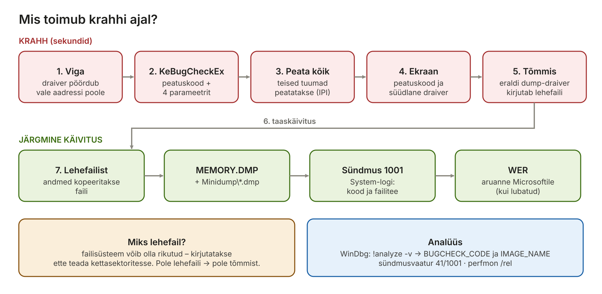
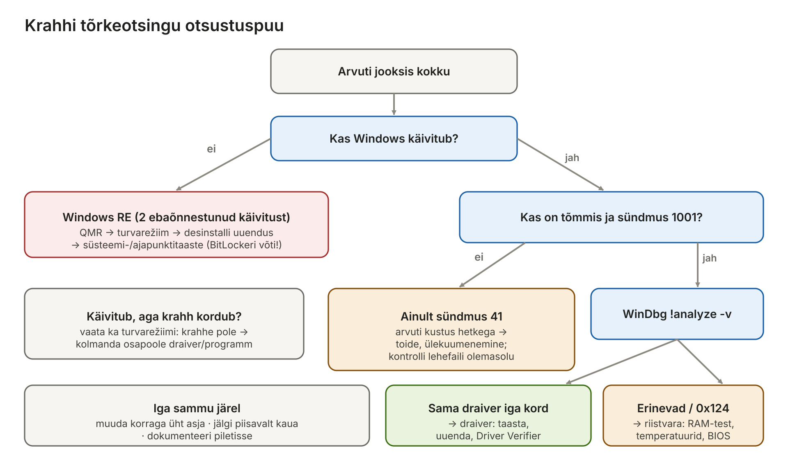

[← 18. Windowsi turvalisus](18-turvalisus.md) · [Sisukord](../README.md) · [20. UUS: Virtualiseerimine, konteinerid ja WSL →](20-virtualiseerimine-konteinerid-wsl.md)

## 19. Kui Windows jookseb kokku

Kui tuumarežiimis tekib viga, mida ei saa ohutult parandada, peatab Windows kogu süsteemi (**bugcheck**), kuvab veateate, salvestab **mälutõmmise** (crash dump) ja taaskäivitub. Windows 11-s on tuttav sinine ekraan asendunud mustaga ning taastumiseks on lisandunud **kiire masinataaste** (Quick Machine Recovery).

**Kuidas seda peatükki lugeda?** Krahh tundub esmapilgul juhuslik ja hirmutav, kuid tegelikult jätab Windows endast maha palju jälgi: peatuskoodi, mälutõmmise ja logikirjed. IT-spetsialisti töö on need jäljed üles leida ja tõlgendada nagu detektiiv. Peatükk liigub järgmises järjekorras:

1. **mis** on krahh ja miks Windows peatub (19.1);
2. **miks** krahhid tekivad ja kuidas eristada draiveri- ja riistvaraviga (19.2);
3. **kuidas taastuda**, kui arvuti enam ei käivitu – Windows RE, turvarežiim, kiire masinataaste (19.3);
4. **kuidas uurida**, mis juhtus – mälutõmmised, WinDbg, logid (19.4);
5. **tõrkeotsingu metoodika** samm-sammult ja võrdlus Linuxi ning macOS-iga (19.5–19.6).

> 🖱️ **Proovi ise:** [interaktiivne õpileht](https://valdonolvak.github.io/Operatsioonis-steemi-ja-k-berturbe-alused/interaktiivne/19-krahhid.html). Lehel on krahhi käigu animatsioon, peatuskoodide dekooder, WinDbg-simulaator nelja tõmmisega, detektiiviülesanded, mälutõmmise tüübi valija, taastamise simulaator (sh CrowdStrike’i juhtum) ja sündmuslogi harjutus.

### 19.1 Sinisest ekraanist mustani

„Surma sinine ekraan“ (Blue Screen of Death, BSOD) näitas **peatuskoodi** (stop code, nt `IRQL_NOT_LESS_OR_EQUAL`, `PAGE_FAULT_IN_NONPAGED_AREA`), mis selgitab vea liiki. Windows 11 24H2-s võeti 2025. aasta suvel kasutusele lihtsam must ekraan, millel on peamiselt peatuskood ja vea põhjustanud draiver ([Computerworld](https://www.computerworld.com/article/4019000/microsoft-windows-more-resilient.html), [Neowin](https://www.neowin.net/news/windows-11-is-getting-a-redesigned-bsod-and-new-tools-to-help-you-recover-from-outages/)). Taustal toimub sama: tuum kutsub välja `KeBugCheckEx`, salvestab tõmmise ja taaskäivitab arvuti.

**Miks Windows ei jätka lihtsalt tööd?** Kui tuumamälu või -andmestruktuur on rikutud, võib edasitöö kahjustada kettal olevaid andmeid või avada turvaaugu. Peatamine on väiksem kahju. Kasutajarežiimi rakenduse kokkujooksmine lõpetab ainult selle protsessi (Windows Error Reporting salvestab aruande).

**Analoogia.** Kujuta ette lennuki piloote. Kui reisija salongis kukub (rakenduse krahh), lend jätkub – teda aidatakse ja kõik muu toimib edasi. Kui aga lennuki juhtimissüsteem annab vastuolulisi näite (tuumaviga), on turvalisem maanduda kohe, kui proovida edasi lennata ja riskida kõigiga. Windowsi tuum on „juhtimissüsteem“: sellel on ligipääs kogu mälule ja kõigile seadmetele, nii et tuumas tekkinud viga võib rikkuda kõike.

#### Krahhi liigid – mitte iga „kokkujooksmine“ pole sinine ekraan

| Mis juhtub | Mõju | Kus jälg on | Näide |
| --- | --- | --- | --- |
| **Rakenduse krahh** | ainult see programm sulgub | Application-logi sündmus **1000** (Application Error), WER-aruanne | Word sulgub ootamatult |
| **Rakenduse hangumine** | programm ei reageeri („Not Responding“) | Application-logi sündmus **1002** (Application Hang) | brauser hangub suure lehe peal |
| **Teenuse krahh** | teenus peatub, Windows võib selle taaskäivitada | System-logi **7031/7034** (Service Control Manager) | prindispuuler jookseb kokku |
| **Graafikadraiveri lähtestamine (TDR)** | ekraan vilgub, töö jätkub | System-logi **4101**, live-tõmmis `C:\Windows\LiveKernelReports` | mängu ajal ekraan läheb hetkeks mustaks |
| **Süsteemi krahh (bugcheck)** | kogu Windows peatub ja taaskäivitub | **1001** (BugCheck), **41** (Kernel-Power), `MEMORY.DMP` | must/sinine ekraan |
| **Ootamatu väljalülitus ilma bugcheckita** | arvuti kustub hetkega | ainult **41** ja **6008**, tõmmist pole | toitekatkestus, ülekuumenemine, rikkis toiteplokk |

Viimane rida on tõrkeotsingus väga oluline: **kui on sündmus 41, aga pole tõmmist ega sündmust 1001**, ei jõudnud Windows krahhi üldse registreerida – arvuti lihtsalt kustus. Siis on põhjus peaaegu alati **riistvaras või toites**, mitte draiveris.

#### Mis toimub krahhi ajal samm-sammult

1. **Viga avastatakse.** Tuum või draiver avastab olukorra, mida ei saa ohutult jätkata – näiteks draiver pöördub mäluaadressi poole, mida pole olemas, või kriitiline protsess (nt `csrss.exe`) lõpetab töö.
2. **Kutsutakse `KeBugCheckEx`.** Sellele antakse **peatuskood** (nt `0xD1`) ja **neli parameetrit**, mis kirjeldavad viga täpsemalt (nt millist aadressi pöörduti ja millisel IRQL-il).
3. **Teised protsessorid peatatakse.** Mitmetuumalises süsteemis saadetakse kõigile teistele tuumadele katkestus, et keegi ei jätkaks rikutud andmetega tööd (ptk 10).
4. **Teavitatakse draivereid.** Registreeritud draiverid saavad lisada tõmmisesse oma andmeid (bugcheck callbacks).
5. **Kuvatakse ekraan** peatuskoodi ja (Windows 11-s) süüdlase draiveri nimega.
6. **Kirjutatakse tõmmis.** Kuna tavaline salvestusdraiverite pinu võib olla rikutud, kasutab Windows **eraldi krahhitõmmise draiveri koopiat** (dump stack), mis kirjutab mälu otse lehefaili asukohta kettal – failisüsteemi kasutamata.
7. **Taaskäivitus** (kui automaatne taaskäivitus on lubatud).
8. **Järgmisel käivitusel** kopeerib Windows andmed lehefailist faili `MEMORY.DMP` (ja minidumpi), kirjutab System-logisse sündmuse 1001 ning Windows Error Reporting saadab (kui lubatud) aruande Microsoftile.



Joonis: krahhi ajal kirjutatakse tõmmis lehefaili asukohta, järgmisel käivitusel kopeeritakse see faili `MEMORY.DMP`.

> 🖱️ **Proovi ise:** [krahhi käik samm-sammult](https://valdonolvak.github.io/Operatsioonis-steemi-ja-k-berturbe-alused/interaktiivne/19-krahhid.html#jada) ja [peatuskoodide dekooder](https://valdonolvak.github.io/Operatsioonis-steemi-ja-k-berturbe-alused/interaktiivne/19-krahhid.html#kood)

#### Peatuskood ja selle neli parameetrit

Peatuskood koosneb **numbrist** (nt `0x000000D1`) ja **nimest** (nt `DRIVER_IRQL_NOT_LESS_OR_EQUAL`). Kood ütleb **vea liigi**, mitte süüdlast. Süüdlase leiad tõmmisest. Levinumad koodid:

| Kood | Nimi | Mida tähendab lihtsalt | Tüüpiline põhjus |
| --- | --- | --- | --- |
| `0x0A` | IRQL_NOT_LESS_OR_EQUAL | tuumakood pöördus vale mälu poole liiga kõrgel prioriteedil | draiver |
| `0xD1` | DRIVER_IRQL_NOT_LESS_OR_EQUAL | sama, aga süüdlane on kindlasti draiver | võrgu-, Wi-Fi-, USB-draiver |
| `0x50` | PAGE_FAULT_IN_NONPAGED_AREA | pöörduti mäluaadressi poole, mida pole olemas | draiver, viirusetõrje, vigane RAM |
| `0x1A` | MEMORY_MANAGEMENT | mäluhalduri andmestruktuurid on rikutud | sageli vigane RAM |
| `0x3B` | SYSTEM_SERVICE_EXCEPTION | erind süsteemikutse töötlemisel | draiver, graafikadraiver |
| `0x7E` | SYSTEM_THREAD_EXCEPTION_NOT_HANDLED | süsteemi lõim tekitas käsitlemata erindi | draiver |
| `0x7B` | INACCESSIBLE_BOOT_DEVICE | käivitusketast ei leita | kettakontrolleri režiim (AHCI/RAID) muudetud, ketas rikkis |
| `0x9F` | DRIVER_POWER_STATE_FAILURE | draiver ei vasta unerežiimi minekul/ärkamisel | draiver |
| `0xC2` | BAD_POOL_CALLER | draiver kasutab tuumamälu (pool) valesti | draiver |
| `0xEF` | CRITICAL_PROCESS_DIED | kriitiline protsess (csrss, wininit) lõpetas töö | rikutud süsteemifailid, pahavara |
| `0x124` | WHEA_UNCORRECTABLE_ERROR | riistvara teatas parandamatust veast | **riistvara**: protsessor, RAM, ülekuumenemine, kiirendamine |
| `0x133` | DPC_WATCHDOG_VIOLATION | draiver hoidis protsessorit liiga kaua kinni | salvestus- (NVMe/SATA) või võrgudraiver |
| `0x139` | KERNEL_SECURITY_CHECK_FAILURE | tuum avastas rikutud andmestruktuuri | draiver, mälu |
| `0xE2` | MANUALLY_INITIATED_CRASH | krahh tekitati meelega (Ctrl+Scroll Lock) | testimine |

**Mis on IRQL?** IRQL (Interrupt Request Level) on protsessori hetke prioriteeditase (ptk 5). Kõrgel IRQL-il (nt katkestuse töötlemisel) ei tohi kasutada lehefaili – kui kood pöördub sel ajal mälu poole, mis tuleks kettalt laadida, ei saa Windows seda teha ja peatub. Seepärast tähendavad `0x0A` ja `0xD1` peaaegu alati draiveri programmeerimisviga.

### 19.2 Mõned põhjused, miks Windows jookseb kokku

| Põhjus | Näide | Mida teha |
| --- | --- | --- |
| Vigane draiver | uus graafika- või võrgudraiver | eelmise draiveri taastamine, turvarežiim |
| Turva- või viirusetõrjetarkvara tuumas | CrowdStrike’i uuendus 2024 | tootja parandus, Windows RE |
| Mälu riistvaraviga | vigane RAM-moodul | Windowsi mälu diagnostika, MemTest86 |
| Ketta- või failisüsteemiviga | NVMe püsivara, rikutud NTFS | `chkdsk`, püsivara uuendus |
| Ülekuumenemine, toide | tolmune jahutus, nõrk toiteplokk | riistvara kontroll |
| Püsivara (UEFI/BIOS) | vana mikrokood | püsivara uuendus |
| Kiirendamine (overclocking) | ebastabiilne sagedus | vaikeseaded |
| Pahavara / juurkomplekt | tuumamuudatus | võrguühenduseta skannimine, uuesti paigaldus |

#### Kuidas eristada draiveri- ja riistvaraviga?

See on tõrkeotsingu kõige olulisem küsimus, sest lahendused on täiesti erinevad: draiveri saab tagasi võtta mõne minutiga, riistvara tuleb välja vahetada.

| Tunnus | Pigem **draiver** | Pigem **riistvara** |
| --- | --- | --- |
| Peatuskoodid | korduvalt **sama** kood | **erinevad** juhuslikud koodid |
| Süüdlane tõmmises | iga kord **sama** draiver (`IMAGE_NAME`) | iga kord erinev moodul, sageli `ntoskrnl.exe` |
| Algus | pärast draiveri, uuenduse või programmi paigaldust | ilma nähtava põhjuseta, vahel pärast seadme kukkumist või tolmu kogunemist |
| Seos tegevusega | konkreetne tegevus (Wi-Fi ühendus, unerežiim, USB-seade) | koormus (mängud, renderdamine) või kuumus |
| Logid | 1001 koos tõmmisega | WHEA-Logger sündmused (18, 19, 47), sündmus 41 ilma tõmmiseta |
| Turvarežiimis | krahhe pole (draiverit ei laadita) | krahhid jätkuvad |

**Kontrollid riistvara jaoks:** Windowsi mälu diagnostika (`mdsched.exe`) või MemTest86 (mitu tsüklit), ketta SMART-andmed (`Get-PhysicalDisk | Get-StorageReliabilityCounter`), temperatuurid (HWiNFO), toiteplokk ja ühendused, BIOS-i vaikeseaded (lülita kiirendamine ja XMP välja).

**Driver Verifier** (`verifier.exe`) on Windowsi tööriist, mis kontrollib valitud draivereid väga rangelt ja tekitab krahhi kohe, kui draiver teeb midagi valesti. Nii saab „peidetud“ draiveri vea kinni püüda. **Hoiatus:** kasuta ainult kolmanda osapoole draiverite peal ja tea, kuidas see välja lülitada (`verifier /reset` turvarežiimis), sest muidu võib arvuti jääda krahhide tsüklisse.

**Uus Windows 11-s:** Microsoft on Insider-versioonides testinud **ennetavat mälu diagnostikat** – pärast krahhi pakub Windows järgmisel käivitusel kiiret mälutesti (keskmiselt alla 5 minuti), et välistada vigane RAM ([Tom’s Hardware](https://www.tomshardware.com/software/windows/new-windows-11-feature-aims-to-diagnose-crashes-will-check-ram-after-bsods-to-look-for-problems)).



Joonis: tõrkeotsingu otsustuspuu – kas arvuti käivitub, kas on tõmmis, kas süüdlane on alati sama draiver?

> 🖱️ **Proovi ise:** [detektiiviülesanded – draiver, riistvara või toide?](https://valdonolvak.github.io/Operatsioonis-steemi-ja-k-berturbe-alused/interaktiivne/19-krahhid.html#detektiiv)

**CrowdStrike’i juhtum (19. juuli 2024).** Vigane sisuuuendus turvatarkvara tuumadraiverile jooksutas kokku miljoneid Windowsi arvuteid üle maailma, sh lennujaamade, haiglate ja pankade süsteemid; paljud masinad jäid käivitamisel tsüklisse ([Help Net Security](https://www.helpnetsecurity.com/2024/11/19/windows-kernel-security-vendors/)). Juhtum näitas, et tuumarežiimi kolmanda osapoole kood on üksik rikkepunkt (ptk 4.4).

**Mis täpsemalt juhtus?** CrowdStrike Falcon on EDR-toode (ptk 18), mille tuumadraiver `csagent.sys` laaditakse juba Windowsi käivitamise alguses (**boot-start draiver**), et pahavara ei saaks sellest ette jõuda. Draiver loeb tootja poolt sageli uuendatavaid **sisufaile** (channel file), mis kirjeldavad uusi rünnakuvõtteid. 19. juulil 2024 levis vigane sisufail (`C-00000291*.sys`): draiver ootas faililt 21 välja, kuid kood andis ette ainult 20 – draiver luges mälust väljaspool massiivi piire. Tuumas tähendab see kohest krahhi (`PAGE_FAULT_IN_NONPAGED_AREA`, `0x50`). Microsofti hinnangul jooksis kokku umbes **8,5 miljonit** Windowsi arvutit.

**Miks oli parandamine nii raske?**

- Draiver laaditi **iga käivitusega uuesti** → arvuti jooksis kokku juba enne, kui jõudis automaatselt parandust alla laadida → **käivitustsükkel**.
- Parandus oli lihtne – kustuta vigane fail –, kuid selleks pidi arvuti käivitama **turvarežiimi või Windows RE-sse**.
- Enamik ettevõtete arvuteid oli **BitLockeriga** krüpteeritud – turvarežiimis faili kustutamiseks oli vaja iga arvuti **48-kohalist taastevõtit**. Kui võtmed olid salvestatud serverisse, mis ise oli kokku jooksnud, tekkis nõiaring.
- Iga arvuti tuli parandada **käsitsi, kohapeal** – tuhandete arvutitega organisatsioonides võttis see päevi.

**Õppetunnid:** (1) tuumakood on ohtlik – mida vähem kolmanda osapoole koodi tuumas, seda parem; (2) uuendusi tuleb levitada **järk-järgult** (kõigepealt väike osa seadmeid, siis kõik – ptk 18 uuendusrõngad); (3) BitLockeri taastevõtmed peavad olema kättesaadavad ka siis, kui põhisüsteemid on maas; (4) on vaja viisi parandada arvuteid **kaugelt**, isegi kui need ei käivitu – sellest sündiski kiire masinataaste.

### 19.3 Windowsi töökindluse algatus

Microsoft vastas **Windowsi töökindluse algatusega** (Windows Resiliency Initiative, november 2024):

- **kiire masinataaste** (Quick Machine Recovery, QMR) – kui arvuti ei käivitu, avab see Windowsi taastekeskkonna (Windows RE), loob võrguühenduse ja laadib Windows Update’ist sihitud paranduse ilma, et IT-tugi peaks füüsiliselt kohal olema. QMR on Home-seadmetes vaikimisi sees; hallatud seadmetes seadistatakse Intune’i või `reagentc.exe` kaudu ([Digitpatrox](https://digitpatrox.com/windows-11-gets-new-black-screen-of-death-auto-recovery-tool/));
- **viirusetõrje viimine tuumast välja** – Microsoft töötab koos turvatootjatega (Microsoft Virus Initiative), et nende tarkvara saaks töötada kasutajarežiimis ([heise](https://heise.de/-10462904));
- rangemad nõuded tootjate uuenduste järk-järgulisele levitamisele ja mäluturvalise koodi kasutamine.

#### Windowsi taastekeskkond (Windows RE)

**Windows RE** on väike eraldi Windows (WinPE-l põhinev), mis asub tavaliselt eraldi taastesektsioonis. See käivitub, kui Windows **kaks korda järjest** ei suuda käivituda, või käsitsi: *Sätted → Süsteem → Taaste → Täpsem käivitus*, Shift + „Taaskäivita“ või `shutdown /r /o /t 0`. Kontrolli selle olekut käsuga `reagentc /info`.

| Windows RE tööriist | Mida teeb | Millal kasutada |
| --- | --- | --- |
| **Käivitusparandus** (Startup Repair) | parandab automaatselt käivitusfaile ja BCD-d | arvuti ei käivitu ja pole selge, miks |
| **Kiire masinataaste** (QMR) | otsib Windows Update’ist sihitud parandust | laialdane probleem (nagu CrowdStrike) |
| **Käivitusseaded → turvarežiim** | käivitab Windowsi minimaalsete draiveritega | vigane draiver või programm |
| **Desinstalli värskendused** | eemaldab viimase kvaliteedi- või funktsiooniuuenduse | probleem algas pärast Windowsi uuendust |
| **Süsteemitaaste** / **ajapunktitaaste** | viib süsteemi varasemasse olekusse | probleem algas pärast muudatust |
| **Käsuviip** | käsitsi parandus (faili kustutamine, `bcdboot`, `chkdsk`, `sfc /offline`) | kogenud administraatorile |
| **UEFI püsivara sätted** | avab BIOS-i/UEFI | käivitusjärjekord, Secure Boot |
| **Lähtesta see arvuti** | paigaldab Windowsi uuesti (failidega või ilma) | viimane abinõu |

**Turvarežiim** (Safe Mode) laadib ainult Microsofti põhidraiverid ja -teenused. Kui arvuti töötab turvarežiimis stabiilselt, on süüdlane peaaegu kindlasti mõni kolmanda osapoole draiver või programm. **NB!** BitLockeriga kettal küsitakse Windows RE-s ja mõnikord turvarežiimi minnes **taastevõtit** – hoia võtmed Entra ID-s, Active Directorys või Microsofti kontol, mitte samas arvutis.

#### Kiire masinataaste lähemalt

1. Arvuti ei suuda mitu korda käivituda → avaneb Windows RE.
2. QMR loob võrguühenduse (juhtmega või eelnevalt seadistatud Wi-Fi) ja saadab Microsoftile diagnostikaandmed.
3. Kui Microsoft on avastanud **laialdase probleemi** (nagu CrowdStrike), on Windows Update’is selle jaoks **sihitud parandus** – näiteks vigase faili eemaldamine.
4. Parandus rakendatakse Windows RE-s ja arvuti taaskäivitub normaalselt – ilma, et IT-tugi peaks kohale tulema.

QMR tuli üldkasutusse Windows 11 24H2 juuli 2025 uuendusega (KB5062660), samal ajal uue musta ekraaniga ([Campus Technology](https://campustechnology.com/Articles/2025/07/30/Microsoft-Updates-Windows-11-with-Faster-Recovery-Redesigned-Restart-Screen.aspx)). **Vaikimisi olek:** Home-väljaandes sees; 2026. aasta märtsi uuendusest alates ka Pro-väljaandes, kui arvuti pole domeenis ega ettevõtte halduses; domeeni- ja ettevõttearvutites väljas, kuni IT selle Intune’i või `reagentc` kaudu lubab ([Pureinfotech](https://pureinfotech.com/?p=185180)). Seadistus: *Sätted → Süsteem → Taaste → Kiire masinataaste*. Seal saab valida ka **automaatse lahenduste otsimise** (kas QMR proovib ise, ilma kasutaja sekkumiseta).

**Ajapunktitaaste** (point-in-time restore, üldkasutuses alates juunist 2026) võimaldab viia kogu seadme mõne minutiga tagasi varasemasse olekusse – näiteks enne vigast uuendust ([Microsoft Tech Community](https://techcommunity.microsoft.com/blog/windows-itpro-blog/point-in-time-restore-for-windows-11-is-now-generally-available/4508101)). See täiendab vana süsteemitaastet.

> 🖱️ **Proovi ise:** [taastamise simulaator – arvuti ei käivitu](https://valdonolvak.github.io/Operatsioonis-steemi-ja-k-berturbe-alused/interaktiivne/19-krahhid.html#taaste)


Joonis: kui Windows käivitub, analüüsitakse tõmmist WinDbg-ga; kui ei käivitu (nt CrowdStrike’i juhtumi moodi käivitustsükkel), avab Windows RE kiire masinataaste, mis laadib paranduse võrgust ilma, et IT-tugi peaks kohale tulema.

### 19.4 Mälutõmmised süsteemikrahhi korral

Windows salvestab krahhi ajal mälu sisu lehefaili kaudu kettale; järgmisel käivitusel kopeeritakse see faili.

| Tõmmise tüüp | Sisu | Fail |
| --- | --- | --- |
| Väike mälutõmmis (minidump) | peatuskood, draiverid, aktiivne lõim; \~256 KB–2 MB | `C:\Windows\Minidump\*.dmp` |
| Tuuma mälutõmmis | tuumamälu | `C:\Windows\MEMORY.DMP` |
| Automaatne mälutõmmis (vaikimisi) | nagu tuuma tõmmis, lehefail kohandub | `MEMORY.DMP` |
| Aktiivne mälutõmmis | tuum + aktiivsed kasutajaprotsessid, ilma külaliste VM-ideta | `MEMORY.DMP` |
| Täielik mälutõmmis | kogu füüsiline mälu | `MEMORY.DMP` |

**Kust seadistada?** *Süsteemi atribuudid* (`sysdm.cpl`) → *Täpsemalt* → *Käivitus ja taaste* → *Sätted*. Seal on ka „Taaskäivita automaatselt“ ja „Kirjuta sündmus süsteemilogisse“. Registris on seade `HKLM\SYSTEM\CurrentControlSet\Control\CrashControl\CrashDumpEnabled`:

| Väärtus | Tähendus |
| --- | --- |
| 0 | tõmmist ei salvestata |
| 1 | täielik (koos `FilterPages=1` aktiivne) |
| 2 | tuuma tõmmis |
| 3 | väike (minidump) |
| 7 | automaatne (vaikimisi) |

**Miks on lehefail oluline?** Krahhi ajal ei saa Windows failisüsteemi kasutada (see võib olla rikutud), seepärast kirjutatakse tõmmis lehefaili asukohta, mille kettasektorid on juba ette teada. Kui lehefail on **liiga väike või puudub** süsteemikettal, siis tõmmist ei teki – sageli põhjus, miks „tõmmist pole“. Täieliku tõmmise jaoks peab lehefail olema vähemalt RAM-i suurune + 1 MB. Alternatiiv on **eraldi tõmmisefail** (`DedicatedDumpFile`). Uus `MEMORY.DMP` kirjutab vaikimisi vana üle; minidumpid kogunevad kuupäevaga failidena.

**Millist tüüpi valida?** Tavaarvutis piisab **automaatsest** – see sisaldab tuumamälu, kus asuvad kõik draiverid, ja Windows säilitab vajaliku lehefaili suuruse. **Minidump** on väike ja sobib hästi esmaseks analüüsiks ja Microsofti toele saatmiseks, kuid ei sisalda kõiki andmeid. **Täielik** on vajalik harva (nt kasutajarežiimi protsessi olek krahhi ajal) ja võib olla kümneid gigabaite. **Aktiivne** sobib Hyper-V hostidele – see jätab välja külaliste VM-ide mälu.

#### Tõmmise analüüs WinDbg-s samm-sammult

1. Paigalda **WinDbg** Microsoft Store’ist ja käivita see administraatorina.
2. *File → Open dump file* → vali `C:\Windows\Minidump\…dmp` või `MEMORY.DMP`.
3. WinDbg laadib automaatselt **sümbolid** (funktsioonide nimed) Microsofti sümbolserverist. Kui ei, käivita `.symfix` ja `.reload`. Ilma sümboliteta näed ainult aadresse.
4. Käivita `!analyze -v` ja loe väljundist neid ridu:

| Väli | Tähendus |
| --- | --- |
| `BUGCHECK_CODE` | peatuskood (nt `d1`) |
| `BUGCHECK_P1…P4` | neli parameetrit; nt `0xD1` puhul P1 = aadress, P2 = IRQL |
| `PROCESS_NAME` | milline protsess töötas krahhi hetkel (sageli `System`) |
| `STACK_TEXT` | funktsioonide kutsete ahel enne krahhi – loe alt üles |
| `MODULE_NAME`, `IMAGE_NAME` | **tõenäoline süüdlane** (nt `netwtw10.sys`) |
| `FAILURE_BUCKET_ID` | kokkuvõtlik vea tunnus – sellega saab internetist sarnaseid juhtumeid otsida |

5. Uuri süüdlast lähemalt: `lmvm netwtw10` näitab draiveri **versiooni, kuupäeva ja tootjat**. Vana kuupäev viitab, et tasub uuendada; väga uus – et äsja paigaldatud versioon on vigane.
6. Muud kasulikud käsud: `k` (pinu), `!thread` (aktiivne lõim), `!irql`, `lm` (kõik laaditud moodulid).

**Ettevaatust:** kui `IMAGE_NAME` on `ntoskrnl.exe` või `hal.dll`, ei tähenda see, et Windowsi tuum on vigane – sageli on tuum lihtsalt koht, kus vigase draiveri või riistvara tekitatud kahju avastati. Vaata pinu (`STACK_TEXT`) ja võrdle mitut tõmmist.

> 🖱️ **Proovi ise:** [WinDbg-simulaator](https://valdonolvak.github.io/Operatsioonis-steemi-ja-k-berturbe-alused/interaktiivne/19-krahhid.html#windbg) ja [millist mälutõmmist valida?](https://valdonolvak.github.io/Operatsioonis-steemi-ja-k-berturbe-alused/interaktiivne/19-krahhid.html#tommis)

#### Kasutajarežiimi tõmmised

Rakenduse krahhi korral saab samuti tõmmise: *Tegumihaldur → Üksikasjad → parem klõps protsessil → Loo tõmmisfail* (hangunud programmi jaoks) või Sysinternalsi **ProcDump** (`procdump -e -ma programm.exe`). Automaatseks salvestamiseks seadista WER-i `LocalDumps` registrivõti; tõmmised lähevad vaikimisi kausta `%LOCALAPPDATA%\CrashDumps`.

#### Sündmuslogi – mis juhtus enne ja pärast?

| Sündmus | Logi / allikas | Tähendus |
| --- | --- | --- |
| **41** | System / Kernel-Power | süsteem käivitus uuesti ilma korrektse väljalülituseta |
| **6008** | System / EventLog | eelmine väljalülitus oli ootamatu |
| **1001** | System / BugCheck | krahh: peatuskood, parameetrid ja tõmmise asukoht |
| **1074** | System / User32 | planeeritud taaskäivitus (kes ja miks – nt Windows Update) |
| **6005 / 6006** | System / EventLog | logiteenus käivitus / peatus (korrektne käivitus/väljalülitus) |
| **1000 / 1002** | Application | rakenduse krahh / hangumine |
| **4101** | System / Display | graafikadraiver lähtestati (TDR) |
| **18, 19, 47** | System / WHEA-Logger | riistvaraviga (parandamatu / parandatud) |
| **7031, 7034** | System / Service Control Manager | teenus lõpetas ootamatult |

> 🖱️ **Proovi ise:** [sündmuslogi harjutus](https://valdonolvak.github.io/Operatsioonis-steemi-ja-k-berturbe-alused/interaktiivne/19-krahhid.html#logi)

### 19.5 Tõrkeotsingu metoodika

Krahhi uurimine ei tohi olla juhuslik katsetamine („installin kõik draiverid uuesti“). Kasuta süsteemset lähenemist:

1. **Kogu teavet.** Millal krahh juhtus? Mida kasutaja tegi? **Mis muutus viimasel ajal?** (uuendus, draiver, programm, uus seade). Kui tihti?
2. **Vaata logisid.** Sündmusvaatur (41, 1001, 6008, WHEA) ja töökindluse monitor (`perfmon /rel`) – ajajoon näitab, kas krahhid algasid pärast mingit paigaldust.
3. **Analüüsi tõmmist.** WinDbg `!analyze -v` → peatuskood ja süüdlane. Võrdle mitut tõmmist: kas süüdlane on alati sama?
4. **Püstita hüpotees.** Nt „Wi-Fi draiveri uus versioon on vigane“ või „RAM-moodul on rikkis“.
5. **Testi hüpoteesi.** Turvarežiim, draiveri tagasivõtmine, mälutest, temperatuuri jälgimine, Driver Verifier. **Muuda korraga ainult üht asja** – muidu ei tea, mis aitas.
6. **Paranda ja kontrolli.** Jälgi arvutit piisavalt kaua (kui krahh oli kord nädalas, ei tõesta üks päev midagi).
7. **Dokumenteeri** – piletisüsteemis: sümptom, põhjus, lahendus. Järgmine kord läheb kiiremini ja sama probleem võib olla teistelgi arvutitel.

| Sümptom | Esimene kahtlus | Esimene samm |
| --- | --- | --- |
| Krahhid algasid pärast draiveri uuendust | uus draiver | „Taasta draiver“ seadmehalduris |
| Krahhid algasid pärast Windowsi uuendust | uuendus või ühildumatu draiver | desinstalli uuendus, otsi tootja uuemat draiverit |
| Krahh ainult mängimisel/koormusel | ülekuumenemine, toide, graafikadraiver | temperatuurid, puhasta jahutus, GPU draiver |
| Erinevad juhuslikud peatuskoodid | RAM | `mdsched.exe` / MemTest86, ühe mooduli kaupa |
| `0x124` WHEA | riistvara | BIOS vaikeseaded, temperatuurid, protsessor/RAM |
| Kustub hetkega, tõmmist pole | toide, ülekuumenemine | toiteplokk, juhtmed, temperatuurid |
| Ei käivitu üldse, `0x7B` | kettakontroller/ketas | BIOS-i SATA režiim, ketta tervis |
| Krahhi tsükkel kohe käivitamisel | boot-start draiver, viirusetõrje | Windows RE → turvarežiim / QMR |

### 19.6 Võrdlus: Linux ja macOS

Krahh on kõigil operatsioonisüsteemidel – põhimõtted on samad, nimed erinevad.

| | Windows | Linux | macOS |
| --- | --- | --- | --- |
| Tuuma krahhi nimi | bugcheck (BSOD/must ekraan) | **kernel panic**; kergem viga **oops** | **kernel panic** |
| Ekraanil | peatuskood + draiver | `Kernel panic - not syncing: …` | arvuti taaskäivitub, seejärel teade „Your computer restarted because of a problem“ |
| Tõmmis | `MEMORY.DMP`, minidump | **kdump** (kexec käivitab teise tuuma, mis salvestab mälu `/var/crash`) | paanikaaruanne |
| Logid | sündmusvaatur 41, 1001 | `journalctl -k -b -1` (eelmise käivituse tuumalogi), `dmesg` | *Konsool* → paanikaaruanded (`/Library/Logs/DiagnosticReports/*.panic`) |
| Analüüs | WinDbg | `crash` tööriist | aruande tekst, Apple’i tugi |
| Taaste | Windows RE, QMR | GRUB-ist vana tuum, päästerežiim | macOS Recovery (⌘R / toitenupp all hoides) |

**Oops vs panic:** Linuxis võib tuumaviga mõnikord lõpetada ainult vigase lõime (**oops**) ja süsteem töötab edasi, kuid ebakindlalt. Serverites seadistatakse sageli `kernel.panic_on_oops=1`, et süsteem peatuks ja taaskäivituks kohe – sama loogika nagu Windowsis: parem peatuda kui jätkata rikutud olekus.

> 🖱️ **Proovi ise:** [krahh Linuxis ja macOS-is](https://valdonolvak.github.io/Operatsioonis-steemi-ja-k-berturbe-alused/interaktiivne/19-krahhid.html#os)

Analüüs:

- **WinDbg** (Microsoft Store’ist) – ava tõmmis ja käivita `!analyze -v`; vaata põhjustajat (`MODULE_NAME`, `IMAGE_NAME`);
- **sündmusvaatur** – System-logi sündmus 1001 (BugCheck) ja 41 (Kernel-Power, ootamatu väljalülitus);
- **töökindluse monitor** (`perfmon /rel`) – ajajoon krahhidest ja paigaldustest;
- NirSofti **BlueScreenView** ja sarnased tööriistad näitavad minidump-failide sisu kiirelt; Microsofti tugi kasutab samu faile.

**Turvalisus:** täielik ja tuuma mälutõmmis võivad sisaldada paroole, võtmeid ja isikuandmeid. Neid ei tohi saata väljapoole organisatsiooni ilma kaalumata ning BitLockeriga kaitstud kettalt mujale kopeeritud tõmmis on loetav igale, kelle kätte see satub.

### Näide: krahh pärast Wi-Fi draiveri uuendust

**Olukord.** Õpilase sülearvuti hakkas pärast tootja tarkvaraga paigaldatud uut Wi-Fi draiverit umbes kord tunnis kokku jooksma.

1. **Sündmusvaatur** → System: sündmus 41 (Kernel-Power) ja 1001 (BugCheck) koodiga `0x000000d1` (`DRIVER_IRQL_NOT_LESS_OR_EQUAL`).
2. **Töökindluse monitor** näitab: krahhid algasid päeval, mil paigaldati draiver.
3. **WinDbg**: avad `C:\Windows\Minidump\` viimase faili ja käivitad `!analyze -v`. Real `IMAGE_NAME` on Wi-Fi draiveri fail.
4. **Parandus:** seadmehaldur → võrgukaart → Draiver → „Taasta draiver“. Krahhid lõppevad. Tootjale saadetakse veateade ja draiveri automaatuuendus peatatakse, kuni parandus tuleb.

**Üldistus:** peatuskood ütleb vea tüübi, tõmmis ütleb süüdlase. `0xD1` tähendab, et draiver pöördus vale aadressi poole liiga kõrgel IRQL-il (ptk 5) – peaaegu alati draiveri viga, mitte kasutaja oma.

### Näide 2: juhuslikud krahhid arvutiklassis

**Olukord.** Arvutiklassi ühes arvutis tekib krahh mõne päeva tagant, kuid iga kord erineva peatuskoodiga: `0x1A`, `0x50`, `0x3B`, `0x124`.

1. **WinDbg:** viie minidumpi `IMAGE_NAME` on erinev (`ntoskrnl.exe`, `win32kfull.sys`, `dxgkrnl.sys`…). Ühtegi kolmanda osapoole draiverit ei korda.
2. **Sündmusvaatur:** WHEA-Logger sündmus 19 (parandatud riistvaraviga) korduvalt.
3. **Hüpotees:** riistvara, tõenäoliselt mälu.
4. **Test:** MemTest86 leiab vigu. Kui moodulid ükshaaval testida, on vigane üks kahest RAM-moodulist.
5. **Lahendus:** mooduli vahetus garantii korras. Krahhid lõppevad.

**Üldistus:** erinevad koodid + erinevad süüdlased = riistvara. Draiverite uuesti paigaldamine poleks siin aidanud.

### Näide 3: kõik arvutid jäävad hommikul käivitustsüklisse

**Olukord.** Esmaspäeva hommikul jäävad kooli kõik Windowsi arvutid krahhi tsüklisse kohe käivitamisel (`0x50`). Reedel uuendas viirusetõrje tootja oma tuumadraiveri sisufaili.

1. Arvuti käivitub kaks korda ebaõnnestunult → avaneb **Windows RE**.
2. **Kui QMR on lubatud** ja Microsoft/tootja on avaldanud paranduse, laadib QMR selle ise alla ja arvuti käivitub – IT-tugi ei pea midagi tegema.
3. **Kui QMR pole lubatud:** *Tõrkeotsing → Täpsemad suvandid → Käivitusseaded → Turvarežiim*. BitLocker küsib taastevõtit → võtme leiab Entra ID-st / AD-st arvuti nime järgi.
4. Turvarežiimis kustutatakse tootja juhise järgi vigane fail ja arvuti taaskäivitatakse.
5. **Pärast:** IT-juht vaatab üle, kas viirusetõrje uuendusi saab levitada järk-järgult, ja lubab QMR-i Intune’i kaudu kõigil arvutitel.

### Kokkuvõte

- Bugcheck peatab süsteemi, kui tuumaviga ohustab andmeid või turvet.
- Kaks levinumat põhjust on vigased draiverid ja riistvara.
- CrowdStrike’i juhtum tõi kaasa QMR-i ja viirusetõrje tuumast väljaviimise.
- Mälutõmmis ja WinDbg näitavad, mis krahhi põhjustas.
- Rakenduse krahh lõpetab ainult ühe protsessi; bugcheck peatab kogu süsteemi.
- Peatuskood ütleb vea liigi, tõmmise `IMAGE_NAME` tõenäolise süüdlase.
- Sama kood ja sama draiver iga kord → draiver; erinevad koodid ja WHEA → riistvara; sündmus 41 ilma tõmmiseta → toide või kuumus.
- Tõmmis kirjutatakse lehefaili kaudu – kui lehefail puudub, pole ka tõmmist.
- Windows RE avaneb pärast kahte ebaõnnestunud käivitust; turvarežiim laadib ainult põhidraiverid; BitLockeri taastevõti peab olema kättesaadav.
- QMR on Home- ja haldamata Pro-arvutites vaikimisi sees, ettevõtte arvutites tuleb see lubada.
- Tõrkeotsingus muuda korraga ainult üht asja ja dokumenteeri tulemus.

### Kontrollküsimused

> 🧪 **Interaktiivne test:** [kontrolli oma teadmisi](https://valdonolvak.github.io/Operatsioonis-steemi-ja-k-berturbe-alused/interaktiivne/19-test.html). Test koosneb 25 valikvastusega küsimusest. Iga vastuse järel näed selgitust ning lõpus saad valesti vastatud küsimusi korrata.

1. Millistel tingimustel kuvab Windows sinise (nüüd musta) ekraani?
2. Nimeta neli asjaolu, mis võivad Windowsi kokku jooksutada.
3. Miks ei ignoreeri Windows tuumaviga ega jätka tööd?
4. Kuidas annab Windows teada, mis krahhi põhjustas?
5. Mis juhtus CrowdStrike’i juhtumi ajal ja millised õppetunnid sellest saadi?
6. Mis on kiire masinataaste ja kuidas see töötab?
7. Nimeta mälutõmmiste tüübid ja nende erinevus.
8. Miks on mälutõmmis turvalisuse seisukohast tundlik?
9. Mis vahe on rakenduse krahhil, teenuse krahhil ja süsteemi krahhil? Kust leiad iga juhtumi jälje?
10. Kirjelda, mis toimub krahhi ajal alates `KeBugCheckEx` väljakutsest kuni faili `MEMORY.DMP` tekkimiseni.
11. Miks ei kasuta Windows krahhitõmmise kirjutamiseks tavalist failisüsteemi?
12. Mida tähendab, kui logis on sündmus 41, kuid pole sündmust 1001 ega tõmmist?
13. Kuidas eristada draiveriviga riistvaraveast? Too kolm tunnust.
14. Miks oli CrowdStrike’i juhtumi järel arvutite parandamine nii aeganõudev? Mis rolli mängis BitLocker?
15. Millal avaneb Windows RE ja milliseid tööriistu seal leidub?
16. Mida tähendab `IMAGE_NAME` WinDbg väljundis ja miks ei pruugi `ntoskrnl.exe` olla tegelik süüdlane?
17. Kuidas nimetatakse tuuma krahhi Linuxis ja macOS-is? Mis on Linuxi „oops“?

### Valikküsimused

1. Milline sündmus logis viitab ootamatule väljalülitusele? a) 4624 b) 41 Kernel-Power c) 7036 d) 1102
2. Milline WinDbg käsk analüüsib krahhi automaatselt? a) `!locks` b) `!analyze -v` c) `lm` d) `g`
3. Mis on kiire masinataaste (QMR)? a) BIOS-i lähtestamine b) Windows RE kaudu võrgust paranduse laadimine c) ketta kloonimine d) mälu tihendamine
4. Mis on vaikimisi tõmmise tüüp? a) täielik b) väike c) automaatne d) aktiivne
5. Millele viitab peatuskood `0x124` WHEA_UNCORRECTABLE_ERROR? a) vigane draiver b) riistvaraviga c) täis ketas d) vale parool
6. Arvuti kustub hetkega, logis on ainult sündmus 41 ja tõmmist pole. Mis on kõige tõenäolisem põhjus? a) Wi-Fi draiver b) toide või ülekuumenemine c) Windowsi uuendus d) viirus
7. Mitu ebaõnnestunud käivitust järjest avab automaatselt Windows RE? a) 1 b) 2 c) 5 d) 10
8. Mis on Linuxis kdump? a) ketta kontrollija b) mehhanism, mis salvestab tuuma paanika korral mälu c) protsessihaldur d) tulemüür

### Praktiline ülesanne

```powershell
Get-ItemProperty 'HKLM:\SYSTEM\CurrentControlSet\Control\CrashControl' | Select-Object CrashDumpEnabled, DumpFile, MinidumpDir, AutoReboot
Get-WinEvent -FilterHashtable @{LogName='System'; Id=41,1001} -MaxEvents 10 | Format-Table TimeCreated, Id, Message -Wrap
reagentc /info
```

**Ainult õppevirtuaalmasinas:** tekita testkrahh ja analüüsi seda. Lisa registris võti `HKLM\SYSTEM\CurrentControlSet\Services\i8042prt\Parameters` (PS/2 klaviatuur) või `…\kbdhid\Parameters` (USB) ja väärtus `CrashOnCtrlScroll` = 1 (DWORD), taaskäivita ja vajuta parempoolset Ctrl-i all hoides kaks korda Scroll Lock. Ava pärast taaskäivitust `MEMORY.DMP` WinDbg-s, käivita `!analyze -v` ja leia peatuskood (`MANUALLY_INITIATED_CRASH`). Ava töökindluse monitor ja leia krahh ajajoonelt. Kustuta lisatud registriväärtus.

### Iseseisvad ülesanded

**0. Krahhitõmmise seadistuse kontroll (soojendus).** Ava `sysdm.cpl` → Täpsemalt → Käivitus ja taaste. Kirjuta üles: milline tõmmise tüüp on valitud, kas automaatne taaskäivitus on sees, kus asub tõmmisefail. Kontrolli, kas süsteemikettal on lehefail (`Get-CimInstance Win32_PageFileUsage`). Selgita, miks lehefaili puudumisel tõmmist ei teki.

**1. Arvuti töökindluse aruanne.** Ava oma arvutis töökindluse monitor (`perfmon /rel`) ja vaata viimase kuu ajajoont. Leia kõik kriitilised sündmused (rakenduste krahhid, Windowsi tõrked, ebaõnnestunud uuendused). Vali kaks ja uuri sündmusvaaturist nende täpsemaid andmeid. **Esita:** stabiilsusindeksi graafiku ekraanipilt, kahe sündmuse kirjeldus ja hüpotees nende põhjuse kohta.

**2. Juhtumianalüüs: CrowdStrike 2024.** Loe vaba valikuga kahest allikast, mis juhtus 19. juulil 2024. Vasta: mis tüüpi tarkvara viga oli (kasutaja- või tuumarežiim), miks ei saanud arvutid käivituda, kuidas neid parandati ja kuidas aitaks täna kiire masinataaste. **Esita:** üheleheküljeline analüüs viidetega ja kolm õppetundi, mis sobivad ka kooli IT-juhile (nt uuenduste järk-järguline levitamine).

**3. Taasteplaan oma organisatsioonile.** Koosta ühe lehe juhend olukorraks „kõik arvutid jäävad käivitustsüklisse“. Vasta: kus asuvad BitLockeri taastevõtmed ja kas need on kättesaadavad, kui server on maas; kas QMR on arvutitel lubatud (`reagentc /info`); kuidas pääseb Windows RE-sse; kes teeb mida ja millises järjekorras; kuidas teavitatakse kasutajaid. **Esita:** juhend ja kontroll-loend (5–10 punkti).

### Viited

- Krogh (2017), ptk 19.
- Microsoft Learn: [Bug check code reference](https://learn.microsoft.com/windows-hardware/drivers/debugger/bug-check-code-reference2); [Windows Recovery Environment](https://learn.microsoft.com/windows-hardware/manufacture/desktop/windows-recovery-environment--windows-re--technical-reference).
- Yosifovich jt, *Windows Internals* 7. tr, 2. osa, ptk 10 (Crash dump analysis).
- Microsoft Learn: [Analyze crash dump files by using WinDbg](https://learn.microsoft.com/windows-hardware/drivers/debugger/crash-dump-files); [Quick Machine Recovery](https://learn.microsoft.com/windows/configuration/quick-machine-recovery/).
- Allikad lingitud tekstis.

> 📝 **Test:** selle peatüki Google Formsi test luuakse skriptiga [`google-forms/looVormid.gs`](../google-forms/looVormid.gs).

---

[← 18. Windowsi turvalisus](18-turvalisus.md) · [Sisukord](../README.md) · [20. UUS: Virtualiseerimine, konteinerid ja WSL →](20-virtualiseerimine-konteinerid-wsl.md)
