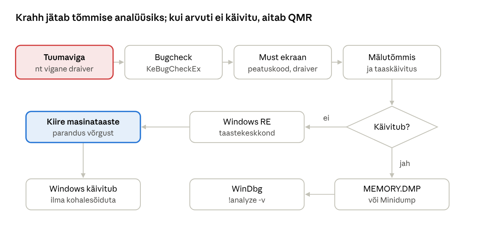

[← 18. Windowsi turvalisus](18-turvalisus.md) · [Sisukord](../README.md) · [20. UUS: Virtualiseerimine, konteinerid ja WSL →](20-virtualiseerimine-konteinerid-wsl.md)

## 19. Kui Windows jookseb kokku

Kui tuumarežiimis tekib viga, mida ei saa ohutult parandada, peatab Windows kogu süsteemi (**bugcheck**), kuvab veateate, salvestab **mälutõmmise** (crash dump) ja taaskäivitub. Windows 11-s on tuttav sinine ekraan asendunud mustaga ning taastumiseks on lisandunud **kiire masinataaste** (Quick Machine Recovery).

### 19.1 Sinisest ekraanist mustani

„Surma sinine ekraan“ (Blue Screen of Death, BSOD) näitas **peatuskoodi** (stop code, nt `IRQL_NOT_LESS_OR_EQUAL`, `PAGE_FAULT_IN_NONPAGED_AREA`), mis selgitab vea liiki. Windows 11 24H2-s võeti 2025. aasta suvel kasutusele lihtsam must ekraan, millel on peamiselt peatuskood ja vea põhjustanud draiver ([Computerworld](https://www.computerworld.com/article/4019000/microsoft-windows-more-resilient.html), [Neowin](https://www.neowin.net/news/windows-11-is-getting-a-redesigned-bsod-and-new-tools-to-help-you-recover-from-outages/)). Taustal toimub sama: tuum kutsub välja `KeBugCheckEx`, salvestab tõmmise ja taaskäivitab arvuti.

**Miks Windows ei jätka lihtsalt tööd?** Kui tuumamälu või -andmestruktuur on rikutud, võib edasitöö kahjustada kettal olevaid andmeid või avada turvaaugu. Peatamine on väiksem kahju. Kasutajarežiimi rakenduse kokkujooksmine lõpetab ainult selle protsessi (Windows Error Reporting salvestab aruande).

### 19.2 Mõned põhjused, miks Windows jookseb kokku

| Põhjus | Näide | Mida teha |
| --- | --- | --- |
| Vigane draiver | uus graafika- või võrgudraiver | eelmise draiveri taastamine, turvarežiim |
| Turva- või viirusetõrjetarkvara tuumas | CrowdStrike’i uuendus 2024 | tootja parandus, Windows RE |
| Mälu riistvaraviga | vigane RAM-moodul | Windowsi mälu diagnostika, MemTest86 |
| Ketta- või failisüsteemiviga | NVMe püsivara, rikutud NTFS | `chkdsk`, püsivara uuendus |
| Ülekuumenemine, toide | tolmune jahutus, nõrk toiteplokk | riistvara kontroll |
| Püsivara (UEFI/BIOS) | vana mikrokood | püsivara uuendus |
| Kiirendamine (overclocking) | ebastabiilne sagedus | vaikeseaded |
| Pahavara / juurkomplekt | tuumamuudatus | võrguühenduseta skannimine, uuesti paigaldus |

**CrowdStrike’i juhtum (19. juuli 2024).** Vigane sisuuuendus turvatarkvara tuumadraiverile jooksutas kokku miljoneid Windowsi arvuteid üle maailma, sh lennujaamade, haiglate ja pankade süsteemid; paljud masinad jäid käivitamisel tsüklisse ([Help Net Security](https://www.helpnetsecurity.com/2024/11/19/windows-kernel-security-vendors/)). Juhtum näitas, et tuumarežiimi kolmanda osapoole kood on üksik rikkepunkt (ptk 4.4).

### 19.3 Windowsi töökindluse algatus

Microsoft vastas **Windowsi töökindluse algatusega** (Windows Resiliency Initiative, november 2024):

- **kiire masinataaste** (Quick Machine Recovery, QMR) – kui arvuti ei käivitu, avab see Windowsi taastekeskkonna (Windows RE), loob võrguühenduse ja laadib Windows Update’ist sihitud paranduse ilma, et IT-tugi peaks füüsiliselt kohal olema. QMR on Home-seadmetes vaikimisi sees; hallatud seadmetes seadistatakse Intune’i või `reagentc.exe` kaudu ([Digitpatrox](https://digitpatrox.com/windows-11-gets-new-black-screen-of-death-auto-recovery-tool/));
- **viirusetõrje viimine tuumast välja** – Microsoft töötab koos turvatootjatega (Microsoft Virus Initiative), et nende tarkvara saaks töötada kasutajarežiimis ([heise](https://heise.de/-10462904));
- rangemad nõuded tootjate uuenduste järk-järgulisele levitamisele ja mäluturvalise koodi kasutamine.



Joonis: kui Windows käivitub, analüüsitakse tõmmist WinDbg-ga; kui ei käivitu (nt CrowdStrike’i juhtumi moodi käivitustsükkel), avab Windows RE kiire masinataaste, mis laadib paranduse võrgust ilma, et IT-tugi peaks kohale tulema.

### 19.4 Mälutõmmised süsteemikrahhi korral

Windows salvestab krahhi ajal mälu sisu lehefaili kaudu kettale; järgmisel käivitusel kopeeritakse see faili.

| Tõmmise tüüp | Sisu | Fail |
| --- | --- | --- |
| Väike mälutõmmis (minidump) | peatuskood, draiverid, aktiivne lõim; \~256 KB–2 MB | `C:\Windows\Minidump\*.dmp` |
| Tuuma mälutõmmis | tuumamälu | `C:\Windows\MEMORY.DMP` |
| Automaatne mälutõmmis (vaikimisi) | nagu tuuma tõmmis, lehefail kohandub | `MEMORY.DMP` |
| Aktiivne mälutõmmis | tuum + aktiivsed kasutajaprotsessid, ilma külaliste VM-ideta | `MEMORY.DMP` |
| Täielik mälutõmmis | kogu füüsiline mälu | `MEMORY.DMP` |

Analüüs:

- **WinDbg** (Microsoft Store’ist) – ava tõmmis ja käivita `!analyze -v`; vaata põhjustajat (`MODULE_NAME`, `IMAGE_NAME`);
- **sündmusvaatur** – System-logi sündmus 1001 (BugCheck) ja 41 (Kernel-Power, ootamatu väljalülitus);
- **töökindluse monitor** (`perfmon /rel`) – ajajoon krahhidest ja paigaldustest;
- NirSofti **BlueScreenView** ja sarnased tööriistad näitavad minidump-failide sisu kiirelt; Microsofti tugi kasutab samu faile.

**Turvalisus:** täielik ja tuuma mälutõmmis võivad sisaldada paroole, võtmeid ja isikuandmeid. Neid ei tohi saata väljapoole organisatsiooni ilma kaalumata ning BitLockeriga kaitstud kettalt mujale kopeeritud tõmmis on loetav igale, kelle kätte see satub.

### Näide: krahh pärast Wi-Fi draiveri uuendust

**Olukord.** Õpilase sülearvuti hakkas pärast tootja tarkvaraga paigaldatud uut Wi-Fi draiverit umbes kord tunnis kokku jooksma.

1. **Sündmusvaatur** → System: sündmus 41 (Kernel-Power) ja 1001 (BugCheck) koodiga `0x000000d1` (`DRIVER_IRQL_NOT_LESS_OR_EQUAL`).
2. **Töökindluse monitor** näitab: krahhid algasid päeval, mil paigaldati draiver.
3. **WinDbg**: avad `C:\Windows\Minidump\` viimase faili ja käivitad `!analyze -v`. Real `IMAGE_NAME` on Wi-Fi draiveri fail.
4. **Parandus:** seadmehaldur → võrgukaart → Draiver → „Taasta draiver“. Krahhid lõppevad. Tootjale saadetakse veateade ja draiveri automaatuuendus peatatakse, kuni parandus tuleb.

**Üldistus:** peatuskood ütleb vea tüübi, tõmmis ütleb süüdlase. `0xD1` tähendab, et draiver pöördus vale aadressi poole liiga kõrgel IRQL-il (ptk 5) – peaaegu alati draiveri viga, mitte kasutaja oma.

### Kokkuvõte

- Bugcheck peatab süsteemi, kui tuumaviga ohustab andmeid või turvet.
- Kaks levinumat põhjust on vigased draiverid ja riistvara.
- CrowdStrike’i juhtum tõi kaasa QMR-i ja viirusetõrje tuumast väljaviimise.
- Mälutõmmis ja WinDbg näitavad, mis krahhi põhjustas.

### Kontrollküsimused

1. Millistel tingimustel kuvab Windows sinise (nüüd musta) ekraani?
2. Nimeta neli asjaolu, mis võivad Windowsi kokku jooksutada.
3. Miks ei ignoreeri Windows tuumaviga ega jätka tööd?
4. Kuidas annab Windows teada, mis krahhi põhjustas?
5. Mis juhtus CrowdStrike’i juhtumi ajal ja millised õppetunnid sellest saadi?
6. Mis on kiire masinataaste ja kuidas see töötab?
7. Nimeta mälutõmmiste tüübid ja nende erinevus.
8. Miks on mälutõmmis turvalisuse seisukohast tundlik?

### Valikküsimused

1. Milline sündmus logis viitab ootamatule väljalülitusele? a) 4624 b) 41 Kernel-Power c) 7036 d) 1102
2. Milline WinDbg käsk analüüsib krahhi automaatselt? a) `!locks` b) `!analyze -v` c) `lm` d) `g`
3. Mis on kiire masinataaste (QMR)? a) BIOS-i lähtestamine b) Windows RE kaudu võrgust paranduse laadimine c) ketta kloonimine d) mälu tihendamine
4. Mis on vaikimisi tõmmise tüüp? a) täielik b) väike c) automaatne d) aktiivne

### Praktiline ülesanne

```powershell
Get-ItemProperty 'HKLM:\SYSTEM\CurrentControlSet\Control\CrashControl' | Select-Object CrashDumpEnabled, DumpFile, MinidumpDir, AutoReboot
Get-WinEvent -FilterHashtable @{LogName='System'; Id=41,1001} -MaxEvents 10 | Format-Table TimeCreated, Id, Message -Wrap
reagentc /info
```

**Ainult õppevirtuaalmasinas:** tekita testkrahh ja analüüsi seda. Lisa registris võti `HKLM\SYSTEM\CurrentControlSet\Services\i8042prt\Parameters` (PS/2 klaviatuur) või `…\kbdhid\Parameters` (USB) ja väärtus `CrashOnCtrlScroll` = 1 (DWORD), taaskäivita ja vajuta parempoolset Ctrl-i all hoides kaks korda Scroll Lock. Ava pärast taaskäivitust `MEMORY.DMP` WinDbg-s, käivita `!analyze -v` ja leia peatuskood (`MANUALLY_INITIATED_CRASH`). Ava töökindluse monitor ja leia krahh ajajoonelt. Kustuta lisatud registriväärtus.

### Iseseisvad ülesanded

**1. Arvuti töökindluse aruanne.** Ava oma arvutis töökindluse monitor (`perfmon /rel`) ja vaata viimase kuu ajajoont. Leia kõik kriitilised sündmused (rakenduste krahhid, Windowsi tõrked, ebaõnnestunud uuendused). Vali kaks ja uuri sündmusvaaturist nende täpsemaid andmeid. **Esita:** stabiilsusindeksi graafiku ekraanipilt, kahe sündmuse kirjeldus ja hüpotees nende põhjuse kohta.

**2. Juhtumianalüüs: CrowdStrike 2024.** Loe vaba valikuga kahest allikast, mis juhtus 19. juulil 2024. Vasta: mis tüüpi tarkvara viga oli (kasutaja- või tuumarežiim), miks ei saanud arvutid käivituda, kuidas neid parandati ja kuidas aitaks täna kiire masinataaste. **Esita:** üheleheküljeline analüüs viidetega ja kolm õppetundi, mis sobivad ka kooli IT-juhile (nt uuenduste järk-järguline levitamine).

### Viited

- Krogh (2017), ptk 19.
- Yosifovich jt, *Windows Internals* 7. tr, 2. osa, ptk 10 (Crash dump analysis).
- Microsoft Learn: [Analyze crash dump files by using WinDbg](https://learn.microsoft.com/windows-hardware/drivers/debugger/crash-dump-files); [Quick Machine Recovery](https://learn.microsoft.com/windows/configuration/quick-machine-recovery/).
- Allikad lingitud tekstis.

> 📝 **Test:** selle peatüki Google Formsi test luuakse skriptiga [`google-forms/looVormid.gs`](../google-forms/looVormid.gs).

---

[← 18. Windowsi turvalisus](18-turvalisus.md) · [Sisukord](../README.md) · [20. UUS: Virtualiseerimine, konteinerid ja WSL →](20-virtualiseerimine-konteinerid-wsl.md)
