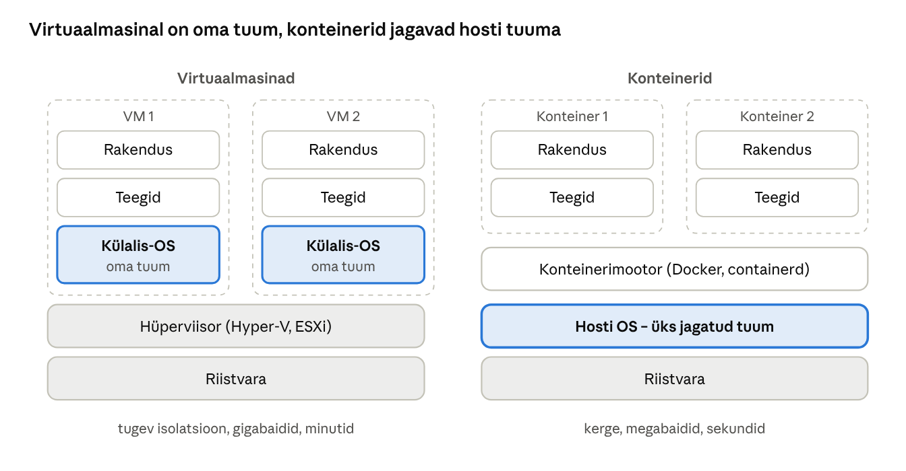
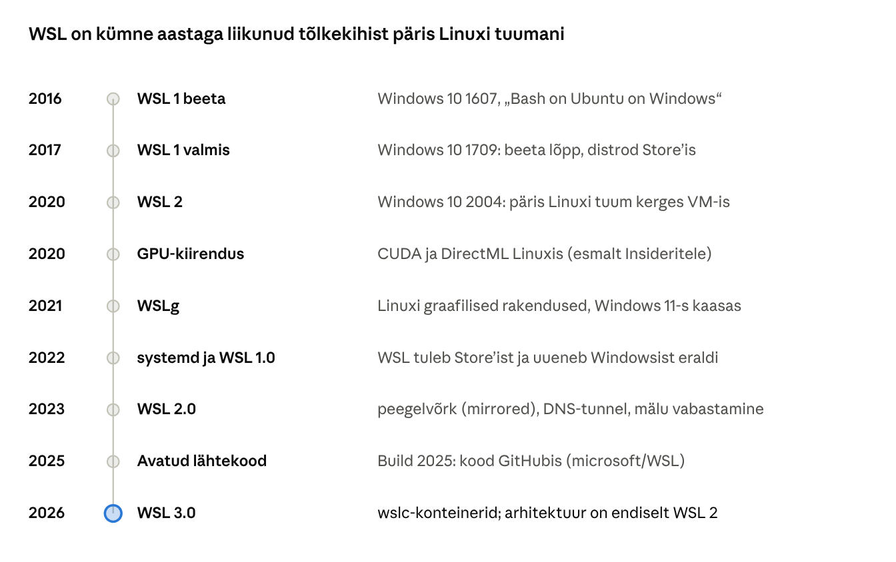
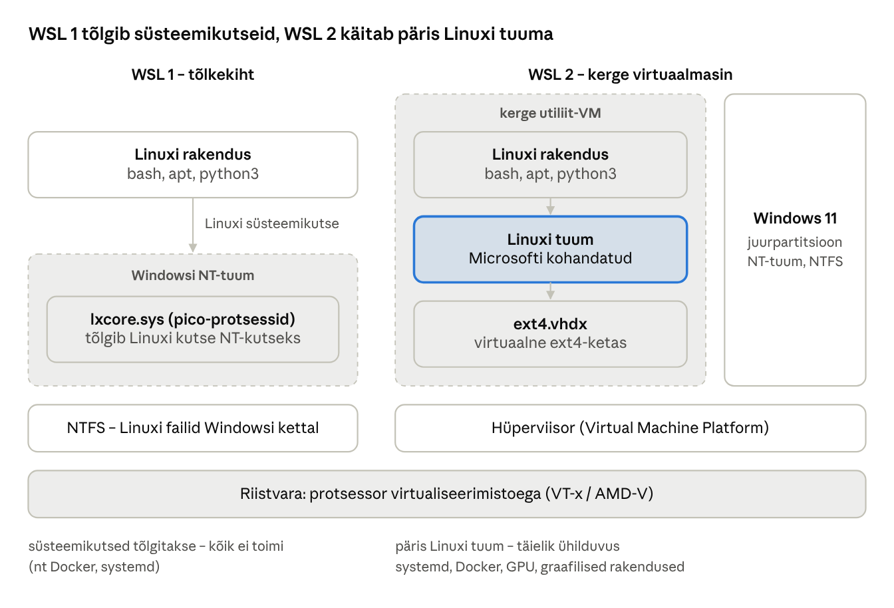
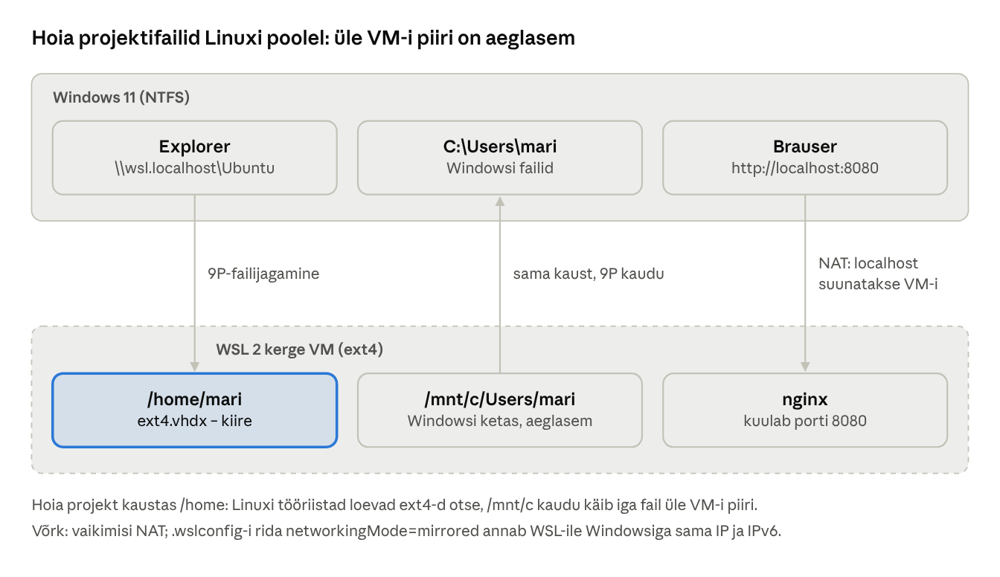

[← 19. Kui Windows jookseb kokku](19-krahhid.md) · [Sisukord](../README.md) · [21. UUS: Tehisintellekt operatsioonisüsteemis →](21-tehisintellekt.md)

## 20. UUS: Virtualiseerimine, konteinerid ja WSL

Virtualiseerimine laseb ühes füüsilises arvutis töötada mitmel operatsioonisüsteemil korraga; konteinerid isoleerivad rakendusi ühe OS-tuuma sees. Windows kasutab hüperviisorit nii serverites (Hyper-V) kui ka kliendi turvalisuses (VBS, ptk 4), Linuxi käitamiseks (WSL 2) ja turvaliseks testimiseks (Windows Sandbox).

### 20.1 Hüperviisorid

| Tüüp | Kirjeldus | Näited |
| --- | --- | --- |
| 1. tüüp (bare-metal) | töötab otse riistvaral, OS-id on selle peal | Hyper-V, VMware ESXi, KVM, Xen |
| 2. tüüp (hosted) | töötab tavalise OS-i rakendusena | VMware Workstation, VirtualBox |

Kaasaegsed hüperviisorid kasutavad protsessori virtualiseerimislaiendusi (Intel VT-x, AMD-V, ARM EL2) ja teisese taseme aadressitõlget (EPT/NPT), et külalis-OS töötaks peaaegu omakeelse kiirusega.

### 20.2 Hyper-V arhitektuur

Hyper-V on 1. tüüpi hüperviisor ka siis, kui see on lubatud Windows 11-s: pärast lubamist käivitub esmalt hüperviisor ja tavaline Windows muutub **juurpartitsiooniks** (root partition), millel on otsene ligipääs seadmetele. Külalis-VM-id töötavad **lapspartitsioonides**. Juur- ja lapspartitsioonid suhtlevad kiire kanali **VMBus** kaudu; külalises töötavad sünteetilised draiverid (enlightenments).

Olulised võimalused:

- **2. põlvkonna VM** – UEFI, Secure Boot, virtuaalne TPM; Windows Server 2025 Hyper-V-s vaikimisi ([Petri](https://petri.com/windows-server-2025-public-preview/));
- **pesastatud virtualiseerimine** – VM-is saab käitada omakorda hüperviisorit (õppelaborid!);
- **dünaamiline mälu, hetktõmmised** (checkpoints), **otseteisaldus** (live migration);
- **GPU jagamine** (GPU-P) VM-ide vahel;
- **varjutatud VM-id** (shielded VMs) – kaitse ka hosti administraatori eest.

VMware ja Hyper-V kooseksisteerivad: kui Windowsis on hüperviisor (Hyper-V, VBS, WSL 2) sees, kasutab VMware Workstation Windowsi hüperviisoriplatvormi API-t.

### 20.3 Konteinerid

**Konteiner** isoleerib rakenduse koos sõltuvustega, kuid jagab hosti OS-tuuma. Konteiner käivitub sekunditega ja on VM-ist palju väiksem.



Joonis: iga VM kannab oma OS-i ja tuuma; konteinerid sisaldavad ainult rakendust ja teeke ning kasutavad hosti tuuma. Hyper-V isolatsiooniga konteiner saab oma kerge tuuma, olles nende kahe vahepealne.

|  | Virtuaalmasin | Konteiner |
| --- | --- | --- |
| Isolatsioon | oma tuum, riistvarapõhine | jagatud tuum, nimeruumid ja piirangud |
| Suurus | gigabaidid | megabaidid |
| Käivitusaeg | sekundid–minutid | sekundid |
| Erinev OS | jah | ei (Windowsi konteiner vajab Windowsi tuuma) |

Windowsi konteinerite isolatsiooniviisid:

- **protsessi isolatsioon** – nagu Linuxi konteinerid; kasutab tööobjekte (ptk 7.4), objektihalduri nimeruume ja failisüsteemi virtualiseerimist;
- **Hyper-V isolatsioon** – iga konteiner töötab kerges VM-is oma tuumaga; turvalisem.

Konteinereid hallatakse Dockeri või containerd abil ja orkestreeritakse **Kubernetesega** (nt AKS). Konteineri tõmmised põhinevad Microsofti alustõmmistel: Nano Server, Server Core, Windows Server.

### 20.4 Windows Sandbox

**Windows Sandbox** (Pro, Enterprise) on ühekordne kerge virtuaalmasin: avad kahtlase faili, ja kui akna sulged, kaob kõik. Sandbox kasutab hosti OS-i faile ilma koopiat tegemata ning seadistatakse `.wsb`-failiga (nt võrgu keelamine, jagatud kaust ainult lugemiseks).

### 20.5 Windowsi alamsüsteem Linuxile (WSL)

**WSL** (Windows Subsystem for Linux) võimaldab käitada Windowsis Linuxi distributsiooni – Ubuntu, Debiani, Kali Linuxi jt – ilma eraldi virtuaalmasinat seadistamata ja ilma arvutit kaheks süsteemiks jagamata (dual boot). Linuxi käsud, `apt`, bash-skriptid, konteinerid ja arendustööriistad töötavad kõrvuti Windowsi programmidega ning mõlemad pooled näevad teineteise faile. IT-õppes on WSL kiireim viis saada Linuxi käsurida igasse klassiarvutisse.

#### 20.5.1 Versiooniajalugu



Joonis: WSL 1 ilmus 2016. aastal tõlkekihina, WSL 2 tõi 2020. aastal päris Linuxi tuuma. Hilisemad muudatused (WSLg, systemd, peegelvõrk, konteinerid) on ehitatud WSL 2 peale ([Wikipedia](https://en.wikipedia.org/wiki/Windows_Subsystem_for_Linux)).

Sõna „versioon“ tähendab WSL-i puhul kaht eri asja:

- **arhitektuuri versioon** – WSL 1 või WSL 2. Seda näitab käsu `wsl -l -v` veerg VERSION ja seda saab iga distributsiooni jaoks eraldi valida;
- **WSL-i rakenduse versioon** – nt 2.6 või 3.0.1. Alates 2022. aastast tuleb WSL Microsoft Store’ist või GitHubist ja uueneb käsuga `wsl --update`, Windowsist eraldi. Seda näitab `wsl --version`.

WSL 3.0.1 (29.09.2026) tõi üldkasutusse **WSL-i konteinerid** ja käsu `wslc`; uut „WSL 3“ arhitektuuri ei ole, kõik töötab endiselt WSL 2 peal ([GitHub: WSL 3.0.1](https://github.com/microsoft/WSL/releases/tag/3.0.1)).

#### 20.5.2 WSL 1 ja WSL 2 erinevused



Joonis: WSL 1-s töötab Linuxi rakendus otse Windowsi tuuma peal ja draiver `lxcore.sys` tõlgib iga Linuxi süsteemikutse NT-tuuma kutseks. WSL 2-s töötab Microsofti kohandatud päris Linuxi tuum kerges utiliit-VM-is, mis kasutab sama hüperviisorit nagu Hyper-V ja VBS (ptk 4). Windows ise on juurpartitsioon.

| Omadus | WSL 1 | WSL 2 |
| --- | --- | --- |
| Tuum | tõlkekiht `lxcore.sys` NT-tuumas | päris Linuxi tuum kerges VM-is |
| Süsteemikutsete ühilduvus | osaline | täielik |
| Docker, systemd, tuumamoodulid | ei toimi | toimivad |
| Failid Linuxi poolel | NTFS-il, aeglasemad | `ext4.vhdx` virtuaalkettal, kiired |
| Windowsi failid (`/mnt/c`) | kiired | aeglasemad, üle VM-i piiri |
| Võrk | sama IP-aadress kui Windowsil | vaikimisi NAT, soovi korral peegelvõrk (mirrored) |
| Virtualiseerimise tugi | pole vaja | vajalik (VT-x / AMD-V, Virtual Machine Platform) |
| Graafika ja GPU | ei | WSLg ja GPU-kiirendus |

Uued distributsioonid paigaldatakse vaikimisi WSL 2-na ([Microsoft Learn: Comparing WSL versions](https://learn.microsoft.com/windows/wsl/compare-versions)). WSL 1 on mõistlik siis, kui virtualiseerimist pole võimalik kasutada (nt vanem virtuaalmasin ilma pesastatud virtualiseerimiseta) või kui töötad peamiselt Windowsi failidega. Versiooni saab muuta: `wsl --set-version Ubuntu 1` või `wsl --set-version Ubuntu 2`.

#### 20.5.3 Failid ja võrk WSL 2-s



Joonis: Windows näeb Linuxi faile Exploreris aadressil `\\wsl.localhost\Ubuntu` ja Linux näeb Windowsi kettaid kaustas `/mnt/c`. Mõlemal juhul liiguvad failid üle VM-i piiri 9P-protokolliga, mis on aeglasem kui otse ext4-lt lugemine. Seepärast hoia Linuxi tööriistadega (git, npm, kompileerimine) töödeldavad projektid Linuxi kodukaustas.

Kasulikud võtted:

- `explorer.exe .` avab Linuxi praeguse kausta Windowsi Exploreris;
- `code .` avab kausta VS Code’is (WSL-laiendusega);
- Windowsi programme saab käivitada Linuxist (`notepad.exe fail.txt`) ja Linuxi käske Windowsist (`wsl ls -la`).

Kogu WSL 2 VM-i seadistab fail `%UserProfile%\.wslconfig`, ühe distributsiooni seadeid fail `/etc/wsl.conf`:

```ini
# %UserProfile%\.wslconfig – kogu WSL 2
[wsl2]
memory=4GB
processors=2
networkingMode=mirrored
```

```ini
# /etc/wsl.conf – üks distributsioon
[boot]
systemd=true
```

Muudatused rakenduvad pärast käsku `wsl --shutdown` ja WSL-i uuesti käivitamist.

#### 20.5.4 Juhend: Ubuntu paigaldamine

**Eeldused:**

- Windows 11 või Windows 10 versioon 2004 või uuem (järk 19041+);
- protsessori virtualiseerimine on UEFI-s lubatud. Kontroll: tegumihaldur → *Jõudlus* → *CPU* → *Virtualiseerimine: lubatud*;
- kui Windows ise töötab virtuaalmasinas, peab olema sisse lülitatud pesastatud virtualiseerimine (VMware: `vhv.enable = "TRUE"`; Hyper-V: `Set-VMProcessor -VMName <nimi> -ExposeVirtualizationExtensions $true`);
- administraatoriõigused.

**Sammud:**

1. Ava PowerShell või Terminal administraatorina ja käivita `wsl --install`. Käsk lülitab sisse vajalikud Windowsi osad (Virtual Machine Platform), paigaldab WSL-i, Linuxi tuuma ja vaikimisi Ubuntu ([Microsoft Learn: Install WSL](https://learn.microsoft.com/windows/wsl/install)).
2. Kui küsitakse, taaskäivita arvuti.
3. Ubuntu avaneb ja küsib uut **UNIX-i kasutajanime ja parooli**. Need ei pea olema samad mis Windowsi omad. Parooli tippimisel ekraanile midagi ei ilmu – see on Linuxis tavaline.
4. Uuenda paketid: `sudo apt update && sudo apt full-upgrade -y`.
5. Kontrolli Windowsi poolel: `wsl -l -v` peab näitama Ubuntu olekut ja versiooni 2; `wsl --version` näitab WSL-i ja tuuma versiooni.
6. Kontrolli Linuxi poolel: `cat /etc/os-release` ja `uname -r`.

Kindla versiooni paigaldamiseks vaata nimekirja `wsl --list --online` ja vali sealt, nt `wsl --install -d Ubuntu-24.04`. Pärast paigaldust tekib Windows Terminali menüüsse Ubuntu profiil.

#### 20.5.5 Juhend: Kali Linuxi paigaldamine

**Kali Linux** on küberturbe ja läbistustestimise distributsioon. Kasuta selle tööriistu ainult oma õppelaboris või süsteemides, mille omanik on andnud kirjaliku loa: võõra süsteemi skannimine või ründamine on seadusevastane. Microsoft Defender võib osa tööriistu ohtlikuks pidada ja karantiini panna. Ära lülita selle pärast tööarvutis viirusetõrjet välja – kasuta eraldi õppe-VM-i.

1. Ava PowerShell administraatorina ja käivita `wsl --install -d kali-linux`.
2. Loo Kali kasutajanimi ja parool.
3. Uuenda: `sudo apt update && sudo apt full-upgrade -y`.
4. WSL-i Kali on algul minimaalne, ilma tööriistadeta. Paigalda tavaline komplekt `sudo apt install -y kali-linux-default` või ainult vajalikud tööriistad, nt `sudo apt install -y nmap`.
5. Graafiline töölaud **Win-KeX**: `sudo apt install -y kali-win-kex`. Käivita aknarežiimis helitoega `kex --win -s`; Windowsi töölauaga ühendatult `kex --sl -s`; RDP kaudu `kex --esm -s`. Aknarežiimist väljud klahviga F8 ([Kali: Win-KeX](https://www.kali.org/docs/wsl/win-kex/)).
6. Windowsist saab Kali käivitada ka otse: `wsl -d kali-linux`.

Võrgu eripära: WSL 2 vaikimisi NAT-võrgus on Kali Windowsi taga eraldi alamvõrgus. Kui õppelabori harjutus eeldab, et Kali on samas kohtvõrgus, lülita `.wslconfig`-is sisse `networkingMode=mirrored` või kasuta eraldi virtuaalmasinat.

#### 20.5.6 Igapäevased WSL-i käsud

| Käsk | Mida teeb |
| --- | --- |
| `wsl --list --online` | saadaval distributsioonid |
| `wsl -l -v` | paigaldatud distributsioonid, olek ja versioon |
| `wsl -d kali-linux` | käivitab kindla distributsiooni |
| `wsl --set-default Ubuntu` | määrab vaikimisi distributsiooni |
| `wsl --set-version Ubuntu 2` | teisendab WSL 1 ↔ WSL 2 |
| `wsl --terminate Ubuntu` | peatab ühe distributsiooni |
| `wsl --shutdown` | peatab kõik distributsioonid ja WSL 2 VM-i |
| `wsl --export Ubuntu D:\varu\ubuntu.tar` | salvestab distributsiooni tõmmisfailiks |
| `wsl --import Ubuntu2 D:\WSL\Ubuntu2 D:\varu\ubuntu.tar` | taastab või kloonib tõmmisfailist |
| `wsl --unregister Ubuntu` | kustutab distributsiooni koos kõigi failidega |
| `wsl --update` | uuendab WSL-i ja Linuxi tuuma |
| `wsl --version` | näitab WSL-i, tuuma ja WSLg versiooni |

#### 20.5.7 Levinud vead

| Viga | Põhjus | Lahendus |
| --- | --- | --- |
| `0x80370102` | virtualiseerimine on UEFI-s välja lülitatud või VM-is puudub pesastatud virtualiseerimine | lülita sisse Intel VT-x / AMD-V või pesastatud virtualiseerimine |
| `0x8007019e` | WSL-i Windowsi osa pole sisse lülitatud | käivita `wsl --install` administraatorina ja taaskäivita |
| Protsess *VmmemWSL* võtab palju mälu | WSL 2 VM hoiab mälu vahemäluna | piira mälu `.wslconfig`-is (`memory=`) või käivita `wsl --shutdown` |
| `git` või `npm` on väga aeglane | projekt asub `/mnt/c` all | kopeeri projekt Linuxi kodukausta |
| Kali tööriistad kaovad | Defender paneb need karantiini | kasuta eraldi õppe-VM-i |

#### 20.5.8 WSL-i konteinerid, haldus ja turve

WSL 3.0 käsk `wslc` ehitab ja käitab Linuxi konteinereid otse Windowsis, ilma Docker Desktopita. Lisaks on olemas Windowsi API, mille kaudu rakendused saavad konteinereid ise käivitada ([Windows Developer Blog](https://blogs.windows.com/windowsdeveloper/2026/09/29/wsl-containers-now-generally-available/)).

Organisatsioonis on WSL ka ründepind: Linuxi poolel töötavad protsessid ei pruugi tavalisele viirusetõrjele nähtavad olla. Seepärast saab Intune’iga WSL-i või WSL-i konteinerid keelata ja lubada ainult heakskiidetud konteineriregistreid. Microsoft Defender for Endpointi WSL-i lisand näitab Linuxi poole ja konteinerite protsesse, faile ja võrguühendusi koos Windowsi hosti sündmustega ([BleepingComputer](https://bleepingcomputer.com/news/microsoft/microsoft-is-rolling-out-linux-container-support-to-wsl)).

Mai 2025 Build-konverentsil avaldas Microsoft suurema osa WSL-i lähtekoodist GitHubis. Mõned Windowsi komponendid, nt WSL 1 draiver `lxcore.sys`, on endiselt suletud ([BleepingComputer](https://bleepingcomputer.com/news/microsoft/microsoft-open-sources-windows-subsystem-for-linux-at-build-2025)).

### 20.6 Pilvearvutid

**Windows 365 Cloud PC** ja **Azure Virtual Desktop** käitavad Windowsi andmekeskuses; kasutaja ühendub brauseri või Windows App’i kaudu. Andmed ei asu lõppseadmes, mis lihtsustab haldust ja vähendab varguse riski. Kaugtöölaua ühendus muutub ise ründepinnaks (tugev autentimine, MFA, tingimuslik juurdepääs).

### Näide: IT-õppe labor – mida kuhu panna

| Vajadus | Sobiv lahendus | Põhjus |
| --- | --- | --- |
| Igal õpilasel oma domeen (DC, DNS, DHCP, klient) | VM-id VMware’is või Hyper-V-s, hetktõmmisega | vaja täisväärtuslikku Windows Serverit ja oma võrku; vea korral taastatakse hetktõmmisest |
| Hyper-V harjutused õpilase VM-is | pesastatud virtualiseerimine | hüperviisor hüperviisori sees |
| Veebirakendus (nt WordPress ja MySQL) | konteinerid Docker Compose’iga | käivitub sekunditega, sama keskkond igal õpilasel |
| Kahtlane e-kirja manus | Windows Sandbox võrguta | kaob sulgemisel, host jääb puutumata |
| Linuxi käsud ja bash-skriptid Windowsis | WSL 2 | päris Linuxi tuum, failid kättesaadavad mõlemast poolest |
| Kodust töötamine kooli tarkvaraga | Windows 365 / Azure Virtual Desktop | andmed jäävad andmekeskusesse |

**Arutle:** miks ei sobi domeenikontrolleri harjutuseks konteiner? (Vihje: Active Directory vajab täielikku Windows Serverit, oma võrguidentiteeti ja taaskäivitusi – konteiner on mõeldud ühe rakenduse jaoks.)

### Kokkuvõte

- 1. tüüpi hüperviisor töötab otse riistvaral; Hyper-V muudab Windowsi juurpartitsiooniks.
- Konteinerid jagavad tuuma, VM-idel on oma tuum; Windows pakub mõlemat ja ka Hyper-V-isoleeritud konteinereid.
- WSL 2 ja Windows Sandbox on igapäevased virtualiseerimise rakendused kliendis.
- WSL 2 käitab päris Linuxi tuuma kerges VM-is. Hoia projektifailid Linuxi kodukaustas; distributsiooni (nt Ubuntu, Kali Linux) paigaldab käsk `wsl --install -d <nimi>`.

### Kontrollküsimused

1. Mis vahe on 1. ja 2. tüüpi hüperviisoril?
2. Mis on juurpartitsioon ja VMBus Hyper-V-s?
3. Mis eelised on 2. põlvkonna VM-il?
4. Võrdle virtuaalmasinat ja konteinerit.
5. Mis vahe on protsessi isolatsioonil ja Hyper-V isolatsioonil?
6. Milleks sobib Windows Sandbox?
7. Mis vahe on WSL 1-l ja WSL 2-l?
8. Mis on Windows 365 Cloud PC eelised ja riskid?
9. Miks on WSL 2-s projektifailide hoidmine kaustas `/home` kiirem kui kaustas `/mnt/c`?
10. Mis vahe on WSL-i arhitektuuri versioonil (WSL 1 või WSL 2) ja WSL-i rakenduse versioonil (nt 3.0)?

### Valikküsimused

1. Milline on 2. tüüpi hüperviisor? a) Hyper-V b) ESXi c) VirtualBox d) KVM
2. Mis kasutab WSL 2? a) tõlget Windowsi tuumas b) päris Linuxi tuuma kerges VM-is c) Dockerit d) Cygwinit
3. Mis juhtub Windows Sandboxi andmetega pärast sulgemist? a) salvestatakse OneDrive’i b) kustutatakse c) kopeeritakse hostile d) krüpteeritakse
4. Mis Windowsi mehhanism on protsessi isolatsiooniga konteineri aluseks? a) tööobjekt b) kiud c) postkastipesa d) register
5. Kus töötavad Linuxi tööriistad WSL 2-s failidega kõige kiiremini? a) kaustas /mnt/c/Users b) võrgukaustas c) Linuxi kodukaustas /home d) USB-pulgal
6. Milline käsk paigaldab Kali Linuxi WSL-i? a) apt install kali b) winget install wsl c) wsl --set-version kali 2 d) wsl --install -d kali-linux

### Praktiline ülesanne

```powershell
Get-ComputerInfo -Property HyperV*
Get-WindowsOptionalFeature -Online | Where-Object FeatureName -match 'Hyper-V|Containers|Subsystem-Linux|DisposableClientVM' | Select-Object FeatureName, State
wsl --install -d Ubuntu
wsl --list --verbose
wsl uname -a
```

Loo fail `test.wsb`:

```xml
<Configuration>
  <Networking>Disable</Networking>
  <MappedFolders>
    <MappedFolder><HostFolder>C:\Kahtlane</HostFolder><ReadOnly>true</ReadOnly></MappedFolder>
  </MappedFolders>
</Configuration>
```

Käivita see ja kontrolli, et võrk puudub ja kaust on kirjutuskaitsega. VMware’i kasutajale: lisa olemasolevale Windows Serveri VM-ile pesastatud virtualiseerimine (`vhv.enable = "TRUE"`) ja paigalda selle sisse Hyper-V.

### Iseseisvad ülesanded

**1. Sama rakendus kolmel moel.** Paigalda lihtne veebiserver (nt IIS või nginx) kolmel viisil: VM-i, Windows Sandboxi ja konteinerisse (`docker run -d -p 8080:80 nginx` WSL 2 või Docker Desktopiga). Mõõda iga variandi käivitusaeg, kettakasutus ja mälukasutus. **Esita:** tabel ja soovitus, millist varianti kasutaksid õppelaboris ja millist tootmises.

**2. Hetktõmmise strateegia.** Koosta oma õppelabori VM-idele (DC, failiserver, klient) hetktõmmiste reegel: millal hetktõmmis tehakse, kui kaua seda hoitakse ja millal kustutatakse. Selgita, miks domeenikontrolleri vana hetktõmmise taastamine võib põhjustada probleeme (USN rollback) ja miks hetktõmmis ei ole varukoopia. **Esita:** reeglid tabelina ja lühiselgitus.

### Viited

- Microsoft Learn: [Hyper-V architecture](https://learn.microsoft.com/windows-server/administration/performance-tuning/role/hyper-v-server/architecture); [Windows containers](https://learn.microsoft.com/virtualization/windowscontainers/about/); [Windows Sandbox](https://learn.microsoft.com/windows/security/application-security/application-isolation/windows-sandbox/); [WSL](https://learn.microsoft.com/windows/wsl/about).
- Popek, G., Goldberg, R. (1974). Formal Requirements for Virtualizable Third Generation Architectures. *Communications of the ACM*, 17(7).
- Allikad lingitud tekstis.

> 📝 **Test:** selle peatüki Google Formsi test luuakse skriptiga [`google-forms/looVormid.gs`](../google-forms/looVormid.gs).

---

[← 19. Kui Windows jookseb kokku](19-krahhid.md) · [Sisukord](../README.md) · [21. UUS: Tehisintellekt operatsioonisüsteemis →](21-tehisintellekt.md)
