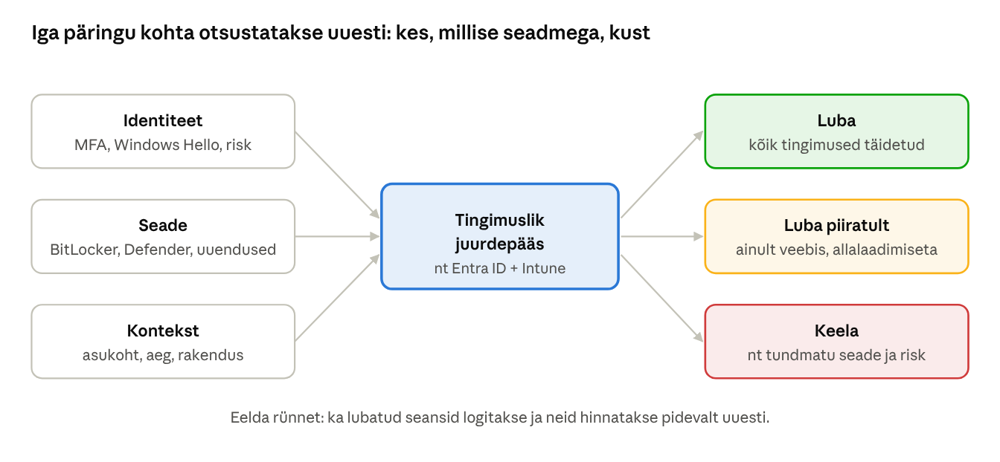
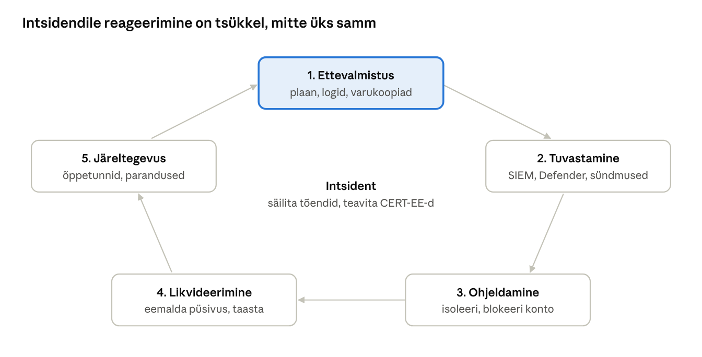

[← 21. UUS: Tehisintellekt operatsioonisüsteemis](21-tehisintellekt.md) · [Sisukord](../README.md) · [23. UUS: Windows, Linux ja macOS võrdluses →](23-windows-linux-macos.md)

## 22. UUS: Küberturve tänapäeva Windowsis

Windowsi turvamehhanismid (ptk 18) on tööriistad; küberturve on nende õige kasutamine konkreetsete ohtude vastu. Selles peatükis seome OS-i teadmised rünnete, karmistamise, logimise, intsidendile reageerimise ja Eesti nõuetega (E-ITS).

### 22.1 Ohumaastik

| Oht | Kuidas töötab | Windowsi kaitse |
| --- | --- | --- |
| Õngitsus ja identiteedivargus | võltslehed, MFA-väsimus, vahendajarünne (AiTM), seansiküpsiste vargus | Hello, pääsvõtmed, SmartScreen, tingimuslik juurdepääs |
| Lunavara | krüpteerib andmed ja varastab need (topeltväljapressimine) | Defender, ASR, kontrollitud kaustad, varundus 3-2-1-1-0 |
| „Living off the land“ | ründaja kasutab PowerShelli, WMI-d, certutil-i jms | AMSI, App Control, PowerShelli logimine |
| Haavatava draiveri toomine (BYOVD) | allkirjastatud, kuid vigane draiver annab tuumaõigused | haavatavate draiverite blokeerimisloend, HVCI |
| Parooliräside vargus | Mimikatz loeb lsass.exe mälu | Credential Guard, LSA kaitse |
| Tarneahel | pahatahtlik uuendus või komponent | allkirjastamine, App Control, tarnijate hindamine |
| Haavatavused | paikamata tarkvara | Windows Update, Autopatch, hotpatch |
| AI-ga toetatud ründed | veenvamad õngituskirjad, hääle- ja videovõltsingud | koolitus, protsessid (kinnitus teise kanali kaudu) |
| AI-agentide kuritarvitamine | kaudne viipesüst (XPIA, ptk 21) | agendi isolatsioon, vähimad õigused |

Eesti kontekstis on RIA küberintsidentide käsitlemise osakond (CERT-EE) korduvalt rõhutanud, et kõige sagedasemad ohud on sisselogimisandmete vargus ja pahavara ([ERR](https://www.err.ee/988704/algteadmised-kuberturvalisusest-hoiaks-ara-95-protsenti-onnetusest-internetis)). Seetõttu annab kasutaja identiteedi kaitse kõige suurema kasu.

### 22.2 Null-usaldus

**Null-usaldus** (zero trust) tähendab, et ühtegi kasutajat, seadet ega võrku ei usaldata ainult asukoha tõttu. Kolm põhimõtet:

1. **kontrolli selgesõnaliselt** – iga päring autenditakse ja autoriseeritakse (identiteet, seadme seisund, asukoht, risk);
2. **vähimad õigused** – õigused ainult vajalikuks ajaks ja ulatuses (administraatori kaitse, JIT-ligipääs);
3. **eelda rünnet** – segmenteeri, krüpteeri, logi ja tuvasta.

Windowsi null-usalduse ehituskivid: TPM ja Pluton (seadme identiteet), Secure Boot ja kaugkinnitus (seadme seisund), Windows Hello (kasutaja identiteet), BitLocker (andmed), VBS (isolatsioon), Intune’i vastavuspoliitika (tingimuslik juurdepääs).



Joonis: sama kasutaja võib saada eri tulemuse: kooli hallatud sülearvutist täieliku ligipääsu, kodusest tahvelarvutist ainult veebiversiooni ja tundmatust riigist vana seadmega keelu.

### 22.3 Windowsi karmistamine

Karmistamise (hardening) baasnimekiri tööjaamale:

- [ ] Windows 11 toetatud versioon, iga kuu uuendused; Windows 10 masinad välja vahetatud või ESU all
- [ ] Secure Boot sees ja 2023. aasta sertifikaadid paigaldatud (ptk 18)
- [ ] TPM 2.0, BitLocker sees, taastevõtmed keskselt hoiul
- [ ] Igapäevatöö tavakasutajana; administraatori kaitse või eraldi adminikonto
- [ ] Windows LAPS kohalikele administraatoritele
- [ ] Windows Hello for Business / MFA, paroolipoliitika
- [ ] VBS, mälu terviklikkus (HVCI), Credential Guard, LSA kaitse sees
- [ ] Defender: reaalajakaitse, pilvekaitse, Tamper Protection, ASR-reeglid, kontrollitud kaustad
- [ ] Smart App Control või App Control for Business / AppLocker
- [ ] Tulemüür kõigis profiilides sees, sissetulev vaikimisi keelatud
- [ ] SMB 1.0, LLMNR, NetBIOS üle TCP/IP, NTLMv1 keelatud; NTLM-i kasutuse audit
- [ ] PowerShelli skriptiplokkide logimine ja transkriptsioon; PowerShell 2.0 eemaldatud
- [ ] Office’i makrod internetist tulnud failides blokeeritud
- [ ] USB-salvestite poliitika vastavalt vajadusele
- [ ] Varundus testitud, üks koopia võrguühenduseta või muutumatu

Aluseks on **turvabaasjooned**: Microsoft Security Baselines (Security Compliance Toolkit), CIS Benchmarks ja Eestis **E-ITS**-i moodulid, nt **SYS.2.2.3 „Windows 10 ja Windows 11“** ning **SYS.1.2.3 „Windows Server“**, mille elutsükli kirjeldusi uuendati 2025. aastal ([E-ITS muutmise seletuskiri](https://adr-docs.karlerss.com/OjT8fCp4mJdi4CBjUBks9bkhZ6kyRbUj/20250730_SK%20E-ITS%20muutmine.pdf)). E-ITS-i portaal: [eits.ria.ee](https://eits.ria.ee/).

### 22.4 Logid ja tuvastamine

Olulised turvasündmused:

| Sündmuse ID | Logi | Tähendus |
| --- | --- | --- |
| 4624 / 4625 | Security | edukas / ebaõnnestunud sisselogimine |
| 4672 | Security | erioõigustega sisselogimine (admin) |
| 4688 | Security | uus protsess (käsureaga, kui lubatud) |
| 4720 / 4726 | Security | kasutajakonto loodud / kustutatud |
| 4728 / 4732 | Security | liige lisatud turvarühma |
| 4740 | Security | konto lukustati |
| 1102 | Security | turvalogi kustutati (punane lipp!) |
| 7045 | System | uus teenus paigaldati |
| 4104 | PowerShell/Operational | skriptiploki logimine |
| 1116 | Defender/Operational | pahavara tuvastati |

Täiendavad vahendid:

- **Sysmon** (Sysinternals) – detailne protsesside, võrguühenduste ja failimuudatuste logimine;
- **Windows Event Forwarding** – logide kogumine kesksesse serverisse;
- **SIEM** (nt Microsoft Sentinel, Wazuh, Elastic) ja **seire** (nt Zabbix Windowsi agendiga sündmuslogide jälgimiseks);
- **EDR** – Defender for Endpoint või muu.

Logi on kasulik ainult siis, kui seda keegi vaatab: määra häirereeglid (nt 4625 > 20 korda 5 minutiga, 1102 alati, 4732 Domain Admins rühma).

### 22.5 Intsidendile reageerimine

Etapid NIST-i raamistiku järgi:

1. **ettevalmistus** – plaan, kontaktid, logid, varukoopiad, harjutused;
2. **tuvastamine ja analüüs** – mis juhtus, millal, milline ulatus;
3. **ohjeldamine** – isoleeri arvuti võrgust (Defenderis „Isolate device“), blokeeri konto, vaheta paroolid;
4. **likvideerimine ja taastamine** – eemalda püsivus (Run-võtmed, teenused, ajastatud ülesanded – ptk 6), taasta puhtast tõmmisest või varukoopiast;
5. **järeltegevus** – õppetunnid, parandused.



Joonis: järeltegevuse õppetunnid parandavad ettevalmistust – iga lahendatud intsident peaks muutma järgmise tuvastamise kiiremaks.

**Tõendite säilitamine:** ära lülita arvutit kohe välja – mälu sisu kaob. Tee esmalt mälutõmmis (nt Magnet RAM Capture, WinPmem) ja ketta tõmmis, kogu logid. Eestis teavita olulisest intsidendist **CERT-EE**-d (cert@cert.ee) ja vajadusel politseid; isikuandmete lekke korral Andmekaitse Inspektsiooni 72 tunni jooksul.

### 22.6 AI küberturbes – mõlemal pool

**Ründajad** kasutavad AI-d veenvate õngituskirjade (ka eesti keeles), hääle- ja videovõltsingute, luure ja pahavara kirjutamise kiirendamiseks. **Kaitsjad** kasutavad AI-d anomaaliate tuvastamiseks (Defenderi pilvekaitse, Smart App Control), logide kokkuvõtteks ja intsidentide analüüsiks. **AI ise on ründepind**: viipesüst, mudeli andmete mürgitamine, tundlike andmete lekkimine vestlustesse, liiga laiade õigustega agendid (ptk 21.5). OWASP-i LLM-rakenduste top 10 nimetab viipesüsti esimese riskina.

Praktilised reeglid organisatsioonile:

- kehtesta AI-tööriistade kasutuspoliitika (mis andmeid tohib sisestada);
- luba ainult organisatsiooni hallatud AI-teenuseid; blokeeri teised (veebifilter, App Control);
- AI-agentidele eraldi kontod ja minimaalsed õigused, tegevuste logimine;
- koolita: rahasüsteemi või parooli muutmise palve kinnitatakse alati teise kanali kaudu, ka siis, kui hääl telefonis kõlab nagu juhil.

### 22.7 Eesti nõuded

- **Küberturvalisuse seadus** (KüTS) ja EL-i **NIS2 direktiiv** – kohustused olulistele ja elutähtsatele teenuseosutajatele ning avalikule sektorile.
- **E-ITS** – avaliku sektori kohustuslik infoturbestandard; auditeerimise kohustus iga kolme aasta järel, esmakordne täht hiljemalt 16.12.2025 ([RIA](https://ria.ee/sites/default/files/documents/2024-10/Kuberturvalisus-haridusasutustes-august2024.pdf)). Haridusasutustele on koostatud eraldi profiil.
- **RIA** ja **CERT-EE** – hoiatused, juhendid, intsidentide käsitlus; [Digiriigi Akadeemia](https://www.digiriigiakadeemia.ee/) koolitused.

### Näide: logidest ründe jutt

SIEM saadab laupäeva hommikul häire. Administraator koostab sündmustest ajajoone (väljamõeldud, kuid tüüpiline juhtum):

| Aeg | Sündmus | Mida see näitab |
| --- | --- | --- |
| 02:10–02:31 | 4625 × 1400, konto `admin` ja `opetaja1`, üks väline IP | paroolide äraarvamine RDP kaudu |
| 02:32 | 4624, LogonType 10, `opetaja1` | sisselogimine õnnestus (nõrk parool, MFA puudus) |
| 02:35 | 4688 `powershell.exe -enc …` | kodeeritud skript – „living off the land“ |
| 02:37 | 4104 skriptiplokk: allalaadimine | PowerShelli logimine näitab skripti sisu |
| 02:40 | 4720, 4732 (Administrators) | uus konto ja õiguste tõstmine |
| 02:44 | 7045 uus teenus | püsivus (ptk 6) |
| 02:47 | 1102 | ründaja kustutas turvalogi – kuid koopia oli juba SIEM-is |

**Reageerimine etappide kaupa:** server isoleeritakse võrgust (ohjeldamine); konto `opetaja1` blokeeritakse ja paroolid vahetatakse; uus konto ja teenus eemaldatakse, server taastatakse puhtast varukoopiast (likvideerimine ja taastamine); RDP suletakse internetist ning lubatakse ainult VPN-i ja MFA-ga, lisatakse häire „4625 üle 20 korra 5 minutiga“ (järeltegevus). Intsidendist teavitatakse CERT-EE-d.

**Õppetund:** kesksesse kohta saadetud logid päästsid uurimise – kohalik logi oli kustutatud.

### Kokkuvõte

- Enamik rünnetest algab identiteedist: Hello, MFA ja vähimad õigused annavad suurima kasu.
- Karmista baasjoonte (Microsoft, CIS, E-ITS) järgi ja kontrolli tulemust regulaarselt.
- Logi ainult siis, kui keegi logisid vaatab; määra häired.
- Intsidendi korral: isoleeri, säilita tõendid, teavita.
- AI kiirendab nii rünnet kui kaitset ja on ise uus ründepind.

### Kontrollküsimused

1. Nimeta viis tavalist ohtu Windowsi keskkonnas ja nende vastu kasutatav Windowsi kaitse.
2. Mis on BYOVD rünne ja kuidas Windows selle eest kaitseb?
3. Selgita null-usalduse kolme põhimõtet.
4. Koosta 10-punktiline karmistamise nimekiri väikese kooli tööjaamadele.
5. Mis on E-ITS ja milline moodul käsitleb Windows 11 kliente?
6. Milliseid sündmuse ID-sid peaks SIEM kindlasti jälgima ja miks?
7. Kirjelda intsidendile reageerimise etappe.
8. Miks ei tohi nakatunud arvutit kohe välja lülitada?
9. Kuidas kasutavad AI-d ründajad ja kuidas kaitsjad?
10. Kellele tuleb Eestis olulisest küberintsidendist teatada?

### Valikküsimused

1. Mida tähendab sündmus 1102? a) edukas sisselogimine b) turvalogi kustutati c) uus teenus d) konto lukustus
2. Mis kaitseb lsass.exe mälust parooliräside varastamise eest? a) SmartScreen b) Credential Guard c) WinRM d) Storage Spaces
3. Milline ei ole null-usalduse põhimõte? a) kontrolli selgesõnaliselt b) vähimad õigused c) usalda sisevõrku d) eelda rünnet
4. Mis tööriist logib detailselt protsesse ja võrguühendusi? a) Sysmon b) WinObj c) RAMMap d) Autoruns
5. Kui kiiresti tuleb isikuandmete lekkest teavitada Andmekaitse Inspektsiooni? a) 24 h b) 72 h c) 7 päeva d) 30 päeva

### Praktiline ülesanne

**Osa A – seisundi kontroll.**

```powershell
Get-MpComputerStatus | Select-Object RealTimeProtectionEnabled, IsTamperProtected, AntivirusSignatureAge
Get-MpPreference | Select-Object -ExpandProperty AttackSurfaceReductionRules_Ids
Get-CimInstance -Namespace root\Microsoft\Windows\DeviceGuard -ClassName Win32_DeviceGuard | Select-Object SecurityServicesRunning
Get-ItemProperty 'HKLM:\SYSTEM\CurrentControlSet\Control\Lsa' -Name RunAsPPL -ErrorAction SilentlyContinue
Get-WindowsOptionalFeature -Online -FeatureName SMB1Protocol, MicrosoftWindowsPowerShellV2Root | Select-Object FeatureName, State
Get-LocalGroupMember Administrators
```

Koosta tulemuste põhjal tabel „kontroll – olek – soovitus“.

**Osa B – logide analüüs.** Proovi virtuaalmasinas viis korda vale parooliga sisse logida. Leia sündmused:

```powershell
Get-WinEvent -FilterHashtable @{LogName='Security'; Id=4625} -MaxEvents 10 |
  Select-Object TimeCreated, @{n='Kasutaja';e={$_.Properties[5].Value}}, @{n='IP';e={$_.Properties[19].Value}}
```

Lülita sisse PowerShelli skriptiplokkide logimine (`gpedit.msc` → Computer Configuration → Administrative Templates → Windows Components → Windows PowerShell → Turn on PowerShell Script Block Logging), käivita mõni käsk ja leia see sündmusest 4104.

**Osa C – laudõppus (rühmatöö).** Stsenaarium: raamatupidaja saab e-kirja „juhilt“, kus palutakse kiiresti tasuda arve; manuses on ISO-tõmmis. Paar tundi hiljem on failiserveris failidel uus laiend. Kirjeldage iga intsidendile reageerimise etapi tegevused, vastutajad ja kasutatavad Windowsi tööriistad. Millised ptk 22.3 meetmed oleksid ründe peatanud?

### Iseseisvad ülesanded

**1. Karmistamise projekt.** Võta õppe-VM vaikimisi Windows 11 paigaldusega. Mõõda algseis (ptk 22 osa A), rakenda vähemalt 10 punkti ptk 22.3 nimekirjast ja mõõda uuesti. Kontrolli, et tavakasutaja saab ikka töötada (brauser, Office, printimine). **Esita:** „enne ja pärast“ tabel, iga muudatuse rakendamise viis (GPO, PowerShell, Seaded) ning üks muudatus, mis tekitas kasutajale probleemi, ja kuidas sa selle lahendasid.

**2. Õngituskirja analüüs.** Leia oma postkastist, rämpspostist või RIA/CERT-EE hoiatustest üks päris õngituskiri (ära klõpsa linke ega ava manuseid!). Analüüsi kirja päiseid (saatja domeen, SPF/DKIM/DMARC tulemus), linkide tegelikku sihtkohta (hiirega peale liikudes) ja psühholoogilisi võtteid (kiirustamine, hirm, autoriteet). **Esita:** anonüümitud ekraanipilt, tunnuste loetelu ja vastus: millised Windowsi või Microsoft 365 kaitsed (SmartScreen, Mark of the Web, Defender, MFA) oleksid rünnet erinevates etappides peatanud?

### Viited

- RIA: [E-ITS portaal](https://eits.ria.ee/); [Küberturvalisus haridusasutustes (2024)](https://ria.ee/sites/default/files/documents/2024-10/Kuberturvalisus-haridusasutustes-august2024.pdf).
- Microsoft Learn: [Security baselines](https://learn.microsoft.com/windows/security/operating-system-security/device-management/windows-security-configuration-framework/windows-security-baselines); [Attack surface reduction rules](https://learn.microsoft.com/defender-endpoint/attack-surface-reduction-rules-reference); [Sysmon](https://learn.microsoft.com/sysinternals/downloads/sysmon).
- NIST SP 800-61: [Incident Response Recommendations](https://csrc.nist.gov/pubs/sp/800/61/r3/final).
- MITRE ATT&CK: [Enterprise Matrix – Windows](https://attack.mitre.org/matrices/enterprise/windows/).
- Allikad lingitud tekstis.

> 📝 **Test:** selle peatüki Google Formsi test luuakse skriptiga [`google-forms/looVormid.gs`](../google-forms/looVormid.gs).

---

[← 21. UUS: Tehisintellekt operatsioonisüsteemis](21-tehisintellekt.md) · [Sisukord](../README.md) · [23. UUS: Windows, Linux ja macOS võrdluses →](23-windows-linux-macos.md)
