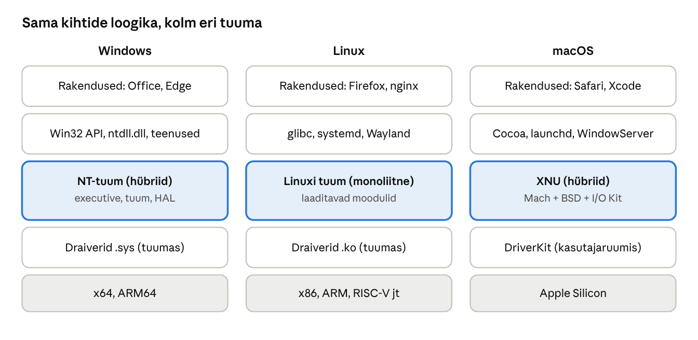
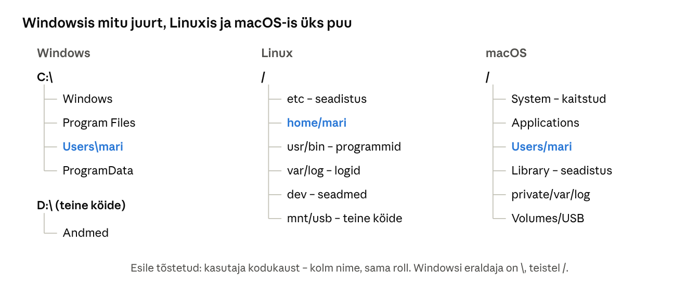
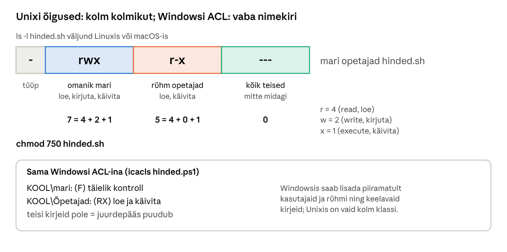
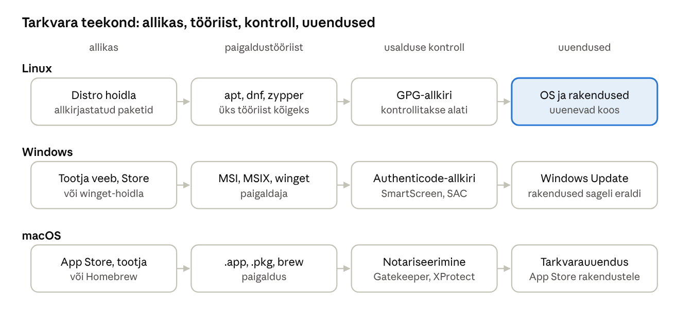

[← 22. UUS: Küberturve tänapäeva Windowsis](22-kuberturve.md) · [Sisukord](../README.md) · [24. UUS: Küberturbe põhimõisted ja ründevektorid →](24-kuberturbe-pohimoisted.md)

## 23. UUS: Windows, Linux ja macOS võrdluses

Kolm levinumat operatsioonisüsteemi lahendavad samu ülesandeid (protsessid, mälu, failid, turve), kuid eri ajaloo ja filosoofiaga. Windows on loodud ühilduvuse ja keskse halduse jaoks, Linux on avatud lähtekoodiga ja domineerib serverites ning pilves, macOS on Apple’i riistvaraga tihedalt seotud Unixi-põhine süsteem. IT-spetsialist puutub täna kokku kõigi kolmega, sageli ühes ja samas võrgus.

### 23.1 Kolm süsteemi 2026. aasta sügisel

- **Windows 11** – viimane versioon 26H2 (september–oktoober 2026, ptk 1). Serveris Windows Server 2025.
- **Linux** – tuuma versioon 7.0 ilmus 12. aprillil 2026 ([Wikipedia: Linux kernel version history](https://wikwiand-revamp.pages.dev/en/2.6.x_kernel_series)); Ubuntu 26.04 LTS kasutab seda tuuma ([HN / PBX Science](https://hn.jakechampion.name/reader/https://pbxscience.com/linux-7-0-confirmed-by-linus-torvalds-stable-version-due-mid-april)). „Linux“ on tegelikult tuum; kasutaja saab selle **distributsioonina** (Ubuntu, Debian, Fedora, RHEL, openSUSE), kus tuuma juurde kuuluvad tööriistad, paketihaldur ja töölaud.
- **macOS** – macOS 27 Golden Gate ilmus 14. septembril 2026 ([MacTech](https://www.mactech.com/2026/09/09/macos-27-will-arrive-on-september-14-along-with-other-os-updates/amp/)) ja töötab ainult Apple Siliconiga Macidel; macOS 26 Tahoe oli viimane Inteli Macide versioon ([Macworld](https://www.macworld.com/article/2644146)).

### 23.2 Päritolu ja arhitektuur

- **Windows NT** (1993) – Microsofti oma tuum, VMS-i mõjutustega; suletud lähtekood.
- **Linux** (1991, Linus Torvalds) – Unixi-laadne monoliitne tuum, mis on avaldatud GPL-litsentsiga; tööriistad suures osas GNU projektist.
- **macOS** (2001, varem Mac OS X) – pärineb NeXTSTEP-ist; tuum XNU ühendab Machi mikrotuuma ja BSD Unixi; on sertifitseeritud UNIX.



Joonis: kõigil kolmel on rakendused, kasutajaruumi teegid ja teenused, tuum, draiverid ja riistvara. Suurim erinevus on tuumas ja selles, kas draiverid töötavad tuumas (Windows, Linux) või kasutajaruumis (macOS DriverKit).

### 23.3 Koondtabel

| Valdkond | Windows | Linux | macOS |
| --- | --- | --- | --- |
| Peamine kasutus | tööjaamad, ettevõtte serverid, mängud | serverid, pilv, konteinerid, sardsead, Android | loometöö, arendus, sülearvutid |
| Litsents | kommerts | vaba (GPL) | Apple’i riistvaraga kaasas |
| Tuum | hübriid (NT) | monoliitne, moodulid | hübriid (XNU) |
| Failisüsteem | NTFS, ReFS | ext4, XFS, Btrfs | APFS |
| Seadistus | register, rühmapoliitika | tekstifailid kaustas `/etc` | `.plist`-failid, konfiguratsiooniprofiilid |
| Teenused | teenusehaldur (SCM) | systemd | launchd |
| Logid | sündmuslogi (Event Log) | journald, syslog | Unified Logging (`log show`) |
| Käsurida | PowerShell, cmd | bash, zsh jt | zsh (vaikimisi), bash |
| Tarkvara paigaldus | winget, Microsoft Store, MSI/MSIX | apt, dnf, zypper, snap, flatpak | App Store, `.pkg`, Homebrew |
| Uuendused | Windows Update, Autopatch | paketihaldur (`apt upgrade`) | Tarkvarauuendus (`softwareupdate`) |
| Keskhaldus | Active Directory, GPO, Intune | Ansible, Puppet, SSSD/FreeIPA | MDM (nt Intune, Jamf), Apple Business Manager |
| Kaughaldus | RDP, WinRM, PowerShell, SSH | SSH | SSH, Screen Sharing (VNC) |

### 23.4 Failisüsteemi puu

Windowsis on iga köide eraldi tähe all ja süsteemifailid on kaustas `C:\Windows`. Linuxis ja macOS-is on üks puu ning kaustadel on kindel tähendus (Filesystem Hierarchy Standard).



| Otstarve | Windows | Linux | macOS |
| --- | --- | --- | --- |
| Süsteemifailid | `C:\Windows` | `/usr`, `/lib`, `/boot` | `/System` (kirjutuskaitsega) |
| Programmid | `C:\Program Files` | `/usr/bin`, `/opt` | `/Applications` |
| Seadistus | register, `C:\ProgramData` | `/etc` | `/Library/Preferences`, `~/Library` |
| Kasutajate kaustad | `C:\Users` | `/home` | `/Users` |
| Logid ja muutuvad andmed | `C:\Windows\Logs`, sündmuslogi | `/var/log` | Unified Logging, `/var/log` |
| Ajutised failid | `%TEMP%` | `/tmp` | `/tmp`, `$TMPDIR` |
| Seadmed | `\\.\` (objektihaldur) | `/dev` | `/dev` |
| Välised kettad | `D:`, `E:` | `/media`, `/mnt` | `/Volumes` |

### 23.5 Õigusemudel

Unixi süsteemides on igal failil omanik, rühm ja kolm õiguste kolmikut (*read, write, execute*) omanikule, rühmale ja teistele. Windowsi ACL on paindlikum: igale kasutajale või rühmale saab anda eri õigusi ning keelavaid kirjeid. Linux ja macOS toetavad ka ACL-e, kuid neid kasutatakse harvem.



Joonis: `chmod 750` annab omanikule kõik õigused, rühmale lugemise ja käivitamise ning ülejäänutele mitte midagi. Windowsis saavutab sama kahe ACL-i kirjega.

### 23.6 Tarkvara paigaldus ja uuendused

Linuxi distributsioonides tuleb peaaegu kogu tarkvara allkirjastatud **hoidlatest** läbi paketihalduri, mis uuendab ühe käsuga nii OS-i kui ka rakendusi. Windowsis on traditsiooniliselt iga programm ise vastutanud oma uuenduste eest; **winget** ja Microsoft Store toovad Windowsi Linuxile lähemale. macOS-is on App Store, tootjate `.pkg`-paigaldajad ja arendajate seas populaarne Homebrew.



Joonis: Linuxi distributsioonid uuendavad kõike ühe tööriistaga; Windowsis ja macOS-is uuendab OS ennast ise, kuid paljud rakendused vajavad eraldi uuendamist – seetõttu on paikamata rakendused Windowsis sage ründetee.

### 23.7 Käsurea vasted

| Ülesanne | Windows (PowerShell) | Linux (bash) | macOS (zsh) |
| --- | --- | --- | --- |
| Failide loend | `Get-ChildItem` (`ls`) | `ls -l` | `ls -l` |
| Protsessid | `Get-Process` | `ps aux`, `top` | `ps aux`, `top` |
| Protsessi lõpetamine | `Stop-Process -Id 1234` | `kill 1234` | `kill 1234` |
| IP-seadistus | `Get-NetIPConfiguration` | `ip addr` | `ifconfig`, `networksetup` |
| Teenuse olek | `Get-Service wuauserv` | `systemctl status ssh` | `launchctl list` |
| Logid | `Get-WinEvent -LogName System` | `journalctl -xe` | `log show --last 1h` |
| Ketta kasutus | `Get-Volume` | `df -h` | `df -h` |
| Tarkvara paigaldus | `winget install 7zip.7zip` | `sudo apt install p7zip-full` | `brew install p7zip` |
| Õigused | `Get-Acl`, `icacls` | `chmod`, `chown`, `getfacl` | `chmod`, `chown`, `ls -le` |
| Administraatorina | „Käivita administraatorina“ | `sudo` | `sudo` |

PowerShell 7 töötab ka Linuxis ja macOS-is, nii et sama skript sobib vahel kõigile kolmele.

### Kokkuvõte

- Kolm OS-i lahendavad samu ülesandeid eri tuumaarhitektuuriga: NT ja XNU on hübriidid, Linux monoliitne.
- Windowsil on register ja ketta tähed, Linuxil ja macOS-il tekstipõhine või `.plist`-seadistus ja üks failipuu.
- Linuxi tarkvara tuleb hoidlatest paketihalduriga, Windowsi ja macOS-i oma suuresti tootjatelt.
- Turvalisuse põhimõtted on samad, nimed erinevad.

### Kontrollküsimused

1. Mille poolest erinevad monoliitne ja hübriidtuum? Too kummastki näide.
2. Mis vahe on Linuxi tuumal ja Linuxi distributsioonil?
3. Kus hoitakse seadistust Windowsis, Linuxis ja macOS-is?
4. Mis on Windowsi teenusehalduri, sündmuslogi ja rühmapoliitika vasted Linuxis ja macOS-is?
5. Selgita Unixi õiguste kolmikut ja võrdle seda Windowsi ACL-iga.
6. Miks on paketihaldur turvalisuse seisukohast hea lahendus?
7. Miks töötavad Linuxi konteinerid Windowsis ja macOS-is virtuaalmasinas?
8. Millist failisüsteemi kasutad USB-pulgal, mida peavad lugema ja kirjutama kõik kolm OS-i?

### Valikküsimused

1. Mis tüüpi tuum on Linuxil? a) monoliitne laaditavate moodulitega b) mikrotuum c) hübriid XNU d) eksotuum
2. Milline on macOS-i vaikimisi failisüsteem? a) ext4 b) NTFS c) APFS d) FAT32
3. Mis on Linuxis Windowsi teenusehalduri vaste? a) launchd b) cron c) udev d) systemd
4. Mida tähendab `-rwxr-x---`? a) kõik võivad kõike b) omanik kõike, rühm loeb ja käivitab, teised ei saa midagi c) ainult omanik saab lugeda d) rühm saab kirjutada
5. Millist protsessorit nõuab macOS 27? a) Intel Core b) AMD Ryzen c) Apple Silicon d) mis tahes 64-bitine

### Praktiline ülesanne

Paigalda WSL 2 koos Ubuntuga (ptk 20) ja tee samad toimingud nii PowerShellis kui ka bashis:

```bash
# Ubuntu (WSL)
uname -a; cat /etc/os-release
ls -l /etc | head
ps aux --sort=-%mem | head -5
systemctl list-units --type=service --state=running | head
journalctl -n 20
touch test.txt; ls -l test.txt; chmod 640 test.txt; ls -l test.txt
sudo apt update && sudo apt install -y tree && tree -L 1 /
```

Võrdle tulemusi PowerShelli vastavate käskudega tabelist 23.7. Kui sul on ligipääs Macile, käivita Terminalis `sw_vers`, `ls -le ~`, `log show --last 5m | head` ja `launchctl list | head`.

### Iseseisvad ülesanded

**1. Sama ülesanne kolmes süsteemis.** Vali üks halduseülesanne (nt „loo kasutaja, anna talle kaustale lugemisõigus ja kontrolli, kas see töötab“ või „leia, milline protsess kasutab kõige rohkem mälu, ja lõpeta see“). Tee see Windowsis ja Linuxis (WSL või VM) ning võimaluse korral macOS-is. **Esita:** käsud, ekraanipildid ja tabel „mis oli sarnane, mis erines“.

**2. OS-i valik asutusele.** Kujuta ette uut kutsekooli IT-osakonda: 40 õpetajat, 300 õpilast, raamatupidamine, õppelaborid, veebileht ja failiserver. Soovita iga rolli ja teenuse jaoks OS (Windows, Linux või macOS) ning põhjenda valikut halduse, hinna, turvalisuse ja tarkvaravajaduse järgi. **Esita:** tabel ja ühe lehekülje pikkune põhjendus.

### Viited

- Tanenbaum, Bos (2022), *Modern Operating Systems*, ptk 10 (Linux) ja 11 (Windows).
- Linuxi tuuma dokumentatsioon: [docs.kernel.org](https://docs.kernel.org/).
- Apple: [Apple Platform Security](https://support.apple.com/guide/security/welcome/web).
- Filesystem Hierarchy Standard: [refspecs.linuxfoundation.org](https://refspecs.linuxfoundation.org/fhs.shtml).
- Allikad lingitud tekstis.

> 📝 **Test:** selle peatüki Google Formsi test luuakse skriptiga [`google-forms/looVormid.gs`](../google-forms/looVormid.gs).

---

[← 22. UUS: Küberturve tänapäeva Windowsis](22-kuberturve.md) · [Sisukord](../README.md) · [24. UUS: Küberturbe põhimõisted ja ründevektorid →](24-kuberturbe-pohimoisted.md)
