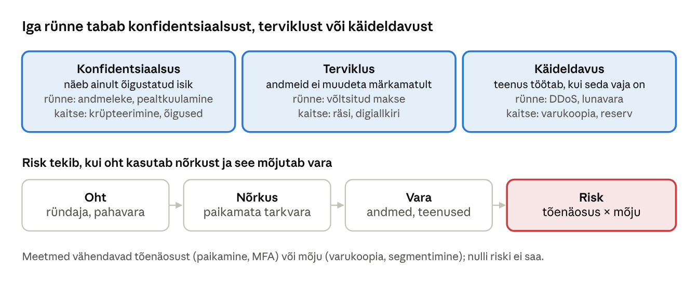
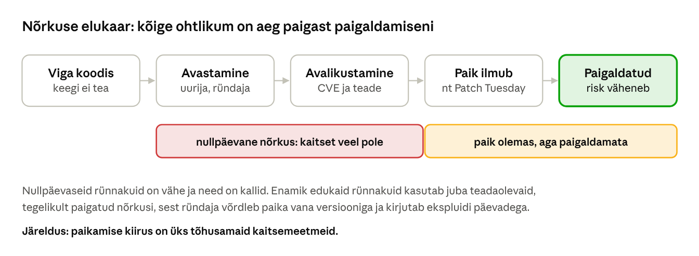
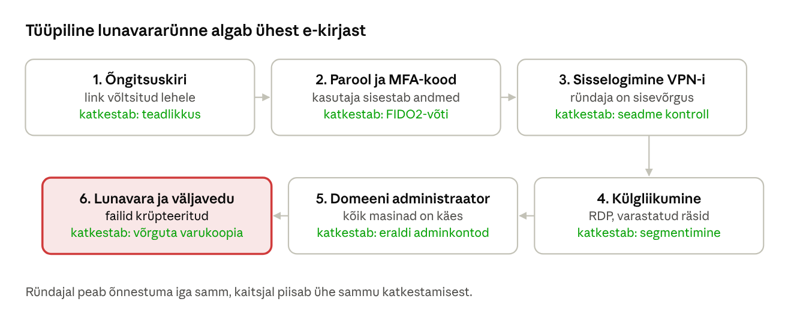
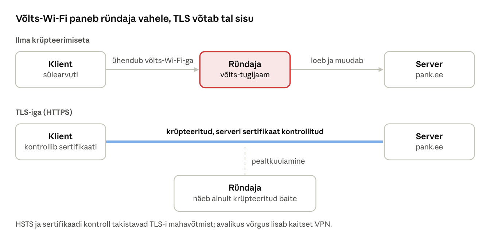

[← 23. UUS: Windows, Linux ja macOS võrdluses](23-windows-linux-macos.md) · [Sisukord](../README.md) · [25. UUS: Krüptograafia ajalugu ja põhimõisted →](25-kruptograafia-ajalugu.md)

## 24. UUS: Küberturbe põhimõisted ja ründevektorid

Peatükid 24–31 moodustavad III osa **„Küberturbe alused“**. Peatükk 24 annab ühise mõisteraamistiku: mida kaitseme, kes ja kuidas ründab ning kuidas rünne kulgeb. Peatükid 25–30 käsitlevad krüptograafiat ja peatükk 31 õigus- ja juhtimisraamistikku. Ründeid ja kaitset käsitlevad põhjalikumalt kaks lisamaterjali: [Peamised küberohud: teooria, ründevektorid ja praktika](https://github.com/valdonolvak/kyberturvalisus/blob/main/K%C3%BCberturbe_alused/Peamised%20k%C3%BCberohud%20teooria%2C%20r%C3%BCndevektorid%20ja%20praktika.md) ja [Küberhügieeni 12 põhimõtet](https://github.com/valdonolvak/kyberturvalisus/blob/main/K%C3%BCberh%C3%BCgieeni%2012%20p%C3%B5him%C3%B5tet%20%E2%80%93%20%C3%B5ppematerjal%20n%C3%A4idete%20ja%20anal%C3%BC%C3%BCsiga.md).

### 24.1 Turvaomadused: CIA kolmik



Joonis: infoturbe kolm põhiomadust ja risk. Iga rünne kahjustab vara vähemalt ühte omadust. Risk tekib alles siis, kui oht leiab nõrkuse, mille kaudu vara kahjustada.

- **Konfidentsiaalsus** (confidentiality) – andmeid näevad ainult need, kellel on selleks õigus.
- **Terviklus** (integrity) – andmed on õiged ja neid ei ole märkamatult muudetud.
- **Käideldavus** (availability) – andmed ja teenused on kasutatavad siis, kui neid vaja on.

Lisaks räägitakse **autentsusest** (kas saatja on see, kes väidab) ja **mittesalgamisest** (non-repudiation: allkirjastaja ei saa hiljem eitada, et ta allkirjastas). Mõlemad tuginevad krüptograafiale (ptk 29).

### 24.2 Oht, nõrkus, risk ja ründepind

| Mõiste | Tähendus | Näide |
| --- | --- | --- |
| Vara (asset) | miski, millel on väärtus | õppijate hinded, e-posti server |
| Oht (threat) | võimalik kahjulik sündmus või selle põhjustaja | lunavaraühendus, rahulolematu töötaja |
| Nõrkus (vulnerability) | viga või puudus, mida saab ära kasutada | paikamata VPN-seade, nõrk parool |
| Ekspluit (exploit) | kood või võte, mis nõrkust kasutab | avalik ründeskript |
| Risk | tõenäosus, et oht kasutab nõrkust, korda mõju | „kõrge: avalik ekspluit ja kriitiline teenus“ |
| Meede (control) | tegevus, mis vähendab tõenäosust või mõju | paikamine, MFA, varukoopia |

Avalikult teada nõrkused saavad **CVE** tunnuse (nt CVE-2024-3400), nende raskust hinnatakse **CVSS** skaalal 0–10. CVSS näitab tehnilist raskust, mitte sinu riski: sama nõrkus on internetis avatud seadmes kriitiline, isoleeritud laborivõrgus väike.

**Ründepind** (attack surface) on kõik kohad, kust ründaja saab süsteemi sisse pääseda: avatud võrgupordid, internetis nähtavad teenused, kasutajakontod, rakendused ja lisandmoodulid, tarnijate ühendused ning inimesed, kes avavad e-kirju. Iga eemaldatud teenus, suletud port ja kustutatud vana konto vähendab ründepinda.

### 24.3 Ründevektorid

**Ründevektor** on tee, mida mööda ründaja esimest korda süsteemi jõuab.

| Ründevektor | Kuidas toimib | Peamine kaitse |
| --- | --- | --- |
| Õngitsus (phishing) | e-kiri, SMS või kõne meelitab avama manuse või sisestama parooli | teadlikkus, e-posti filter, õngitsuskindel MFA |
| Varastatud või lihtsad paroolid | parooliproovimine, varem lekkinud paroolid | paroolihaldur, MFA, lukustuse poliitika |
| Paikamata teenus | avalik nõrkus internetis nähtavas seadmes (VPN, tulemüür, veebiserver) | kiire paikamine, varade nimekiri |
| Vale seadistus | avatud andmebaas, avalik pilvekaust, vaikeparool | seadistuse kontroll, minimaalne avalikustamine |
| Veebirakenduse viga | SQL-süst, XSS, vigane juurdepääsukontroll | turvaline programmeerimine, OWASP Top 10 |
| Tarneahel | nõrk tarnija või rikutud uuendus | tarnijate hindamine, allkirjastatud tarkvara |
| Eemaldatav meedia | nakatunud USB-pulk | automaatkäivituse keeld, seadmekontroll |
| Siseoht | töötaja kuritarvitab õigusi või eksib | vähimad õigused, logimine, lahkumisprotsess |
| Tehisintellekti väärkasutus | süvavõltsitud hääl või video, viipesüst (ptk 21) | teise kanali kaudu kinnitamine |

### 24.4 Ründe käik: Cyber Kill Chain ja MITRE ATT&CK



Joonis: Lockheed Martini **Cyber Kill Chain** jagab sihitud ründe seitsmeks etapiks. Mida varem rünne katkeb, seda vähem kahju see teeb. Iga kasti teine rida näitab, milline kaitse selles etapis toimib ([Lockheed Martin](https://www.lockheedmartin.com/en-us/capabilities/cyber/cyber-kill-chain.html)).

**MITRE ATT&CK** on Kill Chainist detailsem: see on avalik kataloog ründajate taktikatest (eesmärkidest, nt *Initial Access*, *Lateral Movement*) ja tehnikatest (nt T1566 *Phishing*), mis põhineb päris rünnetel ([MITRE ATT&CK](https://attack.mitre.org/)). Seda kasutatakse intsidentide kirjeldamiseks, tuvastusreeglite kirjutamiseks ja kaitse lünkade leidmiseks.

### Näide: õngitsuskirjast lunavarani


Joonis: tavaline lunavararünne organisatsiooni vastu. Iga sammu all on meede, mis selle sammu katkestaks.

Vaata rünnet kaitsja pilguga:

- **samm 2** katkeb, kui MFA on õngitsuskindel (FIDO2-turvavõti või pääsuvõti), sest võltslehele sisestatud kood ei aita ründajat;
- **samm 4** aeglustub, kui tööjaamad ei saa üksteisega RDP või SMB kaudu suhelda;
- **samm 6** ei too ründajale raha, kui võrgust eraldatud varukoopia on olemas ja selle taastamist on harjutatud. Andmete väljaveo vastu varukoopia ei aita, seetõttu on vaja ka logimist ja väljuva liikluse kontrolli.

### 24.5 Võrgu- ja rakenduseründed

**Vahendajarünne** (man-in-the-middle, MITM) – ründaja paigutab end kahe osapoole vahele: võlts-Wi-Fi tugijaam, ARP-võltsimine kohtvõrgus või võltsitud DNS-vastus.



Joonis: krüpteerimata ühenduses näeb ja muudab ründaja kõike. TLS-iga näeb ta ainult krüpteeritud baite. Kui ta esitab võltssertifikaadi, katkestab brauser ühenduse. TLS-i ja sertifikaate käsitleb peatükk 29.

**SQL-süst** (SQL injection) tekib siis, kui programm kleebib kasutaja sisendi andmebaasipäringu teksti sisse. Sisend muutub siis käsu osaks.



Joonis: sisend `' OR '1'='1` muudab tingimuse alati tõeseks ja päring tagastab kõik kasutajad. Parameetriga päringus saadetakse sisend andmebaasile eraldi ja seda ei loeta kunagi käsuna. **XSS** (cross-site scripting) on sama viga veebilehel: kasutaja sisestatud tekst kuvatakse HTML-ina ja selles olev skript käivitub teise kasutaja brauseris. Veebirakenduste levinumad vead koondab [OWASP Top 10](https://owasp.org/Top10/).

**Teenusetõkestamine** (DoS, DDoS) ründab käideldavust: teenus ujutatakse üle päringutega paljudest nakatunud seadmetest (botnet). Kaitseks kasutatakse teenusepakkuja DDoS-kaitset, sisuedastusvõrku (CDN) ja päringute piiramist.

### 24.6 Kaitse kihtidena

Üksik meede ei peata kõiki ründeid, seetõttu ehitatakse kaitse kihtidena (defense in depth): inimesed ja teadlikkus → identiteet ja MFA → seadmed (paikamine, EDR, BitLocker) → võrk (tulemüür, segmentimine) → rakendused (turvaline kood) → andmed (krüpteerimine, varukoopiad) → jälgimine ja intsidendile reageerimine (ptk 22). Iga kihi praktilised meetmed on lisamaterjalis „Küberhügieeni 12 põhimõtet“.

### Kokkuvõte

- Infoturve kaitseb konfidentsiaalsust, terviklust ja käideldavust; risk on tõenäosus korda mõju.
- Ründevektor on ründaja esimene sissepääs; levinumad on õngitsus, paroolid ja paikamata teenused.
- Kill Chain ja MITRE ATT&CK kirjeldavad ründe käiku; kaitsjal piisab ühe etapi katkestamisest.
- SQL-süst ja XSS tekivad, kui sisend muutub käsu osaks; lahendus on parameetrid ja kodeerimine.

### Kontrollküsimused

1. Too näide rünnetest, mis rikuvad konfidentsiaalsust, terviklust ja käideldavust.
2. Mis vahe on ohul, nõrkusel ja riskil?
3. Miks ei ole CVSS-skoor sama mis risk sinu organisatsioonis?
4. Mis on ründepind? Nimeta viis viisi selle vähendamiseks.
5. Nimeta Cyber Kill Chaini seitse etappi.
6. Miks aitab FIDO2-turvavõti õngitsuse vastu paremini kui SMS-kood?
7. Kuidas tekib SQL-süst ja kuidas seda vältida?

### Valikküsimused

1. Milline turvaomadus on rikutud, kui ründaja muudab märkamatult pangaülekande summat? a) konfidentsiaalsus b) terviklus c) käideldavus d) anonüümsus
2. Mis on nõrkus (vulnerability)? a) ründaja b) varukoopia c) süsteemi viga või puudus, mida saab ära kasutada d) turvapoliitika
3. Mis on Cyber Kill Chaini esimene etapp? a) luure b) paigaldamine c) ärakasutamine d) juhtimiskanal
4. Mis kaitseb SQL-süsti eest kõige paremini? a) pikem parool b) tulemüür c) HTTPS d) parameetritega päringud
5. Mis aitab kõige paremini õngitsuse ja MFA-väsitamise vastu? a) SMS-kood b) turvaküsimus c) FIDO2-turvavõti või pääsuvõti d) pikem parool

### Praktiline ülesanne

**Ründepinna kaardistamine ja SQL-süst oma masinas.** Tee ülesanne oma õppe-VM-is või WSL-is (ptk 20.5). Skanni ainult oma masinat.

1. Windowsi kuulavad pordid (PowerShell):

```powershell
Get-NetTCPConnection -State Listen | Sort-Object LocalPort |
  Select-Object LocalAddress, LocalPort, OwningProcess,
    @{n='Protsess'; e={(Get-Process -Id $_.OwningProcess).ProcessName}}
```

2. Linuxi poolel (WSL Ubuntu või Kali):

```bash
sudo apt update && sudo apt install -y nmap python3
ss -tulpn                    # millised teenused kuulavad
sudo nmap -sV localhost      # mida näeb väljastpoolt tulija
```

3. SQL-süsti näide. Salvesta fail `sqlsyst.py` ja käivita `python3 sqlsyst.py`:

```python
import sqlite3
db = sqlite3.connect(":memory:")
db.execute("CREATE TABLE users(name TEXT, secret TEXT)")
db.executemany("INSERT INTO users VALUES (?, ?)", [("mari", "kass123"), ("jaan", "koer456")])

sisend = "' OR '1'='1"
ohtlik = f"SELECT * FROM users WHERE name = '{sisend}'"
print("Ohtlik päring:", ohtlik)
print("Tulemus:", db.execute(ohtlik).fetchall())
print("Parameetriga:", db.execute("SELECT * FROM users WHERE name = ?", (sisend,)).fetchall())
```

Vasta: mitu porti kuulab Windowsis ja mitu WSL-is? Milline teenus on mõttetu ja kuidas selle sulged? Miks tagastas teine päring tühja nimekirja?

### Iseseisvad ülesanded

**1. Intsidendi analüüs.** Vali üks avalikult kirjeldatud intsident viimase viie aasta seest (nt RIA küberturvalisuse aastaraamatust või rahvusvahelisest uudisest). Kirjelda rünnet Kill Chaini seitsme etapi kaupa ja seo vähemalt kolm sammu MITRE ATT&CK tehnikaga. **Esita:** tabel (etapp, mis juhtus, ATT&CK tehnika, meede, mis oleks sammu katkestanud).

**2. Ohtude ja riskide tabel.** Vali oma kool, töökoht või kodu. Nimeta viis vara, iga vara kohta oht ja nõrkus ning hinda tõenäosust ja mõju skaalal 1–3. **Esita:** riskitabel, kolme suurima riski kohta üks meede ja selgitus, kas see vähendab tõenäosust või mõju.

### Viited

- Nolvak, V. [Peamised küberohud: teooria, ründevektorid ja praktika](https://github.com/valdonolvak/kyberturvalisus/blob/main/K%C3%BCberturbe_alused/Peamised%20k%C3%BCberohud%20teooria%2C%20r%C3%BCndevektorid%20ja%20praktika.md) ja [Küberhügieeni 12 põhimõtet](https://github.com/valdonolvak/kyberturvalisus/blob/main/K%C3%BCberh%C3%BCgieeni%2012%20p%C3%B5him%C3%B5tet%20%E2%80%93%20%C3%B5ppematerjal%20n%C3%A4idete%20ja%20anal%C3%BC%C3%BCsiga.md). GitHub.
- Lockheed Martin. [The Cyber Kill Chain](https://www.lockheedmartin.com/en-us/capabilities/cyber/cyber-kill-chain.html).
- MITRE. [ATT&CK](https://attack.mitre.org/).
- OWASP. [Top 10](https://owasp.org/Top10/).
- NIST. [Cybersecurity Framework 2.0](https://www.nist.gov/cyberframework) (2024).
- Riigi Infosüsteemi Amet. [Küberturvalisuse aastaraamat](https://www.ria.ee/).

> 📝 **Test:** selle peatüki Google Formsi test luuakse skriptiga [`google-forms/looVormid.gs`](../google-forms/looVormid.gs).

---

[← 23. UUS: Windows, Linux ja macOS võrdluses](23-windows-linux-macos.md) · [Sisukord](../README.md) · [25. UUS: Krüptograafia ajalugu ja põhimõisted →](25-kruptograafia-ajalugu.md)
