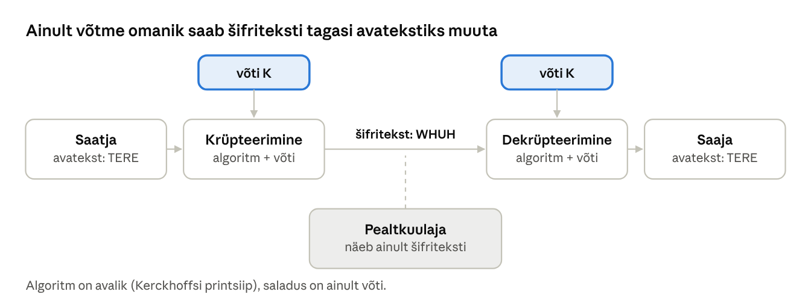
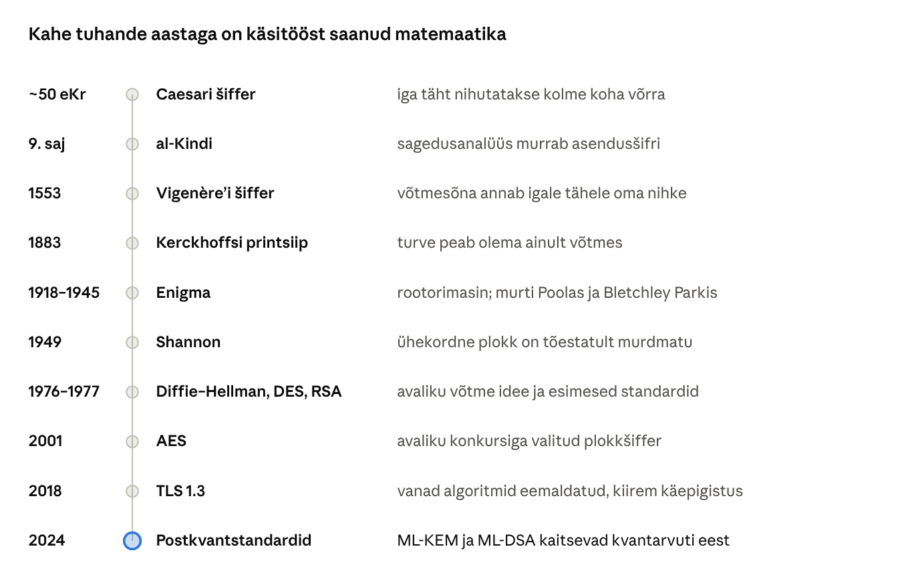
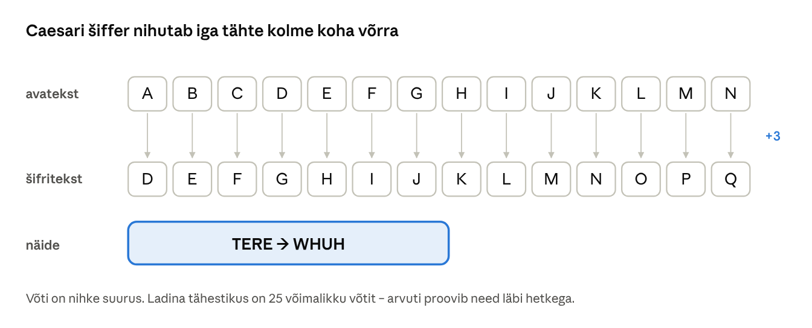
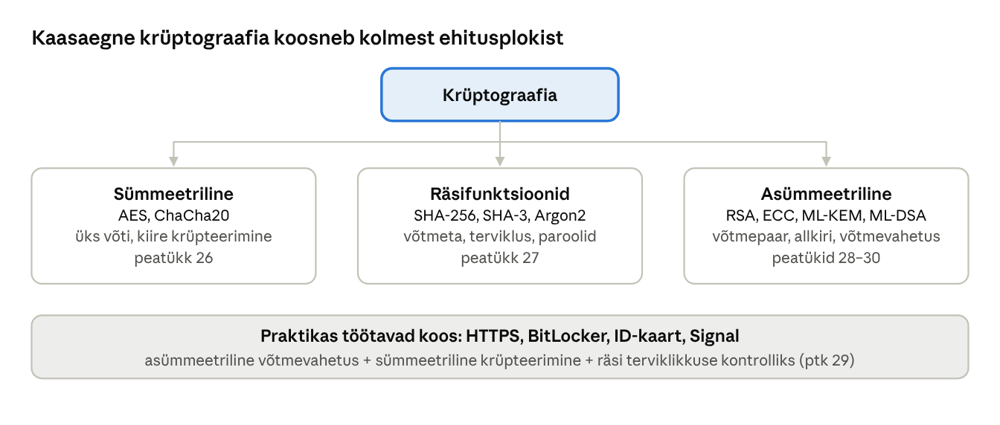

[← 24. UUS: Küberturbe põhimõisted ja ründevektorid](24-kuberturbe-pohimoisted.md) · [Sisukord](../README.md) · [26. UUS: Sümmeetriline krüpteerimine →](26-summeetriline-kruptograafia.md)

## 25. UUS: Krüptograafia ajalugu ja põhimõisted

**Krüptograafia** (kreeka *kryptos* – peidetud, *graphein* – kirjutama) on teadus andmete kaitsmisest matemaatiliste meetoditega. Tema abil saavutatakse konfidentsiaalsus, terviklus, autentsus ja mittesalgamine (ptk 24.1). Windowsis kasutavad krüptograafiat BitLocker (ptk 16), Kerberos (ptk 17), Secure Boot ja draiverite allkirjad (ptk 18) ning iga HTTPS-ühendus.

### 25.1 Põhimõisted



Joonis: krüpteerimise üldmudel. Pealtkuulaja näeb kanalis šifriteksti, kuid ilma võtmeta ei saa ta sellest avateksti tagasi.

| Mõiste | Tähendus |
| --- | --- |
| Avatekst (plaintext) | algne loetav sõnum või fail |
| Šifritekst (ciphertext) | krüpteeritud, ilma võtmeta loetamatu kuju |
| Šiffer, algoritm (cipher) | reegel, mille järgi krüpteeritakse ja dekrüpteeritakse |
| Võti (key) | salajane väärtus, mis määrab algoritmi täpse tulemuse |
| Krüptoanalüüs | šifrite murdmise teadus |
| Toore jõu rünne (brute force) | kõigi võimalike võtmete läbiproovimine |
| Võtmeruum | kõigi võimalike võtmete hulk, nt 128-bitisel võtmel 2¹²⁸ |

**Kodeerimine ei ole krüpteerimine.** Base64, URL-kodeering ja heksakuju muudavad andmete esitusviisi, kuid neil puudub võti: igauüks saab need tagasi muuta. **Steganograafia** peidab sõnumi olemasolu (nt pildi pikslitesse), krüptograafia peidab sõnumi sisu.

### 25.2 Kerckhoffsi printsiip

Auguste Kerckhoffs sõnastas 1883. aastal reegli, mis kehtib siiani: **süsteem peab jääma turvaliseks ka siis, kui vastane teab kõike peale võtme**. Algoritmid on avalikud ja neid on aastaid analüüsinud tuhanded teadlased. Salajane „omatehtud“ algoritm on peaaegu alati nõrk. Näiteks murti 2008. aastal MIFARE Classic kiipkaartide salajane algoritm Crypto-1 pärast seda, kui teadlased selle kiibi pildistamise teel taastasid. Sama põhimõtet väljendab Shannoni maksiim: „vaenlane tunneb süsteemi“.

### 25.3 Ajalugu



Joonis: krüptograafia arengu verstapostid. Kuni 20. sajandini oli krüptograafia käsitöö ja selle saladus oli tihti algoritm ise. Pärast Shannoni tööd 1949. aastal sai sellest matemaatika haru ja avalikud standardid.

#### Asendusšifrid ja sagedusanalüüs



Joonis: Caesari šifris asendatakse iga täht tähega, mis asub tähestikus kolm kohta eespool. Võtmeid on nii vähe, et need saab käsitsi läbi proovida.

Üldisemas **asendusšifris** võib iga täht asenduda suvalise teise tähega. Võtmeid on siis 26! ≈ 4 × 10²⁶ ja toore jõuga neid läbi proovida ei saa. Araabia teadlane al-Kindi kirjeldas 9. sajandil siiski **sagedusanalüüsi**: igas keeles esinevad mõned tähed teistest sagedamini. Eesti tekstis on sagedased näiteks vokaalid *a*, *e* ja *i*. Kui šifritekstis on mõni täht kõige sagedasem, vastab see suure tõenäosusega keele kõige sagedasemale tähele. Seetõttu ei sobi suur võtmeruum üksi turvalisuse mõõduks: tuleb hinnata ka seda, kas šifritekst reedab avateksti struktuuri.

**Vigenère’i šiffer** (16. saj) kasutab võtmesõna: iga avateksti täht nihutatakse võtmesõna vastava tähe võrra. See peitis tähesagedused ja seda peeti kolmsada aastat murdmatuks, kuni Charles Babbage ja Friedrich Kasiski näitasid 19. sajandil, kuidas võtmesõna pikkus kordustest leida.

**Ühekordne plokk** (one-time pad) kasutab võtit, mis on avatekstiga sama pikk, täiesti juhuslik ja mida kasutatakse ainult üks kord. Claude Shannon tõestas 1949. aastal, et selline šiffer on täiuslikult turvaline. Praktikas on see harva kasutatav, sest sama pika võtme turvaline edastamine on sama raske kui sõnumi enda edastamine.

#### Enigma

Saksa **Enigma** oli elektromehaaniline rootorimasin, mis muutis iga klahvivajutusega oma seisu, nii et sama täht krüpteerus iga kord erinevalt. Päevavõti määras rootorite valiku, järjekorra, algasendi ja pistikupaneeli ühendused. Poola matemaatikud eesotsas Marian Rejewskiga murdsid Enigma 1932. aastal. Sõja ajal jätkasid tööd Briti Bletchley Parkis Alan Turing ja tema kolleegid elektromehaaniliste „pommidega“ (bombe). Masina nõrkus oli disainis – ükski täht ei krüpteerunud iseendaks – ning kasutajate harjumustes, nt korduvates tervitustes ja ilmateadetes. Õppetund kehtib tänini: krüptograafia murtakse harva matemaatikaga, sagedamini kasutusvigade kaudu.

#### Arvutiajastu

Avalikud standardid tekkisid 1970. aastatel. **DES** (1977) oli esimene avalik plokkšiffer, kuid selle 56-bitine võti murti 1998. aastal toore jõuga ööpäevaga. Whitfield Diffie ja Martin Hellman avaldasid 1976. aastal **avaliku võtme krüptograafia** idee ja Rivest, Shamir ja Adleman 1977. aastal **RSA**. **AES** valiti 2001. aastal avaliku rahvusvahelise konkursi tulemusel. 2024. aastal avaldas NIST esimesed **postkvantstandardid** (ptk 30).

### 25.4 Krüptograafia kaart



Joonis: kaasaegse krüptograafia kolm ehitusplokki ja peatükid, kus neid käsitletakse. Päris süsteemid kasutavad neid alati koos.

### 25.5 Mida krüptograafia ei lahenda

Krüptograafia kaitseb andmeid teel ja kettal, kuid mitte:

- **nakatunud seadmes**, kus pahavara loeb andmeid enne krüpteerimist või pärast dekrüpteerimist;
- **halva võtmehalduse** korral: võti on samas kaustas mis krüpteeritud fail, parool on skripti sisse kirjutatud või BitLockeri taastevõti on märkmepaberil;
- **teostusvigade** korral: Heartbleedi viga (2014) OpenSSL-is lekitas serveri mälu, kuigi algoritmid olid korras;
- **inimese petmisel**: õngitsusleht saab TLS-sertifikaadi samamoodi nagu päris pank.

Isetehtud krüptograafia asemel kasuta alati testitud teeke (OpenSSL, Windows CNG, libsodium) ja nende vaikeseadeid.

### Näide: Base64 „parool“ seadistusfailis

Veebirakenduse seadistusfailis on rida `db_password=a2Fzc2kxMjM=`. Arendaja arvas, et parool on krüpteeritud. Tegelikult on see Base64:

```bash
echo 'a2Fzc2kxMjM=' | base64 -d     # kassi123
```

Kodeerimiseks ei ole vaja võtit, seega saab igaüks, kes faili näeb, parooli kätte. Õige lahendus: parool hoitakse saladuste hoidlas (nt Azure Key Vault, Windowsi Credential Manager, keskkonnamuutuja piiratud õigustega), mitte koodis ega seadistusfailis.

### Kokkuvõte

- Krüpteerimine muudab avateksti šifritekstiks; ilma võtmeta ei saa seda tagasi muuta.
- Kerckhoffsi printsiip: algoritm on avalik, saladus on ainult võti.
- Ajalooliste šifrite nõrkus oli väike võtmeruum või avateksti mustrid; kaasaegsed algoritmid on avalikult testitud.
- Kodeerimine (Base64) ei ole krüpteerimine.

### Kontrollküsimused

1. Mis vahe on avatekstil, šifritekstil, algoritmil ja võtmel?
2. Sõnasta Kerckhoffsi printsiip ja too näide, mis juhtub, kui seda ei järgita.
3. Miks on Caesari šiffer kergesti murtav?
4. Kuidas töötab sagedusanalüüs ja miks ei aita sellevastu suur võtmeruum?
5. Miks oli Enigma murdmisel oluline kasutajate harjumuste tundmine?
6. Miks on ühekordne plokk teoreetiliselt täiuslik, kuid praktikas harv?
7. Mis vahe on kodeerimisel, krüpteerimisel ja steganograafial?

### Valikküsimused

1. Mida väidab Kerckhoffsi printsiip? a) algoritm peab olema salajane b) võti peab olema lühike c) süsteem peab olema turvaline ka siis, kui kõik peale võtme on avalik d) šifrit ei tohi kunagi muuta
2. Milline meetod murrab lihtsa asendusšifri? a) sagedusanalüüs b) DNS-päring c) räsimine d) digiallkiri
3. Mis on Base64? a) sümmeetriline šiffer b) räsifunktsioon c) asümmeetriline šiffer d) kodeering, mitte krüpteerimine
4. Mitu võimalikku võtit on Caesari šifril 26-tähelises ladina tähestikus? a) 2 b) 25 c) 1000 d) 2¹²⁸

### Praktiline ülesanne

**Ajaloolised šifrid WSL-is.** Ava WSL Ubuntu (ptk 20.5).

1. Caesari šiffer käsuga `tr`:

```bash
echo 'TERE MAAILM' | tr 'A-Z' 'D-ZA-C'      # krüpteeri, nihe 3
echo 'WHUH PDDLOP' | tr 'D-ZA-C' 'A-Z'      # dekrüpteeri
echo 'Tere' | tr 'A-Za-z' 'N-ZA-Mn-za-m'    # ROT13
```

2. Toore jõu rünne: salvesta fail `caesar.py` ja proovi kõik 25 võtit:

```python
sifr = "WHUH PDDLOP"
for k in range(1, 26):
    print(k, "".join(chr((ord(c) - 65 - k) % 26 + 65) if c.isalpha() else c for c in sifr))
```

3. Sagedusanalüüs: kopeeri pikem eestikeelne tekst faili `tekst.txt` ja loe tähti:

```bash
tr -cd 'a-zA-ZõäöüÕÄÖÜ' < tekst.txt | tr 'A-ZÕÄÖÜ' 'a-zõäöü' | grep -o . | sort | uniq -c | sort -rn | head
```

4. Kodeerimine vs krüpteerimine:

```bash
echo -n 'kassi123' | base64            # kodeerimine, võtit pole
openssl rand -hex 16                   # juhuslik 128-bitine võti
```

Vasta: milline võti andis loetava teksti? Millised viis tähte olid sinu tekstis kõige sagedasemad? Miks ei kaitse Base64 parooli?

### Iseseisvad ülesanded

**1. Vigenère’i šiffer.** Kirjuta Pythonis programm, mis krüpteerib ja dekrüpteerib teksti Vigenère’i šifriga. Krüpteeri vähemalt 300 tähe pikkune tekst võtmega `KOOL` ja leia šifritekstist korduvaid kolmetähelisi järjendeid. **Esita:** kood, šifritekst ja selgitus, kuidas korduste vahekaugused reedavad võtme pikkuse (Kasiski meetod).

**2. Salajane algoritm ei kaitse.** Uuri üht juhtumit, kus salajasele algoritmile tuginenud süsteem murti (nt MIFARE Classic Crypto-1, DVD-de CSS, GSM-i A5/1). **Esita:** pool lehekülge: mis oli süsteem, kuidas algoritm avalikuks tuli, mis oli tagajärg ja kuidas see seostub Kerckhoffsi printsiibiga.

### Viited

- Singh, S. (1999). *The Code Book: The Science of Secrecy from Ancient Egypt to Quantum Cryptography*. Fourth Estate.
- Shannon, C. E. (1949). Communication Theory of Secrecy Systems. *Bell System Technical Journal*, 28(4).
- Kerckhoffs, A. (1883). La cryptographie militaire. *Journal des sciences militaires*.
- Katz, J., Lindell, Y. (2020). *Introduction to Modern Cryptography*, 3. tr. CRC Press.
- Tartu Ülikool. [Infoturve: andmete kaitsmine krüpteerimise abil](https://courses.cs.ut.ee/2020/infsec/spring/Main/Loeng-AndmeteKrypteerimine).

> 📝 **Test:** selle peatüki Google Formsi test luuakse skriptiga [`google-forms/looVormid.gs`](../google-forms/looVormid.gs).

---

[← 24. UUS: Küberturbe põhimõisted ja ründevektorid](24-kuberturbe-pohimoisted.md) · [Sisukord](../README.md) · [26. UUS: Sümmeetriline krüpteerimine →](26-summeetriline-kruptograafia.md)
