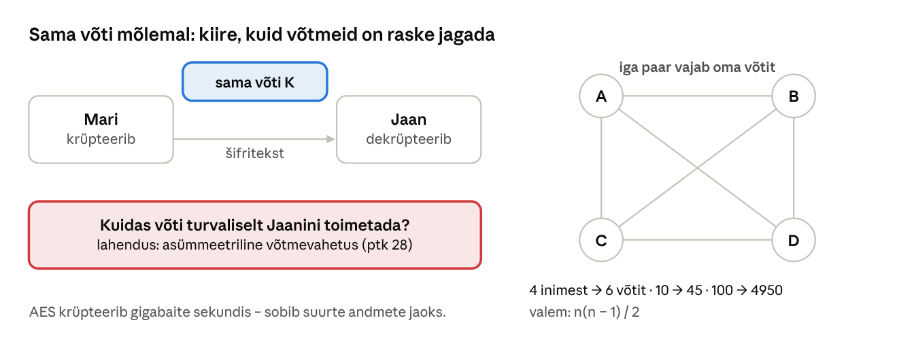
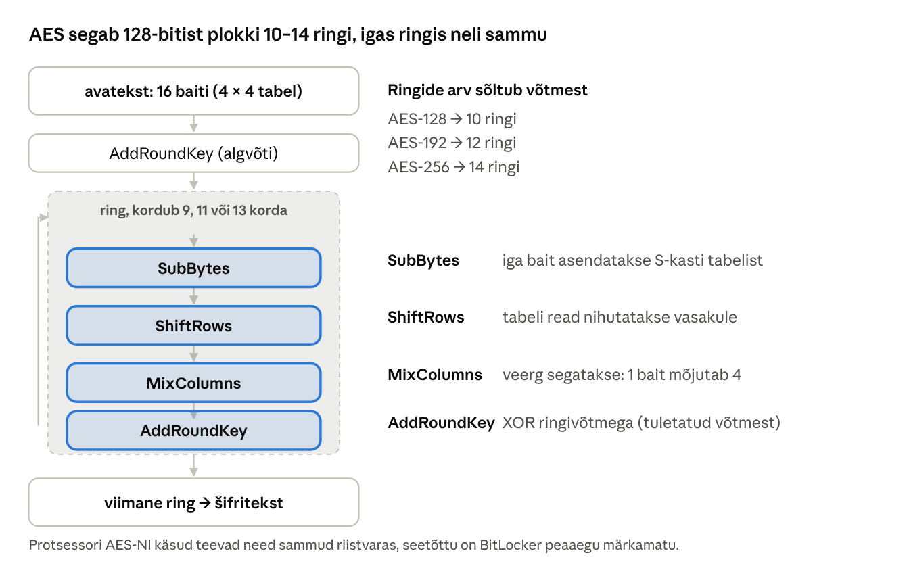
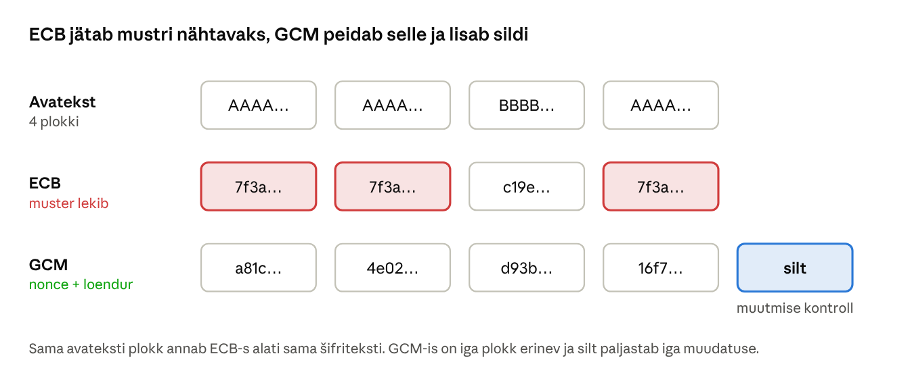
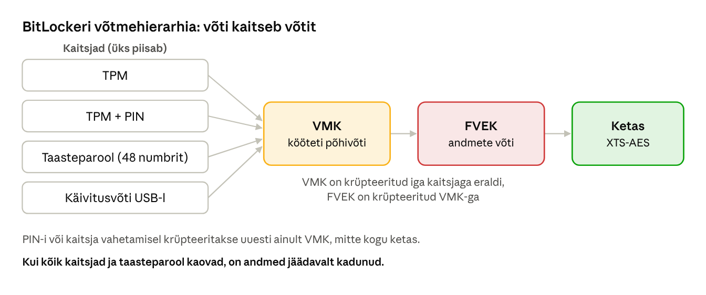

[← 25. UUS: Krüptograafia ajalugu ja põhimõisted](25-kruptograafia-ajalugu.md) · [Sisukord](../README.md) · [27. UUS: Räsimine, sool ja paroolide hoidmine →](27-rasimine-ja-paroolid.md)

## 26. UUS: Sümmeetriline krüpteerimine

Sümmeetrilises krüptograafias kasutavad krüpteerija ja dekrüpteerija **sama võtit**. See on kiire ja töötab kõikjal, kus andmeid on palju: kettakrüpteerimine (BitLocker), võrguühendused (TLS, SMB, Wi-Fi, VPN), varukoopiad ja ZIP-arhiivid. Kaasaegne protsessor krüpteerib AES-iga mitu gigabaiti sekundis, nii et kasutaja ei pane seda tähelegi.

Peatükk 25 näitas, miks ajaloolised šifrid murti: väike võtmeruum, avateksti mustrid ja kasutusvead. Selles peatükis vaatame, kuidas kaasaegne sümmeetriline krüptograafia need probleemid lahendab ja millised vead on endiselt võimalikud.

**Pärast peatüki läbimist õppija:**

- selgitab sümmeetrilise krüptograafia põhimõtet ja võtmejagamise probleemi ning arvutab vajalike võtmete arvu;
- eristab plokk- ja voošifreid ning kirjeldab AES-i ülesehitust;
- selgitab töörežiimide ECB, CBC, CTR ja GCM erinevusi, täidise, IV ja nonce’i rolli;
- põhjendab, miks eelistatakse autenditud krüpteerimist (AEAD);
- kirjeldab võtmehierarhiat BitLockeri näitel ning krüpteerib ja dekrüpteerib faile OpenSSL-i ja Pythoniga.

### 26.1 Põhimõte ja võtmejagamise probleem



Joonis: sümmeetrilise krüptograafia suurim probleem ei ole matemaatika, vaid võtmete jagamine.

Sümmeetriline šiffer on kaks funktsiooni: krüpteerimine **C = E(K, P)** ja dekrüpteerimine **P = D(K, C)**, kus K on sama salajane võti. Kui Mari tahab Jaanile saata krüpteeritud faili, peab Jaanil olema sama võti. Siit tulevad kaks probleemi.

**Kuidas võti teisele poolele saada?** Kui Mari saadab võtme e-kirjaga, näeb seda igaüks, kes e-kirja näeb. Kui ta saadab võtme samas kanalis kui faili, pole krüpteerimisest kasu. Võtme saab üle anda isiklikult, telefoni teel (teine kanal) või usaldusväärse keskserveri kaudu – just nii töötab Kerberos domeenis (ptk 17): domeenikontroller teab iga kasutaja võtit ja jagab ajutisi seansivõtmeid. Internetis, kus osapooled pole kunagi kohtunud, lahendab probleemi asümmeetriline võtmevahetus (ptk 28).

**Kui palju võtmeid on vaja?** Iga paar vajab eraldi võtit, muidu saaks Mari lugeda Jaani ja Kati vahelisi sõnumeid. n inimese jaoks on vaja n(n − 1) / 2 võtit:

| Inimesi | Võtmeid |
| --- | --- |
| 2 | 1 |
| 5 | 10 |
| 20 | 190 |
| 100 | 4950 |
| 1000 | 499 500 |

Seetõttu kasutatakse päris süsteemides **hübriidkrüpteerimist**: asümmeetrilise krüptograafiaga lepitakse kokku juhuslikus seansivõtmes ja andmed krüpteeritakse sümmeetriliselt (ptk 28.5).

### 26.2 Plokk- ja voošifrid

**Plokkšiffer** (block cipher) krüpteerib korraga kindla suurusega ploki, AES-i puhul 128 bitti ehk 16 baiti. Iga võtme jaoks on plokkšiffer justkui hiiglaslik asendustabel, mis seab igale 16-baidisele sisendile vastavusse ühe 16-baidise väljundi. Võimalikke sisendeid on 2¹²⁸, nii et tabelit ei saa kirja panna ega sagedusanalüüsiga murda. Pikem sõnum jagatakse plokkideks ja nende sidumise reegel on **töörežiim** (26.4).

**Voošiffer** (stream cipher) jäljendab ühekordset plokki (ptk 25.3): lühikesest võtmest ja nonce’ist toodetakse pikk pseudojuhuslik **võtmevoog**, mis liidetakse avatekstiga XOR-tehtega. Tänane näide on **ChaCha20**, mida kasutatakse TLS-is ja VPN-is (WireGuard) seadmetes, millel puudub AES-i riistvaratugi.

Voošifril on sama ohtlik nõrkus nagu ühekordsel plokil: **võtmevoogu ei tohi kunagi korduvalt kasutada**. Vana Wi-Fi-kaitse **WEP** kasutas voošifrit RC4 ja ainult 24-bitist initsialiseerimisvektorit. Kiire võrgu korral hakkasid IV-d mõne tunni pärast korduma ja 2001. aastal näidati, et võtme saab kogutud liiklusest taastada. Hilisemate rünnetega piisab selleks mõnest minutist. WEP on seetõttu ammu kasutuselt kõrvaldatud.

### 26.3 AES

**AES** (Advanced Encryption Standard, algne nimi Rijndael) on 2001. aastast USA standard FIPS 197 ja maailmas enim kasutatud sümmeetriline šiffer. Plokk on alati 128 bitti, võti 128, 192 või 256 bitti ja ringide arv vastavalt 10, 12 või 14.



Joonis: AES käsitleb 16 baiti 4 × 4 tabelina (olek, state) ja segab seda mitu ringi. Iga ring koosneb neljast sammust.

| Samm | Mida teeb | Miks |
| --- | --- | --- |
| SubBytes | iga bait asendatakse fikseeritud tabeli (S-kasti) järgi, nt `53` → `ED` | lisab mittelineaarsuse ehk Shannoni **segaduse**; ilma selleta saaks AES-i murda lineaarvõrranditega |
| ShiftRows | tabeli read nihutatakse vasakule 0, 1, 2 ja 3 baidi võrra | viib baidid teistesse veergudesse |
| MixColumns | iga veeru neli baiti segatakse omavahel matemaatilise teisendusega | iga väljundbait sõltub veeru kõigist baitidest; koos ShiftRowsiga tekitab **hajutuse** |
| AddRoundKey | olek XOR-itakse ringivõtmega | seob tulemuse võtmega; ringivõtmed tuletatakse põhivõtmest (key schedule) |

Kahe ringi järel mõjutab iga avateksti bitt kõiki 128 šifriteksti bitti. Kui muudad avatekstis ühe biti, muutub ligikaudu pool šifriteksti bittidest – seda nimetatakse **laviiniefektiks**. Kaasaegsetes protsessorites on AES-i jaoks eraldi käsud (**AES-NI** Intelil ja AMD-l, ARMv8 krüptolaiendus), mis teevad ühe ringi ühe käsuga ja kaitsevad ka ajastusrünnete eest.

| Algoritm | Võtme pikkus | Seisund 2026 |
| --- | --- | --- |
| DES | 56 bitti | murtud toore jõuga (1998), ei kasutata |
| 3DES | 112 bitti (efektiivne) | NIST keelas uutes süsteemides; Windows eemaldab |
| RC4 | 40–128 bitti | murtud; Kerberoses ja TLS-is keelatud |
| AES-128 | 128 bitti | turvaline, BitLockeri vaikimisi valik |
| AES-256 | 256 bitti | turvaline ka kvantarvuteid arvestades (ptk 30) |
| ChaCha20 | 256 bitti | turvaline, kiire ilma riistvaratoeta |

Miks on 128 bitti piisav? Võimalikke võtmeid on 2¹²⁸ ≈ 3,4 × 10³⁸. Kui arvuti proovib miljard miljardit (10¹⁸) võtit sekundis, kulub keskmiselt üle 5 × 10¹² aasta – sadu kordi rohkem, kui on universumi vanus. Parim teadaolev matemaatiline rünne AES-i vastu vähendab töö hulka vaid umbes neli korda, mis praktikas midagi ei muuda. AES-i ei murta šifri, vaid võtme kaudu: nõrk parool, lekkinud võti või vale töörežiim.

### 26.4 Töörežiimid

AES oskab krüpteerida ainult ühte 16-baidist plokki. Töörežiim (mode of operation) ütleb, kuidas pikem sõnum plokkideks jagada ja plokid omavahel siduda.



Joonis: ECB-režiimis krüpteeritakse iga plokk eraldi ja samad avateksti plokid annavad sama šifriteksti. ECB-ga krüpteeritud tõmmisel on esialgne kujutis siiani näha (tuntud „ECB pingviini“ näide).

**ECB** (Electronic Codebook): Cᵢ = E(K, Pᵢ). Iga plokk on sõltumatu, seega lekivad mustrid. Kui andmebaasis on palgaveerg krüpteeritud ECB-ga, näeb ründaja võtit teadmata, kellel on sama palk.

**CBC** (Cipher Block Chaining): enne krüpteerimist XOR-itakse iga avateksti plokk eelmise šifriplokiga. Esimese ploki jaoks kasutatakse juhuslikku **initsialiseerimisvektorit** (IV):

- C₁ = E(K, P₁ ⊕ IV)
- C₂ = E(K, P₂ ⊕ C₁)
- C₃ = E(K, P₃ ⊕ C₂) jne.

Nüüd annavad samad avateksti plokid erineva šifriteksti ja ka sama faili kaks krüpteerimist on erinevad, sest IV on iga kord uus. IV ei ole saladus: see salvestatakse šifriteksti ette.

**Täidis** (padding). CBC vajab täisplokke. Levinud **PKCS#7** täidis lisab nii mitu baiti, kui puudu on, ja iga lisatud baidi väärtus on puuduolevate baitide arv. 13-baidisele sõnumile lisatakse `03 03 03`, 15-baidisele `01`. Kui sõnum on täpselt 16 baiti, lisatakse terve plokk baitidega `10` (kümnendis 16), et dekrüpteerija teaks alati, mitu baiti eemaldada.

Kui server ütleb vastuseks erinevalt, kas täidis oli vale või oli viga mujal, saab ründaja seda infot kasutada ja šifriteksti bait-baidi haaval dekrüpteerida ilma võtmeta. Seda nimetatakse **täidiseoraakli rünnakuks** (padding oracle). Nii murti näiteks 2010. aastal ASP.NET-i krüpteeritud küpsised ja 2014. aastal SSL 3.0 (POODLE). Lahendus on kontrollida enne dekrüpteerimist terviklust – ehk kasutada AEAD-režiimi.

**CTR** (Counter): krüpteeritakse loendur (nonce + ploki number) ja tulemus XOR-itakse avatekstiga. AES muutub nii voošifriks: täidist pole vaja ja plokke saab krüpteerida paralleelselt.

**GCM** (Galois/Counter Mode) = CTR + **autentimissilt** (tag). Krüpteerimise kõrval arvutatakse šifritekstist ja lisaandmetest (nt võrgupaketi päis) 128-bitine silt. Dekrüpteerija arvutab sildi uuesti ja kui see ei klapi, ei anna ta ühtki baiti avateksti välja.

| Režiim | Kuidas töötab | Kasutus | Märkus |
| --- | --- | --- | --- |
| ECB | iga plokk eraldi | ära kasuta | lekitab mustreid |
| CBC | iga plokk XOR-itakse eelmise šifriplokiga, algul IV | vanemad süsteemid | vajab täidist; ilma tervikluse kontrollita täidiseoraakli oht |
| CTR | loendur krüpteeritakse, tulemus XOR-itakse andmetega | voona | nonce ei tohi korduda |
| GCM | CTR + autentimissilt | TLS, SMB 3.1.1, IPsec | **AEAD**: krüpteerib ja kontrollib terviklust |
| XTS | iga sektor oma „puudutusega“ (tweak) | kettakrüpteerimine (BitLocker) | sektori suurus ei muutu |

**AEAD** (authenticated encryption with associated data) tähendab, et lisaks krüpteerimisele kontrollitakse terviklust ja autentsust. Miks see on oluline? CTR- ja CBC-režiimis saab ründaja šifriteksti sihipäraselt muuta. CTR-is muudab šifriteksti biti ümberpööramine täpselt sama biti avatekstis. Kui ründaja teab, et krüpteeritud sõnum algab `Summa: 100`, võib ta muuta selle `Summa: 900`-ks ilma võtit teadmata (bitti ümberpöörav rünne, bit-flipping). Krüpteerimine kaitseb konfidentsiaalsust, aga mitte terviklust – selleks on vaja autentimissilti.

**Nonce** (number used once) ja **IV** ei ole saladused, kuid need peavad iga krüpteerimise jaoks olema erinevad. GCM-is on nonce 96 bitti. Kui kasutada sama võtit ja nonce’i kaks korda, tekib sama võtmevoog: ründaja saab kahe avateksti XOR-i (nagu ptk 25.3 ühekordse ploki näites) ja võib lisaks taastada sildi arvutamise saladuse ning võltsida sõnumeid. Seepärast genereerivad teegid nonce’i ise ja sama võtmega krüpteeritakse piiratud arv sõnumeid.

### 26.5 Võtmed tulevad juhuslikkusest või paroolist

Krüptovõti peab olema juhuslik. Selleks kasutatakse krüptograafiliselt turvalist juhuarvugeneraatorit (CSPRNG, ptk 25.5): Windowsis `BCryptGenRandom`, Linuxis `/dev/urandom` või `getrandom()`, Pythonis moodul `secrets` (mitte `random`!).

Inimene ei suuda aga 128-bitist juhuslikku võtit meelde jätta. Kui võti tuleb tuletada paroolist, kasutatakse **võtmetuletusfunktsiooni** (KDF, key derivation function): PBKDF2, scrypt või Argon2 (ptk 27). KDF teeb kaks asja:

- **lisab soola** – juhuslik väärtus, mis salvestatakse šifriteksti juurde, nii et sama parool annab eri failide jaoks erineva võtme;
- **teeb arvutuse meelega aeglaseks** – näiteks PBKDF2-HMAC-SHA256 600 000 korduse korral kulub ühe parooli kontrollimiseks mõnisada millisekundit. Kasutaja seda ei märka, kuid ründaja, kes tahab proovida miljardit parooli, vajab tuhandeid kordi rohkem aega.

KDF ei tee nõrka parooli tugevaks. Kui parool on `Kevad2026`, leitakse see sõnastikurünnakuga ikkagi. AES-256 paroolist tuletatud võtmega on sama tugev kui parool, mitte sama tugev kui 256-bitine juhuslik võti.

### 26.6 Võtmehaldus ja võtmehierarhia

Krüpteerimine muudab suure saladuse (andmed) väikeseks saladuseks (võti). Võtme kaitsmine on sama oluline kui andmete kaitsmine. Professionaalsetes süsteemides ei krüpteerita andmeid otse kasutaja paroolist, vaid kasutatakse **võtmehierarhiat**: andmeid krüpteerib juhuslik **andmevõti** (DEK, data encryption key) ja andmevõtit omakorda **võtmekrüpteerimisvõti** (KEK, key encryption key). Pilveteenustes nimetatakse seda **ümbrikkrüpteerimiseks** (envelope encryption).



Joonis: BitLocker kasutab kolmetasandilist hierarhiat. Ketast krüpteerib **FVEK** (Full Volume Encryption Key), mis on krüpteeritud **VMK**-ga (Volume Master Key). VMK on omakorda krüpteeritud iga **kaitsjaga** (protector) eraldi.

Miks nii keeruliselt?

- **Kiire võtmevahetus.** Kui kasutaja muudab PIN-koodi, krüpteeritakse uuesti ainult paarsada baiti (VMK), mitte terabaidine ketas.
- **Mitu võimalust avada.** Tavaliselt avab arvuti TPM, kuid kui emaplaat vahetatakse või Secure Boot muutub, saab ketta avada **taasteparooliga**. Taasteparool salvestatakse organisatsioonis Active Directorysse või Entra ID-sse, kodukasutajal Microsofti kontole.
- **Kiire kustutamine.** Kui kustutada kõik võtmed, on andmed hetkega loetamatud ilma ketast üle kirjutamata (krüptograafiline kustutamine, crypto erase).

**TPM** (Trusted Platform Module) on kiip, mis annab VMK välja ainult siis, kui käivitusahel (UEFI, Secure Boot, alglaadur) on muutmata (ptk 18). Kui keegi käivitab arvuti oma USB-pulgalt, TPM võtit ei anna. Ainult TPM-iga kaitstud arvuti käivitub aga Windowsi sisselogimisekraanini ise. Füüsilise ligipääsuga ründaja võib siis proovida võtit käivitamise ajal TPM-i ja protsessori vahelisest siinist pealt kuulata. Seetõttu soovitatakse sülearvutitel **TPM + PIN**.

Võtmehalduse põhireeglid:

- võti ei asu kunagi samas kohas kui krüpteeritud andmed ega lähtekoodis;
- võtmeid hoitakse riistvaras (TPM, HSM, kiipkaart) või võtmehaldusteenuses (Azure Key Vault, AWS KMS);
- võtmeid vahetatakse kindla aja järel ja kohe, kui on kahtlus lekkele (**võtmerotatsioon**);
- taastevõtmete olemasolu ja taastamist kontrollitakse enne, kui neid vaja läheb.

### 26.7 Sümmeetriline krüpteerimine Windowsis

| Koht | Algoritm |
| --- | --- |
| BitLocker | XTS-AES-128 (vaikimisi) või XTS-AES-256 |
| EFS (failide krüpteerimine) | AES, võti kaitstud kasutaja sertifikaadiga |
| SMB 3.1.1 | AES-128-GCM, AES-256-GCM |
| Kerberos | AES-256 ja AES-128; RC4 on kasutuselt kõrvaldamisel |
| Wi-Fi WPA3 | AES-CCMP või AES-GCMP |
| TLS 1.3 | AES-GCM või ChaCha20-Poly1305 |
| DPAPI (brauseri paroolid, Wi-Fi võtmed) | AES, võti tuletatud kasutaja paroolist |

### Näide: sülearvuti jäi rongi

Kooli õpetaja sülearvuti, millel on õppijate hinded ja isikuandmed, jäi rongi. Kui ketas on BitLockeriga krüpteeritud ja võti on TPM-is koos PIN-koodiga, ei saa leidja andmeid lugeda, isegi kui ta ketta teise arvutisse paneb: ta näeb ainult XTS-AES-i šifriteksti. Juhtum tuleb isikuandmete kaitse üldmääruse järgi dokumenteerida, kuid kui andmed olid tugevalt krüpteeritud ja võti ei lekkinud, ei ole andmesubjektide teavitamine üldjuhul vajalik ja sageli ei teki ka kohustust Andmekaitse Inspektsiooni teavitada (ptk 31). IT-tugi kontrollib Entra ID-st, et seadme taasteparool on olemas, ja blokeerib seadme. Krüpteerimata kettaga oleks see olnud isikuandmete leke.

### Kokkuvõte

- Sümmeetriline krüptograafia kasutab ühte võtit. See on kiire, kuid võtme jagamine on probleem ja võtmete arv kasvab n(n − 1) / 2 järgi.
- AES on tänane standard. 128-bitine võti on toore jõu vastu piisav, pikaajaliseks kaitseks eelista 256-bitist.
- Töörežiim on sama oluline kui algoritm: ära kasuta ECB-d, eelista AEAD-režiimi (GCM, ChaCha20-Poly1305).
- Nonce ja IV ei ole saladused, kuid need ei tohi sama võtmega korduda.
- Paroolist tuletatakse võti aeglase KDF-iga ja võtmeid kaitstakse hierarhiaga, mitte andmete kõrval.

### Kontrollküsimused

> 🧪 **Interaktiivne test:** [kontrolli oma teadmisi](https://valdonolvak.github.io/Operatsioonis-steemi-ja-k-berturbe-alused/interaktiivne/26-test.html). Test koosneb 25 valikvastusega küsimusest. Iga vastuse järel näed selgitust ning lõpus saad valesti vastatud küsimusi korrata.

1. Miks vajab 20-liikmeline rühm sümmeetrilise krüptograafiaga 190 võtit? Mitu võtit vajab 50-liikmeline rühm?
2. Kuidas lahendab Kerberos domeenis võtmejagamise probleemi?
3. Mis vahe on plokkšifril ja voošifril? Too mõlema kohta näide.
4. Miks murti WEP?
5. Mida teevad AES-i ringis SubBytes, ShiftRows, MixColumns ja AddRoundKey? Milline neist tekitab segadust ja millised hajutust?
6. Miks ei tohi kasutada ECB-režiimi? Too näide andmebaasist.
7. Kirjuta CBC-režiimi valemid kolme ploki jaoks. Miks on vaja IV-d?
8. Mitu täidisebaiti ja milliste väärtustega lisab PKCS#7 20-baidisele sõnumile?
9. Mis on AEAD ja kuidas saab ründaja ilma autentimissildita krüpteeritud sõnumit muuta?
10. Miks ei tohi GCM-is nonce korduda?
11. Miks ei muuda KDF nõrka parooli tugevaks?
12. Selgita BitLockeri võtmehierarhiat. Miks ei pea PIN-i vahetamisel kogu ketast uuesti krüpteerima?

### Valikküsimused

1. Mis on sümmeetrilise krüptograafia peamine probleem? a) see on aeglane b) see ei tööta failidega c) see vajab kvantarvutit d) sama võti tuleb turvaliselt mõlemale poolele toimetada
2. Miks ei tohi kasutada ECB-režiimi? a) see on liiga aeglane b) samad avateksti plokid annavad sama šifriteksti ja muster jääb nähtavaks c) see nõuab 512-bitist võtit d) see töötab ainult Linuxis
3. Mida lisab AES-GCM tavalisele krüpteerimisele? a) terviklikkuse kontrolli (autentimissildi) b) pakkimise c) digiallkirja d) võtmevahetuse
4. Milline AES-i võtmepikkus on soovitatav pikaajaliseks kaitseks, arvestades kvantarvuteid? a) 56 bitti b) 64 bitti c) 256 bitti d) 40 bitti

### Praktiline ülesanne

**AES WSL-is.** Ava WSL Ubuntu ja paigalda tööriistad: `sudo apt install -y openssl python3-cryptography xxd`.

1. Krüpteeri ja dekrüpteeri fail paroolist tuletatud võtmega:

```bash
echo 'Hinded: Mari 5, Jaan 4' > hinded.txt
openssl enc -aes-256-cbc -pbkdf2 -iter 600000 -salt -in hinded.txt -out hinded.enc
xxd hinded.enc | head -3          # algab sõnaga Salted__, edasi šifritekst
openssl enc -d -aes-256-cbc -pbkdf2 -iter 600000 -in hinded.enc   # vale parool → viga
```

2. Näe ECB mustrit oma silmaga:

```bash
printf 'AAAAAAAAAAAAAAAA%.0s' {1..4} > kordus.bin    # 4 ühesugust 16-baidist plokki
K=$(openssl rand -hex 16)
openssl enc -aes-128-ecb -K $K -nosalt -nopad -in kordus.bin | xxd
openssl enc -aes-128-cbc -K $K -iv $(openssl rand -hex 16) -nosalt -nopad -in kordus.bin | xxd
```

3. AES-GCM ja muutmise avastamine (fail `gcm.py`):

```python
from cryptography.hazmat.primitives.ciphers.aead import AESGCM
import os
voti = AESGCM.generate_key(bit_length=256)
aes = AESGCM(voti)
nonce = os.urandom(12)
sifr = aes.encrypt(nonce, b"Ylekanne: 100 eurot", None)
print(aes.decrypt(nonce, sifr, None))
muudetud = bytearray(sifr); muudetud[12] ^= 0x01     # muuda üks bitt
try:
    aes.decrypt(nonce, bytes(muudetud), None)
except Exception as e:
    print("Muudatus avastati:", type(e).__name__)
```

4. Täidis ja šifriteksti pikkus:

```bash
K=$(openssl rand -hex 16); IV=$(openssl rand -hex 16)
for n in 1 13 15 16 17; do
  head -c $n /dev/zero | openssl enc -aes-128-cbc -K $K -iv $IV | wc -c
done
```

5. Windowsis (PowerShell administraatorina):

```powershell
Get-BitLockerVolume | Select-Object MountPoint, EncryptionMethod, ProtectionStatus, KeyProtector
manage-bde -protectors -get C:
```

Vasta: mitu ühesugust rida näitas `xxd` ECB-režiimis ja mitu CBC-režiimis? Mis juhtus muudetud GCM-sõnumiga? Miks andis 16-baidine sisend 32-baidise šifriteksti? Millist meetodit ja milliseid kaitsjaid kasutab sinu BitLocker?

### Iseseisvad ülesanded

**1. Kiiruse mõõtmine.** Käivita WSL-is `openssl speed -evp aes-128-gcm`, `openssl speed -evp aes-256-gcm` ja `openssl speed -evp chacha20-poly1305`. Kontrolli, kas protsessor toetab AES-NI-d (`grep -o -m1 aes /proc/cpuinfo`). **Esita:** tabel (algoritm, MB/s 16 KB plokkidega) ja selgitus, miks AES on sinu arvutis kiirem või aeglasem kui ChaCha20.

**2. Krüpteeritud varukoopia plaan.** Koosta väikese kontori (5 tööjaama, 1 failiserver) varukoopiate krüpteerimise plaan: millega krüpteeritakse, kus hoitakse võtit, kes saab taastada, mis juhtub, kui võti kaob, ja kuidas taastamist testitakse. **Esita:** ühe lehekülje protseduur.

### Viited

- NIST. [FIPS 197: Advanced Encryption Standard (AES)](https://csrc.nist.gov/pubs/fips/197/final) (2001, uuendatud 2023).
- NIST. [SP 800-38D: Galois/Counter Mode (GCM)](https://csrc.nist.gov/pubs/sp/800/38/d/final).
- Microsoft Learn. [BitLocker overview](https://learn.microsoft.com/windows/security/operating-system-security/data-protection/bitlocker/).
- Ferguson, N., Schneier, B., Kohno, T. (2010). *Cryptography Engineering*. Wiley.
- Tartu Ülikool. [Infoturve: andmete kaitsmine krüpteerimise abil](https://courses.cs.ut.ee/2020/infsec/spring/Main/Loeng-AndmeteKrypteerimine).
- Microsoft Learn. [BitLocker countermeasures](https://learn.microsoft.com/windows/security/operating-system-security/data-protection/bitlocker/countermeasures).
- OWASP. [Password Storage Cheat Sheet](https://cheatsheetseries.owasp.org/cheatsheets/Password_Storage_Cheat_Sheet.html).

> 📝 **Test:** selle peatüki Google Formsi test luuakse skriptiga [`google-forms/looVormid.gs`](../google-forms/looVormid.gs).

---

[← 25. UUS: Krüptograafia ajalugu ja põhimõisted](25-kruptograafia-ajalugu.md) · [Sisukord](../README.md) · [27. UUS: Räsimine, sool ja paroolide hoidmine →](27-rasimine-ja-paroolid.md)
