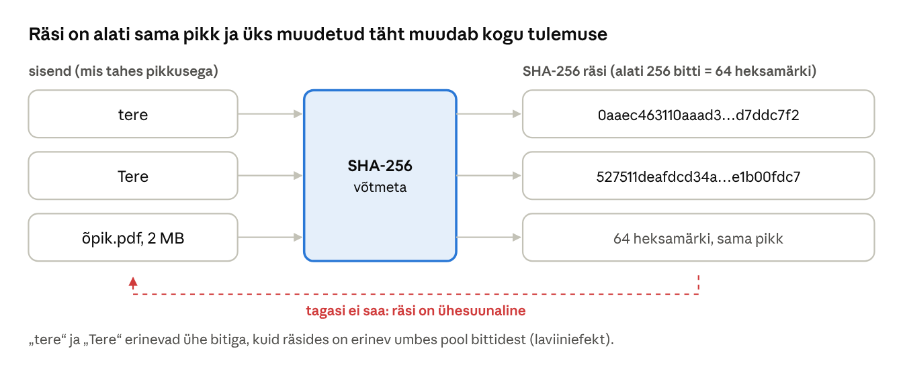
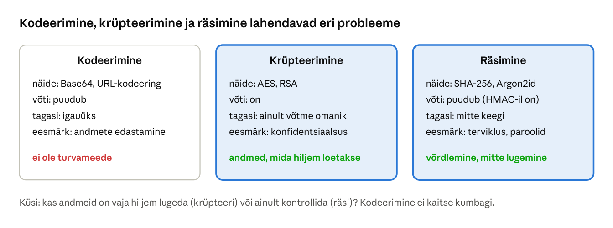
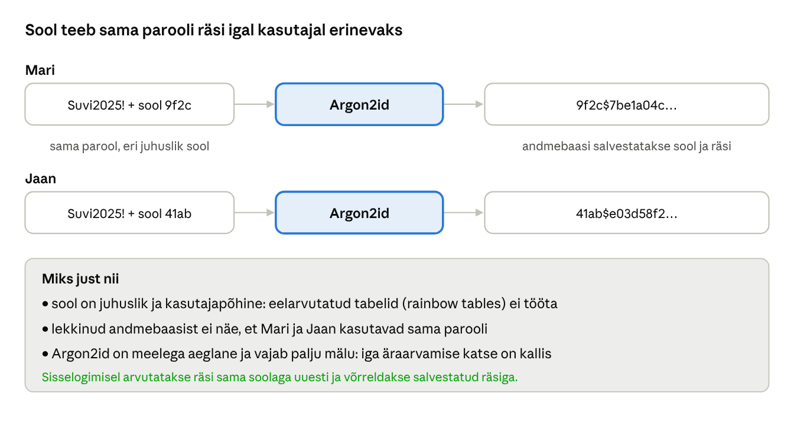
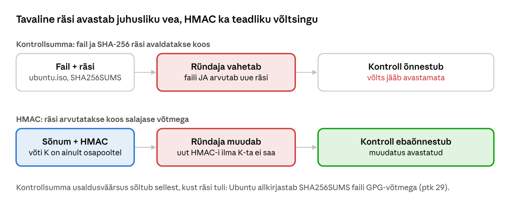

[← 26. UUS: Sümmeetriline krüpteerimine](26-summeetriline-kruptograafia.md) · [Sisukord](../README.md) · [28. UUS: Asümmeetriline krüptograafia ja Diffie–Hellmani võtmevahetus →](28-asummeetriline-kruptograafia.md)

## 27. UUS: Räsimine, sool ja paroolide hoidmine

**Räsifunktsioon** (hash function) arvutab mis tahes andmetest kindla pikkusega „sõrmejälje“. Erinevalt krüpteerimisest ei kasuta räsimine võtit ja räsist ei saa algandmeid tagasi. Räsisid kasutatakse failide tervikluse kontrollimiseks, paroolide hoidmiseks, digiallkirjades (ptk 29), Gitis, plokiahelates ja digitaalses kohtuekspertiisis.

**Pärast peatüki läbimist õppija:**

- nimetab krüptograafilise räsifunktsiooni omadused ja selgitab sünnipäevaparadoksi mõju räsi pikkusele;
- eristab turvalisi ja murtud räsialgoritme;
- selgitab, kuidas paroole rünnatakse ning miks neid hoitakse soolatud ja aeglase räsina;
- arvutab ligikaudu parooli murdmise aja;
- eristab kontrollsummat, HMAC-i ja digiallkirja.

### 27.1 Räsifunktsiooni omadused



Joonis: SHA-256 räsi on alati 256 bitti (64 heksamärki), olgu sisend üks sõna või mitme gigabaidine fail. Sisendi ühe biti muutmine muudab ligikaudu poolt räsi bittidest. Räsist sisendit tagasi arvutada ei saa.

Näide: sõna `tere` SHA-256 räsi algab `0aaec463110aaad3…` ja sõna `Tere` räsi `527511deafdcd34a…`. Erineb ainult üks bitt (väike ja suur T erinevad ASCII-s ühe biti võrra), kuid räsides pole midagi ühist.

Krüptograafiline räsifunktsioon peab olema:

1. **ühesuunaline** (preimage resistance) – räsi teades ei saa leida sisendit;
2. **teise sisendi suhtes kindel** (second preimage resistance) – antud faili jaoks ei saa leida teist faili sama räsiga;
3. **kokkupõrkekindel** (collision resistance) – ei saa leida ükskõik milliseid kahte erinevat sisendit sama räsiga;
4. **laviiniefektiga** – väike muutus sisendis muudab kogu räsi.

**Kas kokkupõrkeid on olemas?** Jah, alati: sisendeid on lõpmatult, räsisid ainult 2²⁵⁶. Kokkupõrkekindlus tähendab, et neid on praktiliselt võimatu **leida**.

**Sünnipäevaparadoks.** Mitu inimest peab ruumis olema, et kahel neist oleks 50% tõenäosusega sama sünnipäev? Vastus on ainult 23, sest võrreldakse kõiki paare omavahel, mitte igaühte ühe kindla kuupäevaga. Sama kehtib räsidele: n-bitise räsi kokkupõrke leidmiseks piisab umbes 2^(n/2) katsest, mitte 2ⁿ. Seetõttu pakub 256-bitine räsi kokkupõrgete vastu 128-bitist turvalisust ja 128-bitine MD5 ainult 64-bitist – ja tegelikud ründed MD5 vastu on veel palju kiiremad.

**Kuidas räsi arvutatakse?** SHA-256 jagab sisendi 512-bitisteks plokkideks ja töötleb neid järjest. Iga plokk segatakse 64 ringis eelmise vahetulemusega, kasutades bititehteid (XOR, nihked, pööramised) ja liitmist. Viimase ploki järel on vahetulemus räsi. SHA-3 kasutab teistsugust „käsna“-ehitust (Keccak), nii et kui SHA-2-s peaks kunagi leitama struktuurne viga, ei puuduta see SHA-3.

| Algoritm | Räsi pikkus | Seisund |
| --- | --- | --- |
| MD5 | 128 bitti | murtud: kokkupõrkeid leitakse sekunditega; Flame-pahavara võltsis 2012 sellega Windows Update’i sertifikaadi |
| SHA-1 | 160 bitti | murtud: Google ja CWI näitasid 2017 kahte erinevat sama räsiga PDF-i (SHAttered); Git liigub SHA-256 peale |
| SHA-256, SHA-512 (SHA-2) | 256 / 512 bitti | turvaline, enim kasutatud |
| SHA-3 | 224–512 bitti | turvaline, teistsugune sisemine ülesehitus (Keccak) |
| BLAKE2, BLAKE3 | muudetav | turvaline, väga kiire |

MD5-st ei loobuta seetõttu, et keegi oskaks MD5 räsist sisendi tagasi arvutada, vaid seetõttu, et saab luua **kaks erinevat faili sama räsiga**. Ründaja koostab süütu dokumendi ja pahatahtliku dokumendi sama räsiga, laseb süütu allkirjastada ja tõstab allkirja pahatahtlikule üle.

### 27.2 Räsimine ei ole krüpteerimine



Joonis: kolm sageli segi aetavat tehnikat. Kodeerimine on ainult teine esitusviis, krüpteerimine on võtmega pööratav ja räsimine on pöördumatu. Hea selgitus koos näidetega on artiklis [Difference between hashing, encryption and salting](https://thecyphere.com/blog/difference-hashing-encryption-salting/).

Kui keegi ütleb „dekrüpteerisin MD5-räsi“, tähendab see tegelikult, et ta **arvas sisendi ära**: arvutas hulga võimalike paroolide räsid ja leidis sobiva. Sellised „dekrüpteerimise“ veebilehed on suured eelarvutatud tabelid.

### 27.3 Paroolide hoidmine

Veebirakendus ega operatsioonisüsteem ei tohi paroole hoida avatekstina ega krüpteeritult. Krüpteeritud paroolide võti peab olema serveris, nii et andmebaasi ja serveri varastaja saab kõik paroolid kätte. Seepärast hoitakse ainult räsi. Sisselogimisel arvutatakse sisestatud parooli räsi ja võrreldakse seda salvestatuga.

#### Kuidas paroole murtakse

Ründaja, kes on varastanud räsid, ei saa neid otse pöörata. Ta arvab paroole ja arvutab iga arvatava räsi:

- **sõnastikurünne** – proovitakse lekkinud paroolide loendeid (nt *rockyou*, miljoneid päris paroole);
- **reeglid** – igale sõnale lisatakse tavalised muudatused: suur algustäht, aastaarv, `!`, `a` → `@` (`kevad` → `Kevad2026!`);
- **toore jõu rünne** – kõik kombinatsioonid kuni teatud pikkuseni;
- **eelarvutatud tabelid** (vikerkaaretabelid, rainbow tables) – räsid on juba ette arvutatud ja tuleb ainult otsida.

Tavaline kiire räsi (MD5, SHA-256, NT-räsi) on mõeldud kiireks. Hea graafikakaart arvutab neid sadu miljardeid sekundis. Meelega aeglane parooliräsi (bcrypt, Argon2id) laseb sama kaardiga proovida vaid tuhandeid kuni kümneid tuhandeid paroole sekundis.

**Arvutame.** Oletame, et ründaja kaardipark proovib kiiret räsi 10¹¹ korda sekundis ja aeglast 10⁴ korda sekundis.

| Parool | Võimalusi | Kiire räsi (10¹¹/s) | Aeglane räsi (10⁴/s) |
| --- | --- | --- | --- |
| 8 väiketähte | 26⁸ ≈ 2,1 × 10¹¹ | umbes 2 sekundit | umbes 8 kuud |
| 8 suvalist märki (95 võimalust) | 95⁸ ≈ 6,6 × 10¹⁵ | umbes 18 tundi | umbes 21 000 aastat |
| 4 juhuslikku sõna 7776-sõnalisest loendist | ≈ 3,7 × 10¹⁵ | umbes 10 tundi | umbes 11 000 aastat |
| 6 juhuslikku sõna | ≈ 2,2 × 10²³ | umbes 70 000 aastat | praktiliselt võimatu |

Tabel eeldab, et parool on **juhuslik**. Inimese valitud `Kevad2026!` leitakse sõnastiku ja reeglitega sekunditega, olgu räsi kui aeglane tahes. Seepärast soovitatakse pikki paroolifraase ja paroolihaldurit, mis genereerib juhuslikud paroolid.

#### Sool ja aeglane räsi



Joonis: **sool** (salt) on iga kasutaja jaoks juhuslikult valitud väärtus, mis lisatakse paroolile enne räsimist ja salvestatakse räsi kõrvale. Sool ei ole saladus, kuid see teeb eelarvutatud tabelid kasutuks ja peidab sama parooli kasutajad.

Ilma soolata on sama parooli räsi kõigil kasutajatel ühesugune. Ründaja arvutab iga arvatava parooli räsi üks kord ja võrdleb seda korraga miljoni kasutaja räsiga. Soolaga peab ta iga kasutaja jaoks eraldi arvutama – miljon korda rohkem tööd.

Parooliräsi funktsioon (Argon2id, scrypt, bcrypt, PBKDF2) on meelega aeglane ja seda saab seadistada:

- **iteratsioonide arv** – mitu korda räsi arvutatakse (PBKDF2, bcrypti cost);
- **mälukulu** – Argon2id ja scrypt nõuavad iga katse jaoks mälu (nt 19 MiB), mis teeb graafikakaardid ja eriotstarbelised kiibid ebatõhusaks;
- **paralleelsus** – mitu lõime kasutatakse.

Argon2id räsi salvestatakse koos kõigi parameetritega, näiteks `$argon2id$v=19$m=19456,t=2,p=1$<sool>$<räsi>`. Nii saab parameetreid hiljem tugevdada: uus parool räsitakse uute parameetritega ja vana kontrollitakse vanadega.

Lisameetmena kasutatakse vahel ka **pipart** (pepper) – salajane väärtus, mida hoitakse andmebaasist eraldi (nt riistvaralises võtmehoidlas). Siis ei piisa ründajale ainult andmebaasi varastamisest.

| Kus | Kuidas paroole hoitakse |
| --- | --- |
| Linux (`/etc/shadow`) | yescrypt (`$y$`) või SHA-512-crypt (`$6$`), igal kasutajal oma sool |
| Windows kohalik konto, AD | NT-räsi = MD4(parool UTF-16 kujul), **ilma soolata**; seetõttu on samade paroolidega kasutajatel sama räsi ja toimib pass-the-hash rünne (ptk 17–18). Credential Guard kaitseb räsisid VBS-iga |
| Veebirakendus (soovitus) | Argon2id; kui see pole saadaval, siis scrypt, bcrypt või PBKDF2 suure iteratsioonide arvuga ([OWASP](https://cheatsheetseries.owasp.org/cheatsheets/Password_Storage_Cheat_Sheet.html)) |

Linuxi `/etc/shadow` real `mari:$y$j9T$Fs0nZ…$Qh8…:20400:0:99999:7:::` tähendab `$y$` algoritmi yescrypt, `j9T` selle parameetreid, järgmine osa soola ja viimane räsi.

PHP-s tee seda nii: `password_hash($parool, PASSWORD_ARGON2ID)` ja kontrolli `password_verify($parool, $rasi)`. `password_needs_rehash()` ütleb, kas salvestatud räsi tuleks uute parameetritega uuendada. Ära kirjuta oma räsimisskeemi.

### 27.4 Terviklus: kontrollsumma ja HMAC



Joonis: kontrollsumma avastab allalaadimisvea, aga mitte ründajat, kes vahetab nii faili kui ka räsi.

**Kontrollsumma** (checksum) on tarkvara allalaadimislehel avaldatud räsi. Kui allalaaditud faili räsi klapib, ei rikutud faili teel juhuslikult. Kui aga ründaja on üle võtnud allalaadimisserveri, vahetab ta nii faili kui ka lehel avaldatud räsi. Seetõttu avaldavad tootjad räside faili koos **digiallkirjaga** (nt Ubuntu `SHA256SUMS` ja `SHA256SUMS.gpg`) või allkirjastavad tarkvara ise (Authenticode, ptk 29).

**HMAC** (hash-based message authentication code) arvutab räsi koos salajase võtmega. Ilma võtmeta ei saa keegi kehtivat HMAC-i luua. HMAC on defineeritud nii:

```math
\mathrm{HMAC}(K, m) = H\big((K \oplus \mathrm{opad}) \,\|\, H((K \oplus \mathrm{ipad}) \,\|\, m)\big)
```

kus H on räsifunktsioon (nt SHA-256), ‖ tähendab järjestikku kirjutamist ning ipad ja opad on kaks fikseeritud konstanti. Miks nii keeruliselt, miks mitte lihtsalt H(võti ‖ sõnum)? SHA-256 ja teised samal põhimõttel ehitatud räsid on haavatavad **pikendusrünnakule** (length extension): räsi H(võti ‖ sõnum) teades saab ründaja arvutada kehtiva räsi sõnumile, mille lõppu on midagi lisatud, ilma võtit teadmata. Nii võltsiti 2009. aastal Flickri API päringuid. HMAC-i kahekordne räsimine välistab selle.

HMAC-i kasutavad TLS, IPsec, JWT-tokenid (HS256), API-päringute allkirjad (nt pilveteenuste REST API-d), Kerberos ja ühekordsed paroolid (TOTP-kood autentimisrakenduses on HMAC kellaajast).

| Meetod | Avastab juhusliku vea | Avastab võltsingu | Kes saab kontrollida |
| --- | --- | --- | --- |
| Kontrollsumma (räsi) | jah | ei | igaüks |
| HMAC | jah | jah | ainult võtme omanikud |
| Digiallkiri (ptk 29) | jah | jah | igaüks avaliku võtmega; saatja ei saa salata |

### 27.5 Muud räside kasutusalad

- **Git** tuvastab iga faili, kausta ja sissekande (commit) tema sisu räsi järgi. Kui keegi muudab ajaloos üht faili, muutuvad kõigi hilisemate sissekannete räsid.
- **Plokiahel** seob iga ploki eelmise ploki räsiga. Vana ploki muutmine nõuaks kõigi järgnevate ümberarvutamist.
- **Digitaalne kohtuekspertiis** – ketta tõmmisfailist arvutatakse räsi kohe pärast kopeerimist. Kohtus saab tõestada, et analüüsitud tõmmis on originaaliga identne.
- **Pahavara tuvastamine** – viirusetõrje ja ohuteabe andmebaasid (nt VirusTotal) tuvastavad tuntud pahavarafaile räsi järgi. Selle nõrkus: ühe baidi muutmine annab uue räsi.
- **Deduplitseerimine** – varundus- ja pilvesalvestus hoiab sama räsiga faile ainult ühe korra.

### Näide: lekkinud paroolide andmebaas

Veebipoe andmebaas lekib. Kui paroolid on salvestatud soolamata MD5-räsina, leiab ründaja populaarsete paroolide räsid valmis tabelitest ja enamiku ülejäänutest mõne tunniga. Kuna inimesed kasutavad sama parooli mitmes kohas, proovib ta neid kohe e-posti ja pangateenustes (volituste täitmine, ptk 24.5). Kui paroolid oleksid Argon2id-räsid soolaga, peaks ründaja iga kasutaja paroole eraldi ja aeglaselt arvama ning tugev parool jääks avastamata.

Mida peab veebipood tegema? Teavitama Andmekaitse Inspektsiooni 72 tunni jooksul ja kasutajaid (ptk 31), sundima kõiki kasutajaid parooli vahetama ja vahetama räsimisalgoritmi. Kasutaja poolt aitavad paroolihaldur, unikaalsed paroolid ja MFA. Kas sinu e-post on lekkes olnud, saab kontrollida teenusest [Have I Been Pwned](https://haveibeenpwned.com/). Sama teenus pakub ka lekkinud paroolide API-t, mida veebirakendus saab registreerimisel kasutada: parooli SHA-1 räsist saadetakse ainult 5 esimest märki ja võrdlus tehakse kohapeal, nii et parool ise lehelt ei lahku.

### Kokkuvõte

- Räsi on ühesuunaline, fikseeritud pikkusega ja laviiniefektiga. Sünnipäevaparadoksi tõttu annab n-bitine räsi kokkupõrgete vastu n/2 bitti turvalisust.
- MD5 ja SHA-1 on murtud, kasuta SHA-2 või SHA-3.
- Paroole hoitakse soolatud, meelega aeglase räsina (Argon2id, scrypt, bcrypt, PBKDF2). Inimese valitud lihtne parool leitakse siiski sõnastikuga.
- Kontrollsumma avastab vea, HMAC ka võltsingu. Võtmeta kontrolliks on vaja digiallkirja.
- Windowsi NT-räsi on soolamata, seetõttu tuleb kaitsta räsisid endid (Credential Guard, LAPS, vähimad õigused).

### Kontrollküsimused

1. Nimeta krüptograafilise räsifunktsiooni neli omadust.
2. Miks on kokkupõrked alati olemas, kuid räsi võib ikkagi olla kokkupõrkekindel?
3. Selgita sünnipäevaparadoksi. Mitu bitti turvalisust annab SHA-256 kokkupõrgete vastu?
4. Miks on MD5 ja SHA-1 kasutamine digiallkirjades ohtlik?
5. Mis vahe on räsimisel ja krüpteerimisel? Miks ei hoita paroole krüpteeritult?
6. Kirjelda nelja viisi, kuidas ründaja varastatud räsidest paroole leiab.
7. Mida teeb sool ja miks ei pea see olema salajane?
8. Miks on parooliräsi funktsioon meelega aeglane? Milleks nõuab Argon2id mälu?
9. Kui kaua kulub tabeli eelduste järgi 10 väiketähest koosneva juhusliku parooli leidmiseks kiire räsi korral?
10. Miks ei piisa allalaaditud faili kontrollimiseks samalt lehelt võetud räsist?
11. Mis on pikendusrünne ja miks ei kasutata HMAC-i asemel H(võti ‖ sõnum)?
12. Mis vahe on HMAC-il ja digiallkirjal?

### Valikküsimused

1. Mis on räsifunktsiooni peamine omadus? a) räsist saab võtmega avateksti tagasi b) räsist ei saa sisendit tagasi arvutada ja väike muutus sisendis muudab kogu räsi c) räsi on alati sisendist pikem d) räsi sõltub kellaajast
2. Milleks lisatakse paroolile sool? a) parool muutub lühemaks b) räsi on kiirem arvutada c) parooli saab hiljem dekrüpteerida d) sama parool annab eri kasutajatel erineva räsi ja eelarvutatud tabelid ei tööta
3. Milline algoritm sobib paroolide hoidmiseks? a) Argon2id b) MD5 c) SHA-1 d) Base64
4. Mis vahe on HMAC-il ja tavalisel räsil? a) HMAC on lühem b) HMAC on pööratav c) HMAC kasutab salajast võtit, seega ei saa ründaja seda ise uuesti arvutada d) HMAC ei kasuta räsifunktsiooni

### Praktiline ülesanne

**Räsid ja paroolid WSL-is.** Ava WSL Ubuntu: `sudo apt install -y whois john openssl`.

1. Laviiniefekt ja fikseeritud pikkus:

```bash
echo -n 'tere' | sha256sum
echo -n 'Tere' | sha256sum
echo -n 'tere' | md5sum
sha256sum /usr/bin/ls
```

Windowsis sama: `Get-FileHash -Algorithm SHA256 C:\Windows\notepad.exe`.

2. Sool Linuxi paroolides:

```bash
mkpasswd -m sha-512 'Suvi2025!'     # käivita kaks korda: tulemused erinevad
mkpasswd -m yescrypt 'Suvi2025!'
sudo grep "^$USER:" /etc/shadow     # sinu enda parooli räsi ja algoritm
```

3. Nõrkade paroolide murdmine **oma** räsidest (John the Ripper):

```bash
for p in kevad2024 Parool123 qwerty 'K8#vL2!pX9z@'; do mkpasswd -m sha-512 "$p"; done | nl -s: -w1 > rasid.txt
john --format=sha512crypt --wordlist=/usr/share/john/password.lst rasid.txt
john --show --format=sha512crypt rasid.txt
```

4. HMAC:

```bash
echo 'Ylekanne 100 EUR' > s.txt
openssl dgst -sha256 -hmac 'salajane-voti' s.txt
openssl dgst -sha256 -hmac 'vale-voti' s.txt
```

5. Kiire ja aeglane räsi. Salvesta fail `kiirus.py` ja käivita `python3 kiirus.py`:

```python
import hashlib, os, time
parool, sool = b"Kevad2026!", os.urandom(16)

t = time.perf_counter()
for _ in range(100_000):
    hashlib.sha256(sool + parool).digest()
kiire = (time.perf_counter() - t) / 100_000

t = time.perf_counter()
for _ in range(5):
    hashlib.scrypt(parool, salt=sool, n=2**15, r=8, p=1, maxmem=64 * 1024 * 1024)
aeglane = (time.perf_counter() - t) / 5

print(f"SHA-256: {1 / kiire:,.0f} katset sekundis")
print(f"scrypt:  {1 / aeglane:,.1f} katset sekundis")
print(f"scrypt on {aeglane / kiire:,.0f} korda aeglasem")
```

Vasta: mitu bitti erines „tere“ ja „Tere“ räsis ligikaudu? Miks andis `mkpasswd` iga kord uue tulemuse? Millised paroolid John leidis ja miks viimast mitte? Mida näitab HMAC-i muutumine vale võtmega? Mitu korda aeglasem oli scrypt sinu arvutis ja kui kaua kuluks sellega 8-tähese väiketähti sisaldava parooli kõigi variantide läbimiseks ühe protsessorituumaga?

### Iseseisvad ülesanded

**1. Kontrolli Ubuntu tõmmisfaili.** Laadi alla Ubuntu ISO-tõmmise räsifail `SHA256SUMS` ja selle allkiri `SHA256SUMS.gpg`. Kontrolli allkirja (`gpg --verify`) ja tõmmisfaili räsi (`sha256sum -c SHA256SUMS --ignore-missing`). **Esita:** käsud, väljund ja selgitus, mida kontrollib räsi ja mida allkiri ning miks on vaja mõlemat.

**2. Paroolipoliitika.** Kirjuta oma kooli või ettevõtte jaoks paroolipoliitika, mis järgib NIST SP 800-63B soovitusi: minimaalne pikkus, lekkinud paroolide kontroll, MFA, paroolihaldur, sunniviisilise perioodilise vahetamise puudumine. **Esita:** poliitika (kuni 1 lk) ja lühike selgitus, miks keerukusreeglid (nt „1 suurtäht ja 1 number“) aitavad vähem kui pikkus.

### Viited

- The Cyphere. [Differences between hashing and encryption and salting explained with examples](https://thecyphere.com/blog/difference-hashing-encryption-salting/).
- OWASP. [Password Storage Cheat Sheet](https://cheatsheetseries.owasp.org/cheatsheets/Password_Storage_Cheat_Sheet.html).
- NIST. [SP 800-63B: Digital Identity Guidelines – Authentication](https://pages.nist.gov/800-63-4/sp800-63b.html).
- NIST. [FIPS 180-4: Secure Hash Standard](https://csrc.nist.gov/pubs/fips/180-4/upd1/final); [FIPS 202: SHA-3](https://csrc.nist.gov/pubs/fips/202/final).
- Stevens, M. jt (2017). [The first collision for full SHA-1](https://shattered.io/).
- IETF. [RFC 2104: HMAC](https://www.rfc-editor.org/rfc/rfc2104) (1997).
- IETF. [RFC 9106: Argon2](https://www.rfc-editor.org/rfc/rfc9106) (2021).

> 📝 **Test:** selle peatüki Google Formsi test luuakse skriptiga [`google-forms/looVormid.gs`](../google-forms/looVormid.gs).

---

[← 26. UUS: Sümmeetriline krüpteerimine](26-summeetriline-kruptograafia.md) · [Sisukord](../README.md) · [28. UUS: Asümmeetriline krüptograafia ja Diffie–Hellmani võtmevahetus →](28-asummeetriline-kruptograafia.md)
