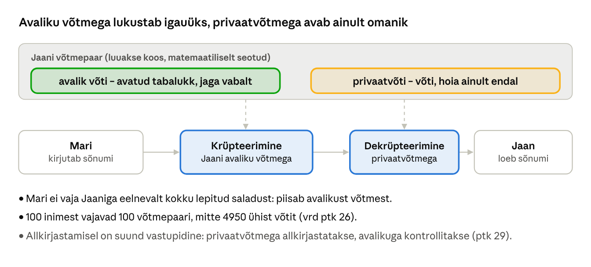
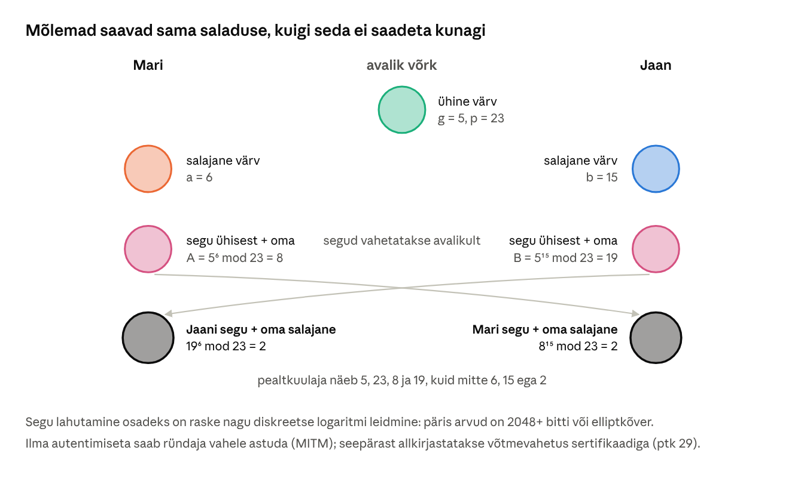
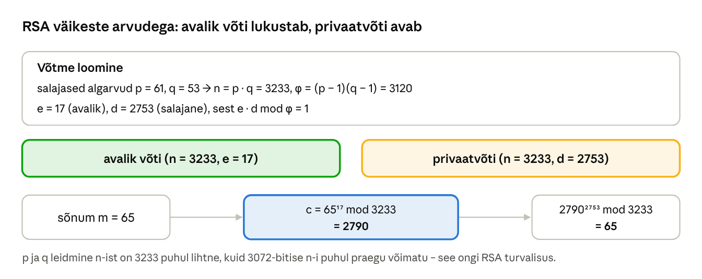
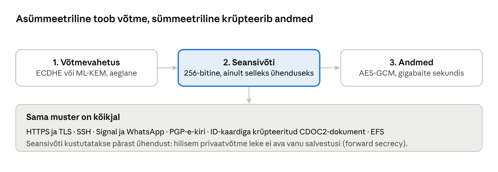

[← 27. UUS: Räsimine, sool ja paroolide hoidmine](27-rasimine-ja-paroolid.md) · [Sisukord](../README.md) · [29. UUS: Digiallkiri, sertifikaadid, PKI ja TLS →](29-digiallkiri-pki-tls.md)

## 28. UUS: Asümmeetriline krüptograafia ja Diffie–Hellmani võtmevahetus

Asümmeetrilises ehk **avaliku võtme krüptograafias** on igal osapoolel **võtmepaar**: avalik võti, mida võib kõigile jagada, ja privaatvõti, mida teab ainult omanik. See lahendab sümmeetrilise krüptograafia võtmejagamise probleemi (ptk 26.1) ja võimaldab digiallkirju (ptk 29). Kui kogu 1970. aastate eelne krüptograafia eeldas, et osapooled on kunagi kohtunud ja võtme kokku leppinud, siis avaliku võtme krüptograafia tegi võimalikuks turvalise suhtluse täiesti võõraste vahel – ilma selleta poleks e-poodi, internetipanka ega e-riiki.

**Pärast peatüki läbimist õppija:**

- selgitab, millist võtit kasutatakse krüpteerimisel, dekrüpteerimisel, allkirjastamisel ja kontrollimisel;
- arvutab moodularitmeetikas lihtsaid tehteid ning teeb Diffie–Hellmani võtmevahetuse ja RSA väikeste arvudega läbi;
- selgitab, miks Diffie–Hellman vajab autentimist ja mida tähendab edasine salastatus;
- võrdleb RSA-d ja elliptkõverkrüptograafiat ning valib sobiva võtmepikkuse;
- kasutab OpenSSL-i, SSH-d ja GPG-d võtmepaaride loomiseks ja kasutamiseks.

### 28.1 Võtmepaar



Joonis: Mari krüpteerib sõnumi Jaani avaliku võtmega. Avada saab selle ainult Jaani privaatvõti. Avalikku võtit võib avaldada veebilehel või e-kirja allkirjas, sest sellest ei saa privaatvõtit tuletada.

Võrdlus: avalik võti on nagu lahtine tabalukk, mida Jaan jagab kõigile. Igaüks saab sellega kasti lukku panna, kuid avada saab ainult Jaan oma võtmega. Digiallkirja puhul on rollid vastupidi: allkirja teeb privaatvõti ja kontrollida saab igaüks avaliku võtmega.

| Toiming | Kelle võti | Milline võti |
| --- | --- | --- |
| Krüpteerin sõnumi Jaanile | Jaani | avalik |
| Jaan dekrüpteerib | Jaani | privaat |
| Allkirjastan dokumendi | minu | privaat |
| Teised kontrollivad mu allkirja | minu | avalik |

#### Lõksuuksefunktsioonid ja moodularitmeetika

Asümmeetrilised algoritmid tuginevad matemaatilistele **lõksuuksefunktsioonidele** (trapdoor function): ühes suunas on arvutamine lihtne, vastupidi aga praktiliselt võimatu, kui ei tea salajast lisateavet. Näide: 61 × 53 = 3233 arvutad peast või paberil kiiresti. Aga millised kaks algarvu annavad korrutiseks 3233? Selleks pead proovima jagajaid. 600-kohalise arvu puhul ei aita ka kõik maailma arvutid.

Asümmeetriline krüptograafia arvutab **moodularitmeetikas** ehk „kellaaritmeetikas“: tulemusest jäetakse alles ainult jagamisjääk. Kell 10 + 5 tundi = 3, sest 15 mod 12 = 3. Samamoodi 5⁶ = 15 625 ja 15 625 mod 23 = 8. Astendamine moodulis on arvutile kiire ka tuhandebitiste arvudega. Vastupidine ülesanne – teades, et 5ˣ mod 23 = 8, leida x – on **diskreetne logaritm**. Väikeste arvudega saab proovida kõik x-id läbi, kuid 3072-bitise mooduli puhul on see praktiliselt võimatu.

| Algoritm | Raske ülesanne | Kasutus |
| --- | --- | --- |
| RSA | suure arvu tegurdamine algarvudeks | krüpteerimine, allkiri, vanemad sertifikaadid |
| Diffie–Hellman (DH) | diskreetne logaritm | võtmevahetus |
| ECC: ECDH, ECDSA, X25519, Ed25519 | diskreetne logaritm elliptkõveral | võtmevahetus, allkiri; ID-kaart, TLS, SSH |
| ML-KEM, ML-DSA | võreprobleemid (lattice) | postkvantkrüptograafia (ptk 30) |

### 28.2 Diffie–Hellmani võtmevahetus

Whitfield Diffie ja Martin Hellman avaldasid 1976. aastal meetodi, mille abil kaks osapoolt saavad avalikus võrgus kokku leppida ühises saladuses, ilma et see saladus kunagi võrgus liiguks ([Wikipedia: Diffie–Hellmani võtmevahetus](https://et.wikipedia.org/wiki/Diffie-Hellmani_v%C3%B5tmevahetus)).



Joonis: värvide segamise analüüs ja sama arvutus väikeste arvudega. Mõlemad segavad avaliku ühise värvi oma salajase värviga ja vahetavad segud. Seejärel lisab kumbki saadud segule oma salajase värvi. Tulemus on mõlemal sama, sest segamise järjekord ei loe. Pealtkuulaja näeb ainult segusid ja ühist värvi ning ei suuda neist salajasi värve eraldada.

Arvutame samm-sammult. Avalikud parameetrid on algarv p = 23 ja alus g = 5.

| Samm | Mari | Avalik võrk | Jaan |
| --- | --- | --- | --- |
| 1. Salajane arv | a = 6 | – | b = 15 |
| 2. Avalik väärtus | A = 5⁶ mod 23 = 8 | A = 8 ja B = 19 liiguvad võrgus | B = 5¹⁵ mod 23 = 19 |
| 3. Ühine saladus | s = Bᵃ mod 23 = 19⁶ mod 23 = 2 | – | s = Aᵇ mod 23 = 8¹⁵ mod 23 = 2 |

Mõlemad said 2, sest (gᵃ)ᵇ = (gᵇ)ᵃ = gᵃᵇ mod p. Pealtkuulaja teab p, g, A ja B. Saladuse arvutamiseks peaks ta leidma a või b, ehk lahendama diskreetse logaritmi. Siin piisab 22 katsest, päris DH-s on p vähemalt 2048-bitine ja elliptkõveral (X25519) 255-bitine.

Kaks olulist täpsustust:

- **Diffie–Hellman üksi ei autendi.** Kui Mari ei tea, et sai väärtuse B just Jaanilt, võib ründaja Eve teha mõlemaga eraldi võtmevahetuse: Mariga saladuse s₁ ja Jaaniga saladuse s₂. Seejärel dekrüpteerib ta iga Mari sõnumi, loeb seda ja krüpteerib uuesti Jaanile (MITM, ptk 24.7). Seepärast allkirjastab TLS-server oma võtmevahetuse sertifikaadiga ja SSH-klient kontrollib serveri võtme sõrmejälge.
- **Ajutised võtmed (ephemeral DH, ECDHE)** luuakse iga ühenduse jaoks uuesti ja kustutatakse pärast seda. See annab **edasise salastatuse** (forward secrecy): kui serveri privaatvõti hiljem lekib, ei saa varem salvestatud liiklust dekrüpteerida, sest seansivõtmeid pole enam kusagil. Vanemas TLS-is, kus seansivõti krüpteeriti otse serveri RSA-võtmega, võis aastaid salvestatud liiklust hiljem lugeda. TLS 1.3 kasutab ainult ajutisi võtmevahetusi.

### 28.3 RSA

**RSA** (Rivest, Shamir, Adleman, 1977) on esimene praktiline avaliku võtme algoritm, millega saab nii krüpteerida kui ka allkirjastada.



Joonis: RSA põhimõte nii väikeste arvudega, et neid saab kalkulaatoriga kontrollida.

**Võtme loomine** käib nii:

1. Vali kaks suurt juhuslikku algarvu p ja q. Näites p = 61 ja q = 53.
2. Arvuta moodul n = p × q = 3233. See on avalik.
3. Arvuta φ(n) = (p − 1)(q − 1) = 60 × 52 = 3120. See on salajane, sest selle arvutamiseks on vaja p-d ja q-d.
4. Vali avalik eksponent e, millel pole φ-ga ühiseid tegureid. Näites e = 17, päris RSA-s peaaegu alati 65 537.
5. Leia privaatne eksponent d, mille korral e × d mod φ = 1. Näites d = 2753, sest 17 × 2753 = 46 801 = 15 × 3120 + 1. Selle leiab laiendatud Eukleidese algoritmiga (Pythonis `pow(17, -1, 3120)`).

Avalik võti on (n = 3233, e = 17), privaatvõti (n = 3233, d = 2753).

**Krüpteerimine:** c = mᵉ mod n. Sõnum m = 65 annab c = 65¹⁷ mod 3233 = 2790.

**Dekrüpteerimine:** m = cᵈ mod n = 2790²⁷⁵³ mod 3233 = 65.

**Allkirjastamine** käib vastupidi: s = mᵈ mod n = 65²⁷⁵³ mod 3233 = 588. Igaüks saab kontrollida avaliku võtmega: 588¹⁷ mod 3233 = 65. Kuna d-d teab ainult omanik, saab ainult tema luua sellise s, mis avaliku võtmega tagasi m-ks muutub.

**Miks see turvaline on?** Kes teab p-d ja q-d, saab arvutada φ ja sellest d. Ründaja teab ainult n-i ja peab selle teguriteks lahutama. 3233 puhul on see lihtne, kuid 2048-bitine n on 617 kümnendkohta pikk. Suurim avalikult tegurdatud RSA-arv on 829-bitine RSA-250 (2020), mille jaoks kulus umbes 2700 protsessoriaastat. 2048-bitise arvu tegurdamine on klassikaliste arvutitega miljardeid kordi raskem. Päris RSA-s on n vähemalt 2048, soovitatavalt 3072 bitti.

Päris RSA-s ei krüpteerita kunagi sõnumit otse („textbook RSA“). Ilma täidiseta annab sama sõnum alati sama šifriteksti, nii et ründaja saab võimalikke sõnumeid (nt „jah“ ja „ei“) ise avaliku võtmega krüpteerida ja võrrelda. Seepärast lisatakse enne juhuslik täidis: **OAEP** krüpteerimisel ja **PSS** allkirjal. Vana täidis PKCS#1 v1.5 on haavatav oraaklirünnakutele (Bleichenbacheri rünne 1998, ROBOT 2017).

### 28.4 Elliptkõverad ja võtmepikkused

**Elliptkõverkrüptograafia** (ECC) kasutab arvude asemel elliptkõvera punkte, näiteks kõverat y² = x³ + 486662x² + x (Curve25519, millel põhinevad X25519 ja Ed25519). Kõvera punkte saab omavahel „liita“ kindla geomeetrilise reegli järgi. Kui võtta avalik alguspunkt G ja liita see iseendaga k korda, saame punkti K = k · G.

- Privaatvõti on juhuslik arv k (umbes 2²⁵² võimalust).
- Avalik võti on punkt K. Selle arvutamiseks kulub kahekordistamise nipiga vaid paarsada sammu.
- Vastupidi – K-d ja G-d teades leida k – on **elliptkõvera diskreetne logaritm**, mille jaoks ei ole teada ühtki kiiret meetodit.

Kuna parim rünne ECC vastu on palju aeglasem kui parim tegurdamismeetod RSA vastu, piisab sama turvalisuse jaoks palju lühemast võtmest. 256-bitine ECC-võti on sama tugev kui 3072-bitine RSA-võti. Lühem võti tähendab kiiremat arvutust, väiksemaid sertifikaate ja väiksemat energiakulu – seetõttu sobib ECC kiipkaartidele ja telefonidele.

Eesti ID-kaart kasutab alates 2018. aastast elliptkõvervõtmeid (P-384), sest varasemate kaartide RSA-võtmete genereerimises leiti 2017. aastal viga (ROCA), mille tõttu sai avalikust võtmest privaatvõtme arvutada. Kiibi võtmegeneraator valis algarve liiga kitsast ja ennustatavast hulgast. Ligi 750 000 kaarti tuli uuendada kaugteel.

| Turvatase | Sümmeetriline | RSA, DH | ECC |
| --- | --- | --- | --- |
| 112 bitti (kuni 2030) | 3DES | 2048 bitti | 224 bitti |
| 128 bitti | AES-128 | 3072 bitti | 256 bitti (P-256, X25519) |
| 192 bitti | AES-192 | 7680 bitti | 384 bitti (P-384) |
| 256 bitti | AES-256 | 15 360 bitti | 521 bitti (P-521) |

Allikas: [NIST SP 800-57](https://csrc.nist.gov/pubs/sp/800/57/pt1/r5/final). RSA ja ECC on mõlemad kvantarvutite suhtes haavatavad (ptk 30).

### 28.5 Hübriidkrüpteerimine



Joonis: asümmeetriline krüptograafia on sadu kuni tuhandeid kordi aeglasem kui AES, seetõttu ei krüpteerita sellega andmeid. Sellega vahetatakse või krüpteeritakse ainult juhuslik sümmeetriline seansivõti ja andmed krüpteeritakse AES-iga.

Lisaks kiirusele on teinegi põhjus: RSA-ga saab ühe korraga krüpteerida vähem andmeid, kui on mooduli pikkus (3072-bitise võtmega ja OAEP-täidisega umbes 300 baiti). Kui Mari saadab Jaanile 10 MB faili, juhtub see nii:

1. Mari programm loob juhusliku 256-bitise AES-võtme.
2. Fail krüpteeritakse AES-GCM-iga selle võtmega.
3. AES-võti (32 baiti) krüpteeritakse Jaani avaliku võtmega.
4. Jaanile saadetakse krüpteeritud fail ja krüpteeritud võti.
5. Jaan dekrüpteerib oma privaatvõtmega AES-võtme ja sellega faili.

Kui fail on vaja saata kolmele inimesele, krüpteeritakse sama AES-võti kolm korda – iga saaja avaliku võtmega – ja fail ise ainult üks kord. Nii töötavad GPG, S/MIME-e-kiri, Eesti DigiDoc-i krüpteeritud konteiner (CDOC) ja EFS. TLS-is ja SSH-s saadakse seansivõti võtme krüpteerimise asemel Diffie–Hellmani võtmevahetusest.

### 28.6 Asümmeetriline krüptograafia igapäevas

| Kus | Mida tehakse | Algoritm |
| --- | --- | --- |
| HTTPS (TLS 1.3) | võtmevahetus, serveri allkiri | X25519 / ML-KEM, ECDSA või RSA |
| SSH | võtmevahetus, serveri ja kasutaja autentimine | X25519 / ML-KEM, Ed25519 |
| ID-kaart, Smart-ID | autentimine, digiallkiri | ECDSA P-384 |
| WhatsApp, Signal | otsast-otsani krüpteerimine | X25519 + ML-KEM |
| Windows Hello, pääsuvõti (passkey) | sisselogimine ilma paroolita: seade allkirjastab serveri väljakutse | ECDSA P-256 |
| Windows Update, draiverid | tarkvara allkiri (Authenticode) | RSA |

### Näide: SSH-võtmega serverisse

Administraator logib Linuxi serverisse ilma paroolita. Ta loob oma arvutis võtmepaari `ssh-keygen -t ed25519` ja kopeerib avaliku võtme serveri faili `~/.ssh/authorized_keys`. Ühendusel juhtub kolm asümmeetrilist asja:

1. **ECDH või ML-KEM võtmevahetus** loob seansivõtme (Ubuntu 26.04 vaikimisi hübriid `mlkem768x25519-sha256`);
2. **server allkirjastab** võtmevahetuse oma hostivõtmega ja klient võrdleb serveri võtme sõrmejälge failiga `known_hosts` – see takistab MITM-i;
3. **klient tõestab** oma privaatvõtmega allkirja abil, et ta on administraator. Privaatvõti ei lahku kunagi tema arvutist.

Pärast seda krüpteeritakse kogu liiklus sümmeetriliselt (AES-GCM või ChaCha20-Poly1305). Paroolitõestuse võib serveris seejärel välja lülitada (`PasswordAuthentication no` failis `/etc/ssh/sshd_config`), mis peatab paroolide äraarvamise ründed.

Kui klient ühendub serveriga esimest korda, näitab ta hoiatust `The authenticity of host ... can't be established` ja serveri võtme sõrmejälge. Seda tuleb võrrelda administraatorilt teise kanali kaudu saadud sõrmejäljega. Kui hiljem tuleb hoiatus `REMOTE HOST IDENTIFICATION HAS CHANGED`, on kas server uuesti paigaldatud või on ühenduse vahel ründaja – ühendust ei tohi enne selgitamist jätkata.

### Kokkuvõte

- Avaliku võtmega krüpteeritakse ja kontrollitakse allkirja, privaatvõtmega dekrüpteeritakse ja allkirjastatakse.
- Asümmeetriline krüptograafia põhineb lõksuuksefunktsioonidel: astendamine moodulis on lihtne, tegurdamine ja diskreetne logaritm rasked.
- Diffie–Hellman loob avalikus võrgus ühise saladuse, kuid vajab autentimist MITM-i vastu. Ajutised võtmed annavad edasise salastatuse.
- RSA turvalisus põhineb tegurdamise raskusel ja vajab täidist (OAEP, PSS). ECC võtmed on sama turvalisuse juures palju lühemad.
- Praktikas on krüpteerimine hübriidne: asümmeetriline seansivõti, sümmeetrilised andmed.

### Kontrollküsimused

1. Millise võtmega krüpteerid sõnumi sõbrale ja millisega sõber selle avab? Millise võtmega allkirjastad?
2. Mis on lõksuuksefunktsioon? Too näide.
3. Arvuta 3⁴ mod 7 ja 2¹⁰ mod 11.
4. Tee Diffie–Hellmani võtmevahetus läbi parameetritega p = 23, g = 5, a = 4, b = 9. Mis on ühine saladus?
5. Kirjelda samm-sammult, kuidas ründaja Diffie–Hellmani ilma autentimiseta vahendab.
6. Mida tähendab edasine salastatus ja miks on see oluline?
7. Millele põhineb RSA turvalisus? Miks on φ(n) salajane?
8. Miks ei krüpteerita RSA-ga sõnumeid otse ilma täidiseta?
9. Miks piisab ECC-s palju lühemast võtmest kui RSA-s?
10. Mis oli ROCA viga ja kuidas see Eestit puudutas?
11. Kirjelda, kuidas krüpteeritakse hübriidselt fail kolmele saajale.
12. Mida tuleb teha, kui SSH-klient näitab hoiatust REMOTE HOST IDENTIFICATION HAS CHANGED?

### Valikküsimused

1. Millise võtmega krüpteeritakse sõnum, mida ainult Jaan peab lugema saama? a) Jaani avaliku võtmega b) Jaani privaatvõtmega c) saatja privaatvõtmega d) ühise AES-võtmega, mis saadetakse e-postiga
2. Mis on Diffie–Hellmani võtmevahetuse tulemus? a) mõlemad saavad teineteise privaatvõtme b) avalik võti krüpteeritakse c) mõlemad arvutavad sama jagatud saladuse, ilma et see võrgus liiguks d) parool salvestatakse serverisse
3. Millele põhineb RSA turvalisus? a) räsi kokkupõrgetele b) XOR-tehtele c) elliptkõveratele d) suurte arvude tegurdamise raskusele
4. Miks kasutatakse praktikas hübriidkrüpteerimist? a) asümmeetriline krüptograafia on kiirem b) asümmeetriline on aeglane, seepärast vahetatakse sellega ainult sümmeetriline seansivõti c) sümmeetriline ei vaja võtit d) see on seadusega kohustuslik

### Praktiline ülesanne

**Võtmepaarid WSL-is.** Ava WSL Ubuntu: `sudo apt install -y openssl openssh-client gnupg python3`.

1. Diffie–Hellman väikeste arvudega Pythonis (kontrolli joonise arvutust ja proovi oma arvudega):

```python
p, g = 23, 5
a, b = 6, 15                       # salajased
A, B = pow(g, a, p), pow(g, b, p)  # avalikud
print("A =", A, "B =", B)
print("Mari:", pow(B, a, p), "Jaan:", pow(A, b, p))
```

2. Päris X25519 võtmevahetus OpenSSL-iga:

```bash
openssl genpkey -algorithm X25519 -out mari.key && openssl pkey -in mari.key -pubout -out mari.pub
openssl genpkey -algorithm X25519 -out jaan.key && openssl pkey -in jaan.key -pubout -out jaan.pub
openssl pkeyutl -derive -inkey mari.key -peerkey jaan.pub | xxd -p
openssl pkeyutl -derive -inkey jaan.key -peerkey mari.pub | xxd -p   # sama tulemus!
```

3. RSA krüpteerimine ja dekrüpteerimine:

```bash
openssl genpkey -algorithm RSA -pkeyopt rsa_keygen_bits:3072 -out rsa.key
openssl pkey -in rsa.key -pubout -out rsa.pub
echo 'Salajane kohtumine kell 15' > s.txt
openssl pkeyutl -encrypt -pubin -inkey rsa.pub -pkeyopt rsa_padding_mode:oaep -in s.txt -out s.enc
openssl pkeyutl -decrypt -inkey rsa.key -pkeyopt rsa_padding_mode:oaep -in s.enc
ls -l rsa.pub mari.pub            # võrdle võtmete suurust
```

4. SSH-võti: `ssh-keygen -t ed25519 -C "oma.nimi@kool.ee"` ja vaata `cat ~/.ssh/id_ed25519.pub`.

5) Allkiri ja selle kontroll Ed25519-ga:

```bash
openssl genpkey -algorithm ED25519 -out allk.key
openssl pkey -in allk.key -pubout -out allk.pub
echo 'Kinnitan hinded. Mari Maasikas' > otsus.txt
openssl pkeyutl -sign -inkey allk.key -rawin -in otsus.txt -out otsus.sig
openssl pkeyutl -verify -pubin -inkey allk.pub -rawin -in otsus.txt -sigfile otsus.sig
sed -i 's/Kinnitan/Muudan/' otsus.txt
openssl pkeyutl -verify -pubin -inkey allk.pub -rawin -in otsus.txt -sigfile otsus.sig
```

Vasta: kas Mari ja Jaan said sama jagatud saladuse? Kui suur on RSA avalik võti võrreldes X25519 omaga? Miks võib `id_ed25519.pub` faili kellelegi saata, aga `id_ed25519` mitte? Mida näitas allkirja teine kontroll ja miks?

### Iseseisvad ülesanded

**1. Krüpteeritud kiri kaaslasele.** Loo GPG-võtmepaar (`gpg --full-generate-key`, vali ECC), ekspordi avalik võti (`gpg --armor --export`) ja vaheta seda kaaslasega. Krüpteeri talle fail (`gpg --encrypt --recipient`) ja dekrüpteeri tema saadetud fail. Kontrollige teineteise võtme sõrmejälge suuliselt. **Esita:** kasutatud käsud, võtme sõrmejälg ja selgitus, miks sõrmejälje kontroll on vajalik.

**2. RSA käsitsi.** Vali kaks väikest algarvu (nt 11 ja 17), arvuta n, φ, vali e ja leia d (Pythonis `pow(e, -1, phi)`). Krüpteeri ja dekrüpteeri arv 42. Seejärel näita, kuidas pealtkuulaja, kes teab ainult n-i ja e-d, leiab d, kui n on väike. **Esita:** arvutused ja selgitus, miks see päris RSA puhul ei õnnestu.

### Viited

- Diffie, W., Hellman, M. (1976). New Directions in Cryptography. *IEEE Transactions on Information Theory*, 22(6).
- Rivest, R., Shamir, A., Adleman, L. (1978). A Method for Obtaining Digital Signatures and Public-Key Cryptosystems. *Communications of the ACM*, 21(2).
- [Diffie–Hellmani võtmevahetus](https://et.wikipedia.org/wiki/Diffie-Hellmani_v%C3%B5tmevahetus). Vikipeedia.
- Tartu Ülikool. [Infoturve: avaliku võtme krüptograafia ja PKI](https://courses.cs.ut.ee/2022/infsec/spring/Main/PKI).
- NIST. [SP 800-57 Part 1 Rev. 5: Recommendation for Key Management](https://csrc.nist.gov/pubs/sp/800/57/pt1/r5/final).
- Nemec, M. jt (2017). [The Return of Coppersmith’s Attack: Practical Factorization of Widely Used RSA Moduli (ROCA)](https://crocs.fi.muni.cz/public/papers/rsa_ccs17). ACM CCS.
- Bernstein, D. J. (2006). [Curve25519: new Diffie-Hellman speed records](https://cr.yp.to/ecdh.html).
- Boudot, F. jt (2020). [Factorization of RSA-250](https://caramba.loria.fr/rsa250.txt).

> 📝 **Test:** selle peatüki Google Formsi test luuakse skriptiga [`google-forms/looVormid.gs`](../google-forms/looVormid.gs).

---

[← 27. UUS: Räsimine, sool ja paroolide hoidmine](27-rasimine-ja-paroolid.md) · [Sisukord](../README.md) · [29. UUS: Digiallkiri, sertifikaadid, PKI ja TLS →](29-digiallkiri-pki-tls.md)
