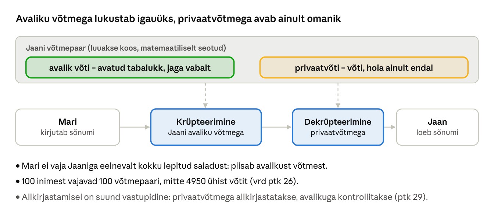
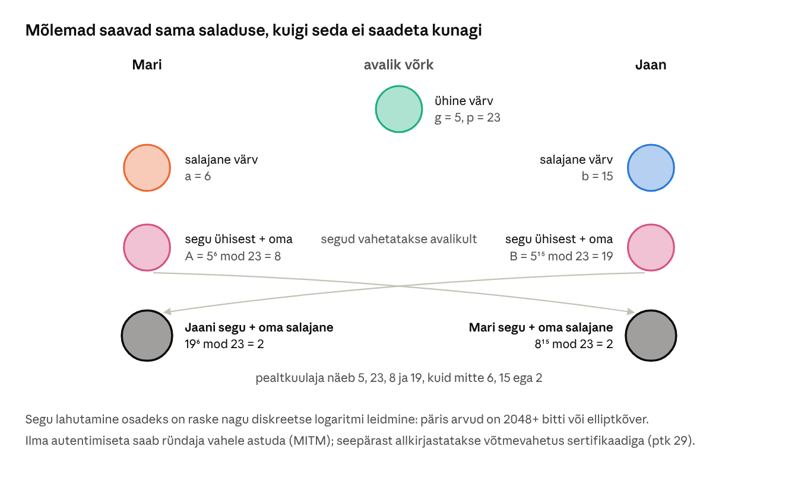
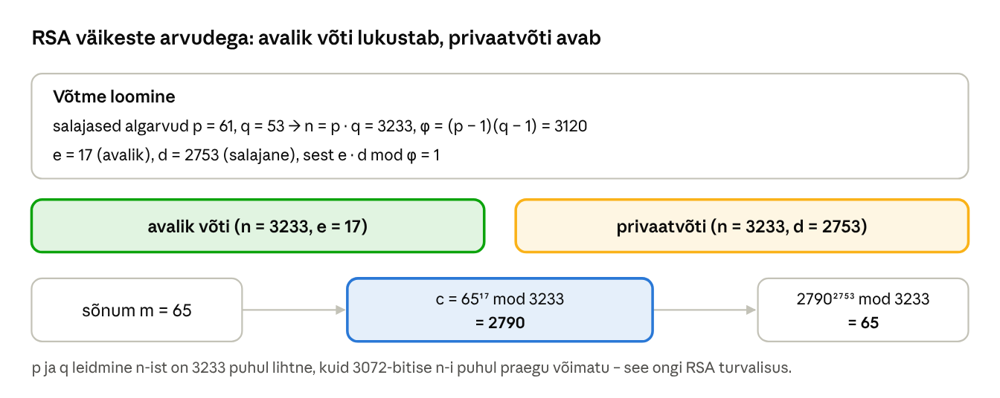
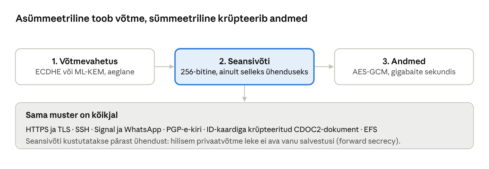

[← 27. UUS: Räsimine, sool ja paroolide hoidmine](27-rasimine-ja-paroolid.md) · [Sisukord](../README.md) · [29. UUS: Digiallkiri, sertifikaadid, PKI ja TLS →](29-digiallkiri-pki-tls.md)

## 28. UUS: Asümmeetriline krüptograafia ja Diffie–Hellmani võtmevahetus

Asümmeetrilises ehk **avaliku võtme krüptograafias** on igal osapoolel **võtmepaar**: avalik võti, mida võib kõigile jagada, ja privaatvõti, mida teab ainult omanik. See lahendab sümmeetrilise krüptograafia võtmejagamise probleemi (ptk 26.1) ja võimaldab digiallkirju (ptk 29). Kui kogu 1970. aastate eelne krüptograafia eeldas, et osapooled on kunagi kohtunud ja võtme kokku leppinud, siis avaliku võtme krüptograafia tegi võimalikuks turvalise suhtluse täiesti võõraste vahel – ilma selleta poleks e-poodi, internetipanka ega e-riiki.

**Pärast peatüki läbimist õppija:**

- selgitab, millist võtit kasutatakse krüpteerimisel, dekrüpteerimisel, allkirjastamisel ja kontrollimisel;
- arvutab moodularitmeetikas lihtsaid tehteid ning teeb Diffie–Hellmani võtmevahetuse ja RSA (*Rivest–Shamir–Adleman*) väikeste arvudega läbi;
- selgitab, miks Diffie–Hellman vajab autentimist ja mida tähendab edasine salastatus;
- võrdleb RSA-d ja elliptkõverkrüptograafiat ning valib sobiva võtmepikkuse;
- kasutab OpenSSL-i, SSH-d (*Secure Shell*) ja GPG-d (*GNU Privacy Guard*) võtmepaaride loomiseks ja kasutamiseks.

### 28.1 Võtmepaar



Joonis: Mari krüpteerib sõnumi Jaani avaliku võtmega. Avada saab selle ainult Jaani privaatvõti. Avalikku võtit võib avaldada veebilehel või e-kirja allkirjas, sest sellest ei saa privaatvõtit tuletada.

Võrdlus: avalik võti on nagu lahtine tabalukk, mida Jaan jagab kõigile. Igaüks saab sellega kasti lukku panna, kuid avada saab ainult Jaan oma võtmega. Digiallkirja puhul on rollid vastupidi: allkirja teeb privaatvõti ja kontrollida saab igaüks avaliku võtmega.

| Toiming | Kelle võti | Milline võti |
| --- | --- | --- |
| Krüpteerin sõnumi Jaanile | Jaani | avalik |
| Jaan dekrüpteerib | Jaani | privaat |
| Allkirjastan dokumendi | minu | privaat |
| Teised kontrollivad mu allkirja | minu | avalik |

#### Lõksuuksefunktsioonid ja moodularitmeetika

Asümmeetrilised algoritmid tuginevad matemaatilistele **lõksuuksefunktsioonidele** (trapdoor function): ühes suunas on arvutamine lihtne, vastupidi aga praktiliselt võimatu, kui ei tea salajast lisateavet. Näide: 61 × 53 = 3233 arvutad peast või paberil kiiresti. Aga millised kaks algarvu annavad korrutiseks 3233? Selleks pead proovima jagajaid. 600-kohalise arvu puhul ei aita ka kõik maailma arvutid.

Asümmeetriline krüptograafia arvutab **moodularitmeetikas** ehk „kellaaritmeetikas“: tulemusest jäetakse alles ainult jagamisjääk. Kell 10 + 5 tundi = 3, sest 15 mod 12 = 3. Samamoodi 5⁶ = 15 625 ja 15 625 mod 23 = 8. Astendamine moodulis on arvutile kiire ka tuhandebitiste arvudega. Vastupidine ülesanne – teades, et 5ˣ mod 23 = 8, leida x – on **diskreetne logaritm**. Väikeste arvudega saab proovida kõik x-id läbi, kuid 3072-bitise mooduli puhul on see praktiliselt võimatu.

| Algoritm | Raske ülesanne | Kasutus |
| --- | --- | --- |
| RSA | suure arvu tegurdamine algarvudeks | krüpteerimine, allkiri, vanemad sertifikaadid |
| Diffie–Hellman (DH) | diskreetne logaritm | võtmevahetus |
| ECC (*Elliptic Curve Cryptography*): ECDH (*Elliptic Curve Diffie–Hellman*), ECDSA (*Elliptic Curve Digital Signature Algorithm*), X25519, Ed25519 | diskreetne logaritm elliptkõveral | võtmevahetus, allkiri; ID-kaart (ID – *identity card*), TLS (*Transport Layer Security*), SSH |
| ML-KEM (*Module-Lattice-Based Key-Encapsulation Mechanism*), ML-DSA (*Module-Lattice-Based Digital Signature Algorithm*) | võreprobleemid (lattice) | postkvantkrüptograafia (ptk 30) |

#### Kuidas moodularitmeetikat käsitsi arvutada

> 🖱️ **Proovi ise:** [moodularitmeetika, Diffie–Hellmani ja RSA arvutaja](https://valdonolvak.github.io/Operatsioonis-steemi-ja-k-berturbe-alused/interaktiivne/28-arvutused.html). Sisesta oma arvud ja vaata iga vahesammu.

**Jagamisjääk.** a mod n on jääk, mis jääb alles, kui a jagada n-ga. Leia, mitu korda n mahub a sisse (jagatise täisosa), korruta see tagasi n-ga ja lahuta a-st:

- 15 625 ÷ 23 = 679,3… → täisosa on 679
- 679 × 23 = 15 617
- 15 625 − 15 617 = **8**, seega 15 625 mod 23 = 8

Telefoni kalkulaatoris ei ole tavaliselt mod-nuppu, kuid need kolm sammu töötavad alati: **jaga, jäta komakohad ära, korruta tagasi ja lahuta.** Jääk on alati vahemikus 0 … n − 1. Kui a on n-st väiksem, on jääk a ise.

| Tehe | a ÷ n | Täisosa × n | Jääk |
| --- | --- | --- | --- |
| 15 625 mod 23 | 679,35… | 679 × 23 = 15 617 | 15 625 − 15 617 = **8** |
| 361 mod 23 | 15,69… | 15 × 23 = 345 | 361 − 345 = **16** |
| 984 064 mod 3233 | 304,38… | 304 × 3233 = 982 832 | 984 064 − 982 832 = **1232** |
| 20 mod 23 | 0,86… | 0 × 23 = 0 | 20 − 0 = **20** |

**Võta jääk pärast iga korrutamist.** Suuri astmeid ei pea lõpuni välja arvutama, sest (x × y) mod n = ((x mod n) × (y mod n)) mod n. Kui jääk võetakse vahepeal, jäävad arvud väikeseks ja tulemus on sama. Näide (17 × 19) mod 5:

- otse: 17 × 19 = 323 ja 323 mod 5 = **3**;
- jääkidega: 17 mod 5 = 2 ja 19 mod 5 = 4, siis 2 × 4 = 8 ja 8 mod 5 = **3**.

Tulemus on sama, kuid teisel juhul ei tulnud ühtegi arvu, mis oleks suurem kui 8.

**Ruutu tõstmise võte** (*square-and-multiply*). Suurt astet ei arvutata korrutades g-d iseendaga ükshaaval, vaid kolmes sammus:

1. **Kirjuta astendaja kahe astmete summana.** Võta suurim kahe aste (1, 2, 4, 8, 16, 32 …), mis astendajasse mahub, lahuta see ja korda jäägiga. See on sama mis astendaja kahendkuju: iga 1-bitt tähistab ühte liidetavat.
2. **Arvuta ruudud.** g² = g × g, g⁴ = g² × g², g⁸ = g⁴ × g⁴ jne. Iga järgmine rida on eelmise rea tulemus ruudus, sest g²ᵏ = (gᵏ)². Võta jääk pärast iga ruutu tõstmist.
3. **Korruta kokku need read, mis on summas.** Astmete korrutamisel astendajad liituvad (g⁴ × g² = g⁶). Võta jääk pärast iga korrutamist.

| Astendaja | Kahe astmete summa | Kahendkuju | Ruutu tõstmisi + korrutamisi |
| --- | --- | --- | --- |
| 6 | 4 + 2 | 110 | 2 + 1 |
| 15 | 8 + 4 + 2 + 1 | 1111 | 3 + 3 |
| 17 | 16 + 1 | 10001 | 4 + 1 |
| 2753 | 2048 + 512 + 128 + 64 + 1 | 101011000001 | 11 + 4 |

Näide: 19⁶ mod 23, kus 6 = 4 + 2.

| Aste | Arvutus | Jääk 23-ga jagamisel |
| --- | --- | --- |
| 19² | 19 × 19 = 361 | 361 − 15 × 23 = **16** |
| 19⁴ | 16 × 16 = 256 | 256 − 11 × 23 = **3** |
| 19⁶ = 19⁴ × 19² | 3 × 16 = 48 | 48 − 2 × 23 = **2** |

Teise rea 16 × 16 ei ole juhuslik: 19⁴ = (19²)² ja 19² jääk oli eelmises reas 16. Viimases reas korrutame 19⁴ jäägi (3) ja 19² jäägi (16), sest 4 + 2 = 6.

Kolme väikese korrutamisega saime 19⁶ mod 23 = 2, ilma et peaksime arvutama 19⁶ = 47 045 881. Arvuti teeb sama: 3072-bitise astendaja korral kulub umbes 3072 ruutu tõstmist, mitte 2³⁰⁷² korrutamist. Seepärast on astendamine moodulis kiire ka väga suurte arvudega.

### 28.2 Diffie–Hellmani võtmevahetus

Whitfield Diffie ja Martin Hellman avaldasid 1976. aastal meetodi, mille abil kaks osapoolt saavad avalikus võrgus kokku leppida ühises saladuses, ilma et see saladus kunagi võrgus liiguks ([Wikipedia: Diffie–Hellmani võtmevahetus](https://et.wikipedia.org/wiki/Diffie-Hellmani_v%C3%B5tmevahetus)).



Joonis: värvide segamise analüüs ja sama arvutus väikeste arvudega. Mõlemad segavad avaliku ühise värvi oma salajase värviga ja vahetavad segud. Seejärel lisab kumbki saadud segule oma salajase värvi. Tulemus on mõlemal sama, sest segamise järjekord ei loe. Pealtkuulaja näeb ainult segusid ja ühist värvi ning ei suuda neist salajasi värve eraldada.

Arvutame samm-sammult. Avalikud parameetrid on algarv p = 23 ja alus g = 5.

| Samm | Mari | Avalik võrk | Jaan |
| --- | --- | --- | --- |
| 1. Salajane arv | a = 6 | – | b = 15 |
| 2. Avalik väärtus | A = 5⁶ mod 23 = 8 | A = 8 ja B = 19 liiguvad võrgus | B = 5¹⁵ mod 23 = 19 |
| 3. Ühine saladus | s = Bᵃ mod 23 = 19⁶ mod 23 = 2 | – | s = Aᵇ mod 23 = 8¹⁵ mod 23 = 2 |

**Samm 2: avalikud väärtused.** Mari arvutab A = 5⁶ mod 23. Astendaja 6 = 4 + 2:

- 5² = 25 ja 25 − 23 = **2**;
- 5⁴ = 2 × 2 = **4**;
- 5⁶ = 5⁴ × 5² = 4 × 2 = **8**. Seega A = 8.

Jaan arvutab B = 5¹⁵ mod 23. Astendaja 15 = 8 + 4 + 2 + 1. Esmalt ruudud, siis korrutame need ükshaaval kokku ja võtame jäägi pärast iga korrutamist:

| Samm | Arvutus | Jääk 23-ga jagamisel |
| --- | --- | --- |
| 5² | 5 × 5 = 25 | 25 − 1 × 23 = **2** |
| 5⁴ | 2 × 2 = 4 | **4** |
| 5⁸ | 4 × 4 = 16 | **16** |
| 5⁸ × 5⁴ = 5¹² | 16 × 4 = 64 | 64 − 2 × 23 = **18** |
| 5¹² × 5² = 5¹⁴ | 18 × 2 = 36 | 36 − 1 × 23 = **13** |
| 5¹⁴ × 5¹ = 5¹⁵ | 13 × 5 = 65 | 65 − 2 × 23 = **19** |

Seega B = 19. Mari saadab Jaanile 8 ja Jaan Marile 19.

**Samm 3: ühine saladus.** Mari tõstab Jaanilt saadud B astmesse oma salajase a-ga: 19⁶ mod 23 = 2. Selle tegime käsitsi läbi eespool (28.1). Jaan tõstab Marilt saadud A astmesse oma salajase b-ga: 8¹⁵ mod 23. Astendaja 15 = 8 + 4 + 2 + 1:

| Aste | Arvutus | Jääk 23-ga jagamisel |
| --- | --- | --- |
| 8² | 8 × 8 = 64 | 64 − 2 × 23 = **18** |
| 8⁴ | 18 × 18 = 324 | 324 − 14 × 23 = **2** |
| 8⁸ | 2 × 2 = 4 | **4** |
| 8¹⁵ = 8⁸ × 8⁴ × 8² × 8¹ | 4 × 2 × 18 × 8 = 1152 | 1152 − 50 × 23 = **2** |

Siin korrutasime neli jääki korraga, sest arvud on väikesed. Suuremate arvude puhul korruta ükshaaval nagu 5¹⁵ tabelis.

Mõlemad said 2, sest (gᵃ)ᵇ = (gᵇ)ᵃ = gᵃᵇ mod p. Mari arvutas tegelikult (5¹⁵)⁶ ja Jaan (5⁶)¹⁵. Mõlemal juhul on tulemus 5⁹⁰ mod 23, sest 15 × 6 = 6 × 15 = 90. Kumbki ei pidanud teise salajast arvu teadma.

**Mida näeb pealtkuulaja?** Eve teab p = 23, g = 5, A = 8 ja B = 19. Saladuse arvutamiseks peab ta leidma a või b ehk lahendama diskreetse logaritmi. Nii väikese p korral teeb ta lihtsalt tabeli kõigist astmetest:

| x | 1 | 2 | 3 | 4 | 5 | 6 | 7 | 8 | 9 | 10 | 11 |
| --- | --- | --- | --- | --- | --- | --- | --- | --- | --- | --- | --- |
| 5ˣ mod 23 | 5 | 2 | 10 | 4 | 20 | **8** | 17 | 16 | 11 | 9 | 22 |

| x | 12 | 13 | 14 | 15 | 16 | 17 | 18 | 19 | 20 | 21 | 22 |
| --- | --- | --- | --- | --- | --- | --- | --- | --- | --- | --- | --- |
| 5ˣ mod 23 | 18 | 21 | 13 | **19** | 3 | 15 | 6 | 7 | 12 | 14 | 1 |

Tabelist näeb Eve, et 5⁶ mod 23 = 8, seega a = 6, ja arvutab saladuse 19⁶ mod 23 = 2. Pane tähele, et väärtused hüppavad ilma nähtava mustrita. Kui teada on 5ˣ, ei aita see ära arvata x-i. Kõik 22 väärtust on ka erinevad, nii et iga A vastab täpselt ühele a-le (g = 5 on 23 jaoks **algjuur**, *primitive root*).

Päris DH-s on p vähemalt 2048-bitine ja elliptkõveral (X25519) 255-bitine. Tabelis oleks siis umbes 2²⁰⁴⁸ või 2²⁵² rida. Parimad teadaolevad meetodid on küll kiiremad kui kõigi väärtuste läbiproovimine, kuid ka nendega on sellise suurusega ülesanne praktiliselt lahendamatu.

Kaks olulist täpsustust:

- **Diffie–Hellman üksi ei autendi.** Kui Mari ei tea, et sai väärtuse B just Jaanilt, võib ründaja Eve teha mõlemaga eraldi võtmevahetuse: Mariga saladuse s₁ ja Jaaniga saladuse s₂. Seejärel dekrüpteerib ta iga Mari sõnumi, loeb seda ja krüpteerib uuesti Jaanile (MITM – *Man-in-the-Middle*, ptk 24.7). Seepärast allkirjastab TLS-server oma võtmevahetuse sertifikaadiga ja SSH-klient kontrollib serveri võtme sõrmejälge.
- **Ajutised võtmed (ephemeral DH, ECDHE – *Elliptic Curve Diffie–Hellman Ephemeral*)** luuakse iga ühenduse jaoks uuesti ja kustutatakse pärast seda. See annab **edasise salastatuse** (forward secrecy): kui serveri privaatvõti hiljem lekib, ei saa varem salvestatud liiklust dekrüpteerida, sest seansivõtmeid pole enam kusagil. Vanemas TLS-is, kus seansivõti krüpteeriti otse serveri RSA-võtmega, võis aastaid salvestatud liiklust hiljem lugeda. TLS 1.3 kasutab ainult ajutisi võtmevahetusi.

### 28.3 RSA

**RSA** (*Rivest, Shamir, Adleman*, 1977) on esimene praktiline avaliku võtme algoritm, millega saab nii krüpteerida kui ka allkirjastada.



Joonis: RSA põhimõte nii väikeste arvudega, et neid saab kalkulaatoriga kontrollida.

**Võtme loomine** käib nii:

1. Vali kaks suurt juhuslikku algarvu p ja q. Näites p = 61 ja q = 53.
2. Arvuta moodul n = p × q = 3233. See on avalik.
3. Arvuta φ(n) = (p − 1)(q − 1) = 60 × 52 = 3120. See on salajane, sest selle arvutamiseks on vaja p-d ja q-d.
4. Vali avalik eksponent e, millel pole φ-ga ühiseid tegureid. Näites e = 17: 3120 = 2⁴ × 3 × 5 × 13 ja algarv 17 nende hulgas ei ole, seega sobib. Päris RSA-s on e peaaegu alati 65 537. Ühiste tegurite puudumine on vajalik, sest muidu ei leidu sammus 5 sobivat d-d. Näiteks e = 15 ei sobiks, sest 3120 jagub nii 3 kui ka 5-ga.
5. Leia privaatne eksponent d, mille korral e × d mod φ = 1. Näites d = 2753, sest 17 × 2753 = 46 801 = 15 × 3120 + 1. Selle leiab laiendatud Eukleidese algoritmiga (Pythonis `pow(17, -1, 3120)`).

**Kuidas d leitakse proovimisega.** Väikeste arvudega on kõige lihtsam mõte selline: e × d mod φ = 1 tähendab, et e × d = k × φ + 1 mingi täisarvu k korral. Proovime k = 1, 2, 3 … ja vaatame, millal k × 3120 + 1 jagub 17-ga:

| k | k × 3120 + 1 | ÷ 17 |
| --- | --- | --- |
| 1 | 3121 | 183,59… ei jagu |
| 2 | 6241 | 367,12… ei jagu |
| 3 | 9361 | 550,65… ei jagu |
| … | … | … |
| 15 | 46 801 | **2753** jagub täpselt |

Seega d = 2753. Kuna k < e, piisab alati kuni e − 1 katsest. Päris RSA-s on aga e = 65 537 ja φ sadu kohti pikk, seega kasutatakse laiendatud Eukleidese algoritmi, mis leiab d mõne kümne jagamisega.

**Kuidas d leitakse laiendatud Eukleidese algoritmiga.** Otsime d, mille korral 17 × d annab 3120-ga jagades jäägi 1. Algoritmil on kaks poolt.

*Esimene pool: jagamine jäägiga.* Jagame suurema arvu väiksemaga. Järgmisel real saab eelmine jagaja jagatavaks ja eelmine jääk jagajaks. Jätkame, kuni jääk on 1:

| Rida | Jagatav = jagatis × jagaja + jääk | Selgitus |
| --- | --- | --- |
| 1 | 3120 = 183 × 17 + **9** | 3120 ÷ 17 = 183,52… → täisosa 183 → 183 × 17 = 3111 → 3120 − 3111 = 9 |
| 2 | 17 = 1 × 9 + **8** | 17 ÷ 9 = 1,88… → täisosa 1 → 1 × 9 = 9 → 17 − 9 = 8 |
| 3 | 9 = 1 × 8 + **1** | 9 ÷ 8 = 1,125 → täisosa 1 → 1 × 8 = 8 → 9 − 8 = 1 |

Kui viimane jääk on 1, on 17-l ja 3120-l suurim ühistegur 1, seega e = 17 sobib (samm 4). Kui jääk oleks 0 enne 1-ni jõudmist, ei leiduks d-d.

*Teine pool: tagasi asendamine.* Avaldame igast reast jäägi (jääk = jagatav − jagatis × jagaja) ja liigume alt üles:

1. Reast 3: **1 = 9 − 1 × 8**.
2. Reast 2 on 8 = 17 − 9. Asendame selle 8 asemele: 1 = 9 − (17 − 9) = 9 − 17 + 9 = **2 × 9 − 17**.
3. Reast 1 on 9 = 3120 − 183 × 17. Asendame selle 9 asemele ja lihtsustame. Iga rea väärtus peab olema 1:

| Avaldis | Mis tehti | Arvutus |
| --- | --- | --- |
| 1 = 2 × (3120 − 183 × 17) − 17 | 9 asendati avaldisega 3120 − 183 × 17 | 2 × (3120 − 3111) − 17 = 2 × 9 − 17 = 18 − 17 = **1** |
| = 2 × 3120 − 366 × 17 − 1 × 17 | sulud lahti: 2 × 183 = 366 | 6240 − 6222 − 17 = **1** |
| = **2 × 3120 − 367 × 17** | 366 + 1 = 367 (366 korda 17 ja veel üks 17) | 6240 − 6239 = **1** |

Kui võtame mõlemast poolest jäägi 3120-ga jagamisel, kaob 2 × 3120 ära, sest see jagub 3120-ga. Järele jääb (−367 × 17) mod 3120 = 1, seega −367 on sobiv d. Negatiivsest arvust saame positiivse, kui liidame φ: d = 3120 − 367 = **2753**. Kontroll: 17 × 2753 = 46 801 = 15 × 3120 + 1.

Avalik võti on (n = 3233, e = 17), privaatvõti (n = 3233, d = 2753).

**Krüpteerimine:** c = mᵉ mod n. Sõnum m = 65 annab c = 65¹⁷ mod 3233 = 2790. Käsitsi tehakse see ruutu tõstmise võttega, astendaja 17 = 16 + 1:

| Aste | Arvutus | Jääk 3233-ga jagamisel |
| --- | --- | --- |
| 65² | 65 × 65 = 4225 | 4225 − 1 × 3233 = **992** |
| 65⁴ | 992 × 992 = 984 064 | 984 064 − 304 × 3233 = **1232** |
| 65⁸ | 1232 × 1232 = 1 517 824 | 1 517 824 − 469 × 3233 = **1547** |
| 65¹⁶ | 1547 × 1547 = 2 393 209 | 2 393 209 − 740 × 3233 = **789** |
| 65¹⁷ = 65¹⁶ × 65 | 789 × 65 = 51 285 | 51 285 − 15 × 3233 = **2790** |

Kolmanda veeru täisosa (nt 304) leiad nii nagu eespool: 984 064 ÷ 3233 = 304,38…, komakohad jäävad ära.

**Dekrüpteerimine:** m = cᵈ mod n = 2790²⁷⁵³ mod 3233. Astendaja 2753 = 2048 + 512 + 128 + 64 + 1, seega kulub 11 ruutu tõstmist ja 4 korrutamist. Käsitsi on see tüütu, kuid põhimõte on täpselt sama:

| Samm | Arvutus | Jääk 3233-ga jagamisel |
| --- | --- | --- |
| 2790² | 2790 × 2790 = 7 784 100 | 7 784 100 − 2407 × 3233 = **2269** |
| 2790⁴ | 2269 × 2269 = 5 148 361 | 5 148 361 − 1592 × 3233 = **1425** |
| 2790⁸ | 1425 × 1425 = 2 030 625 | 2 030 625 − 628 × 3233 = **301** |
| 2790¹⁶ | 301 × 301 = 90 601 | 90 601 − 28 × 3233 = **77** |
| 2790³² | 77 × 77 = 5929 | 5929 − 1 × 3233 = **2696** |
| 2790⁶⁴ | 2696 × 2696 = 7 268 416 | 7 268 416 − 2248 × 3233 = **632** |
| 2790¹²⁸ | 632 × 632 = 399 424 | 399 424 − 123 × 3233 = **1765** |
| 2790²⁵⁶ | 1765 × 1765 = 3 115 225 | 3 115 225 − 963 × 3233 = **1846** |
| 2790⁵¹² | 1846 × 1846 = 3 407 716 | 3 407 716 − 1054 × 3233 = **134** |
| 2790¹⁰²⁴ | 134 × 134 = 17 956 | 17 956 − 5 × 3233 = **1791** |
| 2790²⁰⁴⁸ | 1791 × 1791 = 3 207 681 | 3 207 681 − 992 × 3233 = **545** |
| 2790²⁰⁴⁸ × 2790⁵¹² | 545 × 134 = 73 030 | 73 030 − 22 × 3233 = **1904** |
| … × 2790¹²⁸ | 1904 × 1765 = 3 360 560 | 3 360 560 − 1039 × 3233 = **1473** |
| … × 2790⁶⁴ | 1473 × 632 = 930 936 | 930 936 − 287 × 3233 = **3065** |
| … × 2790¹ = 2790²⁷⁵³ | 3065 × 2790 = 8 551 350 | 8 551 350 − 2645 × 3233 = **65** |

Tulemus on 65 – algne sõnum tuli tagasi. Pythonis on sama arvutus üks rida: `pow(2790, 2753, 3233)`.

**Miks dekrüpteerimine annab tagasi m-i?** Krüpteerimine ja dekrüpteerimine kokku tõstavad m-i astmesse e × d: (mᵉ)ᵈ = mᵉᵈ. Valisime d nii, et e × d = 46 801 = 15 × φ(n) + 1. Euleri teoreemi järgi on m^φ(n) mod n = 1 (kui m ja n ühiseid tegureid ei oma). Seega mᵉᵈ = m^(15 × φ(n) + 1) = (m^φ(n))¹⁵ × m ja moodulis n on see 1¹⁵ × m = m. Iga täisarvkordne φ(n) astendajas „kaob ära“ ja alles jääb ainult + 1.

**Allkirjastamine** käib vastupidi: s = mᵈ mod n = 65²⁷⁵³ mod 3233 = 588 (arvutus käib nagu dekrüpteerimisel, ainult alus on 65). Igaüks saab kontrollida avaliku võtmega, astendaja 17 = 16 + 1:

| Samm | Arvutus | Jääk 3233-ga jagamisel |
| --- | --- | --- |
| 588² | 588 × 588 = 345 744 | 345 744 − 106 × 3233 = **3046** |
| 588⁴ | 3046 × 3046 = 9 278 116 | 9 278 116 − 2869 × 3233 = **2639** |
| 588⁸ | 2639 × 2639 = 6 964 321 | 6 964 321 − 2154 × 3233 = **439** |
| 588¹⁶ | 439 × 439 = 192 721 | 192 721 − 59 × 3233 = **1974** |
| 588¹⁷ = 588¹⁶ × 588 | 1974 × 588 = 1 160 712 | 1 160 712 − 359 × 3233 = **65** |

Kontroll andis 65, seega allkiri on õige. Kuna d-d teab ainult omanik, saab ainult tema luua sellise s, mis avaliku võtmega tagasi m-ks muutub. Pane tähele, et kontrollimine (e = 17) on palju kiirem kui allkirjastamine (d = 2753). Seepärast valitakse päris RSA-s väike e = 65 537.

**Miks see turvaline on?** Kes teab p-d ja q-d, saab arvutada φ ja sellest d. Ründaja teab ainult n-i ja peab selle teguriteks lahutama. 3233 puhul on see lihtne, kuid 2048-bitine n on 617 kümnendkohta pikk. Suurim avalikult tegurdatud RSA-arv on 829-bitine RSA-250 (2020), mille jaoks kulus umbes 2700 protsessoriaastat. 2048-bitise arvu tegurdamine on klassikaliste arvutitega miljardeid kordi raskem. Päris RSA-s on n vähemalt 2048, soovitatavalt 3072 bitti.

Päris RSA-s ei krüpteerita kunagi sõnumit otse („textbook RSA“). Ilma täidiseta annab sama sõnum alati sama šifriteksti, nii et ründaja saab võimalikke sõnumeid (nt „jah“ ja „ei“) ise avaliku võtmega krüpteerida ja võrrelda. Seepärast lisatakse enne juhuslik täidis: **OAEP** (*Optimal Asymmetric Encryption Padding*) krüpteerimisel ja **PSS** (*Probabilistic Signature Scheme*) allkirjal. Vana täidis PKCS#1 (PKCS – *Public-Key Cryptography Standards*) v1.5 on haavatav oraaklirünnakutele (Bleichenbacheri rünne 1998, ROBOT (*Return Of Bleichenbacher’s Oracle Threat*) 2017).

### 28.4 Elliptkõverad ja võtmepikkused

**Elliptkõverkrüptograafia** (ECC) kasutab arvude asemel elliptkõvera punkte, näiteks kõverat y² = x³ + 486662x² + x (Curve25519, millel põhinevad X25519 ja Ed25519). Kõvera punkte saab omavahel „liita“ kindla geomeetrilise reegli järgi. Kui võtta avalik alguspunkt G ja liita see iseendaga k korda, saame punkti K = k · G.

- Privaatvõti on juhuslik arv k (umbes 2²⁵² võimalust).
- Avalik võti on punkt K. Selle arvutamiseks kulub kahekordistamise nipiga vaid paarsada sammu.
- Vastupidi – K-d ja G-d teades leida k – on **elliptkõvera diskreetne logaritm**, mille jaoks ei ole teada ühtki kiiret meetodit.

Kuna parim rünne ECC vastu on palju aeglasem kui parim tegurdamismeetod RSA vastu, piisab sama turvalisuse jaoks palju lühemast võtmest. 256-bitine ECC-võti on sama tugev kui 3072-bitine RSA-võti. Lühem võti tähendab kiiremat arvutust, väiksemaid sertifikaate ja väiksemat energiakulu – seetõttu sobib ECC kiipkaartidele ja telefonidele.

Eesti ID-kaart kasutab alates 2018. aastast elliptkõvervõtmeid (P-384), sest varasemate kaartide RSA-võtmete genereerimises leiti 2017. aastal viga (ROCA – *Return of Coppersmith’s Attack*), mille tõttu sai avalikust võtmest privaatvõtme arvutada. Kiibi võtmegeneraator valis algarve liiga kitsast ja ennustatavast hulgast. Ligi 750 000 kaarti tuli uuendada kaugteel.

| Turvatase | Sümmeetriline | RSA, DH | ECC |
| --- | --- | --- | --- |
| 112 bitti (kuni 2030) | 3DES | 2048 bitti | 224 bitti |
| 128 bitti | AES-128 (AES – *Advanced Encryption Standard*) | 3072 bitti | 256 bitti (P-256, X25519) |
| 192 bitti | AES-192 | 7680 bitti | 384 bitti (P-384) |
| 256 bitti | AES-256 | 15 360 bitti | 521 bitti (P-521) |

Allikas: [NIST SP 800-57](https://csrc.nist.gov/pubs/sp/800/57/pt1/r5/final). RSA ja ECC on mõlemad kvantarvutite suhtes haavatavad (ptk 30).

### 28.5 Hübriidkrüpteerimine



Joonis: asümmeetriline krüptograafia on sadu kuni tuhandeid kordi aeglasem kui AES, seetõttu ei krüpteerita sellega andmeid. Sellega vahetatakse või krüpteeritakse ainult juhuslik sümmeetriline seansivõti ja andmed krüpteeritakse AES-iga.

Lisaks kiirusele on teinegi põhjus: RSA-ga saab ühe korraga krüpteerida vähem andmeid, kui on mooduli pikkus (3072-bitise võtmega ja OAEP-täidisega umbes 300 baiti). Kui Mari saadab Jaanile 10 MB faili, juhtub see nii:

1. Mari programm loob juhusliku 256-bitise AES-võtme.
2. Fail krüpteeritakse AES-GCM-iga (GCM – *Galois/Counter Mode*) selle võtmega.
3. AES-võti (32 baiti) krüpteeritakse Jaani avaliku võtmega.
4. Jaanile saadetakse krüpteeritud fail ja krüpteeritud võti.
5. Jaan dekrüpteerib oma privaatvõtmega AES-võtme ja sellega faili.

Kui fail on vaja saata kolmele inimesele, krüpteeritakse sama AES-võti kolm korda – iga saaja avaliku võtmega – ja fail ise ainult üks kord. Nii töötavad GPG, S/MIME-e-kiri (*Secure/Multipurpose Internet Mail Extensions*), Eesti DigiDoc-i krüpteeritud konteiner (CDOC) ja EFS (*Encrypting File System*). TLS-is ja SSH-s saadakse seansivõti võtme krüpteerimise asemel Diffie–Hellmani võtmevahetusest.

### 28.6 Asümmeetriline krüptograafia igapäevas

| Kus | Mida tehakse | Algoritm |
| --- | --- | --- |
| HTTPS (*Hypertext Transfer Protocol Secure*; TLS 1.3) | võtmevahetus, serveri allkiri | X25519 / ML-KEM, ECDSA või RSA |
| SSH | võtmevahetus, serveri ja kasutaja autentimine | X25519 / ML-KEM, Ed25519 |
| ID-kaart, Smart-ID | autentimine, digiallkiri | ECDSA P-384 |
| WhatsApp, Signal | otsast-otsani krüpteerimine | X25519 + ML-KEM |
| Windows Hello, pääsuvõti (passkey) | sisselogimine ilma paroolita: seade allkirjastab serveri väljakutse | ECDSA P-256 |
| Windows Update, draiverid | tarkvara allkiri (Authenticode) | RSA |

### Näide: SSH-võtmega serverisse

Administraator logib Linuxi serverisse ilma paroolita. Ta loob oma arvutis võtmepaari `ssh-keygen -t ed25519` ja kopeerib avaliku võtme serveri faili `~/.ssh/authorized_keys`. Ühendusel juhtub kolm asümmeetrilist asja:

1. **ECDH või ML-KEM võtmevahetus** loob seansivõtme (Ubuntu 26.04 vaikimisi hübriid `mlkem768x25519-sha256`);
2. **server allkirjastab** võtmevahetuse oma hostivõtmega ja klient võrdleb serveri võtme sõrmejälge failiga `known_hosts` – see takistab MITM-i;
3. **klient tõestab** oma privaatvõtmega allkirja abil, et ta on administraator. Privaatvõti ei lahku kunagi tema arvutist.

Pärast seda krüpteeritakse kogu liiklus sümmeetriliselt (AES-GCM või ChaCha20-Poly1305). Paroolitõestuse võib serveris seejärel välja lülitada (`PasswordAuthentication no` failis `/etc/ssh/sshd_config`), mis peatab paroolide äraarvamise ründed.

Kui klient ühendub serveriga esimest korda, näitab ta hoiatust `The authenticity of host ... can't be established` ja serveri võtme sõrmejälge. Seda tuleb võrrelda administraatorilt teise kanali kaudu saadud sõrmejäljega. Kui hiljem tuleb hoiatus `REMOTE HOST IDENTIFICATION HAS CHANGED`, on kas server uuesti paigaldatud või on ühenduse vahel ründaja – ühendust ei tohi enne selgitamist jätkata.

### Kokkuvõte

- Avaliku võtmega krüpteeritakse ja kontrollitakse allkirja, privaatvõtmega dekrüpteeritakse ja allkirjastatakse.
- Asümmeetriline krüptograafia põhineb lõksuuksefunktsioonidel: astendamine moodulis on lihtne, tegurdamine ja diskreetne logaritm rasked.
- Diffie–Hellman loob avalikus võrgus ühise saladuse, kuid vajab autentimist MITM-i vastu. Ajutised võtmed annavad edasise salastatuse.
- RSA turvalisus põhineb tegurdamise raskusel ja vajab täidist (OAEP, PSS). ECC võtmed on sama turvalisuse juures palju lühemad.
- Praktikas on krüpteerimine hübriidne: asümmeetriline seansivõti, sümmeetrilised andmed.

### Kontrollküsimused

> 🧪 **Interaktiivne test:** [kontrolli oma teadmisi](https://valdonolvak.github.io/Operatsioonis-steemi-ja-k-berturbe-alused/interaktiivne/28-test.html). Test koosneb 25 valikvastusega küsimusest. Iga vastuse järel näed selgitust ning lõpus saad valesti vastatud küsimusi korrata.

1. Millise võtmega krüpteerid sõnumi sõbrale ja millisega sõber selle avab? Millise võtmega allkirjastad?
2. Mis on lõksuuksefunktsioon? Too näide.
3. Arvuta 3⁴ mod 7 ja 2¹⁰ mod 11.
4. Tee Diffie–Hellmani võtmevahetus läbi parameetritega p = 23, g = 5, a = 4, b = 9. Mis on ühine saladus?
5. Kirjelda samm-sammult, kuidas ründaja Diffie–Hellmani ilma autentimiseta vahendab.
6. Mida tähendab edasine salastatus ja miks on see oluline?
7. Millele põhineb RSA turvalisus? Miks on φ(n) salajane?
8. Miks ei krüpteerita RSA-ga sõnumeid otse ilma täidiseta?
9. Miks piisab ECC-s palju lühemast võtmest kui RSA-s?
10. Mis oli ROCA viga ja kuidas see Eestit puudutas?
11. Kirjelda, kuidas krüpteeritakse hübriidselt fail kolmele saajale.
12. Mida tuleb teha, kui SSH-klient näitab hoiatust REMOTE HOST IDENTIFICATION HAS CHANGED?

### Valikküsimused

1. Millise võtmega krüpteeritakse sõnum, mida ainult Jaan peab lugema saama? a) Jaani avaliku võtmega b) Jaani privaatvõtmega c) saatja privaatvõtmega d) ühise AES-võtmega, mis saadetakse e-postiga
2. Mis on Diffie–Hellmani võtmevahetuse tulemus? a) mõlemad saavad teineteise privaatvõtme b) avalik võti krüpteeritakse c) mõlemad arvutavad sama jagatud saladuse, ilma et see võrgus liiguks d) parool salvestatakse serverisse
3. Millele põhineb RSA turvalisus? a) räsi kokkupõrgetele b) XOR-tehtele (XOR – *Exclusive OR*) c) elliptkõveratele d) suurte arvude tegurdamise raskusele
4. Miks kasutatakse praktikas hübriidkrüpteerimist? a) asümmeetriline krüptograafia on kiirem b) asümmeetriline on aeglane, seepärast vahetatakse sellega ainult sümmeetriline seansivõti c) sümmeetriline ei vaja võtit d) see on seadusega kohustuslik

### Praktiline ülesanne

**Võtmepaarid WSL-is (*Windows Subsystem for Linux*).** Ava WSL Ubuntu: `sudo apt install -y openssl openssh-client gnupg python3`.

1. Diffie–Hellman väikeste arvudega Pythonis (kontrolli joonise arvutust ja proovi oma arvudega):

```python
p, g = 23, 5
a, b = 6, 15                       # salajased
A, B = pow(g, a, p), pow(g, b, p)  # avalikud
print("A =", A, "B =", B)
print("Mari:", pow(B, a, p), "Jaan:", pow(A, b, p))
```

2. Päris X25519 võtmevahetus OpenSSL-iga:

```bash
openssl genpkey -algorithm X25519 -out mari.key && openssl pkey -in mari.key -pubout -out mari.pub
openssl genpkey -algorithm X25519 -out jaan.key && openssl pkey -in jaan.key -pubout -out jaan.pub
openssl pkeyutl -derive -inkey mari.key -peerkey jaan.pub | xxd -p
openssl pkeyutl -derive -inkey jaan.key -peerkey mari.pub | xxd -p   # sama tulemus!
```

3. RSA krüpteerimine ja dekrüpteerimine:

```bash
openssl genpkey -algorithm RSA -pkeyopt rsa_keygen_bits:3072 -out rsa.key
openssl pkey -in rsa.key -pubout -out rsa.pub
echo 'Salajane kohtumine kell 15' > s.txt
openssl pkeyutl -encrypt -pubin -inkey rsa.pub -pkeyopt rsa_padding_mode:oaep -in s.txt -out s.enc
openssl pkeyutl -decrypt -inkey rsa.key -pkeyopt rsa_padding_mode:oaep -in s.enc
ls -l rsa.pub mari.pub            # võrdle võtmete suurust
```

4. SSH-võti: `ssh-keygen -t ed25519 -C "oma.nimi@kool.ee"` ja vaata `cat ~/.ssh/id_ed25519.pub`.

5) Allkiri ja selle kontroll Ed25519-ga:

```bash
openssl genpkey -algorithm ED25519 -out allk.key
openssl pkey -in allk.key -pubout -out allk.pub
echo 'Kinnitan hinded. Mari Maasikas' > otsus.txt
openssl pkeyutl -sign -inkey allk.key -rawin -in otsus.txt -out otsus.sig
openssl pkeyutl -verify -pubin -inkey allk.pub -rawin -in otsus.txt -sigfile otsus.sig
sed -i 's/Kinnitan/Muudan/' otsus.txt
openssl pkeyutl -verify -pubin -inkey allk.pub -rawin -in otsus.txt -sigfile otsus.sig
```

Vasta: kas Mari ja Jaan said sama jagatud saladuse? Kui suur on RSA avalik võti võrreldes X25519 omaga? Miks võib `id_ed25519.pub` faili kellelegi saata, aga `id_ed25519` mitte? Mida näitas allkirja teine kontroll ja miks?

### Iseseisvad ülesanded

**1. Krüpteeritud kiri kaaslasele.** Loo GPG-võtmepaar (`gpg --full-generate-key`, vali ECC), ekspordi avalik võti (`gpg --armor --export`) ja vaheta seda kaaslasega. Krüpteeri talle fail (`gpg --encrypt --recipient`) ja dekrüpteeri tema saadetud fail. Kontrollige teineteise võtme sõrmejälge suuliselt. **Esita:** kasutatud käsud, võtme sõrmejälg ja selgitus, miks sõrmejälje kontroll on vajalik.

**2. RSA käsitsi.** Vali kaks väikest algarvu (nt 11 ja 17), arvuta n, φ, vali e ja leia d (Pythonis `pow(e, -1, phi)`). Krüpteeri ja dekrüpteeri arv 42. Seejärel näita, kuidas pealtkuulaja, kes teab ainult n-i ja e-d, leiab d, kui n on väike. **Esita:** arvutused ja selgitus, miks see päris RSA puhul ei õnnestu.

### Viited

- Diffie, W., Hellman, M. (1976). New Directions in Cryptography. *IEEE Transactions on Information Theory*, 22(6).
- Rivest, R., Shamir, A., Adleman, L. (1978). A Method for Obtaining Digital Signatures and Public-Key Cryptosystems. *Communications of the ACM*, 21(2).
- [Diffie–Hellmani võtmevahetus](https://et.wikipedia.org/wiki/Diffie-Hellmani_v%C3%B5tmevahetus). Vikipeedia.
- Tartu Ülikool. [Infoturve: avaliku võtme krüptograafia ja PKI](https://courses.cs.ut.ee/2022/infsec/spring/Main/PKI).
- NIST. [SP 800-57 Part 1 Rev. 5: Recommendation for Key Management](https://csrc.nist.gov/pubs/sp/800/57/pt1/r5/final).
- Nemec, M. jt (2017). [The Return of Coppersmith’s Attack: Practical Factorization of Widely Used RSA Moduli (ROCA)](https://crocs.fi.muni.cz/public/papers/rsa_ccs17). ACM CCS.
- Bernstein, D. J. (2006). [Curve25519: new Diffie-Hellman speed records](https://cr.yp.to/ecdh.html).
- Boudot, F. jt (2020). [Factorization of RSA-250](https://caramba.loria.fr/rsa250.txt).

> 📝 **Test:** selle peatüki Google Formsi test luuakse skriptiga [`google-forms/looVormid.gs`](../google-forms/looVormid.gs).

---

[← 27. UUS: Räsimine, sool ja paroolide hoidmine](27-rasimine-ja-paroolid.md) · [Sisukord](../README.md) · [29. UUS: Digiallkiri, sertifikaadid, PKI ja TLS →](29-digiallkiri-pki-tls.md)
