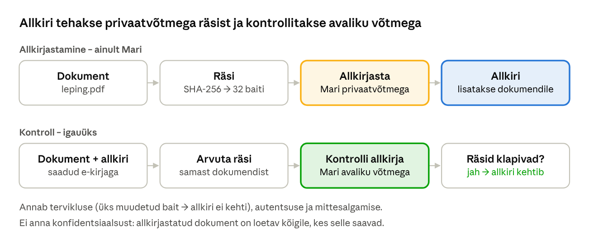
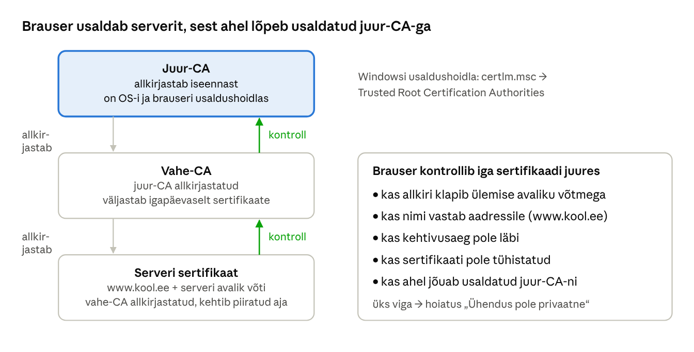
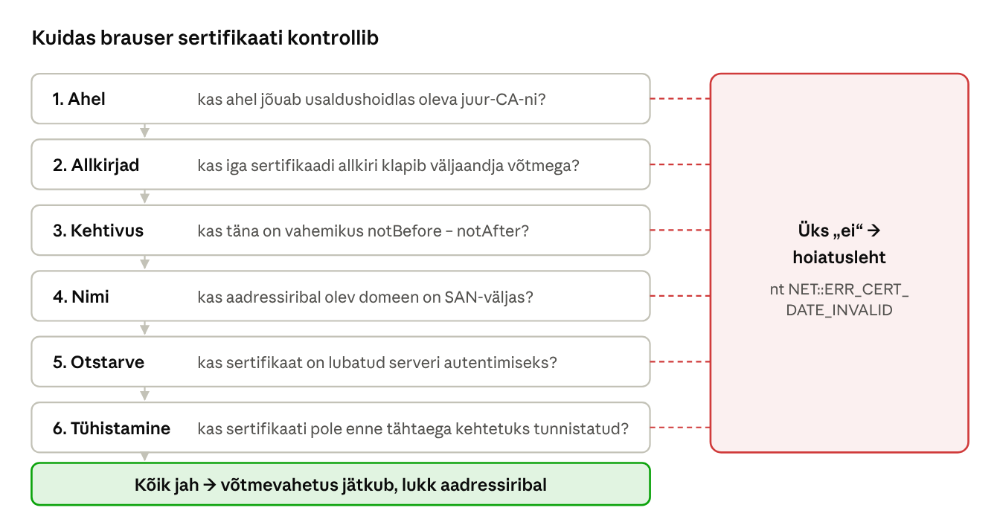
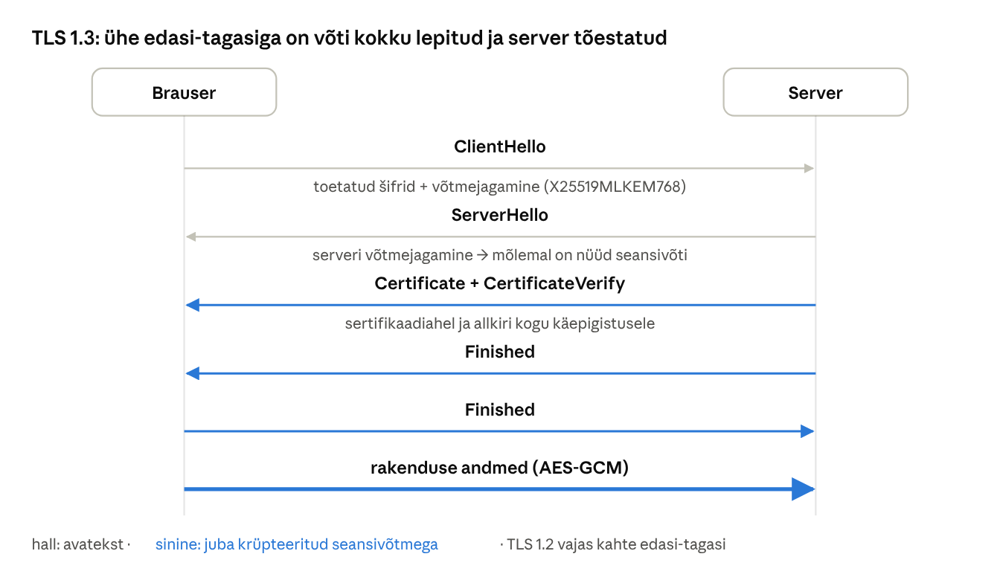
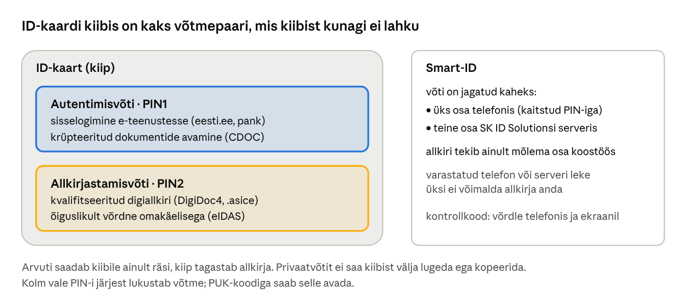

[← 28. UUS: Asümmeetriline krüptograafia ja Diffie–Hellmani võtmevahetus](28-asummeetriline-kruptograafia.md) · [Sisukord](../README.md) · [30. UUS: Postkvantkrüptograafia ja krüptograafia tulevik →](30-postkvantkruptograafia.md)

## 29. UUS: Digiallkiri, sertifikaadid, PKI ja TLS

Asümmeetriline krüptograafia lahendab võtmejagamise, kuid jätab ühe küsimuse: **kuidas teada, et avalik võti kuulub tõesti sellele, kellele väidetakse?** Kui ründaja suudab sulle anda oma avaliku võtme panga nime all, krüpteerid sa oma andmed hoolikalt just ründajale. Vastus on digiallkiri ja sertifikaatide süsteem ehk **avaliku võtme taristu** (PKI, public key infrastructure). Selle peale on ehitatud HTTPS, Eesti ID-kaart, draiverite allkirjad, Secure Boot (ptk 18) ja tarkvarauuendused.

**Pärast peatüki läbimist õppija:**

- kirjeldab digiallkirja andmise ja kontrollimise samme ning selgitab, mida digiallkiri tõendab;
- selgitab X.509-sertifikaadi sisu, usaldusahelat ja sertifikaadi kontrolli samme;
- kirjeldab sertifikaadi elukaart: taotlemine, väljastamine, uuendamine ja tühistamine;
- kirjeldab TLS 1.3 käepigistust ja seda, mida HTTPS tõendab ning mida mitte;
- selgitab Eesti ID-kaardi ja Smart-ID võtmete kasutust ning loob laboris oma CA ja TLS-serveri.

### 29.1 Digiallkiri



Joonis: allkirjastaja arvutab dokumendist räsi ja allkirjastab selle oma privaatvõtmega. Kontrollija arvutab sama räsi uuesti ja kontrollib allkirja allkirjastaja avaliku võtmega. Kui dokumendis muutub kas või üks bait, räsid ei klapi ja allkiri on kehtetu.

> 🖱️ **Proovi ise:** [digiallkiri brauseris](https://valdonolvak.github.io/Operatsioonis-steemi-ja-k-berturbe-alused/interaktiivne/29-pki.html#allkiri). Allkirjasta leping päris ECDSA-võtmega, muuda seda ründajana ja vaata, mida kontroll avastab.

**Allkirjastamine:**

1. Arvuta dokumendi räsi, nt SHA-256.
2. Allkirjasta räsi oma privaatvõtmega (RSA-PSS, ECDSA või Ed25519).
3. Lisa allkiri ja oma sertifikaat dokumendi juurde.

**Kontrollimine:**

1. Arvuta saadud dokumendi räsi ise uuesti.
2. Kontrolli allkirja allkirjastaja avaliku võtmega (sertifikaadist): kas see vastab sinu arvutatud räsile?
3. Kontrolli sertifikaati: kas selle on välja andnud usaldatud CA ja kas see kehtis allkirjastamise hetkel?

Digiallkiri annab kolm omadust korraga: **terviklus** (dokumenti ei ole muudetud), **autentsus** (allkirja tegi privaatvõtme omanik) ja **mittesalgamine** (omanik ei saa hiljem väita, et ta ei allkirjastanud, sest kellelgi teisel tema võtit pole). Viimane eeldab, et privaatvõti on hästi kaitstud – näiteks ID-kaardi kiibis, kust seda välja lugeda ei saa.

Allkirjastatakse räsi, mitte kogu dokumenti, sest räsi on lühike ja asümmeetrilised tehted on aeglased. Seetõttu peab ka räsifunktsioon olema kokkupõrkekindel (ptk 27): kui ründaja leiaks kaks sama räsiga dokumenti, kehtiks üks allkiri mõlemale. Levinud allkirjaalgoritmid on RSA-PSS, ECDSA, Ed25519 ja postkvantalgoritm ML-DSA (ptk 30).

**Digiallkiri ei ole krüpteerimine.** Allkirjastatud dokument on endiselt loetav kõigile. Kui dokument peab olema ka salajane, see krüpteeritakse lisaks saaja avaliku võtmega (nt DigiDoc4-s eraldi CDOC-konteiner).

**Ajatempel ja pikaajaline kehtivus.** Sertifikaat aegub mõne aasta pärast, kuid leping peab kehtima kümneid aastaid. Seepärast lisatakse allkirjale usaldusteenuse osutaja **ajatempel** (kinnitus, et allkiri oli olemas kindlal hetkel) ja sertifikaadi kehtivuse kinnitus (OCSP-vastus) sellest hetkest. Nii saab ka 20 aasta pärast tõestada, et allkirja andmise ajal oli sertifikaat kehtiv. Eesti `.asice`-konteinerites tehakse seda automaatselt.

### 29.2 Sertifikaadid ja usaldusahel

**Sertifikaat** (X.509) on dokument, mis seob avaliku võtme nimega (domeeni, isiku või organisatsiooniga) ja mille on allkirjastanud **sertifitseerimiskeskus** (CA, certificate authority). Sertifikaadis on muu hulgas:

- **Subject** – omaniku nimi (veebiserveril domeen, isikul nimi ja isikukood);
- **Subject Alternative Name** (SAN) – kõik domeenid, mille jaoks sertifikaat kehtib, nt `kool.ee` ja `www.kool.ee`;
- **avalik võti** ja selle algoritm;
- **kehtivusaeg** (notBefore, notAfter);
- **kasutusotstarve** (Key Usage, Extended Key Usage), nt serveri autentimine, koodiallkiri, e-kiri;
- **väljaandja** (Issuer) ja väljaandja **allkiri** kogu sertifikaadile.



Joonis: usaldusahel. Brauser ei tunne www.kool.ee serverit, kuid usaldab juur-CA-d, mille sertifikaat on Windowsi või brauseri usaldushoidlas. Juur-CA privaatvõtit hoitakse võrgust eraldatud riistvaras ja sellega allkirjastatakse ainult vahe-CA-sid. Vahe-CA väljastab igapäevased serverisertifikaadid.



Joonis: sertifikaadi kontroll. Kui ükski samm ebaõnnestub, näitab brauser hoiatuslehte. Hoiatuse eiramine tähendab, et sa ei tea enam, kellega suhtled – see on täpselt olukord, mida MITM-ründaja vajab.

> 🖱️ **Proovi ise:** [sertifikaadi kontroll](https://valdonolvak.github.io/Operatsioonis-steemi-ja-k-berturbe-alused/interaktiivne/29-pki.html#sert). Läbi stsenaariumid (aegunud, vale domeen, iseallkirjastatud, DigiNotar, tulemüür, õngitsusleht) ja vaata, milline kuuest kontrollist ebaõnnestub.

**Kuidas CA veendub, et domeen kuulub taotlejale?** Kolm valideerimistaset:

| Tase | Mida kontrollitakse | Näide |
| --- | --- | --- |
| DV (domain validated) | ainult domeeni kontroll: taotleja paneb serverisse kindla faili (ACME HTTP-01) või DNS-i kindla kirje (DNS-01) | Let’s Encrypt, enamik veebilehti |
| OV (organization validated) | lisaks organisatsiooni olemasolu ja nimi äriregistris | ettevõtete veebilehed |
| EV (extended validation) | põhjalikum organisatsiooni kontroll | pangad; brauserid ei näita seda enam eraldi |

**Kui CA-d ennast rünnatakse.** 2011. aastal murti sisse Hollandi CA-sse **DigiNotar** ja ründajad väljastasid võltssertifikaadi muu hulgas domeenile `*.google.com`. Sellega kuulati Iraanis pealt sadade tuhandete kasutajate Gmaili-ühendusi. Brauserid eemaldasid DigiNotari usaldushoidlatest ja ettevõte läks pankrotti. Selliste juhtumite avastamiseks loodi **sertifikaatide läbipaistvuse** (CT) logid: iga avalik TLS-sertifikaat tuleb kanda avalikku logisse, kus domeeni omanik näeb, kui keegi on tema nimele sertifikaadi välja võtnud.

| Mõiste | Tähendus |
| --- | --- |
| Usaldushoidla (trust store) | OS-i või brauseri loend usaldatud juur-CA-dest |
| CSR (certificate signing request) | serveri avalik võti + nimi, mis saadetakse CA-le allkirjastamiseks |
| Tühistamine (revocation) | sertifikaadi kehtetuks tunnistamine enne aja lõppu, nt privaatvõtme lekke tõttu (CRL, OCSP) |
| Sertifikaadi läbipaistvus (CT) | avalikud logid kõigist väljastatud TLS-sertifikaatidest; vaata nt [crt.sh](https://crt.sh/) |
| Iseallkirjastatud sertifikaat | omaniku enda allkirjastatud; sobib laborisse, mitte avalikku teenusesse |

**Sertifikaadi elukaar:** võtmepaari loomine serveris → CSR → CA kontrollib ja allkirjastab → sertifikaat paigaldatakse → uuendatakse enne aegumist → aegumine või tühistamine. TLS-sertifikaatide kehtivus lüheneb: CA/Browser Forumi otsuse kohaselt väheneb maksimaalne kehtivus 2026. aasta märtsist 200 päevale ja 2029. aastaks 47 päevale. Seetõttu peab sertifikaatide uuendamine olema automaatne (ACME-protokoll, nt Let’s Encrypt, win-acme, certbot). Aegunud sertifikaat on üks sagedasemaid teenuskatkestuste põhjusi.

**Organisatsiooni sisemine PKI.** Windowsi domeenis saab luua oma CA rolliga **Active Directory Certificate Services** (AD CS). Selle juursertifikaat jagatakse rühmapoliitikaga kõigile domeeni arvutitele ja need saavad automaatselt sertifikaate (autoenrollment) Wi-Fi 802.1X autentimiseks, VPN-i, sisemiste veebiserverite ja kiipkaardiga sisselogimise jaoks. Valesti seadistatud sertifikaadimallid on aga levinud ründetee domeeniadministraatori õigusteni, mistõttu tuleb AD CS-i seadistust regulaarselt auditeerida.

### 29.3 TLS ja HTTPS

**TLS** (Transport Layer Security) kaitseb HTTPS-i, e-posti (SMTPS, IMAPS), VPN-e ja paljusid teisi protokolle. Kehtivad versioonid on TLS 1.2 ja 1.3; SSL 3.0, TLS 1.0 ja 1.1 on keelatud.



Joonis: TLS 1.3 käepigistus. Brauser saadab oma võtmejagamise kohe esimeses sõnumis. Pärast serveri vastust on mõlemal sama seansivõti ja ülejäänud käepigistus, sh serveri sertifikaat, liigub juba krüpteeritult.

Käepigistus samm-sammult:

> 🖱️ **Proovi ise:** [TLS 1.3 käepigistus](https://valdonolvak.github.io/Operatsioonis-steemi-ja-k-berturbe-alused/interaktiivne/29-pki.html#tls). Liigu sõnum sõnumi haaval ja vaata, mida pealtkuulaja näeb ning milline sõnum avastab rünnaku.

1. **ClientHello** – brauser saadab toetatud šifrikomplektid, juhusliku arvu, domeeninime (SNI, et server teaks, millist sertifikaati näidata) ja oma ajutise võtmejagamise (key share), nt X25519 või X25519MLKEM768.
2. **ServerHello** – server valib šifrikomplekti ja saadab oma võtmejagamise. Mõlemad arvutavad nüüd sama jagatud saladuse (Diffie–Hellman, ptk 28.2) ja tuletavad sellest HKDF-iga seansivõtmed.
3. **Certificate** – server saadab oma sertifikaadiahela, juba krüpteeritult. Brauser kontrollib seda (29.2).
4. **CertificateVerify** – server allkirjastab kogu senise käepigistuse oma privaatvõtmega. See tõendab, et serveril on sertifikaadi privaatvõti. Ilma selleta võiks ründaja saata kellegi teise avaliku sertifikaadi.
5. **Finished** – mõlemad saadavad HMAC-i kogu käepigistusest. Kui ründaja muutis mõnda sõnumit (nt eemaldas tugevad šifrid, et sundida nõrgemat valikut), see ei klapi.
6. **Rakenduse andmed** liiguvad AES-GCM-i või ChaCha20-Poly1305-ga.

TLS 1.3 vajab selleks ühe edasi-tagasi sõnumi (TLS 1.2 vajas kahte), eemaldas kõik vanad nõrgad algoritmid (RSA-võtmevahetus, CBC, RC4, SHA-1, staatiline DH) ja krüpteerib ka sertifikaadi. Domeeninimi ClientHellos on siiski näha. Selle peitmiseks on loodud **ECH** (Encrypted Client Hello).

TLS ühendab kõik eelmiste peatükkide ehitusplokid: võtmevahetus (ECDHE või hübriidne X25519MLKEM768, ptk 28 ja 30), sertifikaat ja allkiri (29.1–29.2), sümmeetriline AEAD-krüpteerimine (AES-GCM või ChaCha20-Poly1305, ptk 26) ja räsipõhine võtmetuletus (HKDF, ptk 27). Ubuntu 25.10 ja 26.04 kasutavad OpenSSL 3.5-ga TLS-is vaikimisi hübriidset postkvantvõtmevahetust ([Ubuntu Discourse](https://discourse.ubuntu.com/t/post-quantum-support-in-the-upcoming-26-04-lts/76840)).

TLS-i lisavõimalused, mida administraator peaks tundma:

- **HSTS** (HTTP Strict Transport Security) – server ütleb brauserile, et see sait on ainult HTTPS-iga. Brauser ei proovi siis enam krüpteerimata ühendust, mis takistab allaviimise rünnet (ptk 24.7).
- **mTLS** (mutual TLS) – ka klient esitab sertifikaadi. Kasutatakse serverite vahel, X-tees ja ID-kaardiga sisselogimisel.
- **TLS-i katkestamine** (TLS inspection) – organisatsiooni tulemüür dekrüpteerib ja kontrollib liiklust, esitades brauserile oma CA allkirjastatud sertifikaadi. See töötab ainult siis, kui ettevõtte CA on tööjaamade usaldushoidlas, ja tähendab sisuliselt kokkulepitud vahendajat.

**Mida HTTPS ei tõenda.** Lukuikoon näitab, et ühendus on krüpteeritud ja server omab sertifikaati selle domeeni jaoks. See ei näita, et domeen on usaldusväärne: õngitsusleht `minu-pank-turvakontroll.com` saab samamoodi tasuta sertifikaadi. Kontrolli alati aadressi.

### 29.4 Eesti e-identiteet



Joonis: Eesti ID-kaardi kiibis on kaks eraldi võtmepaari koos sertifikaatidega. PIN1 võimaldab autentimist, PIN2 kvalifitseeritud digiallkirja, mis on Euroopa Liidu eIDAS-määruse järgi võrdne omakäelise allkirjaga. Smart-ID kasutab Cyberneticas loodud jagatud võtme tehnoloogiat. Märtsi 2025 seisuga oli Eestis 1,4 miljonit kehtivat ID-kaarti ja Smart-ID tunnistati kõrge tagatistasemega identimisvahendiks ([RIA](https://ria.ee/en/state-information-system/electronic-identity-eid-and-trust-services/integration-tools-eid)).

**Miks kaks võtmepaari?** Autentimisel allkirjastab kaart serveri saadetud juhusliku väljakutse (TLS-i kliendisertifikaadiga või Web eID kaudu). Allkirjastamisel allkirjastab kaart dokumendi räsi. Kui oleks üks võti, võiks pahatahtlik veebileht saata „autentimiseks“ tegelikult lepingu räsi ja saada sinu allkirja. Eraldi võtmed ja eraldi PIN-koodid välistavad selle.

**Kus võti asub?** ID-kaardi privaatvõtmed on genereeritud kiibis ja neid ei saa sealt välja lugeda. PIN ei ole võti, vaid luba kiibile võtit kasutada. Kolm vale katset lukustavad PIN-i, mistõttu ei saa varastatud kaardilt PIN-i ära arvata. Smart-ID-s on võti jagatud kaheks: üks osa on telefonis (kaitstud PIN-iga), teine teenusepakkuja serveris, ja allkiri tekib ainult mõlema osa koostöös.

**Digiallkirja konteiner.** DigiDoc4 loob `.asice`-faili, mis on tegelikult ZIP-arhiiv. Selles on allkirjastatud failid, allkirjafail XAdES-vormingus (allkiri, sertifikaat, ajatempel ja kehtivuskinnitus) ja manifest. Seetõttu saab allkirja kontrollida ka aastate pärast ilma internetita.

Eesti e-identiteedi juhtumid näitavad, et krüptograafiat tuleb pidevalt hooldada: 2017. aasta **ROCA** viga kiibi RSA-võtmete genereerimises (ptk 28.4) lahendati kaartide kaugsertifikaatide uuendamisega ja üleminekuga elliptkõveratele. Alates 15. novembrist 2025 väljastatav uus ID-kaart on kontaktivaba ja QR-koodiga, kuid autentimise ja allkirjastamise põhimõte on sama.

### Näide: Windowsi koodiallkiri

Kasutaja laadib alla programmi `setup.exe`. Windows kontrollib selle **Authenticode** allkirja:

- kehtiv allkiri usaldatud tootjalt → UAC näitab tootja nime (nt „Verified publisher: Mozilla Corporation“);
- allkiri puudub või on vigane → UAC näitab „Unknown publisher“ ja SmartScreen või Smart App Control võivad käivituse peatada.

Kui ründaja muudab allkirjastatud faili kas või ühe baidi võrra, allkiri enam ei kehti. Seetõttu proovivad ründajad varastada tootjate allkirjastamisvõtmeid. Sama juhtus 2010. aastal Stuxnetiga, mille draiverid olid allkirjastatud kahelt Taiwani firmalt varastatud sertifikaatidega. Turvaline arendaja hoiab koodiallkirja võtit riistvaralises turvamoodulis (HSM) või pilveteenuses, nt Azure Trusted Signing.

Allkiri tõendab, **kes** faili tegi, mitte seda, et fail on ohutu. Ka pahavara võib olla allkirjastatud kehtiva sertifikaadiga, mille ründaja on ostnud väljamõeldud ettevõtte nimele.

### Kokkuvõte

- Digiallkiri tehakse privaatvõtmega dokumendi räsist ja kontrollitakse avaliku võtmega. See annab tervikluse, autentsuse ja mittesalgamise, kuid mitte konfidentsiaalsust.
- Sertifikaat seob avaliku võtme nimega. Usaldus tekib ahelast, mis lõpeb usaldushoidlas oleva juur-CA-ga. Brauser kontrollib ahelat, allkirju, aega, nime, otstarvet ja tühistamist.
- Sertifikaatide kehtivus lüheneb, seega peab uuendamine olema automaatne.
- TLS 1.3 ühendab võtmevahetuse, sertifikaadi, allkirja ja sümmeetrilise krüpteerimise. Lukuikoon ei tõenda, et leht on aus.
- ID-kaardi privaatvõtmed on kiibis: PIN1 autentimiseks, PIN2 allkirjastamiseks.

### Kontrollküsimused

> 🧪 **Interaktiivne test:** [kontrolli oma teadmisi](https://valdonolvak.github.io/Operatsioonis-steemi-ja-k-berturbe-alused/interaktiivne/29-test.html). Test koosneb 25 valikvastusega küsimusest. Iga vastuse järel näed selgitust ning lõpus saad valesti vastatud küsimusi korrata.

1. Kirjelda digiallkirja andmise ja kontrollimise samme.
2. Miks allkirjastatakse dokumendi räsi, mitte dokument ise?
3. Milliseid kolme turvaomadust digiallkiri annab ja millist mitte?
4. Milleks lisatakse digiallkirjale ajatempel?
5. Mida sisaldab X.509-sertifikaat? Mis on SAN-väli?
6. Kuidas töötab usaldusahel ja miks on juur-CA privaatvõti võrgust eraldatud?
7. Nimeta kuus kontrolli, mille brauser sertifikaadiga teeb.
8. Mis juhtus DigiNotariga ja kuidas aitavad CT-logid sarnaseid juhtumeid avastada?
9. Miks on TLS-sertifikaatide kehtivusaeg lühenemas ja mida see administraatorile tähendab?
10. Mida tõestavad CertificateVerify- ja Finished-sõnumid TLS 1.3 käepigistuses?
11. Miks on ID-kaardil kaks eraldi võtmepaari ja PIN-koodi?
12. Miks ei tähenda lukuikoon brauseris ega kehtiv koodiallkiri, et veebileht või programm on ohutu?

### Valikküsimused

1. Millise võtmega allkirjastatakse dokument digitaalselt? a) saaja avaliku võtmega b) AES-võtmega c) allkirjastaja privaatvõtmega d) sertifitseerimiskeskuse avaliku võtmega
2. Mida kinnitab TLS-sertifikaat? a) et avalik võti kuulub nimetatud domeenile, kinnitatud usaldusväärse CA allkirjaga b) et veebileht ei sisalda pahavara c) et server asub Eestis d) et ühendus on kiire
3. Mis on juursertifikaat? a) serveri privaatvõti b) usaldusahela tipus olev CA sertifikaat, mis on OS-i või brauseri usaldushoidlas c) ajutine seansivõti d) räsifunktsioon
4. Milleks on ID-kaardi PIN2? a) avab kaardi füüsiliselt b) logib arvutisse c) muudab PIN1 d) kinnitab digiallkirja andmise privaatvõtmega

### Praktiline ülesanne

**Oma CA ja TLS-server WSL-is.** Ava WSL Ubuntu.

1. Loo laboris oma sertifitseerimiskeskus ja serveri sertifikaat:

```bash
mkdir -p ~/pki && cd ~/pki
openssl req -x509 -new -newkey ec -pkeyopt ec_paramgen_curve:P-256 -nodes -days 365 \
  -keyout ca.key -out ca.crt -subj "/CN=Kooli Labori CA"
openssl req -new -newkey ec -pkeyopt ec_paramgen_curve:P-256 -nodes \
  -keyout server.key -out server.csr -subj "/CN=localhost"
printf 'subjectAltName=DNS:localhost\nextendedKeyUsage=serverAuth\n' > ext.cnf
openssl x509 -req -in server.csr -CA ca.crt -CAkey ca.key -CAcreateserial -days 90 -extfile ext.cnf -out server.crt
openssl verify -CAfile ca.crt server.crt
openssl x509 -in server.crt -noout -text | less
```

2. Käivita TLS-server ühes terminalis ja ühendu teisest:

```bash
openssl s_server -accept 8443 -cert server.crt -key server.key -www
openssl s_client -connect localhost:8443 -CAfile ca.crt -brief      # teises aknas
```

3. Vaata päris serveri ahelat ja kasutatud võtmevahetust:

```bash
openssl s_client -connect www.ria.ee:443 -servername www.ria.ee -showcerts </dev/null 2>/dev/null | grep -E 's:|i:|Protocol|group|Cipher'
```

4. Allkirjasta fail ja kontrolli allkirja:

```bash
echo 'Leping: 100 eurot' > leping.txt
openssl dgst -sha256 -sign server.key -out leping.sig leping.txt
openssl dgst -sha256 -verify <(openssl x509 -in server.crt -pubkey -noout) -signature leping.sig leping.txt
echo 'Leping: 900 eurot' > leping.txt && openssl dgst -sha256 -verify <(openssl x509 -in server.crt -pubkey -noout) -signature leping.sig leping.txt
```

5. Windowsis: `Get-AuthenticodeSignature C:\Windows\System32\notepad.exe | Format-List` ja ava `certlm.msc`.

Vasta: miks ütleb `s_client` ilma `-CAfile` võtmeta, et sertifikaati ei saa kontrollida? Milline TLS-versioon ja võtmevahetuse rühm valiti www.ria.ee ühenduses? Mis juhtus allkirjaga pärast lepingu muutmist?

### Iseseisvad ülesanded

**1. Sertifikaadi uurimine.** Vali kolm Eesti veebilehte (nt kool, pank, riigiasutus). Uuri iga sertifikaati brauseris ja lehel [crt.sh](https://crt.sh/): väljaandja, kehtivusaeg, alternatiivnimed (SAN), võtme tüüp ja ahela pikkus. **Esita:** võrdlustabel ja selgitus, kui palju sertifikaate on domeenile viimase aasta jooksul väljastatud ja miks CT-logid on kasulikud.

**2. Digiallkiri ID-kaardi või Smart-ID-ga.** Allkirjasta DigiDoc4-ga dokument (.asice) ja lase kaaslasel see kontrollida. Seejärel muuda konteineris olevat faili (paki lahti, muuda, paki uuesti) ja kontrolli uuesti. **Esita:** kuvatõmmised mõlemast kontrollist ja selgitus, miks muudetud fail allkirja ei läbi.

### Viited

- Tartu Ülikool. [Infoturve: avaliku võtme taristu (PKI)](https://courses.cs.ut.ee/2022/infsec/spring/Main/PKI).
- IETF. [RFC 8446: The Transport Layer Security (TLS) Protocol Version 1.3](https://www.rfc-editor.org/rfc/rfc8446).
- RIA. [Integration tools of eID](https://ria.ee/en/state-information-system/electronic-identity-eid-and-trust-services/integration-tools-eid); [id.ee](https://www.id.ee/).
- Ubuntu. [Post Quantum Support in the upcoming 26.04 LTS](https://discourse.ubuntu.com/t/post-quantum-support-in-the-upcoming-26-04-lts/76840).
- Parsovs, A. (2021). [Estonian Electronic Identity Card and its Security Challenges](https://dspace.ut.ee/handle/10062/71481). Doktoritöö, Tartu Ülikool.
- Microsoft Learn. [Cryptography and Certificate Management](https://learn.microsoft.com/windows/security/operating-system-security/data-protection/).

> 📝 **Test:** selle peatüki Google Formsi test luuakse skriptiga [`google-forms/looVormid.gs`](../google-forms/looVormid.gs).

---

[← 28. UUS: Asümmeetriline krüptograafia ja Diffie–Hellmani võtmevahetus](28-asummeetriline-kruptograafia.md) · [Sisukord](../README.md) · [30. UUS: Postkvantkrüptograafia ja krüptograafia tulevik →](30-postkvantkruptograafia.md)
