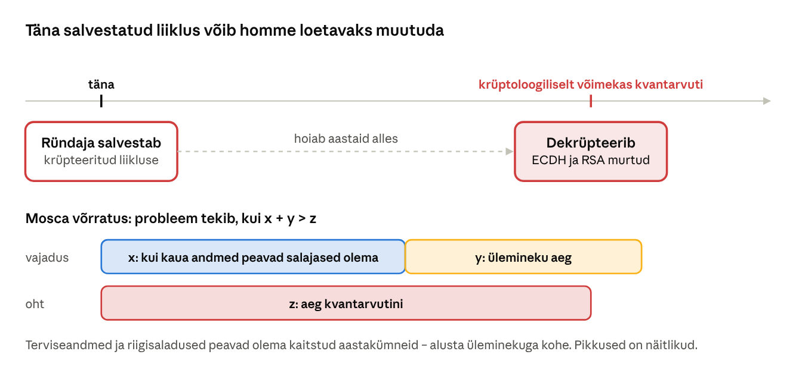
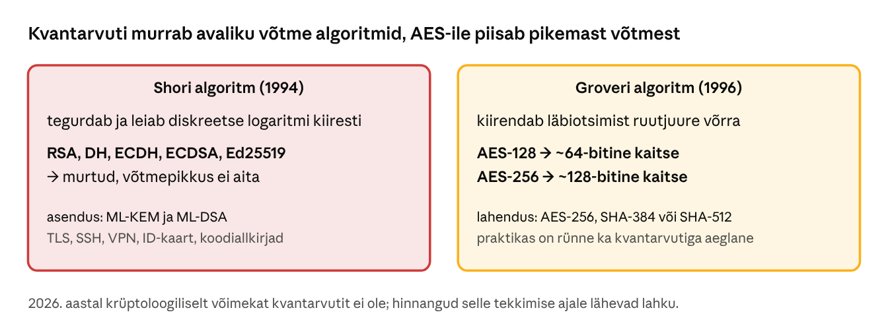
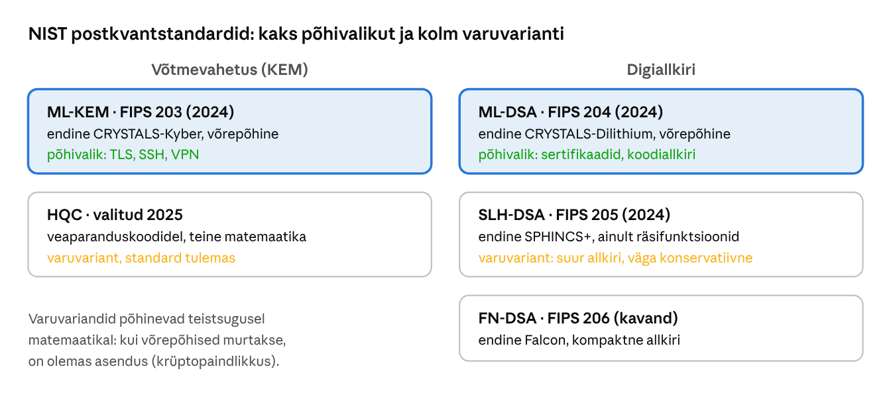
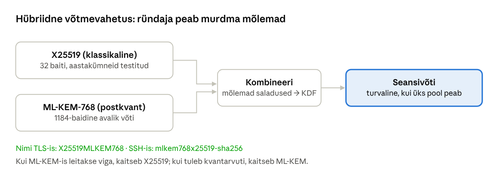

[← 29. UUS: Digiallkiri, sertifikaadid, PKI ja TLS](29-digiallkiri-pki-tls.md) · [Sisukord](../README.md) · [31. UUS: Küberturbe õigus- ja juhtimisraamistik →](31-oigus-ja-juhtimisraamistik.md)

## 30. UUS: Postkvantkrüptograafia ja krüptograafia tulevik

**Kvantarvuti** kasutab kubitte, mis võivad olla korraga mitmes olekus. Mõne kindla matemaatilise ülesande lahendab see eksponentsiaalselt kiiremini kui tavaarvuti. Kahjuks kuuluvad nende hulka just need ülesanded, millel põhineb tänane avaliku võtme krüptograafia. **Postkvantkrüptograafia** (PQC, post-quantum cryptography) on uued algoritmid, mis töötavad tavaarvutites, kuid on kindlad ka kvantarvuti vastu.

### 30.1 Miks tegeleda sellega juba täna



Joonis: **salvesta nüüd, dekrüpteeri hiljem** (harvest now, decrypt later). Ründaja võib täna salvestada krüpteeritud liiklust ja dekrüpteerida selle aastate pärast, kui kvantarvuti on olemas. Michele Mosca võrratus ütleb: kui andmete salajasuse nõue (x) pluss üleminekuks kuluv aeg (y) on pikem kui aeg kvantarvuti tekkimiseni (z), on andmed juba täna ohus.

### 30.2 Mida kvantarvuti murrab



Joonis: Shori algoritm murrab kõik tänapäeval levinud avaliku võtme algoritmid. Pikem RSA-võti ei aita. Groveri algoritm kiirendab ainult toore jõu otsingut, seega piisab sümmeetrilises krüptograafias ja räsides pikemast võtmest või räsist. AES-256 on ka kvantajastul turvaline ([SecurityWeek](https://www.securityweek.com/nist-announces-hqc-as-fifth-standardized-post-quantum-algorithm/)).

### 30.3 NIST-i standardid

USA standardiinstituut NIST korraldas 2016–2024 avaliku konkursi, millest kasvasid välja esimesed postkvantstandardid. Need avaldati 13. augustil 2024.



Joonis: postkvantstandardite ülevaade. Põhivalikud ML-KEM ja ML-DSA tuginevad **võreprobleemidele** (lattice): mitmemõõtmelises võres on raske leida lühimat vektorit, kui sellele on lisatud väike juhuslik viga. HQC valiti 2025. aasta märtsis ML-KEM-i varuvariandiks ja selle standardi kavand on oodata 2026. aastal. FN-DSA (FIPS 206) on kavandi staadiumis ([SecurityWeek](https://www.securityweek.com/nist-announces-hqc-as-fifth-standardized-post-quantum-algorithm/)).

Postkvantalgoritmide võtmed ja allkirjad on suuremad:

| Algoritm | Avalik võti | Šifritekst või allkiri |
| --- | --- | --- |
| X25519 (klassikaline) | 32 baiti | 32 baiti |
| ML-KEM-768 | 1184 baiti | 1088 baiti |
| Ed25519 (klassikaline) | 32 baiti | 64 baiti |
| ML-DSA-65 | 1952 baiti | 3309 baiti |

Suuremad sõnumid tähendavad veidi pikemat TLS-käepigistust. Praktikas on ML-KEM arvutuslikult isegi kiirem kui klassikaline võtmevahetus.

### 30.4 Hübriidne üleminek



Joonis: üleminekuperioodil kasutatakse **hübriidvõtmevahetust**: klassikaline ja postkvantalgoritm töötavad korraga ning seansivõti tuletatakse mõlemast. See kaitseb kahe riski eest korraga: kvantarvuti ja uues algoritmis leitava vea eest.

Seis 2026. aasta lõpus:

- **Brauserid** (Chrome, Edge, Firefox, Safari) ja suured sisuedastusvõrgud kasutavad TLS-is vaikimisi X25519MLKEM768.
- **OpenSSL 3.5** (aprill 2025) toetab ML-KEM-i, ML-DSA-d ja SLH-DSA-d. Ubuntu 26.04 LTS-is on OpenSSH 10.2 ja OpenSSL 3.5, mis kasutavad SSH-s ja TLS-is vaikimisi hübriidvõtmevahetust ([Ubuntu Discourse](https://discourse.ubuntu.com/t/post-quantum-support-in-the-upcoming-26-04-lts/76840)).
- **Euroopa Liidu koordineeritud tegevuskava** (juuni 2025) näeb ette, et liikmesriigid alustavad üleminekut ja koostavad riikliku kava 2026. aasta lõpuks, kõrge riskiga süsteemid viiakse postkvantkrüptograafiale 2030. aastaks ja ülejäänud võimalikult palju 2035. aastaks ([Euroopa Komisjon](https://digital-strategy.ec.europa.eu/en/library/coordinated-implementation-roadmap-transition-post-quantum-cryptography)).
- **Allkirjade** üleminek on aeglasem kui võtmevahetuse oma, sest sertifikaadid ja kiipkaardid (sh ID-kaart) vajavad uusi standardeid, riistvara ja usaldushoidlaid. Salvesta-nüüd-rünne allkirju ei ohusta: allkiri tuleb murda enne selle aegumist.

### 30.5 Krüptopaindlikkus ja üleminekuplaan

**Krüptopaindlikkus** (crypto-agility) tähendab, et süsteemis saab algoritmi vahetada ilma kogu süsteemi ümber ehitamata: algoritm on seadistus, mitte koodi sisse kirjutatud konstant. Organisatsiooni üleminek algab krüpto-inventuurist:

1. **Inventuur**: kus ja millist krüptograafiat kasutatakse (TLS-serverid, VPN, SSH, sertifikaadid, rakendused, kiipkaardid, varukoopiad)? Seda nimekirja nimetatakse ka CBOM-iks (cryptographic bill of materials).
2. **Riskihinnang**: millised andmed peavad salajased olema kaua (Mosca võrratus)?
3. **Tarnijad**: millal toetavad tulemüür, VPN-seade, PKI ja rakendused PQC-d?
4. **Pilootprojekt**: hübriidvõtmevahetus TLS-is ja SSH-s.
5. **Üleminek** riskide järjekorras ja vanade algoritmide väljalülitamine.

### Näide: kas meie VPN on postkvantkindel?

Omavalitsuse IT-juht kontrollib, kas täna salvestatud kaugtööliiklus võiks 15 aasta pärast lekkida. VPN kasutab IKEv2-d ECDH-võtmevahetusega, seega oleks see kvantarvutiga murtav. Liikluses on isikuandmeid, mille kaitse peab kestma aastakümneid, seega x + y > z on võimalik. IT-juht kontrollib tulemüüri tootja teekaarti ja leiab, et uus tarkvaraversioon toetab IKEv2 lisavõtmevahetust ML-KEM-iga (RFC 9370). Ta lisab selle krüpto-inventuuri tegevuskavasse, katsetab seda testkeskkonnas ja seab tootmise üleminekule tähtaja. Siseveebi TLS-i üleminek on lihtsam: piisab veebiserveri OpenSSL-i värskendamisest.

### Kokkuvõte

- Kvantarvuti murrab RSA, DH ja ECC (Shori algoritm), AES-i ja SHA-2 puhul piisab pikemast võtmest (Groveri algoritm).
- Salvesta-nüüd-rünne teeb pikaajaliselt salajased andmed ohtlikuks juba täna.
- NIST-i standardid: ML-KEM (võtmevahetus), ML-DSA ja SLH-DSA (allkiri); varuvariandid HQC ja FN-DSA.
- Üleminek on hübriidne ja algab krüpto-inventuurist; EL-i tähtajad on 2026, 2030 ja 2035.

### Kontrollküsimused

1. Mis on salvesta-nüüd-dekrüpteeri-hiljem rünne ja keda see ohustab?
2. Selgita Mosca võrratust oma näite abil.
3. Mille poolest erinevad Shori ja Groveri algoritmi mõjud krüptograafiale?
4. Milleks on ML-KEM ja milleks ML-DSA?
5. Miks on NIST valinud ka teistsugusel matemaatikal põhinevad varualgoritmid?
6. Miks kasutatakse üleminekuperioodil hübriidvõtmevahetust?
7. Mis on krüptopaindlikkus ja millest algab organisatsiooni üleminek?

### Valikküsimused

1. Milline algoritm on kvantarvuti suhtes haavatav? a) AES-256 b) SHA-512 c) RSA-4096 d) ML-KEM-768
2. Mis on ML-KEM? a) postkvant-võtmevahetusmehhanism (FIPS 203) b) uus räsifunktsioon c) kvantarvuti tootja d) Windowsi failisüsteem
3. Miks loetakse AES-256 kvantajastul turvaliseks? a) kvantarvuti ei oska XOR-i b) Groveri algoritm vähendab turvataseme umbes poole võrra, jääb \~128 bitti c) AES põhineb võredel d) AES-256 on salajane algoritm
4. Mida tagab hübriidne võtmevahetus X25519MLKEM768? a) ainult kiiruse b) andmete pakkimise c) digiallkirja d) seansivõti on kaitstud, kui vähemalt üks kahest algoritmist peab vastu

### Praktiline ülesanne

**Postkvantkrüptograafia WSL-is.** Vajad OpenSSL 3.5 või uuemat: Ubuntu 26.04 (`wsl --install -d Ubuntu-26.04`, kui see on loendis `wsl --list --online`) või Kali Linux. Kontrolli: `openssl version`.

1. Vaata saadaval algoritme:

```bash
openssl list -kem-algorithms | grep -i ml-kem
openssl list -signature-algorithms | grep -i -E 'ml-dsa|slh-dsa'
ssh -Q kex | grep -i mlkem
```

2. ML-KEM: kapselda saladus avaliku võtmega ja ava see privaatvõtmega:

```bash
openssl genpkey -algorithm ML-KEM-768 -out kem.key
openssl pkey -in kem.key -pubout -out kem.pub
openssl pkeyutl -encap -pubin -inkey kem.pub -out kapsel.bin -secret saladus1.bin
openssl pkeyutl -decap -inkey kem.key -in kapsel.bin -secret saladus2.bin
cmp saladus1.bin saladus2.bin && echo 'Sama saladus!'
ls -l kem.pub kapsel.bin
```

3. ML-DSA allkiri ja võrdlus Ed25519-ga:

```bash
openssl genpkey -algorithm ML-DSA-65 -out dsa.key && openssl pkey -in dsa.key -pubout -out dsa.pub
echo 'Otsus nr 12' > otsus.txt
openssl pkeyutl -sign -rawin -inkey dsa.key -in otsus.txt -out otsus.sig
openssl pkeyutl -verify -rawin -pubin -inkey dsa.pub -in otsus.txt -sigfile otsus.sig
openssl genpkey -algorithm ED25519 -out ed.key && openssl pkeyutl -sign -rawin -inkey ed.key -in otsus.txt -out ed.sig
ls -l otsus.sig ed.sig
```

4. Kontrolli päris ühendust: `curl -sv https://www.google.com -o /dev/null 2>&1 | grep -i 'SSL connection'` ja brauseris leht [pq.cloudflareresearch.com](https://pq.cloudflareresearch.com/).

Vasta: kui suured on ML-KEM-768 avalik võti ja kapsel võrreldes X25519-ga (ptk 28 praktiline ülesanne)? Mitu korda suurem on ML-DSA allkiri kui Ed25519 oma? Kas sinu brauser kasutab postkvantvõtmevahetust?

### Iseseisvad ülesanded

**1. Krüpto-inventuur.** Koosta oma õppelabori või töökoha 10 süsteemi krüpto-inventuur: süsteem, protokoll, võtmevahetus, allkirjaalgoritm, sertifikaadi väljastaja, andmete salajasuse nõue aastates ja tootja PQC-tugi. **Esita:** tabel ja kolme esimese ülemineku järjekord põhjendusega (Mosca võrratus).

**2. Postkvant-SSH.** Seadista WSL-is või VM-is OpenSSH-server nii, et see lubab ainult postkvantvõtmevahetust (`KexAlgorithms mlkem768x25519-sha256`). Ühendu kliendiga, kontrolli `ssh -v` väljundist valitud algoritmi ja proovi ühendust vana kliendiga. **Esita:** seadistusfail, `ssh -v` väljundi asjakohane rida ja selgitus, mis juhtus vana kliendiga.

### Viited

- NIST. [FIPS 203: ML-KEM](https://csrc.nist.gov/pubs/fips/203/final); [FIPS 204: ML-DSA](https://csrc.nist.gov/pubs/fips/204/final); [FIPS 205: SLH-DSA](https://csrc.nist.gov/pubs/fips/205/final) (2024).
- SecurityWeek. [NIST Announces HQC as Fifth Standardized Post Quantum Algorithm](https://www.securityweek.com/nist-announces-hqc-as-fifth-standardized-post-quantum-algorithm/) (2025).
- Euroopa Komisjon. [A Coordinated Implementation Roadmap for the Transition to Post-Quantum Cryptography](https://digital-strategy.ec.europa.eu/en/library/coordinated-implementation-roadmap-transition-post-quantum-cryptography) (2025).
- Ubuntu. [Post Quantum Support in the upcoming 26.04 LTS](https://discourse.ubuntu.com/t/post-quantum-support-in-the-upcoming-26-04-lts/76840).
- Mosca, M. (2018). Cybersecurity in an Era with Quantum Computers: Will We Be Ready? *IEEE Security & Privacy*, 16(5).

> 📝 **Test:** selle peatüki Google Formsi test luuakse skriptiga [`google-forms/looVormid.gs`](../google-forms/looVormid.gs).

---

[← 29. UUS: Digiallkiri, sertifikaadid, PKI ja TLS](29-digiallkiri-pki-tls.md) · [Sisukord](../README.md) · [31. UUS: Küberturbe õigus- ja juhtimisraamistik →](31-oigus-ja-juhtimisraamistik.md)
