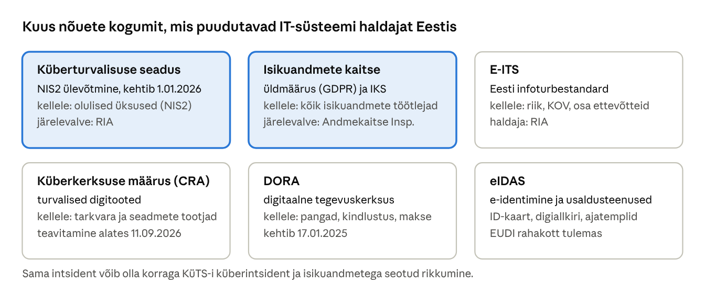
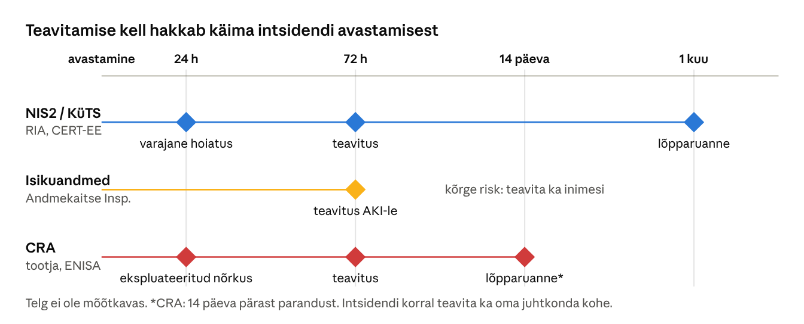
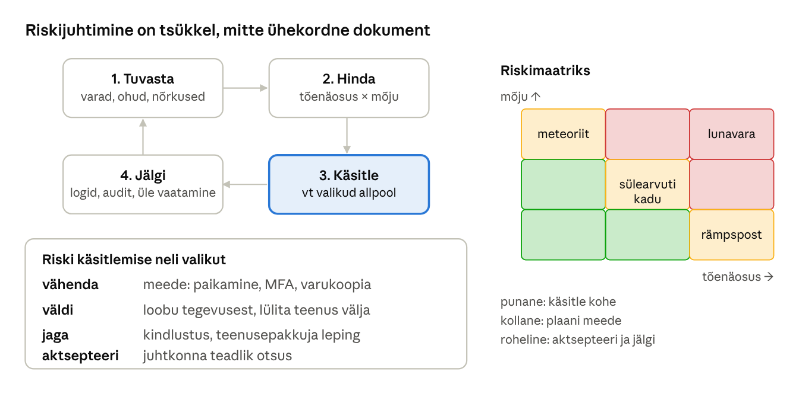

[← 30. UUS: Postkvantkrüptograafia ja krüptograafia tulevik](30-postkvantkruptograafia.md) · [Sisukord](../README.md) · [Valikküsimuste vastused →](vastused.md)

## 31. UUS: Küberturbe õigus- ja juhtimisraamistik

Tehnilised meetmed (peatükid 18, 22, 24–30) on mõjusad ainult siis, kui keegi vastutab nende eest, nende rakendamine on plaanitud ja intsidendi korral on teada, kellele ja millal teatada. Peatükk annab IT-süsteemi haldajale ülevaate Eesti ja Euroopa Liidu nõuetest. Peatükk ei ole õigusnõu: konkreetse organisatsiooni kohustused tuleb täpsustada RIA, Andmekaitse Inspektsiooni või juristiga.

Miks peab administraator seadusi tundma? Esiteks rakendab just tema enamikku nõutud meetmetest: logimist, varundust, MFA-d ja krüpteerimist. Teiseks on tema see, kes intsidenti esimesena näeb ja kelle tegevusest sõltub, kas tähtajad peetakse kinni. Kolmandaks on ka administraatoril endal seaduslikud piirid: suured õigused ei tähenda luba vaadata kõike, mida tehniliselt näha saab.

**Pärast peatüki läbimist õppija:**

- nimetab Eesti ja EL-i olulisemad küberturbe- ja andmekaitsenõuded ning nende sihtrühma;
- kirjeldab KüTS-i (NIS2) peamisi kohustusi ja intsidendist teavitamise tähtaegu;
- selgitab isikuandmete kaitse põhimõtteid ja rikkumisest teavitamise korda;
- võrdleb E-ITS-i, ISO/IEC 27001-t ja NIST CSF-i;
- hindab riski ja valib riski käsitlemise viisi;
- tunneb IT-spetsialisti seaduslikke ja eetilisi piire.

### 31.1 Nõuete kaart



Joonis: kuus olulisemat nõuete kogumit. Need kattuvad osaliselt: haigla peab täitma nii küberturvalisuse seadust kui ka isikuandmete kaitse nõudeid, pank lisaks DORA-t ja tarkvaratootja CRA-d.

| Nõue | Mida reguleerib | Keda puudutab |
| --- | --- | --- |
| KüTS (NIS2) | organisatsiooni küberturbe meetmed ja intsidentidest teavitamine | elutähtsad ja olulised teenused, avalik sektor, paljud ettevõtted |
| IKÜM (GDPR) ja isikuandmete kaitse seadus | isikuandmete töötlemine ja kaitse | kõik, kes töötlevad isikuandmeid |
| E-ITS | Eesti infoturbestandard: konkreetsed meetmed | riigi- ja KOV-asutused, vabatahtlikult teised |
| CRA (küberkerksuse määrus) | digitaalsete toodete turvalisus kogu elukaare jooksul | riist- ja tarkvara tootjad, importijad, turustajad |
| DORA | finantssektori IKT-riskide juhtimine ja testimine | pangad, kindlustus, investeerimisühingud ja nende IT-tarnijad |
| eIDAS | e-identimine ja usaldusteenused (digiallkiri, ajatempel) | ID-kaardi, Smart-ID ja usaldusteenuste kasutajad ja osutajad |

Lisaks puudutab IT-t **tehisintellekti määrus** (AI Act, 2024/1689), mis seab tehisintellektisüsteemidele riskipõhised nõuded, ning **karistusseadustik**, mis määrab arvutikuriteod (31.7).

### 31.2 Küberturvalisuse seadus ja NIS2

Euroopa Liidu **NIS2-direktiiv** (2022/2555) võeti Eestis üle **küberturvalisuse seaduse** (KüTS) muudatustega, mis jõustusid 1. jaanuaril 2026 ([KPMG](https://kpmg.com/ee/et/sundmused/2026/02/kueberturvalisuse-ja-haedaolukorra-seaduse-muudatused.html)). Eestis oli küberturvalisuse seadus juba 2018. aastast, seega NIS2 laiendas olemasolevat raamistikku. Kohustatud üksuste ring kasvas mitme tuhandeni: lisaks elutähtsate teenuste osutajatele ja avalikule sektorile ka näiteks energeetika, transpordi, tervishoiu, joogivee, digitaristu, IT-teenuste, postiteenuste, jäätmekäitluse ja toidutootmise ettevõtted ([Legiscope](https://www.legiscope.com/blog/nis2-eestis.html)).

NIS2 jagab kohustatud organisatsioonid kaheks: **väga olulised üksused** (nt suured energia-, transpordi- ja tervishoiuettevõtted) ja **olulised üksused** (nt keskmise suurusega toidutootjad, postiteenused, digiteenuste pakkujad). Kohustused on sarnased, erinevad järelevalve viis ja trahvide suurus. Enamasti määrab kuuluvuse sektor ja ettevõtte suurus: üldjuhul alates 50 töötajast või 10 miljoni euro käibest. Organisatsioon peab ise hindama, kas ta on kohustatud, ja end RIA juures registreerima.

Olulisemad kohustused:

- **riskipõhised turvameetmed** (NIS2 art 21): riskianalüüs, intsidentide käsitlus, toimepidevus ja varundus, tarneahela turve, turvaline arendus ja hooldus, krüptograafia, juurdepääsuhaldus, MFA, koolitus ja küberhügieen;
- **juhtkonna vastutus**: juhtkond kinnitab riskijuhtimise meetmed, jälgib nende täitmist ja osaleb ise koolitustel. Juhte saab rikkumiste eest isiklikult vastutusele võtta;
- **intsidentidest teavitamine** RIA-le (31.4);
- **järelevalve**: RIA võib teha auditeid ja anda ettekirjutusi. NIS2 näeb ette trahvid kuni 10 miljonit eurot või 2% ülemaailmsest käibest väga olulistele ja kuni 7 miljonit eurot või 1,4% olulistele üksustele.

Seadus ei ütle täpselt, millist tulemüüri või parooli pikkust kasutada. See nõuab, et meetmed oleksid **riskiga proportsionaalsed** ja võtavad arvesse tehnika taset. Praktikas tähendab see E-ITS-i, ISO 27001 või muu tunnustatud raamistiku kasutamist ja oma otsuste dokumenteerimist.

### 31.3 Isikuandmete kaitse

**Isikuandmete kaitse üldmäärus** (IKÜM, GDPR) ja Eesti **isikuandmete kaitse seadus** kehtivad kõigile, kes töötlevad isikuandmeid, sh koolidele, KOV-idele ja väikeettevõtetele. **Isikuandmed** on kõik andmed, mille järgi saab inimese tuvastada: nimi, isikukood, e-post, IP-aadress, asukoht, foto, hinded. **Eriliigilised** (tundlikud) andmed on terviseandmed, biomeetria, rahvus, usutunnistus jms, mille kaitse nõuded on rangemad.

Kaks rolli tuleb eristada: **vastutav töötleja** (controller) otsustab, milleks ja kuidas andmeid töödeldakse (nt kool), **volitatud töötleja** (processor) töötleb andmeid vastutava töötleja nimel (nt õppeinfosüsteemi pakkuja või pilveteenus). Nende vahel peab olema leping (IKÜM art 28), mis kirjeldab ka turvameetmeid.

Andmetöötluse põhimõtted (art 5), millest paljud on otseselt IT-otsused:

- **seaduslikkus ja läbipaistvus** – andmeid töödeldakse õigusliku aluse alusel ja inimene teab sellest;
- **eesmärgipärasus** – andmeid kasutatakse ainult kogumise eesmärgil;
- **võimalikult väheste andmete kogumine** – andmebaasi ei lisata välju „igaks juhuks“;
- **õigsus** – andmed on ajakohased;
- **säilitamise piiramine** – vanad andmed kustutatakse, ka varukoopiatest ja logidest;
- **usaldusväärsus ja konfidentsiaalsus** – sobivad turvameetmed;
- **vastutus** – töötleja peab suutma nõuete täitmist tõendada.

Turbe seisukohalt on kõige olulisemad:

- **art 25 – lõimitud ja vaikimisi andmekaitse**: süsteemi kavandatakse algusest peale nii, et see kogub ainult vajalikke andmeid ja piirab ligipääsu;
- **art 32 – töötlemise turvalisus**: krüpteerimine, pseudonüümimine, konfidentsiaalsus, terviklus, käideldavus ja taastamisvõime ning meetmete regulaarne testimine;
- **art 33–34 – rikkumisest teavitamine**: Andmekaitse Inspektsioonile 72 tunni jooksul, kui rikkumine võib ohustada inimeste õigusi; inimesi endid, kui risk on kõrge. Kui andmed olid tugevalt krüpteeritud, ei ole inimeste teavitamine üldjuhul vajalik (ptk 26 näide).

**Isikuandmetega seotud rikkumine** ei ole ainult häkkimine. Rikkumine on ka valele adressaadile saadetud hinnetetabel, kaotatud krüpteerimata mälupulk, lunavara poolt krüpteeritud andmebaas (käideldavuse rikkumine) või kogemata avalikuks jäetud pilvekaust. IKÜM-i trahv võib ulatuda 20 miljoni euroni või 4%-ni ülemaailmsest käibest. Iga rikkumine tuleb dokumenteerida sisemisse registrisse ka siis, kui teavitamiskohustust ei teki.

### 31.4 Intsidendist teavitamine



Joonis: teavitamise tähtajad. KüTS-i (NIS2) järgi saadab üksus olulisest intsidendist RIA-le (CERT-EE-le) **varajase hoiatuse 24 tunni** jooksul, **intsidendi teavituse 72 tunni** jooksul ja **lõpparuande ühe kuu** jooksul. Isikuandmetega seotud rikkumisest teavitatakse Andmekaitse Inspektsiooni 72 tunni jooksul. Küberkerksuse määruse (CRA) järgi peavad tootjad alates 11. septembrist 2026 teatama aktiivselt ärakasutatavatest nõrkustest oma toodetes.

| Etapp | Tähtaeg | Sisu |
| --- | --- | --- |
| Varajane hoiatus | 24 h teadasaamisest | mis juhtus, kas võib olla pahatahtlik, kas võib mõjutada teisi riike või organisatsioone |
| Intsidendi teavitus | 72 h | esialgne hinnang: raskusaste, mõju, kompromiteerimise tunnused (IP-aadressid, failide räsid) |
| Vahearuanne | RIA nõudmisel | olukorra muutused |
| Lõpparuanne | 1 kuu | põhjus, mõju, rakendatud ja kavandatud meetmed |

**Mis on oluline intsident?** NIS2 järgi on intsident oluline, kui see on põhjustanud või võib põhjustada teenuse tõsise häire või rahalise kahju või mõjutada teisi isikuid olulise kahjuga. Kahtluse korral on mõistlikum teatada: RIA saab hoiatada teisi sama ründe sihtmärke ja anda abi. Teavitamine ei ole karistus, vaid osa riiklikust kaitsest.

Intsidendi ajal on lihtne teavitamine unustada. Seepärast kirjutatakse intsidendile reageerimise plaani (ptk 22) ette: kes otsustab, kas intsident on oluline, kes teavitab ja millise kanali kaudu, ning kus on teavitusvormid. Plaanis peab olema ka see, kuidas säilitada tõendeid (logid, mälutõmmis, ketta tõmmisfail koos räsiga, ptk 27.5), sest neid võib vaja minna politseile ja kindlustusele.

### 31.5 Standardid ja raamistikud

| Raamistik | Mis see on | Kellele |
| --- | --- | --- |
| **E-ITS** | Eesti infoturbestandard, RIA haldab; põhineb Saksa BSI IT-Grundschutzil; moodulid ja meetmed | kohustuslik riigi- ja KOV-asutustele, sobib ka ettevõtetele |
| **ISO/IEC 27001:2022** | rahvusvaheline infoturbe juhtimissüsteemi standard (ISMS), sertifitseeritav | ettevõtted, kes vajavad sertifikaati klientidele |
| **NIST CSF 2.0** | USA raamistik: Govern, Identify, Protect, Detect, Respond, Recover | üldine struktuur, tasuta |
| **CIS Controls** | 18 prioriseeritud tehnilist kontrolli | väiksemad organisatsioonid, kiire algus |
| **Microsoft Security Baselines** | soovitatud Windowsi ja M365 turvaseaded | Windowsi haldajad (ptk 22) |

**E-ITS** on ehitatud kataloogidena. Organisatsioon kirjeldab oma varad (süsteemid, ruumid, rakendused) ja valib igale sobivad **moodulid** (nt „Windows Server“, „Veebiserver“, „Varundus“). Iga mooduli juures on ohud ja **meetmed**, mis jagunevad põhi-, standard- ja kõrgmeetmeteks. Näiteks Windowsi kliendi moodul nõuab muu hulgas turvauuendusi, kasutajakontode haldust ja logimist. E-ITS-i täisrakendamine on suur projekt. Alates 2025. aasta oktoobrist on osal ettevõtetel võimalus standardi asemel rakendada esmaste turvameetmete komplekti.

**ISO/IEC 27001** ei anna valmis tehnilisi meetmeid, vaid nõuab **juhtimissüsteemi**: organisatsioon määrab ulatuse, hindab riskid, valib meetmed (lisa A-st 93 meetme seast), dokumenteerib otsused ja parendab pidevalt (PDCA-tsükkel: planeeri, teosta, kontrolli, täiusta). Sertifitseerimise auditi teeb sõltumatu audiitor.

### 31.6 Riskijuhtimine



Joonis: riskijuhtimise tsükkel ja lihtne 3 × 3 riskimaatriks. Riskianalüüs (ptk 24.3) seob tehnika juhtimisega: juhtkond ei pea teadma, mis on Kerberos, kuid peab otsustama, kas „andmeleke paikamata VPN-i kaudu“ on vastuvõetav risk.

Kui risk on hinnatud, on selle käsitlemiseks neli võimalust:

| Valik | Tähendus | Näide |
| --- | --- | --- |
| Vähendamine | rakendatakse meetmeid, mis vähendavad tõenäosust või mõju | MFA, paikamine, varukoopiad |
| Vältimine | loobutakse riskantsest tegevusest | vana äppi, mida ei saa paigata, enam ei kasutata |
| Jagamine (üleandmine) | osa riskist kantakse kolmandale osapoolele | küberkindlustus, teenuse sisseostmine pilvest |
| Aktsepteerimine | juhtkond otsustab teadlikult jääkriski kanda | väikese mõjuga süsteem, mille kaitse oleks kahjust kallim |

Jääkriski aktsepteerimine on juhtkonna allkirjastatud otsus, mitte vaikimine. Riskide nimekiri (**riskiregister**) vaadatakse üle vähemalt kord aastas ja pärast suuremaid muudatusi või intsidente.

Rollid organisatsioonis:

- **juhtkond** – vastutab, kinnitab riskid ja eelarve;
- **infoturbejuht** (CISO) – koordineerib turvet, raporteerib juhtkonnale;
- **andmekaitsespetsialist** (DPO) – nõustab isikuandmete küsimustes, kohustuslik nt avalikus sektoris;
- **IT-administraator** – rakendab tehnilisi meetmeid, logib ja teavitab;
- **iga töötaja** – järgib reegleid ja teatab kahtlastest sündmustest.

### 31.7 IT-spetsialisti seaduslikud ja eetilised piirid

Administraatoril on sageli rohkem õigusi kui ükskõik millisel teisel töötajal. Need õigused on antud töö tegemiseks, mitte uudishimu rahuldamiseks.

- **Karistusseadustik** näeb ette vastutuse muu hulgas arvutisüsteemi ebaseadusliku kasutamise (§ 217), arvutiandmetesse sekkumise (§ 206), arvutisüsteemi toimimise takistamise (§ 207) ja arvutikelmuse (§ 213) eest. Ka „hea kavatsusega“ võõra süsteemi skaneerimine või nõrkuse proovimine ilma loata võib olla kuritegu.
- **Turvatestimine** (penetration test) on lubatud ainult kirjaliku loaga, kus on kirjas ulatus (millised süsteemid), aeg ja meetodid. Kui leiad nõrkuse kogemata, teata sellest omanikule või CERT-EE-le ega proovi seda edasi ära kasutada (vastutustundlik avalikustamine).
- **Töötajate andmed ja kirjavahetus.** Administraator võib näha teiste e-kirju ja faile, kuid neid ei tohi lugeda ilma õigusliku aluse ja organisatsiooni kehtestatud korrata. Iga ligipääs peaks olema põhjendatud ja logitud.
- **Logid on isikuandmed.** Logides on kasutajanimed, IP-aadressid ja tegevused. Neid hoitakse nii kaua, kui on vajalik, ja ligipääs neile on piiratud.

### Näide: lunavara väikeses tootmisettevõttes

Toiduainetetootja (KüTS-i mõistes oluline üksus) avastab esmaspäeval kell 8, et failiserveri failid on krüpteeritud. Mis peab juhtuma?

1. **Kohe**: IT-administraator isoleerib serveri võrgust, säilitab logid ja teavitab juhtkonda (intsidendiplaan, ptk 22). Serverit ei lülitata välja enne, kui mälutõmmis on tehtud, sest mälus võivad olla tõendid.
2. **24 h jooksul**: varajane hoiatus RIA-le (CERT-EE). Kas rünne võib olla pahatahtlik ja mõjutada teisi? Jah.
3. **72 h jooksul**: intsidendi teavitus RIA-le koos esialgse hinnanguga. Failiserveril olid töötajate andmed, kuid kas need lekkisid? Kui ei saa välistada, teavitatakse ka Andmekaitse Inspektsiooni. Kuriteoteade politseile.
4. **Taastamine**: võrguta varukoopiast (ptk 24 näide), pärast seda, kui sissetungi tee on suletud ja paroolid vahetatud.
5. **Ühe kuu jooksul**: lõpparuanne RIA-le: põhjus, mõju, rakendatud meetmed.
6. **Järel**: juhtkond vaatab üle riskianalüüsi ja eelarve; töötajad saavad koolituse; MFA ja segmentimine lisatakse tegevuskavasse.

Lunaraha maksmist riik ei soovita: see ei taga andmete tagasisaamist ega seda, et varastatud andmed avaldamata jäävad, ning rahastab järgmisi rünnakuid.

### Kokkuvõte

- Küberturvalisuse seadus (NIS2) kehtib Eestis uuel kujul 1. jaanuarist 2026 ja nõuab riskipõhiseid meetmeid, juhtkonna vastutust ja intsidentidest teavitamist.
- Isikuandmete kaitse nõuab andmete minimeerimist, turvalist töötlemist ja rikkumisest teavitamist 72 tunni jooksul.
- E-ITS, ISO 27001 ja NIST CSF annavad struktuuri; riskijuhtimine seob tehnika ja juhtimise. Riski saab vähendada, vältida, jagada või aktsepteerida.
- Teavitamise tähtajad (24 h, 72 h, 1 kuu) tuleb kirjutada intsidendiplaani enne intsidenti.
- Administraatori õigused on antud tööks: võõraid süsteeme testitakse ainult kirjaliku loaga.

### Kontrollküsimused

1. Mis muutus Eestis 1. jaanuaril 2026 ja keda see puudutab?
2. Mis vahe on väga olulisel ja olulisel üksusel?
3. Nimeta viis NIS2 artikli 21 nõutud turvameedet.
4. Mida tähendab juhtkonna vastutus NIS2 järgi?
5. Mis vahe on vastutaval ja volitatud töötlejal? Too näide koolist.
6. Nimeta kolm isikuandmete töötlemise põhimõtet, mis on otseselt IT-otsused.
7. Too kolm näidet isikuandmetega seotud rikkumisest, mis ei ole häkkimine.
8. Millal ja kellele tuleb teatada isikuandmetega seotud rikkumisest?
9. Kirjelda NIS2 kolmeetapilist teavitamist.
10. Mis vahe on E-ITS-il ja ISO/IEC 27001-l?
11. Millised on riski käsitlemise neli valikut? Too igaühe kohta näide.
12. Millal on turvatestimine seaduslik ja mida teha, kui leiad kogemata võõra süsteemi nõrkuse?

### Valikküsimused

1. Millise seadusega võeti Eestis üle NIS2-direktiiv? a) isikuandmete kaitse seadus b) küberturvalisuse seadus c) karistusseadustik d) avaliku teabe seadus
2. Mis aja jooksul tuleb NIS2 järgi olulisest intsidendist saata varajane hoiatus? a) ühe nädala b) ühe kuu c) 72 tunni d) 24 tunni
3. Kellele teatatakse Eestis isikuandmetega seotud rikkumisest? a) Andmekaitse Inspektsioonile b) Politsei- ja Piirivalveametile c) Maksu- ja Tolliametile d) Tarbijakaitse ja Tehnilise Järelevalve Ametile
4. Mida tähendab riski aktsepteerimine? a) risk kõrvaldatakse täielikult b) risk kantakse kindlustusele c) juhtkond otsustab teadlikult jääkriski kanda d) süsteem lülitatakse välja

### Praktiline ülesanne

**Turvaaudit ja nõuetele vastavus WSL-is.** Ava WSL Ubuntu ja käivita turvaauditi tööriist Lynis:

```bash
sudo apt install -y lynis
sudo lynis audit system --quick | tee lynis.txt
grep -E 'Warning|Suggestion' /var/log/lynis-report.dat | head -20
grep 'hardening_index' /var/log/lynis-report.dat
```

Windowsis (PowerShell administraatorina) vaata, kas olulised kaitsed on sees:

```powershell
Get-MpComputerStatus | Select AMServiceEnabled, RealTimeProtectionEnabled, AntivirusSignatureLastUpdated
Get-BitLockerVolume | Select MountPoint, ProtectionStatus
Get-NetFirewallProfile | Select Name, Enabled
```

Vali Lynise ja Windowsi tulemustest viis leidu. Seo igaüks NIS2 artikli 21 meetmega (nt „krüptograafia“, „juurdepääsuhaldus“) ja hinda riskimaatriksiga.

Vasta: milline oli Lynise hardening index? Milline leid on kõige suurema riskiga ja miks? Milline meede seda vähendaks?

### Iseseisvad ülesanded

**1. Kas meie organisatsioon on KüTS-i subjekt?** Vali Eesti organisatsioon (kool, KOV, haigla, ettevõte). Uuri RIA NIS2 lehelt, kas see kuulub olulise või väga olulise üksuse hulka, ja selgita, millised kohustused sellest tulenevad. **Esita:** 1 lk analüüs koos allikaviidetega.

**2. Intsidendi teavitamise plaan.** Koosta leheküljeline juhend, mida organisatsioon teeb intsidendi esimese 72 tunni jooksul: kes otsustab intsidendi olulisuse, kes teavitab RIA-d ja Andmekaitse Inspektsiooni, millised andmed kogutakse ja kuidas säilitatakse tõendeid. Kasuta näidet 31.6-st. **Esita:** juhend ja kontaktide tabel (rollid, mitte päris nimed).

### Viited

- [Küberturvalisuse seadus](https://www.riigiteataja.ee/akt/kyberturvalisuse-seadus). Riigi Teataja.
- Euroopa Parlament ja nõukogu. [Direktiiv (EL) 2022/2555 (NIS2)](https://eur-lex.europa.eu/eli/dir/2022/2555/oj).
- Euroopa Parlament ja nõukogu. [Määrus (EL) 2016/679 (IKÜM)](https://eur-lex.europa.eu/eli/reg/2016/679/oj).
- Euroopa Parlament ja nõukogu. [Määrus (EL) 2024/2847 (küberkerksuse määrus, CRA)](https://eur-lex.europa.eu/eli/reg/2024/2847/oj).
- RIA. [E-ITS – Eesti infoturbestandard](https://eits.ria.ee/).
- KPMG Eesti (2026). [Küberturvalisuse ja hädaolukorra seaduse muudatused](https://kpmg.com/ee/et/sundmused/2026/02/kueberturvalisuse-ja-haedaolukorra-seaduse-muudatused.html).
- Legiscope (2026). [NIS2 Eestis 2026: küberturvalisuse seadus ja RIA järelevalve](https://www.legiscope.com/blog/nis2-eestis.html).
- NIST. [Cybersecurity Framework 2.0](https://www.nist.gov/cyberframework) (2024).

> 📝 **Test:** selle peatüki Google Formsi test luuakse skriptiga [`google-forms/looVormid.gs`](../google-forms/looVormid.gs).

---

[← 30. UUS: Postkvantkrüptograafia ja krüptograafia tulevik](30-postkvantkruptograafia.md) · [Sisukord](../README.md) · [Valikküsimuste vastused →](vastused.md)
